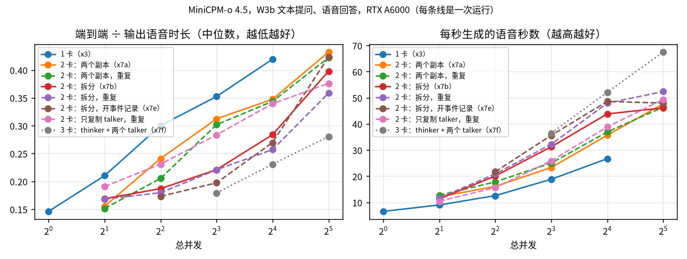
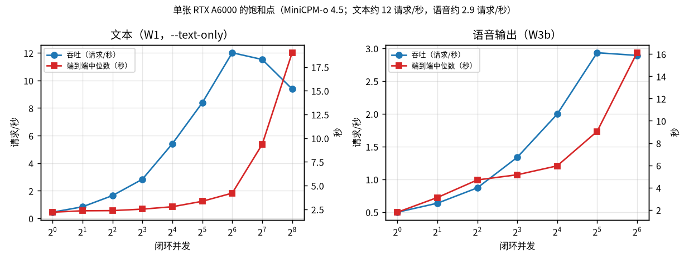
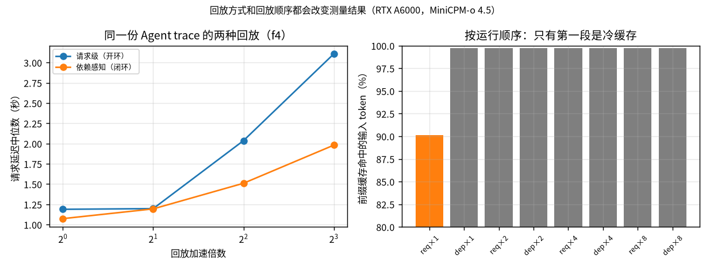

# Job 409712：3 张 RTX A6000 上的第一批测量

## 概况

| 项目 | 内容 |
|---|---|
| 作业 | Slurm Job 409712，组内分区，hold 模式提交 |
| 资源 | 3 张 RTX A6000（每卡可用约 46 GB，ECC 开启）、24 个 CPU 核、300 GB 内存，时限 10 小时 |
| 开始 | 2026-11-11 16:16（调度器原来估计 19:19，提前约 3 小时） |
| 模型 | MiniCPM-o 4.5（`fb09628e`）；Qwen3-Omni-30B-A3B（`26291f79`，x9）；Qwen3-TTS-0.6B（`5d839924`，只用于生成合成语音） |
| 软件 | SGLang-Omni `520b49ee`（上游 `1845546e` 加两个 pre-Hopper 修复），sglang 0.5.21，torch 2.13.0 |
| 输入 | 全部是合成数据（`docs/02_workloads/data_sources.md`） |
| 结论 | `docs/05_findings/baseline_results.md`、`research_conclusions.md`、`profiling_findings.md` |

作业启动后自动运行事先放好的计划（15 个实验）。运行中又通过编排器的 `plan.d/` 追加了后续实验、重复实验、两次重跑和崩溃定位实验。每个实验是一个 `srun --exact` step，独占分给它的 GPU 和 CPU 核。同一时间最多 3 个实验并行。

**代码冻结**：作业运行期间，Unicorn 上的代码固定在 `38dd3aa`。之后只替换或新增了个别配置文件，每次都记录在作业目录的 `code_freeze.txt` 里，原文件备份在 `config_backups/`。分析代码的改进只在 Spark 上运行，不影响 A6000 上的执行。

## 时间线

（**[实测]**，编排器的 `events.jsonl`；GPU 小时按实验实际占用的卡数和时长计算）

| 时间 | 实验 | 内容 | 结果 |
|---|---|---|---|
| 16:16–16:19 | x0 | 环境检查、拓扑、GPU 信息 | 成功 |
| 16:19–16:27 | x1 | 用 Qwen3-TTS 生成合成语音，生成计数视频 | 成功；两段 TTS 没有正常停止，事后修复了素材清单 |
| 16:19–16:30 | x2 | 文本服务并发扫描 | 成功 |
| 16:27–16:37 | x3 | 默认语音流水线（单卡） | 成功 |
| 16:27–16:35 | x4 | 语音与视频理解 | 成功 |
| 16:30–16:34 | x5 | Agent 采集 | 成功 |
| 16:34–16:41 | x3r | 单卡上的 Agent 回放（放置对比的基线） | 成功 |
| 16:35–16:45 | x6 | 两种回放模式 | 成功 |
| 16:37–16:42 | x3 重复 | 同 x3 | 成功 |
| 16:42–16:52 | x7a | 2 卡，两个完整副本 | 成功 |
| 16:45–16:53 | x8 | 阶段分解、事件记录开销、torch profiler | 成功 |
| 16:52–17:02 | x7b | 2 卡，thinker 与 talker 拆开 | 成功 |
| 16:53–17:00 | x3m | thinker 显存比例 0.6 | 成功 |
| 17:00–17:04 | x4c | 视频，4 个 CPU 核 | 成功 |
| 17:02–17:03 | x7c | 2 卡，只复制 talker | **失败**：YAML 缺 `model_path` |
| 17:03–17:10 | f1 | 文本饱和（并发 128/256，开环） | 成功 |
| 17:03–17:08 | f3 | 更大规模的 Agent 采集 | 成功 |
| 17:10–17:20 | x9 | Qwen3-Omni，3 卡 | **失败**：冷加载超过 600 秒启动时限 |
| 17:20–17:28 | f2 | 语音饱和（并发 32/64，开环） | 闭环完成；开环阶段**服务崩溃** |
| 17:20–17:26 | f4 | 大规模 trace 的两种回放 | 成功 |
| 17:28–17:32 | x9 重跑 | 加大启动时限 | **失败**：thinker 显存比例不足 |
| 17:32–17:42 | x7c 重跑 | 补 `model_path` 和各阶段显存比例 | 并发 2、4 完成；并发 8 时**服务崩溃** |
| 17:42–17:48 | x9 第二次重跑 | 显式设定 thinker 显存比例 | 成功 |
| 17:48–18:00 | x7c 重复 | 同 x7c | 成功 |
| 17:48–17:59 | f5 | 语音开环饱和曲线 | 1.5 请求/秒时**服务崩溃** |
| 18:00–18:10 | x7b 重复 | 同 x7b | 成功 |
| 18:00–18:09 | f2 重复 | 同 f2 | 闭环与开环 1–4 请求/秒完成；6 请求/秒时**服务崩溃** |
| 18:10–18:30 | z1 | 崩溃定位：`CUDA_LAUNCH_BLOCKING=1`，1.0 请求/秒 | 16.8 分钟没有崩溃 |
| 18:10–18:21 | z4 | 崩溃定位：默认配置对照，1.5 请求/秒 | 约 7 分钟时**崩溃** |
| 18:10–18:20 | z2 | 崩溃定位：关闭 code2wav 的 torch.compile | 约 5 分钟时**崩溃** |
| 18:20–18:38 | z3 | 崩溃定位：关闭 talker 和 flow 的 CUDA graph | 16.5 分钟没有崩溃 |
| 18:21–18:23 | z5 | 崩溃定位：关闭 talker 的异步 decode | **失败**：工厂函数不接受这个参数 |
| 18:30–18:39 | x7a 重复 | 同 x7a | 成功 |
| 18:38–18:54 | z6 | 崩溃定位：只关 talker 的 CUDA graph | 约 11 分钟时**崩溃** |
| 18:39–18:43 | x7e | 2 卡拆分，开事件记录 | 成功 |
| 18:43–18:47 | z7 | 崩溃定位：只关 flow 的 CUDA graph | 约 2 分钟时**崩溃** |
| 18:54–18:58 | x7f | 3 卡：thinker 一张，两个 talker 副本各一张 | 成功 |
| 18:58–19:02 | z4 重复 | 默认配置对照 | 约 2 分钟时**崩溃** |
| 18:58– | z3 重复 | 同 z3 | 进行中 |
| 19:04– | z3 第三次 | 同 z3，与第二次并排 | 进行中 |

## 主要结果

详见 `docs/05_findings/baseline_results.md`（下文的“第 N 节”指其中的小节）。图在 `figures/`，由 `scripts/analysis/summary_figures.py` 从各实验的分析结果生成。

1. **[实测]** 语音输出时，每个请求的 thinker、talker、code2wav 严格先后执行，音频在最后整段返回。单卡上 GPU 93% 的时间有 kernel 在执行，thinker 和 talker 两个进程 33% 的时间同时有工作（第 6 节）。
2. **[实测]** 2 卡预算下，并发 4–16 时把 thinker 和 talker 拆到两张卡上最好，两次运行结果一致；并发 32 时三种放置接近（第 7 节，`figures/placement_2gpu_w3b.png`）。
3. **[实测]** 单卡饱和点：文本约 12 请求/秒，语音输出约 2.9 请求/秒，重复运行相差不到 2%（第 11、16 节，`figures/saturation_1gpu.png`）。
4. **[实测]** 视频理解受预处理限制，GPU 只有 15% 的时间在工作（第 3 节）。
5. **[实测]** Agent 请求的输入约 90% 由前缀缓存提供，会话数从 1 增加到 32 时请求延迟几乎不变（第 12 节）。
6. **[实测]** 接近饱和时，请求级回放比依赖感知回放测得的延迟高 35–57%；重复回放和复制会话会让前缀缓存命中率虚高到 99.8%（第 13、14 节，`figures/replay_modes_and_cache.png`）。
7. **[实测]** 拆开后 thinker 不再是瓶颈（并发 4–64 时执行时间都在 1.5–1.7 s），并发 32 时瓶颈在 talker 那张卡上；再给 talker 加一张卡（3 卡），并发 32 时语音吞吐再提高 41%（第 7 节）。
8. **[实测]** Qwen3-Omni 的音频是流式返回的（首个音频块 0.27–0.38 s），MiniCPM-o 是整段返回（第 18 节）。
9. **[实测]** MiniCPM-o 语音流水线在负载下会崩溃（CUDA illegal memory access，talker 进程退出，整个服务下线），共出现九次，默认配置在 1.5 请求/秒下几分钟内就会出现。关闭 torch.compile 或只关一种 CUDA graph 都不能避免；两种 CUDA graph 都关时 16.5 分钟没有崩溃，重复运行进行中（第 17 节）。

## 失败与处理

| 问题 | 原因 | 处理 |
|---|---|---|
| x7c 启动失败（exit 2） | `--config` 文件会先按完整配置校验，YAML 里缺 `model_path` | 在 YAML 里写公开的模型名，由 `--model-path` 覆盖 |
| x7c 在 Spark 功能测试中启动失败 | 副本与其他进程共用一张卡时，这张卡上每个 GPU 阶段都必须声明 `gpu_memory_fraction` | 按 x7b 的实测显存定比例；新增离线检查 `scripts/spark/check_pipeline_config.py` |
| x9 启动失败两次 | 冷加载超过 `SGLANG_OMNI_STARTUP_TIMEOUT`（600 秒）；thinker 自动显存比例扣掉编码器预留后只剩 0.654，低于需要的 0.707 | 调大时限；显式设 `--thinker.engine.mem_fraction_static 0.80` |
| 四次服务崩溃 | 未知（第 17 节） | 定位实验 z1–z4；执行器加了服务中途退出检测（不影响本作业的冻结代码），分析会扫描服务日志并标出崩溃 |
| 对比脚本崩溃 | 回放阶段的负载水平是 `dependency`，排序时被当成数字 | 已修复并加测试 |

前三类问题都只有真实的 sglang-omni 配置解析才会报出来，CPU 版假服务的预演发现不了。这是这次提交前检查的漏洞，以后用离线配置检查补上。

## 资源使用

（作业结束后补全）

## 数据位置

- 原始数据和每个实验的中文报告：Unicorn 项目目录的 `results/experiments/20261111_*`，Spark 上的副本在 `~/research/data/unicorn/experiments/`。不进 git。
- 跨实验对比：Spark 的 `~/research/data/unicorn/comparisons/`。
- 编排器状态、事件、代码冻结记录：Unicorn 的 `results/runs/hold-20261111T132626/`。

## 还没有完成的

（作业结束后补全）
