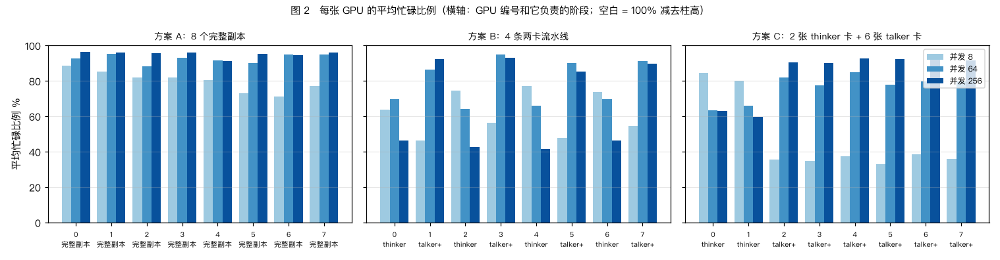
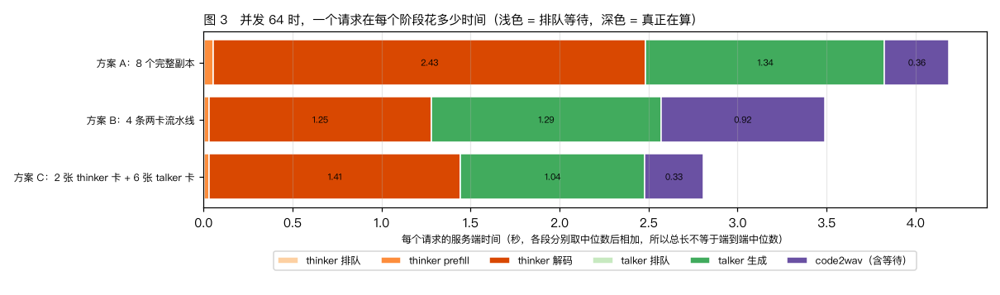
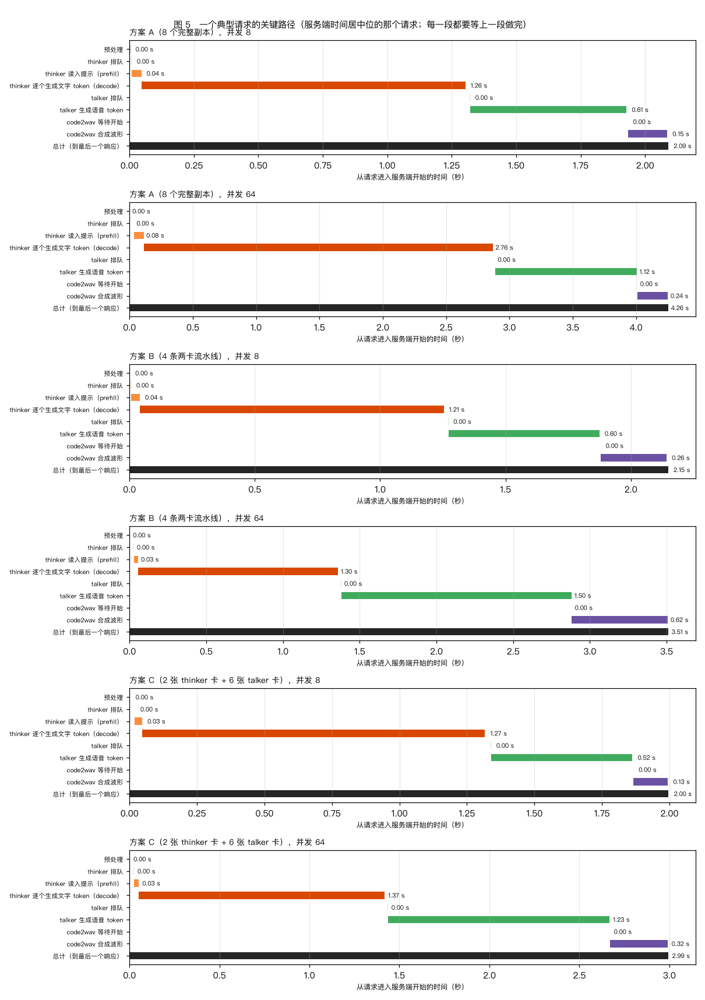
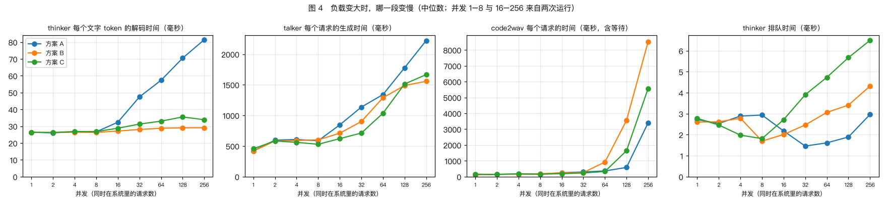
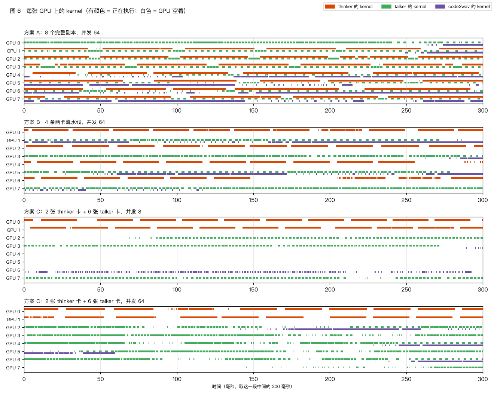
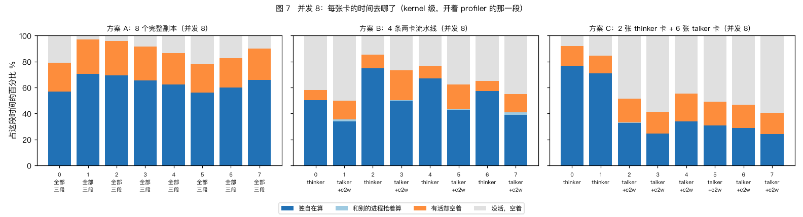
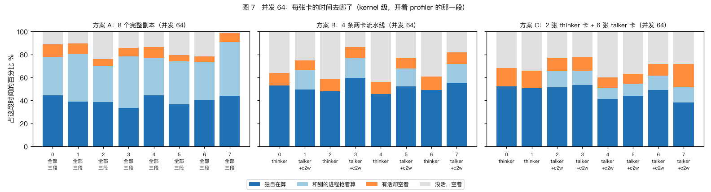
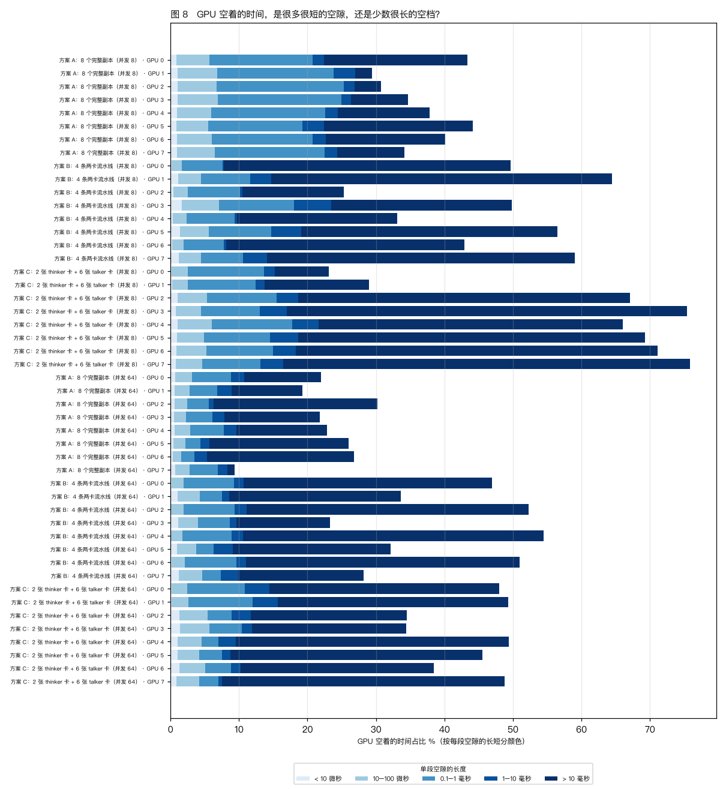
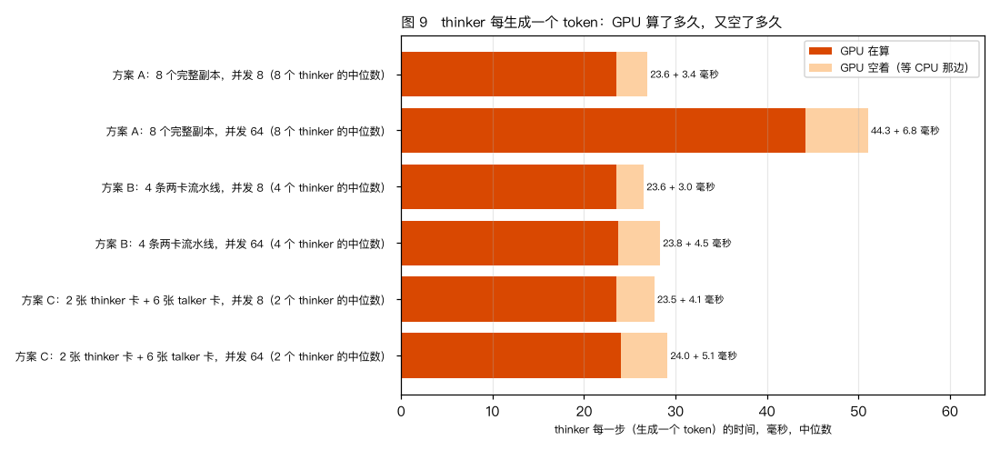

# 实验 1：8 张 GPU 在做什么？

> **状态：第二版（2026-11-17）**
> - 第一版用已有数据（nvidia-smi 采样和服务端事件）分析了每张卡的忙闲。
> - 第二版加入了 compute-03 上补测的 kernel 级时间线（torch profiler），并改正了第一版里一个高估的推算，见第 6.3 节。

## 先认识几个词

**GPU Bubble（GPU 气泡）**
- **是什么**：GPU 本来可以干活，却没有 kernel 在运行的那段时间。kernel 是 GPU 上执行的一个计算任务，比如一次矩阵乘法。
- **为什么会出现**：流水线里，后一道工序要等前一道交货。前一道慢了，后一道就闲着；后一道慢了，前一道做好的东西只能堆着。
- **例子**：两个人包饺子，一个擀皮一个包。擀皮的慢，包的人就空手等着。空手等的这段时间就是 bubble。
- **在这个实验里**：talker 卡等 thinker 的输出，thinker 卡等新请求，或者 CPU 还没把下一个 kernel 发给 GPU，都会形成 bubble。

**GPU 忙碌比例**
- **是什么**：一段时间里，GPU 上至少有一个 kernel 在跑的时间占多少。
- **两种测法**：
  - nvidia-smi 每 0.2 秒报告一次，代价小，可以一直开着；
  - torch profiler 记录下每个 kernel 的开始和结束时间，精确到微秒，但会拖慢程序，只能短时间打开。
- **要注意**：它只说明 GPU 有没有在跑，不说明跑得满不满。一个只用到一小部分算力的 kernel 一直在跑，也算 100%。

**GPU 没在跑 kernel，一定有问题吗？** 不一定。
- 系统里本来就没有足够的请求，GPU 空着很正常。
- 只有“有活要干，GPU 却空着”，或者“GPU 空着拖慢了请求”，才值得优化。
- 所以本实验把空闲分成两种：**有活却空着**（这张卡上的阶段手里有请求，GPU 却在等 CPU）和**没活空着**（手里没有请求）。

**为什么最空闲的 GPU 不一定最需要优化？**
- 一个请求要依次经过 thinker、talker、code2wav。决定请求多快完成的，是这条链上最慢的那一段，不是最闲的那张卡。

**关键路径（critical path）**
- 一个请求从进来到完成，必须依次走完的那串步骤。
- 缩短关键路径上的任何一段，请求都会更快；缩短不在关键路径上的步骤，请求不会更快。

**并发（concurrency）**
- 同一时刻系统里正在处理的请求数。
- 本实验用的是闭环测试：客户端始终保持固定数量的请求在途，完成一个就立刻补一个。

**CUDA graph**
- **是什么**：把一长串 kernel 先录下来，之后 CPU 只要发一次命令，GPU 就把整串跑完。
- **为什么需要**：thinker 生成一个 token 要跑约 500 个 kernel。如果 CPU 一个一个地发，光“发”就要花不少时间，GPU 在这期间只能等。
- **在这里**：thinker 每一步约 90% 的 kernel 来自 CUDA graph。剩下约 10% 在 graph 之外，由 CPU 一个一个地发：准备输入、选下一个 token、把结果拷回 CPU。

**争用（contention）**
- 两个进程共用一张 GPU 时，GPU 只能轮流执行它们的 kernel。两边都有活的时候，每一边都变慢。
- 打比方：一个灶台两个厨师。灶台一直在烧，所以“很忙”，但每个厨师都要等。

## 1. 一句话解释

在三种常用的 GPU 分工下，看 8 张 A6000 各自有多少时间在干活、多少时间在等、为什么等，以及一个请求的时间都花在哪一段。

## 2. 为什么做

- 前两批实验已经知道每种分工“能扛多大的流量”，但不知道 GPU 的时间浪费在哪里。
- 不知道浪费在哪里，就没法判断该优化什么：是换分工、改调度，还是把某个模块搬到别的卡上。

## 3. 实验怎么运行

### 3.1 一个请求要走哪几步

模型是 MiniCPM-o 4.5，负载是 W3b：文字提问，模型用“文字 + 语音”回答。

- 提问约 26 个 token。
- 文字回答中位数 45 个 token，上限 64。
- 语音中位数 14 秒，大多在 8–17 秒之间。

```text
用户提问 ──► Thinker ──────────► Talker ─────────► Code2Wav ──────► 返回文字和语音
            8B 语言模型          小模型             声码器
            逐个写出文字 token    把文字变成语音 token  把语音 token 还原成声音
```

- **Thinker**：8B 规模的语言模型（结构同 Qwen3-8B：36 层，hidden 4096）。每写一个 token，都要把约 15 GB 权重从显存读一遍。
- **Talker**：小得多的模型（约 0.2B 参数）。
- **Code2Wav**：把语音 token 还原成 24 kHz 的波形，计算量大。
- 在当前代码（sglang-omni 520b49ee）里三段是串行的：thinker 写完整个回答，talker 才开始；talker 做完，code2wav 才开始。

### 3.2 三种分工

```text
方案 A：8 个完整副本（内部代号 R8）
  GPU0 [thinker+talker+code2wav]   GPU1 [同左] ... GPU7 [同左]
  每张卡单独处理请求，客户端把新请求交给手上请求最少的那张卡。

方案 B：4 条两卡流水线（P4）
  GPU0 thinker ──► GPU1 talker+code2wav      GPU2 ──► GPU3      GPU4 ──► GPU5      GPU6 ──► GPU7

方案 C：2 张 thinker 卡 + 6 张 talker 卡（S2:6，一个服务）
  GPU0、GPU1：thinker  ──► 交给 GPU2–7 中的一张：talker+code2wav
```

所有方案里，code2wav 都是单独的进程，和 talker 放在同一张卡上。这样做是为了避开一个已知的崩溃，见实验 10。

### 3.3 改变什么、不变什么

- **改变**：GPU 分工（方案 A/B/C）和并发。
- **不变**：模型和代码版本、负载、机器型号（8×A6000，每张 48 GiB）。

### 3.4 两部分数据

**第一部分：已有数据（第一版）**

| 并发 | 来自 | 机器 | 运行次数 |
|---|---|---|---|
| 16–256 | plan v2 第一批，Job 625796 | 共享 gpu 分区的一台 8×A6000 | 方案 A、C 各 3 次（含 compute-03 上的复跑），B 2 次 |
| 1–8 | plan v2 第二批，Job 454290 | compute-03 | 每个方案 1 次 |

两台机器的驱动版本不同（570 + cuda-compat 和 580）。同一配置在两台机器上相差不到 3%（实验 2）。

**第二部分：kernel 级补测（第二版新增）**

- 在 compute-03 上，Job 454290，内部代号 `exp01_prof_r8`、`exp01_prof_p4`、`exp01_prof_s2x6`，2026-11-17 00:50–01:02，每个约 4 分钟，代码版本 22ae544。
- 每个方案启动一次服务，依次跑 4 段：
  1. 并发 8，32 个请求，不开 profiler；
  2. 并发 8，开 torch profiler；
  3. 并发 64，64 个请求，不开 profiler；
  4. 并发 64，开 profiler。
- 不开 profiler 的两段只记录服务端事件，用来比较 profiler 本身带来的开销。
- 三次都成功，没有失败的请求，没有服务重启。

## 4. 我们测量什么

| 指标 | 一句话解释 | 怎么测 |
|---|---|---|
| GPU 忙碌比例 | GPU 有 kernel 在跑的时间占比 | nvidia-smi 采样；kernel 级用 torch profiler |
| 有活却空着 / 没活空着 | GPU 空着的时候，这张卡上的阶段手里有没有请求 | profiler 的空闲时间对上服务端事件：thinker、talker 看“模型开始→结束”，code2wav 看“派发→完成” |
| 争用 | 同一张卡上两个以上进程同时有 kernel 在排队的时间 | profiler，同卡各进程的 kernel 时间重叠 |
| thinker 每一步的“算 + 空” | thinker 每生成一个 token，GPU 算了多久、空了多久 | profiler，按每一步开头固定出现的那个 kernel 切分 |
| 各阶段处理和排队时间 | 一个请求在每个阶段花多久、在门口等多久 | 服务端事件 |
| 关键路径 | 一个典型请求依次走过的每一段 | 服务端事件，取服务端总时间居中的请求 |

## 5. 实验结果

### 5.1 8 张卡的忙闲时间线（nvidia-smi，已有数据）


每一行是一张 GPU，颜色越亮越忙，虚线是并发档的切换。

- **方案 A**：8 张卡几乎一直亮。
- **方案 B**：负载越高，thinker 卡（0、2、4、6）越暗，而且一阵亮一阵暗。
- **方案 C**：thinker 卡始终是中等亮度；talker 卡低负载时很暗。
- 每次切换并发档时，所有卡都会暗一小段。这是测试方法造成的：上一档的请求全部做完，下一档才开始。



**表 1　平均忙碌比例（%，nvidia-smi 实测，同一角色的卡取平均；括号里是 2–3 次运行的范围）**

| 方案 | 并发 8 | 并发 64 | 并发 256 |
|---|---|---|---|
| A：8 个完整副本 | 80 | 93（90–93） | 95（94–95） |
| B：thinker 卡 / talker 卡 | 72 / 51 | 67（67–67） / 91（85–91） | 44（44–44） / 90（88–90） |
| C：thinker 卡 / talker 卡 | 82 / 36 | 65（65–72） / 80（80–81） | 61（57–61） / 92（86–92） |

### 5.2 一个请求的时间花在哪里（服务端事件，已有数据）





**表 2　并发 64 时，一个请求在服务端各段的时间（中位数，秒，实测）**

| 方案 | thinker 排队 | thinker 写文字 | talker 生成 | code2wav（含等待） | 端到端 |
|---|---|---|---|---|---|
| A | 0.002 | 2.43 | 1.34 | 0.36 | 4.28 |
| B | 0.003 | 1.25 | 1.29 | 0.92 | 3.59 |
| C | 0.005 | 1.41 | 1.04 | 0.33 | 3.02 |

- 各阶段门口的排队都只有几毫秒，thinker 交给 talker 的传递 3–5 毫秒。
- 并发 8 时，三个方案的关键路径几乎一样，端到端约 2.0–2.2 秒：
  - thinker 写文字约 1.25 秒，占六成多；
  - talker 约 0.55 秒；
  - code2wav 约 0.15 秒。

### 5.3 负载变大时，哪一段变慢（已有数据）



**表 3　各段时间随并发的变化（中位数，实测）**

| 方案 | thinker 每 token：并发 8 → 64 → 256 | code2wav 每个请求：并发 8 → 64 → 256 |
|---|---|---|
| A | 26.7 → 57.3 → 81.4 毫秒 | 0.16 → 0.36 → 3.40 秒 |
| B | 26.3 → 28.8 → 29.1 毫秒 | 0.19 → 0.92 → 8.52 秒 |
| C | 26.8 → 33.0 → 33.9 毫秒 | 0.16 → 0.33 → 5.57 秒 |

### 5.4 kernel 级时间线（补测）



图里每一行是一张 GPU，一行里分三条细线：上面是 thinker，中间是 talker，下面是 code2wav。有颜色的地方是有 kernel 在跑，白色是空着。图里截的是 300 毫秒。

- **方案 A，并发 64**：每张卡上三种颜色交替出现，三个进程在轮流用同一张 GPU。
- **方案 B、C**：thinker 卡上是一块一块约 24 毫秒的橙色，每一块是生成一个 token，块和块之间夹着白色的小空隙。
- **方案 C，并发 8**：GPU 4、5 这 300 毫秒里几乎什么都没跑。
- talker（绿色）是密密麻麻的小点，它的 kernel 非常短，中位数约 2 微秒。

### 5.5 每张卡的时间去哪了（补测）





**表 4　kernel 级的时间分配（占开 profiler 那一段的 %，同一角色的卡取平均，实测）**

| 方案 | 并发 | 卡 | 在算（其中和别的进程抢着算） | 有活却空着 | 没活空着 |
|---|---|---|---|---|---|
| A | 8 | 全部三段 | 63（0） | 24 | 13 |
| A | 64 | 全部三段 | 78（38） | 8 | 15 |
| B | 8 | thinker | 62 | 9 | 29 |
| B | 8 | talker+code2wav | 43（1） | 18 | 40 |
| B | 64 | thinker | 49 | 11 | 40 |
| B | 64 | talker+code2wav | 71（17） | 9 | 20 |
| C | 8 | thinker | 74 | 14 | 12 |
| C | 8 | talker+code2wav | 29 | 18 | 53 |
| C | 64 | thinker | 51 | 16 | 33 |
| C | 64 | talker+code2wav | 58（12） | 12 | 30 |

**读表要注意**：并发 64 那一段只有 64 个请求，开始时一起进去，之后陆续做完，没有稳定满负载的时候。后半段 thinker 早就把自己的部分做完了，所以表里并发 64 的“没活空着”偏高。这是补测设计的不足，见第 6.8 节。



图 8 把空闲时间按每段空隙的长短分颜色：
- thinker 卡上，“有活却空着”主要是 0.1–1 毫秒的小空隙，发生在每一步内部和步与步之间。
- talker 卡在低负载时，大部分空闲是超过 10 毫秒的长空档，也就是没活。

### 5.6 thinker 每生成一个 token：算多久，空多久（补测）



**表 5　thinker 每一步（中位数，毫秒，实测）**

| 方案 | 并发 8：GPU 在算 + 空着 | 并发 64：GPU 在算 + 空着 |
|---|---|---|
| A：8 个完整副本 | 23.6 + 3.4 | **44.3** + 6.8 |
| B：4 条流水线 | 23.6 + 3.0 | 23.8 + 4.5 |
| C：2+6 | 23.5 + 4.1 | 24.0 + 5.1 |

- thinker 独占一张卡时，每一步 GPU 只算 23.5–24 毫秒，batch 大小几乎没有影响。
  - 推算：每一步要读一遍约 15 GB 的权重，A6000 标称带宽 768 GB/s，下限约 19.7 毫秒。实测 23.5 毫秒，相当于用到了标称带宽的约 84%。GPU 这一侧已经接近硬件上限。
- 每一步还会空 3–5 毫秒，占一步时间的 11–18%。
  - 这些空隙出现在 CUDA graph 之外的小 kernel（准备输入、选下一个 token）和 CPU↔GPU 拷贝之后：GPU 做完这些小事，要等 CPU 处理完结果、发出下一批命令。
- 方案 A 并发 64 时，每一步 GPU 要算 44.3 毫秒，几乎是独占时的两倍。原因是另外两个进程的 kernel 和 thinker 抢同一张卡。

### 5.7 两种“忙碌”测法对得上吗（补测）

同一段时间里，同一角色的卡取平均：nvidia-smi 和 kernel 级的忙碌比例相差在 8 个百分点以内。比如方案 C 并发 8，thinker 卡是 71% 对 74%，talker 卡是 31% 对 29%。单张卡最多相差约 15 个百分点。

所以第一版用 nvidia-smi 看的趋势是可信的；但用它去推算“每一步空多久”，误差太大（第 6.3 节）。

### 5.8 profiler 本身的开销（补测）

| 方案 | 并发 8：开 profiler 后端到端变化 | 并发 64 |
|---|---|---|
| A | +24% | 后跑的、开 profiler 的那段反而快 9% |
| B | +14% | 快 27% |
| C | +10% | 快 27% |

- 并发 8 的结果说明 profiler 会拖慢 10–24%，所以带 profiler 测到的“空着”时间里，有一部分是 profiler 自己造成的。
- 并发 64 的比较不成立：三个方案都是先跑的那段（不开 profiler）更慢。很可能先跑的那段承担了第一次遇到大 batch 时的准备工作。

## 6. 为什么出现这个结果

标注：**实测** = 直接测到；**推算** = 由实测算出来；**假设** = 还没验证的解释；**未知** = 现有数据回答不了。

### 6.1 方案 A：卡很“忙”，但每一段都变慢（Bubble 类型 6：资源争用）

- **实测**：
  - 并发 64 时，每张卡有 38% 的时间同时有两到三个进程的 kernel 在排队。
  - thinker 每一步的 GPU 计算时间从 23.6 毫秒涨到 44.3 毫秒。
  - 已有数据里，并发 256 时 thinker 每 token 81.4 毫秒，是独占时的 3 倍。
- **结论**：方案 A 没有多少空闲 bubble，但有大量“抢着算”。GPU 忙碌比例高，并不说明效率高。

### 6.2 方案 B 高负载：thinker 卡一阵忙一阵闲（类型 2：下游太慢）

- **实测（已有数据）**：并发 256 时，talker 卡 90% 忙，code2wav 每个请求 8.5 秒；thinker 卡只有 44% 忙，一段亮一段暗。
- **推算**：闭环测试里，做完一个请求才补一个。大部分请求卡在 talker 卡上的 code2wav 那里。code2wav 一批做完，一批请求同时返回，客户端同时补进一批新请求，thinker 卡忙一阵，然后又没活。
- **结论**：thinker 卡的空闲是下游堵塞的结果，不是原因。

### 6.3 方案 B、C：thinker 每一步有 3–5 毫秒在等 CPU（类型 3/4：CPU 端开销和同步）

- **实测**：thinker 每生成一个 token，GPU 算约 24 毫秒，再空 3–5 毫秒。这些空隙跟在 CUDA graph 之外的小 kernel 和 CPU↔GPU 拷贝后面。
- **改正第一版**：第一版根据 nvidia-smi 推算“方案 C 并发 64 时每一步约 21 毫秒在算、12 毫秒空着，空闲约 35%”，这是高估。
  - kernel 级数据显示，每一步只空 3–5 毫秒（11–18%）；
  - nvidia-smi 看到的其余空闲，大多是 thinker 手上没有请求的时段（表 4 的“没活空着”）。
  - 去掉每一步的这段空档，thinker 最多快约 15%，不是第一版说的约 35%。
- **假设**：每一步之间，CPU 要做的事包括：把选出的 token 和隐藏状态拷回 CPU，处理每个请求的输出，准备下一步的输入。具体每一项占多少，现在的 trace 还分不出来：profiler 没开调用栈，Python 代码的时间看不到。

### 6.4 talker 卡：手上有活时，GPU 也常空着（类型 3，新发现）

- **实测**：
  - 方案 C 并发 8 时，talker 卡只有 29% 的时间在算，18% 是“有活却空着”。也就是说，手上有请求时，GPU 约有四成的时间没在跑 kernel（18 ÷ 47）。方案 B 情况类似。
  - talker 的 kernel 极小，中位数约 2 微秒。方案 B 并发 64 时，一个 talker 进程 6 秒里跑了 40 多万个 kernel。
- **假设**：talker 每一步的 GPU 计算量很小，速度主要受 CPU 那边的开销限制：发 kernel、调度、处理每一步的输出。
- **为什么重要**：高负载时 talker 卡是瓶颈（第 6.5 节）。如果 talker 本身被 CPU 卡住，光给它加 GPU 算力用处有限。
- **实验 5 的更正（2026-11-17）**：在并发 128 的稳定负载下，talker 卡“有活却空着”只有 3–6%，94–97% 的时间有 kernel 在跑，大头是 code2wav（73–86%）。所以高负载时 talker 卡的瓶颈是 GPU 时间，不是 talker 的 CPU。这里低负载时看到的空档，不是高负载瓶颈的原因。

### 6.5 code2wav：高负载时最大的等待点

- **实测（已有数据）**：并发 256 时，code2wav 每个请求要 3.4–8.5 秒，约占端到端的 37%（A）、72%（B）、61%（C）。
- **实测（补测）**：方案 B 并发 64 时，talker 卡上 code2wav 的 kernel 占了约 53% 的时间，talker 占 34%，两者有 17% 的时间在抢卡。
- **实测（第二批中期报告）**：code2wav 会把多个请求合成一批，但每个请求的耗时基本不降。
- **推算**：code2wav 受算力限制，合批省不了时间。它和 talker 挤在同一张卡上，卡满了就只能排队。

### 6.6 方案 C 低负载：talker 卡大部分时间没活（类型 7：请求不足）

- **实测**：并发 8 时，talker 卡 53% 的时间“没活空着”。
- **意义**：这不影响延迟。并发 8 时三个方案的端到端都在 2.0–2.2 秒，全部满足 SLO。这正是“最闲的卡不一定最需要优化”的例子。

### 6.7 根因排序（第二版）

| 排名 | 浪费 | 影响 | 证据 | 能优化吗 |
|---|---|---|---|---|
| 1 | 高负载时 talker 卡（talker + code2wav）饱和，code2wav 排队，thinker 卡被拖着闲（方案 B、C） | 决定高负载吞吐和尾延迟 | nvidia-smi 2–3 次重复 + kernel 级 | 能：code2wav 单独占卡、调整卡数比例，或让 talker 和 code2wav 本身更快 |
| 2 | 三个阶段共用一张卡的争用（方案 A）：38% 的时间在抢，thinker 每一步慢近一倍 | 方案 A 中高负载时的吞吐和延迟 | kernel 级实测 | 能：拆分部署，也就是方案 B、C |
| 3 | talker 在低负载时手上有活却约四成时间空着 | 实验 5 显示高负载时这个空档几乎消失（3–6%），不是吞吐瓶颈 | kernel 级实测 | 低优先级 |
| 4 | thinker 每一步 3–5 毫秒等 CPU（11–18%） | 低中负载时 thinker 是关键路径上最长的一段，最多快约 15% | kernel 级实测；原因部分是假设 | 待实验 5 |
| 5 | 低负载时 talker 卡没活（方案 C） | 不影响延迟 | 实测 | 不必优化 |
| — | 并发档切换、单波请求结束时的空闲 | 测试方法造成的 | 实测 | 不是系统问题 |

### 6.8 这次补测的不足

- **并发 64 那段太短**：只有一波 64 个请求，没有稳定段。下次每档至少要有 3 波请求。
- **没有在目标并发下预热**：开不开 profiler 的两段结果被先后顺序干扰（第 5.8 节）。下次要先预热，并把开和不开 profiler 的顺序交替安排。
- **profiler 拖慢 10–24%**：kernel 级的“空着”时间要打折看。下次可以缩短录制窗口，或用更轻的记录方式。
- **看不到 Python 层**：没开调用栈记录，CPU 每一步具体做了什么看不到。
- **每个方案只跑了 1 次**：kernel 级结果是初步的。好在和已有数据的趋势一致。

## 7. 这说明什么

1. “哪张卡最闲”和“哪里最该优化”是两回事。要看关键路径和吞吐，不能只看空闲比例。
2. **低负载时，瓶颈是三段串行**：thinker 写完，talker 才开始；talker 做完，code2wav 才开始。thinker 写文字占六成时间，而 thinker 在 GPU 上已经接近带宽上限，每一步只有 11–18% 在等 CPU。想让单个请求明显更快，有两条路：
   - 让 thinker 每一步读更少的权重：量化（实验 8），或者一步出多个 token：投机解码（实验 7）；
   - 让三段重叠起来：流水线和流式输出（实验 6）。
3. **高负载时，瓶颈在 talker 卡。** 那里 code2wav 占了一半以上的 GPU 时间，talker 又受 CPU 开销限制。先解决它，吞吐才能上去（实验 5、实验 9）。
4. **方案 A 的高忙碌比例是假象**：三个进程抢一张卡，thinker 每一步慢了近一倍。
5. **方法上的经验**：nvidia-smi 适合看趋势，不适合推算细节；要看每一步，需要 kernel 级时间线。

## 8. 接下来做什么

最值得做的一步是**实验 5：talker 卡为什么忙不过来**（第一轮已完成，见 `research/01_性能瓶颈/实验05_GPU为什么会等待/README.md`）。高负载时它是瓶颈，但现在分不清是 talker 被 CPU 卡住，还是 code2wav 算不过来。这两种情况的解法完全不同：前者要减少 talker 每一步的 CPU 开销，后者要给 code2wav 单独的卡。

做法：在方案 C 上用较高的稳定负载，每档至少 3 波请求，先在这个并发下预热。只在 talker 卡上短时间开 profiler，并打开调用栈记录，同时分开统计 code2wav 里 flow 和 HiFT 两部分的时间。

## 9. 文件在哪里

| 内容 | 路径 |
|---|---|
| 本报告 | `research/01_性能瓶颈/实验01_8张GPU在做什么/README.md` |
| 图 1–5（已有数据） | `figures/fig1`–`fig5`，由 `scripts/analysis/exp01_gpu_timeline.py` 生成 |
| 图 6–9（kernel 级） | `figures/fig6`–`fig9`，由 `scripts/analysis/exp01_kernel_timeline.py` 生成 |
| 报告里的数字 | `results/summary.json`（已有数据）、`results/kernel_summary.json`（kernel 级）、`results/profiler_overhead.json` |
| 编号、内部 ID、Job、代码版本 | `metadata.json` |
| 补测配置 | `configs/experiments/plan_a6000_8gpu_exp01.json`、`configs/experiments/a6000_8gpu_v2/exp01_prof_*.json` |
| 原始数据和 trace | 不在仓库里（trace 共约 1.2 GB，还带机器名和路径），在集群 `results/experiments/<运行目录>`，Mac 和 Spark 上有镜像；运行目录见 metadata.json |

复现：

```bash
python scripts/analysis/exp01_gpu_timeline.py --data-root <结果镜像目录> \
  --scheme A=20261115_v2_a_r8_run1_run01 --scheme B=20261115_v2_a_p4_run1_run01 --scheme C=20261115_v2_a_s2x6_run1_run01 \
  --low A=20261116_v2b_sb_r8_run01 --low B=20261116_v2b_sb_p4_run01 --low C=20261116_v2b_sb_s2x6_run01 \
  --out research/01_性能瓶颈/实验01_8张GPU在做什么
python scripts/analysis/exp01_kernel_timeline.py --data-root <结果镜像目录> \
  --run A=20261117_exp01_prof_r8_run01 --run B=20261117_exp01_prof_p4_run01 --run C=20261117_exp01_prof_s2x6_run01 \
  --out research/01_性能瓶颈/实验01_8张GPU在做什么
```

**SLO 说明**：沿用 plan v2 的定义。

- 语音回答：端到端 ÷ 输出语音秒数 ≤ 0.5，并且 TTFT ≤ 1 秒。TTFT 是从发出请求到收到第一个文字 token 的时间。
- 文字回答：TTFT ≤ 1 秒。
