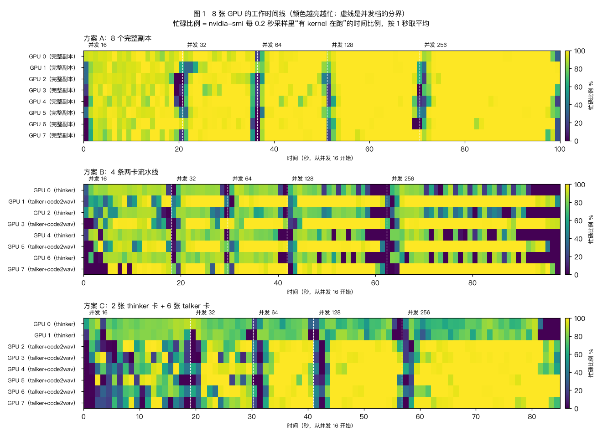

# 实验 1：8 张 GPU 在做什么？

> **状态：第一版（2026-11-17）。**
> - 已完成：用已有数据做了 GPU 级的忙闲分析、各阶段时间分析和关键路径分析。
> - 进行中：kernel 级时间线的补测在 Job 454290 里运行。结果出来后补进第 5、6 节。
> - 原因：第一批的 profiler 没有录到 GPU kernel，见第 6.7 节。

## 先认识几个词

**GPU Bubble（GPU 气泡）**
- **是什么**：GPU 本来可以干活，却没有 kernel 在运行的那段时间。kernel 是 GPU 上执行的一个计算任务，比如一次矩阵乘法。
- **为什么会出现**：流水线里，后一道工序要等前一道交货。前一道慢了，后一道就闲着；后一道慢了，前一道做好的东西只能堆着。
- **例子**：两个人包饺子，一个擀皮一个包。擀皮的慢，包的人就空手等着。空手等的这段时间就是 bubble。
- **在这个实验里**：talker 卡等 thinker 的输出，thinker 卡等新请求，或者 CPU 还没把下一个 kernel 发给 GPU，都会形成 bubble。

**GPU 忙碌比例**（本文的“忙碌比例”都是指它）
- **是什么**：nvidia-smi 每 0.2 秒报告一次，这段时间里“至少有一个 kernel 在跑”的时间占多少。
- **要注意**：它只说明 GPU 有没有在跑，不说明跑得满不满。一个只用到一小部分算力的 kernel 一直在跑，也会显示 100%。所以“100% 忙”不等于“算力用满”。

**GPU 没在跑 kernel，一定有问题吗？** 不一定。
- 系统里本来就没有足够的请求，GPU 空着很正常，比如深夜没什么人用。
- 只有“有请求在等，GPU 却空着”，或者“GPU 空着拖慢了请求”，才值得优化。

**为什么最空闲的 GPU 不一定最需要优化？**
- 一个请求要依次经过 thinker、talker、code2wav。决定请求多快完成的，是这条链上最慢的那一段，不是最闲的那张卡。
- 比如一张 talker 卡闲了 60%，但请求的时间主要花在 thinker 上。这时让 talker 卡更忙，请求也不会更快。

**并发（concurrency）**
- 同一时刻系统里正在处理的请求数。
- 本实验用的是闭环测试：客户端始终保持固定数量的请求在途，完成一个就立刻补一个。

**关键路径（critical path）**
- 一个请求从进来到完成，必须依次走完的那串步骤。
- 缩短关键路径上的任何一段，请求都会更快。缩短不在关键路径上的步骤，请求不会更快。

## 1. 一句话解释

在三种常用的 GPU 分工下，看 8 张 A6000 各自有多少时间在干活、多少时间在等，以及一个请求的时间都花在了哪一段。

## 2. 为什么做

- 前两批实验已经知道每种分工“能扛多大的流量”，但不知道 GPU 的时间浪费在哪里。
- 不知道浪费在哪里，就没法判断该优化什么：是换分工、改调度，还是把某个模块搬到别的卡上。

## 3. 实验怎么运行

### 3.1 一个请求要走哪几步

模型是 MiniCPM-o 4.5。负载是 W3b：用户用文字提问，模型用“文字 + 语音”回答。

- 提问约 26 个 token。
- 文字回答中位数 45 个 token，上限 64 个。
- 语音中位数 14 秒，大多在 8–17 秒之间。

一个请求依次经过三个主要阶段：

```text
用户提问 ──► Thinker ──────────► Talker ─────────► Code2Wav ──────► 返回文字和语音
            8B 语言模型          小模型             声码器
            读问题，逐个写出      把文字变成          把语音 token
            文字 token            “语音 token”        还原成声音波形
```

- **Thinker**：8B 规模的语言模型（结构同 Qwen3-8B：36 层，hidden 4096）。它一个 token 一个 token 地写回答，每写一个 token 都要把约 15 GB 的权重从显存读一遍。
- **Talker**：小得多的模型（约 0.2B 参数）。它把 thinker 写好的回答变成语音 token，也就是声音的压缩编码。
- **Code2Wav**：把语音 token 还原成 24 kHz 的声音波形。它属于计算量大的那一类模型。
- 在当前的代码（sglang-omni 520b49ee）里，三段是串行的：thinker 写完整个回答，talker 才开始；talker 做完，code2wav 才开始。

### 3.2 三种分工

```text
方案 A：8 个完整副本（内部代号 R8）
  GPU0 [thinker+talker+code2wav]   GPU1 [同左] ... GPU7 [同左]
  每张卡单独处理请求，客户端把新请求交给手上请求最少的那张卡。
  三个阶段挤在同一张卡上，轮流使用 GPU。

方案 B：4 条两卡流水线（内部代号 P4）
  GPU0 thinker ──► GPU1 talker+code2wav
  GPU2 thinker ──► GPU3 talker+code2wav
  GPU4 thinker ──► GPU5 talker+code2wav
  GPU6 thinker ──► GPU7 talker+code2wav

方案 C：2 张 thinker 卡 + 6 张 talker 卡（内部代号 S2:6，一个服务）
  GPU0、GPU1：thinker
         └──► 交给 GPU2–7 中的一张：talker+code2wav
```

所有方案里，code2wav 都是单独的进程，和 talker 放在同一张卡上。这样做是为了避开一个已知的崩溃：talker 和 code2wav 放在同一个进程里并发运行时会出错，见实验 10。

### 3.3 改变什么、不变什么

- **改变**：GPU 分工（方案 A/B/C）和并发（1、2、4、8，以及 16、32、64、128、256）。
- **不变**：模型和代码版本、负载、机器型号（8×A6000，每张 48 GiB 显存），以及每档请求数的规则。并发 16–256 时，每档 max(96, 2×并发) 个请求；并发 1–8 时，每档 64 个请求。

### 3.4 数据从哪里来（都是已有数据，没有新跑）

| 并发 | 来自 | 机器 | 运行次数 |
|---|---|---|---|
| 16–256 | plan v2 第一批，Job 625796 | 共享 gpu 分区的一台 8×A6000 | 方案 A、C 各 3 次（包括 compute-03 上的复跑），方案 B 2 次。图用第 1 次，表 1 给出范围 |
| 1–8 | plan v2 第二批，Job 454290 | compute-03（8×A6000） | 每个方案 1 次 |

两台机器的驱动版本不同（570 + cuda-compat 和 580）。同一配置在两台机器上的结果相差不到 3%（实验 2 的跨节点复现）。

## 4. 我们测量什么

| 指标 | 一句话解释 | 怎么测 |
|---|---|---|
| GPU 忙碌比例 | GPU 有 kernel 在跑的时间占比 | nvidia-smi 每 0.2 秒采样 |
| 各阶段处理时间 | 一个请求在 thinker、talker、code2wav 里分别花多久 | 服务端事件：每个阶段开始和结束的时间戳 |
| 排队时间 | 请求到了某个阶段，等着被处理的时间 | 服务端事件：从“进入队列”到“开始处理” |
| thinker 每 token 时间 | thinker 每写一个文字 token 要多少毫秒 | （thinker 时间 − 读题时间）÷（输出 token 数 − 1） |
| 有效 batch | 一个副本里平均同时在算几个请求 | 各请求在该阶段的时间之和 ÷ 时间窗口 ÷ 副本数（Little 定律） |
| 关键路径 | 一个典型请求依次走过的每一段和它的时长 | 服务端事件，取服务端总时间居中的那个请求 |

## 5. 实验结果

### 5.1 8 张 GPU 的工作时间线



怎么看这张图：每一行是一张 GPU，横轴是时间，颜色越亮越忙，虚线是并发档的切换。

- **方案 A**：8 张卡几乎一直是亮黄色，也就是一直在忙。
- **方案 B**：负载越高，thinker 卡（0、2、4、6）越暗，而且一阵亮一阵暗。talker 卡（1、3、5、7）从并发 32 起一直很亮。
- **方案 C**：thinker 卡（0、1）始终是中等亮度，约 60–70%。talker 卡低负载时很暗，并发 64 以后变亮。
- 每次切换并发档时，所有卡都会暗一小段。这是测试方法造成的：上一档的请求全部做完，下一档才开始。这不是系统的问题。

### 5.2 每张卡平均有多忙


**表 1　平均忙碌比例（%，实测，同一角色的卡取平均；括号里是 2–3 次运行的范围）**

| 方案 | 并发 8 | 并发 64 | 并发 256 |
|---|---|---|---|
| A：8 个完整副本 | 80 | 93（90–93） | 95（94–95） |
| B：thinker 卡 / talker 卡 | 72 / 51 | 67（67–67） / 91（85–91） | 44（44–44） / 90（88–90） |
| C：thinker 卡 / talker 卡 | 82 / 36 | 65（65–72） / 80（80–81） | 61（57–61） / 92（86–92） |

### 5.3 一个请求的时间花在哪里


**表 2　并发 64 时，一个请求在服务端各段的时间（中位数，秒，实测）**

| 方案 | thinker 排队 | thinker 写文字 | talker 生成 | code2wav（含等待） | 端到端 |
|---|---|---|---|---|---|
| A | 0.002 | 2.43 | 1.34 | 0.36 | 4.28 |
| B | 0.003 | 1.25 | 1.29 | 0.92 | 3.59 |
| C | 0.005 | 1.41 | 1.04 | 0.33 | 3.02 |

- 各阶段门口的排队时间都只有几毫秒。thinker 交给 talker 的传递时间是 3–5 毫秒。
- 并发 8 时，三个方案的关键路径几乎一样，端到端约 2.0–2.2 秒：
  - thinker 写文字约 1.25 秒，占六成多；
  - talker 约 0.55 秒；
  - code2wav 约 0.15 秒。
- 并发 8 时，所有请求都满足 SLO（见文末的说明）。

### 5.4 负载变大时，哪一段变慢


**表 3　各段时间随并发的变化（中位数，实测）**

| 方案 | thinker 每 token：并发 8 → 64 → 256 | code2wav 每个请求：并发 8 → 64 → 256 |
|---|---|---|
| A | 26.7 → 57.3 → 81.4 毫秒 | 0.16 → 0.36 → 3.40 秒 |
| B | 26.3 → 28.8 → 29.1 毫秒 | 0.19 → 0.92 → 8.52 秒 |
| C | 26.8 → 33.0 → 33.9 毫秒 | 0.16 → 0.33 → 5.57 秒 |

### 5.5 显存

- 方案 A 每张卡用到 43.6–46.9 GiB，总共 48 GiB，几乎满了。
- 方案 B、C 的 thinker 卡用 35.7–37.2 GiB，talker 卡用 19.2–25.2 GiB。

## 6. 为什么出现这个结果

标注说明：**实测** = 直接测到；**推算** = 由实测数字算出来；**假设** = 还没验证的解释；**未知** = 现有数据回答不了。

### 6.1 方案 A：卡都很“忙”，但每一段都变慢了（Bubble 类型 6：资源争用）

- **实测**：GPU 忙碌 93–95%，thinker 每 token 从 26.7 毫秒涨到 81.4 毫秒，是原来的 3 倍。
- **推算**：方案 B、C 里 thinker 独占一张卡，同样的负载下每 token 只要 29–34 毫秒。方案 A 多出来的时间，来自同一张卡上三个进程轮流使用 GPU。
- **打个比方**：一个厨房三个厨师共用一个灶台。灶台一直在烧，所以“很忙”，但每个厨师都要排队等灶台。
- **意义**：GPU“忙”不等于效率高。方案 A 几乎没有空闲的 bubble，但有大量的“互相等待”。三个进程的 kernel 怎样交替，要看 kernel 级时间线（补测中）。

### 6.2 方案 B 高负载：thinker 卡一阵忙一阵闲（类型 2：下游太慢）

- **实测**：并发 256 时，talker 卡 90% 忙，code2wav 每个请求要 8.5 秒。thinker 卡只有 44% 忙，而且在时间线上一段亮一段暗。
- **推算**：闭环测试里，做完一个请求才补一个。大部分请求卡在 talker 卡上的 code2wav 那里。code2wav 一批做完，一批请求同时返回，客户端同时补进一批新请求，thinker 卡就忙一阵；做完这批，又没活了。
- **意义**：thinker 卡的空闲是下游堵塞的结果，不是原因。让 thinker 更快没有用，要先让 talker 卡、尤其是 code2wav 更快。

### 6.3 方案 C：thinker 卡手上有活，却有三分之一的时间没在跑 kernel（类型 3 或 4，待验证）

- **实测**：并发 64 时，每个 thinker 副本平均同时在算 13 个请求（有效 batch 13.3），但 GPU 只有约 65% 的时间在跑 kernel。时间线上这个比例很均匀，不是一阵一阵的。
- **推算**：
  - 并发 64 时，thinker 每 token 33 毫秒，按 65% 的忙碌比例，每一步约 21 毫秒在跑 GPU，约 12 毫秒没有。
  - 并发 8 时，每一步约 22 毫秒在跑，约 5 毫秒没有。
  - 每一步 GPU 的工作量几乎不变：写一个 token 的主要成本是读一遍权重，batch 大一点也差不多。变大的是每一步之间的空档。
- **假设**：每写一步，CPU 都要为 batch 里的每个请求做一些事，比如选出下一个 token、把新 token 发给文字输出。请求越多，CPU 这部分越久，GPU 就在这段时间里等着。
- **还不知道**：这是类型 3（CPU 调度）还是类型 4（CUDA 同步），要看 kernel 和 CPU 的时间线（补测中）。
- **为什么重要**：如果去掉这段空档，方案 C 的 thinker 每 token 有望从 33 毫秒降到约 21 毫秒（推算）。

### 6.4 方案 C 低负载：talker 卡六成时间空闲（类型 7：请求不足）

- **实测**：并发 8 时，6 张 talker 卡平均只有 36% 忙。
- **推算**：同一时刻，每个 talker 副本里平均只有 0.3 个请求（有效 batch 0.3）。6 张 talker 卡是为高负载准备的，低负载时用不满。
- **意义**：这不影响延迟。并发 8 时三个方案的端到端都在 2.0–2.2 秒，全部满足 SLO。这正是“最闲的卡不一定最需要优化”的例子。

### 6.5 code2wav：高负载时最大的等待点

- **实测**：并发 256 时，code2wav 每个请求要 3.4–8.5 秒，约占端到端的 37%（A）、72%（B）、61%（C）。
- **实测（第二批中期报告）**：code2wav 会把多个请求合成一批处理，但每个请求的耗时基本不降。比如方案 B 并发 256 时，每批 14.6 个请求，一批约 2.5 秒，折合每个请求约 0.17 秒，和单独处理一个差不多。
- **推算**：code2wav 受算力限制，合批省不了时间。它和 talker 挤在同一张卡上，卡满了就只能排队。
- **未知**：现在的事件只记录了 code2wav“开始派发 → 完成”，没法把它内部的排队和真正的计算分开。

### 6.6 根因排序（初步）

| 排名 | 浪费 | 影响 | 证据强度 | 能优化吗 |
|---|---|---|---|---|
| 1 | 高负载时 talker 卡饱和：code2wav 排队，thinker 卡被拖着闲（方案 B、C） | 决定高负载时的吞吐和尾延迟 | 实测（2–3 次重复）+ 推算 | 能：把 code2wav 放到单独的卡、调整 thinker 和 talker 的卡数比例，或让 code2wav 本身更快 |
| 2 | thinker 卡每一步之间的空档，约 35%（方案 C） | 决定 thinker 的速度上限。低中负载时 thinker 是关键路径上最长的一段 | 忙碌比例实测；原因是假设 | 待 kernel 时间线确认后再定 |
| 3 | 三个阶段共用一张卡的争用（方案 A） | 中高负载时 thinker 慢 2–3 倍 | 实测 + 推算 | 能：拆分部署，也就是方案 B、C |
| 4 | 低负载时 talker 卡空闲（方案 C） | 不影响延迟 | 实测 | 不必优化。它说明低负载时这种分工多占了卡 |
| — | 并发档切换时的短暂空闲 | 测试方法造成的 | 实测 | 不是系统问题 |

### 6.7 为什么还没有 kernel 级时间线

- **实测**：第一批在并发 64 时开过 torch profiler，但录下的文件里只有 CPU 事件（每个进程约 2400 个），一个 GPU kernel 都没有。
- **实测**：服务日志里，每个阶段进程都报了 `CUPTI initialization failed … CUPTI_ERROR_INVALID_DEVICE`。CUPTI 是 profiler 用来记录 GPU kernel 的 NVIDIA 组件。
- **推算**：那台机器的驱动是 570，靠 cuda-compat 才能运行 CUDA 13 的程序，CUDA 13 的 CUPTI 在这种组合下起不来。compute-03 的驱动是 580，原生支持 CUDA 13，所以补测放在 compute-03 上跑。
- 集群上也没有 Nsight Systems（nsys），所以先用 torch profiler。

## 7. 这说明什么

1. “哪张卡最闲”和“哪里最该优化”是两回事。要看关键路径和吞吐，不能只看空闲比例。
2. **低负载时，瓶颈不是 GPU 不够，而是三段串行。** thinker 写完，talker 才开始；talker 做完，code2wav 才开始。thinker 写文字占了六成时间。想让单个请求更快，有两条路：
   - 让 thinker 写得更快：量化、投机解码，见实验 7、8；
   - 让三段重叠起来：流水线和流式输出，见实验 6。
3. **高负载时，瓶颈在 talker 卡，主要是 code2wav。** thinker 卡的空闲是被它拖累的。想提高吞吐，先解决 code2wav，比如单独部署它，见实验 9。
4. **方案 A 的高忙碌比例是假象。** 三段共用一张卡，各自都变慢了。

## 8. 接下来做什么

最值得做的一步：拿到 kernel 级时间线。补测已经在 Job 454290 里运行，内部代号 exp01_prof_r8、exp01_prof_p4、exp01_prof_s2x6。它要回答两个问题：

1. 方案 C 的 thinker 卡在每一步之间空着的那约 12 毫秒里，CPU 在做什么？
2. talker 卡上，talker 和 code2wav 的 kernel 各占多少时间？code2wav 的时间花在哪一部分？

这也是实验 5（GPU 为什么会等待）的起点。

**补测的设计**：三个方案各启动一次服务，依次跑并发 8（32 个请求）和并发 64（64 个请求）。每个并发先只开事件记录跑一遍，再开 profiler 跑一遍，两遍的差别就是 profiler 本身带来的开销。

## 9. 文件在哪里

| 内容 | 路径 |
|---|---|
| 本报告 | `research/01_性能瓶颈/实验01_8张GPU在做什么/README.md` |
| 图 1–5 | `research/01_性能瓶颈/实验01_8张GPU在做什么/figures/` |
| 报告里所有数字 | `research/01_性能瓶颈/实验01_8张GPU在做什么/results/summary.json`（脚本生成） |
| 编号、内部 ID、Job、代码版本 | `research/01_性能瓶颈/实验01_8张GPU在做什么/metadata.json` |
| 分析脚本 | `scripts/analysis/exp01_gpu_timeline.py`（用到 `scripts/analysis/stage_by_level.py`） |
| 补测配置 | `configs/experiments/plan_a6000_8gpu_exp01.json`、`configs/experiments/a6000_8gpu_v2/exp01_prof_*.json` |
| 原始数据 | 不在仓库里（体积大，还带机器信息）。在集群的 `results/experiments/<运行目录>`，Mac 和 Spark 上有镜像；运行目录列在 metadata.json 里 |

复现图和数字：

```bash
python scripts/analysis/exp01_gpu_timeline.py --data-root <结果镜像目录> \
  --scheme A=20261115_v2_a_r8_run1_run01 --scheme B=20261115_v2_a_p4_run1_run01 \
  --scheme C=20261115_v2_a_s2x6_run1_run01 \
  --low A=20261116_v2b_sb_r8_run01 --low B=20261116_v2b_sb_p4_run01 --low C=20261116_v2b_sb_s2x6_run01 \
  --out research/01_性能瓶颈/实验01_8张GPU在做什么
```

**SLO 说明**：SLO 是服务质量目标，本项目沿用 plan v2 的定义：

- 语音回答要同时满足两条：端到端时间 ÷ 输出语音秒数 ≤ 0.5，并且 TTFT ≤ 1 秒。TTFT 是从发出请求到收到第一个文字 token 的时间。
- 文字回答只看 TTFT ≤ 1 秒。
