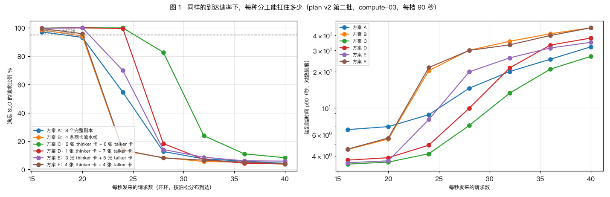
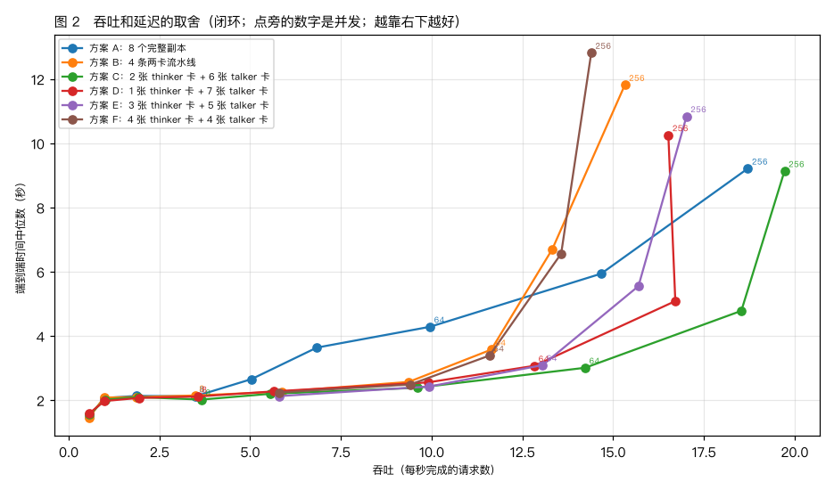
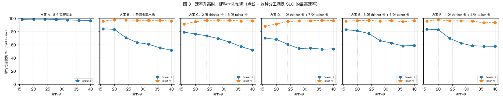

# 实验 2：不同 GPU 分工的比较

> **状态：第一版（2026-11-17）。** 全部用已有数据，没有新跑实验。
>
> 数据来自三批运行：plan v2 第一批（Job 625796）的闭环测试，第二批（Job 454290，compute-03）的同速率开环和小 batch 测试，以及 compute-03 上的复跑。

## 先认识几个词

**吞吐（throughput）**
- 每秒完成多少个请求。它代表系统一共能干多少活。

**开环和闭环**
- **闭环**：客户端始终保持固定数量的请求在途，完成一个才补一个。系统慢了，客户端也跟着慢下来，所以压不垮系统。
- **开环**：请求按固定的平均速率到达，比如每秒 20 个，不管系统忙不忙。真实用户就是这样来的。系统一旦跟不上，请求就越积越多，延迟越来越长。
- **在这里**：比较分工“能扛多大的流量”，主要看开环。

**SLO 容量**
- SLO 是服务质量目标。本项目用的是：语音回答的“端到端时间 ÷ 语音秒数”≤ 0.5，并且 TTFT（收到第一个文字 token 的时间）≤ 1 秒。
- **SLO 容量**：开环测试中，至少 95% 的请求还满足 SLO 的最高到达速率。
- 本实验的速率每档相差 4 请求/秒，所以容量只能精确到 4 请求/秒。

**吞吐和延迟的取舍**
- 想让同一套机器多干活，就得让更多请求同时在里面，每个请求要排的队也更长。
- 所以吞吐上去了，延迟也会上去。比较分工时，要在同一条“吞吐–延迟”曲线上看谁更靠右下（又快又多）。

**合用（池化）和固定配对**
- **固定配对**：每张 thinker 卡只把活交给固定的那一张 talker 卡。
- **合用**：所有 thinker 卡做完的活，交给任意一张空闲的 talker 卡。
- 打比方：银行 4 个窗口各排各的队（固定配对），或者大家排一队、哪个窗口空了就去哪个（合用）。后者不会出现“这边排长队、那边窗口空着”。

## 1. 一句话解释

在 8 张卡的总预算下，比较六种把 thinker 和 talker 分给不同卡的方式，看谁在低负载和高负载下更好，以及为什么。

## 2. 为什么做

- 实验 1 发现，不同分工的 GPU 浪费在不同的地方：完整副本在“抢”，流水线在“等下游”。
- 要选分工，就得知道浪费最终怎样变成吞吐和延迟上的差别，以及最佳的卡数比例由什么决定。

## 3. 实验怎么运行

### 3.1 六种分工

所有分工里，code2wav 都是单独的进程，和 talker 同卡（原因见实验 10）。“talker 卡”指 talker + code2wav 所在的卡。

```text
方案 A：8 个完整副本（内部代号 R8）
  每张卡：thinker + talker + code2wav，8 个独立的服务。客户端把新请求交给手上请求最少的那个。

方案 B：4 条两卡流水线（P4）—— 固定配对
  GPU0 T → GPU1 K     GPU2 T → GPU3 K     GPU4 T → GPU5 K     GPU6 T → GPU7 K

方案 C：2 张 thinker 卡 + 6 张 talker 卡（S2:6）—— 合用，一个服务
  T T | K K K K K K

方案 D：1 + 7（S1:7）   T | K K K K K K K
方案 E：3 + 5（S3:5）   T T T | K K K K K
方案 F：4 + 4（S4:4）   T T T T | K K K K      （和方案 B 卡数相同，但是合用）

T = thinker 卡，K = talker 卡（talker + code2wav）
```

| 方案 | thinker 卡 | talker 卡 | 服务数 | 共用一张卡的进程 | 请求怎么流动 |
|---|---|---|---|---|---|
| A | 8（共用） | 8（共用） | 8 | thinker、talker、code2wav 三个进程 | 每个请求从头到尾都在同一张卡上 |
| B | 4 | 4 | 4 | talker 卡上 talker 和 code2wav | thinker 卡只交给自己配对的 talker 卡 |
| C–F | 1–4 | 7–4 | 1 | talker 卡上 talker 和 code2wav | thinker 做完，交给任意一张 talker 卡 |

### 3.2 负载和测量

- 负载都是 W3b：文字提问，文字 + 语音回答（回答约 45 个 token、14 秒语音）。
- **同速率开环**（主要数据，第二批，compute-03）：每种分工依次承受 16、20、24、28、32、36、40 请求/秒，每档 90 秒，按泊松分布到达。
- **闭环**（第一批，每种分工 2 次；A、C 另有 compute-03 上的第 3 次）：并发 16、32、64、128、256。
- **小 batch**（第二批）：并发 1、2、4、8。只测了 A、B、C、D。
- 代码、模型、驱动都相同：sglang-omni 520b49ee，MiniCPM-o 4.5。第一批和第二批的机器不同，同一配置的结果相差不到 3%。

## 4. 我们测量什么

| 指标 | 一句话解释 |
|---|---|
| SLO 容量 | 开环下至少 95% 请求满足 SLO 的最高速率（请求/秒） |
| 先坏在哪 | 超过容量时是 TTFT 先超标（thinker 一侧排队），还是“端到端 ÷ 语音秒”先超标（talker 一侧跟不上） |
| 吞吐–延迟曲线 | 闭环下每个并发的吞吐和端到端中位数 |
| 各角色卡的忙碌比例 | thinker 卡和 talker 卡分别有多少时间在跑 kernel（nvidia-smi） |
| 显存 | 每种卡用到的最大显存 |

## 5. 实验结果

### 5.1 同样的到达速率，谁扛得住（开环，实测）



**表 1　满足 SLO 的请求比例（每档 1 次运行，初步）**

| 方案 | 16 | 20 | 24 | 28 | 32 | SLO 容量（请求/秒） | 超过容量时先坏在哪 |
|---|---|---|---|---|---|---|---|
| C：2+6 | 1.00 | 1.00 | 1.00 | 0.83 | 0.24 | **24** | talker 一侧 |
| D：1+7 | 1.00 | 1.00 | 0.99 | 0.18 | 0.07 | **24** | **thinker 一侧**（TTFT p90 从 0.31 秒涨到 5.73 秒） |
| E：3+5 | 1.00 | 1.00 | 0.70 | 0.14 | 0.09 | 20 | talker 一侧 |
| F：4+4（合用） | 0.99 | 0.96 | 0.14 | 0.08 | 0.07 | 20 | talker 一侧 |
| B：4 对固定配对 | 0.99 | 0.94 | 0.13 | 0.08 | 0.06 | 16 | talker 一侧 |
| A：8 个完整副本 | 0.97 | 0.93 | 0.55 | 0.13 | 0.07 | 16 | talker 一侧，24 请求/秒起出现显存不足 |

### 5.2 吞吐和延迟的取舍（闭环，实测）



**表 2　闭环：并发 256 时的最高吞吐（请求/秒；括号里是多次运行的范围），以及低负载时的端到端中位数**

| 方案 | 并发 256 的吞吐 | 并发 256 的端到端中位数 | 并发 8 的端到端中位数 |
|---|---|---|---|
| C：2+6 | **19.7**（19.4–19.9，3 次） | 9.1 秒 | 2.02 秒 |
| A：8 个完整副本 | 18.7（18.5–18.7，3 次） | 9.2 秒 | 2.12 秒 |
| E：3+5 | 17.0（17.0–17.1） | 10.8 秒 | — |
| D：1+7 | 16.5（16.4–16.5），TTFT p90 6.6–6.8 秒 | 10.2 秒 | 2.11 秒 |
| B：4 对固定配对 | 15.3（15.2–15.3） | 11.8 秒 | 2.14 秒 |
| F：4+4（合用） | 14.4–15.2 | 12.3–12.8 秒 | — |

### 5.3 哪种卡先忙满（开环，实测）



- 所有拆分的分工（B–F）里，talker 卡在 16 请求/秒时就已经 88–98% 忙，之后一直停在约 96%。
- thinker 卡反而随速率升高越来越闲：方案 C 从 79% 降到 52%。

### 5.4 显存（实测，每种卡的最大值）

| 方案 | thinker 卡 | talker 卡 |
|---|---|---|
| A | 47.4 GiB（三段合计，总共 48 GiB） | — |
| B | 35.9 GiB | 46.3 GiB |
| C | 37.4 GiB | 42.0 GiB |
| D | 37.8 GiB | 16.6 GiB |
| E | 37.0 GiB | 44.8 GiB |
| F | 36.7 GiB | 45.2 GiB |

## 6. 为什么出现这个结果

### 6.1 低负载时，分工几乎没有影响

- **实测**：并发 8 时，A、B、C、D 的端到端都在 2.0–2.2 秒，全部满足 SLO。
- **原因（推算，见实验 1）**：低负载时请求不用排队，时间都花在串行的三段上，而 thinker 写文字的速度受显存带宽限制。在哪种分工下，thinker 每个 token 都是约 26 毫秒。

### 6.2 高负载时，几乎所有分工都是 talker 那一侧先撑不住

- **实测**：除了方案 D，超过容量时都是“端到端 ÷ 语音秒”先超标，而 TTFT 仍在 0.07–0.17 秒。也就是说，请求很快就拿到了文字，卡在了后面的语音生成上。
- **推算**：所以 talker 卡越多，扛得越多。2+6、1+7 > 3+5、4+4 > 4 对固定配对。

### 6.3 thinker 只需要 1–2 张卡（推算）

两类卡各自能处理多少请求：

- **一张 thinker 卡约 24–28 请求/秒**：方案 D 只有一张 thinker 卡，24 请求/秒还达标，28 请求/秒时 TTFT 失控。
  - thinker 能处理这么多，是因为它合批的效率很高：每一步不管算 1 个还是 25 个请求，GPU 时间都是约 24 毫秒（实验 1）。
- **一张 talker 卡约 4–5 请求/秒**：方案 C 的 6 张 talker 卡扛住 24、扛不住 28；方案 E 的 5 张扛住 20、扛不住 24。

用一个简单的模型算 8 张卡的容量：容量 ≈ min（thinker 卡数 × 26，talker 卡数 × 4.5）。

| 方案 | thinker 一侧 | talker 一侧 | 预测容量 | 实测 SLO 容量 |
|---|---|---|---|---|
| D：1+7 | 26 | 31.5 | 26（thinker 先满） | 24–28 |
| C：2+6 | 52 | 27 | 27 | 24–28 |
| E：3+5 | 78 | 22.5 | 22.5 | 20–24 |
| F：4+4 | 104 | 18 | 18 | 20–24 |
| B：4 对 | 4 × min(26, 4.5) | — | 18 | 16–20 |

- 模型和实测大体吻合，只有方案 F 实测比预测好一点。按这个模型，8 张卡里给 thinker 1–2 张最合适。
- 这个比例只适用于 W3b 这种“短文字 + 长语音”的负载。实验 11 显示，混合负载里文字请求多，thinker 需要的卡就更多。

### 6.4 合用比固定配对好（方案 F 对方案 B）

- **实测**：卡数相同（4+4），合用的方案 F 能扛 20 请求/秒，固定配对的方案 B 只有 16。
- **推算**：请求的语音有长有短，固定配对时某张 talker 卡可能正好分到几个长的，配对的 thinker 也跟着被拖住；合用时活会分给空闲的卡。
- **注意**：闭环并发 256 时，方案 B 的吞吐（15.3）反而比 F（14.4–15.2）略高。合用的优势主要体现在开环满足 SLO 上。

### 6.5 8 个完整副本：抢卡加显存紧张

- **实测**：每张卡的显存用到 47.4 GiB，几乎占满 48 GiB。24 请求/秒起开始出现显存不足的错误（实验 1、第二批中期报告）。
- **实测（实验 1）**：三个进程抢同一张卡，thinker 每一步慢近一倍。

### 6.6 nvidia-smi 的“忙”判断不了 talker 卡满没满

- **实测**：方案 C 的 talker 卡在 16 请求/秒时已经 91% 忙，但一直到 24 请求/秒都能满足 SLO。
- **推算（结合实验 1）**：talker 的 kernel 极小（中位数约 2 微秒），只要有 kernel 在跑就算“忙”，但实际用到的算力不多。所以 talker 卡显示 95% 忙时，可能还有不少余量。
- **意义**：判断瓶颈要看延迟和排队，不能只看 nvidia-smi。

### 6.7 卡间通信不是因素

- 实验 13 测过：thinker 交给 talker 的传递在 NVLink、PCIe、跨 CPU 插槽上都是 3.4–4.5 毫秒，在每个请求 2 秒以上的时间里可以忽略。所以分工好坏和卡之间怎么连关系不大。

## 7. 这说明什么

1. **低负载**：选哪种分工都可以。单个请求的延迟由串行的三段决定，要靠实验 6–8 的方法降低。
2. **高负载（W3b）**：给 thinker 1–2 张卡、其余都给 talker。thinker 合批效率高，talker 才是瓶颈。
3. **合用比固定配对好**：同样的卡，一个服务内部自由调度更扛压。
4. **最佳比例随负载变化**：语音多就要多给 talker，文字多就要多给 thinker（实验 11）。如果负载组成会变，固定分配一定会在某些时候浪费卡。这引出一个值得研究的问题：能不能根据负载动态调整 thinker 和 talker 的卡数。
5. **方法上**：比较分工要用开环和 SLO 容量。闭环的最高吞吐还会受到每个 thinker 副本最多同时处理 64 个请求这类设置的影响（推算：方案 D 闭环并发 256 时 TTFT 涨到 6–7 秒，很可能就是唯一的 thinker 撞上了这个上限）。

## 8. 接下来做什么

最值得做的一步：**查清 talker 卡被什么卡住（实验 5，补测已在运行）**。

- 如果主要是 code2wav 的计算占满了 talker 卡，下一步就是把 code2wav 放到单独的卡上（实验 9），看 talker 一侧的容量能不能从每卡 4–5 请求/秒往上提。
- 如果主要是 talker 自己受 CPU 开销限制，加卡帮助有限，应该先减少 talker 每一步的 CPU 开销。

## 9. 文件在哪里

| 内容 | 路径 |
|---|---|
| 本报告 | `research/01_性能瓶颈/实验02_不同GPU分工的比较/README.md` |
| 图 1–3 | `research/01_性能瓶颈/实验02_不同GPU分工的比较/figures/` |
| 报告里所有数字 | `research/01_性能瓶颈/实验02_不同GPU分工的比较/results/summary.json` |
| 编号、内部 ID、Job | `research/01_性能瓶颈/实验02_不同GPU分工的比较/metadata.json` |
| 分析脚本 | `scripts/analysis/exp02_placement.py` |
| 配置 | `configs/experiments/a6000_8gpu_v2/v2b_aoh_*.json`、`v2_a_*_run1.json`、`v2_a_*_run2.json`、`v2b_a_*_c03.json`、`v2b_sb_*.json` |
| 原始数据 | 集群 `results/experiments/<运行目录>`，Mac 和 Spark 上有镜像 |

复现：`python scripts/analysis/exp02_placement.py --data-root <结果镜像目录> --out research/01_性能瓶颈/实验02_不同GPU分工的比较`
