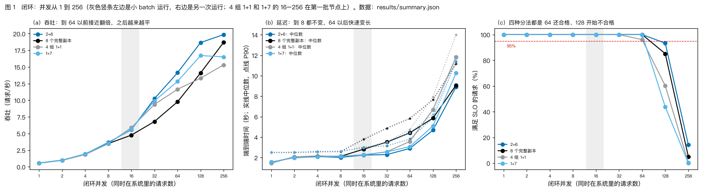
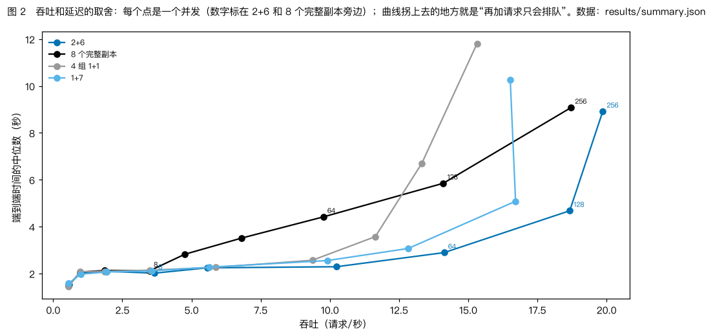
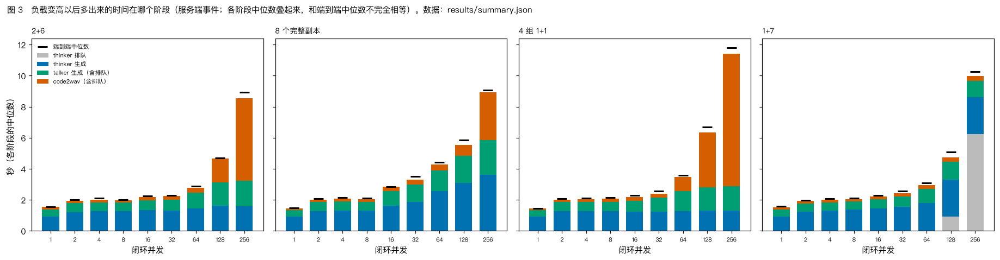
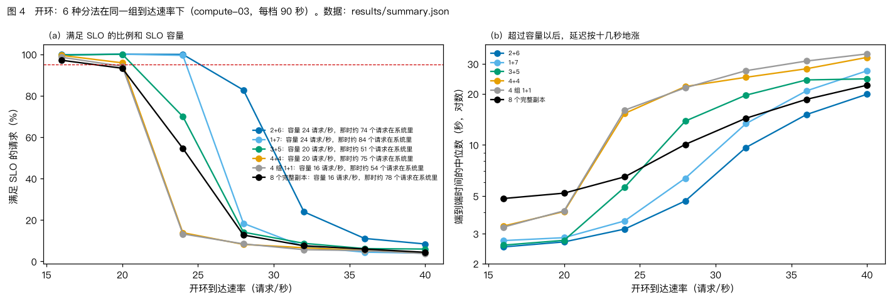

# 实验 3：同时处理多少请求最好？

> **状态：完成（2026-11-18，只用已有数据，没有新的 GPU 运行）**
> - 数据来自 plan v2 的 14 个运行（2026-11-15、11-16）：4 种分法在并发 1–8 的小 batch 运行，同一种分法在并发 16–256 的闭环运行，以及 6 种分法在同一组开环到达速率（16–40 请求/秒）下的运行。全部成功，没有服务中途重启。
> - 每种配置只跑过 1 次，结论都是**初步**的。这个问题当初没有写下预测；只有计划里 A-H1 的后半句和它有关，判定是探索性的，见 [hypotheses.md](hypotheses.md)。限制见 [limitations.md](limitations.md)。
> - 负载都是 W3b（文字提问、语音回答）。这份报告整理并重新计算了 [第二批中期报告](../../../reports/experiment_reports/20261116_plan_v2_batch2_a6000_8gpu.md) 第 2–4 节和[实验 2](../实验02_不同GPU分工的比较/README.md) 里分散的结果。

## 第一部分：一句话

- 8 张 A6000 跑语音回答时，**同时在系统里大约 50–80 个请求最合适**。再多，新加的请求几乎只是在排队：吞吐涨得很少，延迟却成倍增加。
- 具体地说（2+6 分法）：
  - 并发 1 到 8，延迟几乎不变（端到端中位数约 2 秒），吞吐跟着并发翻倍；
  - 并发 64 时吞吐 14.1 请求/秒，全部请求满足 SLO；
  - 并发 128 时吞吐 18.7，但只有 93% 满足 SLO；
  - 并发 256 时吞吐只再多 6%（19.9），端到端中位数却从 4.7 秒涨到 8.9 秒。
- 4 种分法都是“并发 64 合格、128 开始不合格”。开环时按利特尔法则换算，在各自的 SLO 容量上，同时在系统里的请求是 51–84 个，两种测法对得上。
- 多出来的时间在哪：2+6 和 4 组 1+1 主要在 code2wav 门口排队（并发 256 时占端到端的 60%、72%）；8 个完整副本是同卡抢 GPU，thinker 本身变慢；1+7 是唯一的 thinker 前排长队。

## 第二部分：为什么要做

- 部署服务时最常要定的一个数：最多同时接多少个请求、或者每秒最多放进多少个请求。接少了浪费卡，接多了每个请求都变慢。
- 实验 2 比较了各种分法的“容量”，但没有专门回答“容量以内，并发多少最好”和“超过以后时间去了哪里”。
- 这两个问题对研究也重要：后面的实验（9、10、11）都要在“高负载但还没崩”的区间里做比较，需要先知道这个区间在哪。

## 第三部分：先学几个概念

吞吐、TTFT、P50/P90、闭环、开环、饱和、背压见[概念手册](../../../reports/research_updates/exp09_11_concepts.md)和[实验 9 第三部分](../实验09_最佳GPU分工/README.md#第三部分先学几个概念)。

### 3.1 并发和到达速率

- **定义**：
  - **并发**（闭环）：系统里始终保持几个请求；一个完成，马上补一个。
  - **到达速率**（开环）：每秒新来几个请求，不管前面的有没有完成。
- **生活例子**：并发像餐厅只有 64 个座位，走一桌进一桌；到达速率像每分钟有多少客人进门，没座位就在门口等。
- **本项目**：闭环并发取 1–256；开环速率取 16–40 请求/秒。
- **容易混淆**：闭环永远不会“堵死”，因为客户端自己会等；真实服务的流量更像开环，超过容量后队伍会越排越长。

### 3.2 利特尔法则

- **定义**：一个稳定的系统里，平均同时在系统里的请求数 = 吞吐 × 每个请求平均待多久。
- **生活例子**：每分钟进 2 个客人，每人平均坐 30 分钟，店里平均就有 60 个客人。
- **本项目**：用它把开环的结果（速率、平均端到端时间）换算成“同时在系统里的请求数”，和闭环的并发对照。
- **容易混淆**：闭环“并发 64”的那一档，平均在系统里的请求只有约 42 个：每档只有 128 个请求，开头补满和结尾收尾的时候都不满 64 个。

### 3.3 SLO 和 SLO 容量

- **SLO**（plan v2）：请求成功，TTFT ≤ 1 秒，并且“端到端时间 ÷ 语音秒数”≤ 0.5。
- **SLO 容量**：开环下，从低到高，到第一次有一档不足 95% 的请求合格为止，最后一个合格档的速率。
- **容易混淆**：容量和“最高吞吐”不是一回事。2+6 在开环 40 请求/秒时还能完成 32 请求/秒，但那时只有 8% 的请求合格。

### 3.4 拐点

- **定义**：吞吐–延迟曲线上，从“加负载主要换来吞吐”变成“加负载主要换来排队”的地方。
- **本项目**：用“并发翻倍时吞吐涨了多少”来看：2+6 从并发 64 到 128 吞吐只涨 32%，从 128 到 256 只涨 6%，而端到端中位数分别涨了 62% 和 90%。

## 第四部分：一个请求经过哪里

```
客户端 → thinker（写文字，约 1.3 秒）→ talker（生成声音编码，约 0.5 秒）→ code2wav（生成声音，约 0.15 秒）→ 客户端
（括号里是并发 8 时 2+6 各阶段的中位数）

负载变高以后，请求会在某个阶段门口排队：
  thinker 前（“thinker 排队”）、talker 前、code2wav 前（code2wav 的“服务时间”里包含它自己的排队）
```

分法的写法和实验 2、9 相同：2+6 是 2 张卡放 thinker、6 张放 talker 和 code2wav；1+7 只有 1 张 thinker 卡；4 组 1+1 是 4 个独立的两卡服务；8 个完整副本是每张卡一个完整服务。

## 第五部分：我们究竟怎么做实验

### 5.1 用了哪些运行

| 用途 | 分法 | 并发或速率 | 节点、时间 |
|---|---|---|---|
| 小 batch（闭环） | 2+6、8 个完整副本、4 组 1+1、1+7 | 并发 1、2、4、8，每档 64 个请求 | compute-03，11-16 19:54–20:18 |
| 闭环 | 2+6、8 个完整副本 | 并发 16–256，每档 max(96, 2×并发) 个请求 | compute-03，11-16 19:08–19:39 |
| 闭环 | 4 组 1+1、1+7 | 同上 | 第一批节点，11-15 03:12–03:42 |
| 开环 | 2+6、1+7、3+5、4+4、4 组 1+1、8 个完整副本 | 16、20、24、28、32、36、40 请求/秒，每档 90 秒 | compute-03，11-16 19:40–21:32 |

- 闭环的运行都记了服务端事件，可以拆出每个阶段的时间；开环的没有记。
- 每种分法的闭环曲线由两次运行拼成（并发 1–8 一次，16–256 一次）。4 组 1+1 和 1+7 的两段还在不同的节点上；同一种分法换节点，吞吐相差不到 3%（第二批报告第 5 节）。

### 5.2 怎么算

- **吞吐**：一档里完成的请求数 ÷（第一个请求发出到最后一个完成的时间）。
- **各阶段时间**：服务端事件，取这一档所有请求的中位数（`scripts/analysis/stage_by_level.py`）。
- **满足 SLO 的比例**：失败的请求算不合格，预热请求不算。
- **百分位**：线性插值。
- **开环的“同时在系统里的请求数”**：SLO 容量那一档的吞吐 × 平均端到端时间。

## 第六部分：每张图怎么读

### 图 1　闭环：并发从 1 到 256



- **（a）吞吐**：并发 1 到 8，4 种分法一样，每翻一倍吞吐涨 73%–96%（并发 8 时 3.5–3.7 请求/秒）。之后分开：并发 256 时 2+6 19.9、8 个完整副本 18.7、1+7 16.5、4 组 1+1 15.3 请求/秒。
- **（b）延迟**：并发 1 到 8，端到端中位数约 1.5–2.2 秒（并发 1 抽到的回答偏短，所以更短），各分法一样。并发 64 以后快速变长：2+6 在 64、128、256 时是 2.9、4.7、8.9 秒。
- **（c）满足 SLO 的比例**：4 种分法到并发 64 都 ≥ 96%；并发 128 时 2+6 93%、8 个完整副本 85%、4 组 1+1 60%、1+7 44%；并发 256 时都 ≤ 14%。

### 图 2　吞吐和延迟的取舍



- 每个点是一个并发。曲线前半段向右走（加并发换来吞吐），后半段向上走（加并发只换来延迟）。
- 2+6 的拐点在并发 64 到 128 之间：64 → 128 吞吐 +32%、端到端 +62%；128 → 256 吞吐 +6%、端到端 +90%。
- 8 个完整副本的曲线一直在 2+6 的上方（同样吞吐，延迟更高），因为同一张卡上的三个阶段互相抢 GPU。

### 图 3　多出来的时间在哪个阶段



- 每根柱子是一个并发下各阶段的中位数叠起来（不完全等于端到端中位数，横线才是）。
- **2+6**：并发 4 以上，thinker 一直在 1.3–1.6 秒（并发 1、2 时回答偏短，更短），thinker 前几乎不排队（中位数 ≤ 6 毫秒）。多出来的时间先在 talker（并发 64 时 1.0 秒，256 时 1.6 秒），然后大部分在 code2wav：并发 64 时 0.33 秒（端到端的 12%），128 时 1.5 秒（33%），256 时 5.3 秒（60%）。
- **4 组 1+1**：同样是 code2wav，而且更早更多：并发 64 时 0.9 秒（26%），256 时 8.5 秒（72%）。它每个服务只有一张 talker 卡，code2wav 和 talker 挤在一起。
- **8 个完整副本**：thinker 自己变慢，从并发 8 的 1.3 秒变成 256 的 3.6 秒；thinker 前不排队，是同一张卡上的 talker、code2wav 在抢 GPU。
- **1+7**：唯一的 thinker 前排起长队：并发 128 时排队中位数 0.9 秒，256 时 6.2 秒。所以它的 TTFT 先超标。

### 图 4　开环：同一组到达速率



- **（a）**：SLO 容量 2+6 和 1+7 是 24 请求/秒，3+5 和 4+4 是 20，4 组 1+1 和 8 个完整副本是 16（和第二批报告、实验 2 一致）。
- 按利特尔法则，在各自的容量上，同时在系统里的请求是：2+6 约 74 个，1+7 约 84 个，4+4 约 75 个，8 个完整副本约 78 个，4 组 1+1 约 54 个，3+5 约 51 个。
- **（b）**：超过容量以后，端到端中位数按十几秒地涨：2+6 在 28、32 请求/秒时是 4.7、9.6 秒，40 请求/秒时 19.9 秒。
- 过载时的失败：8 个完整副本在 24 请求/秒及以上出现服务端显存不足（每档 31–314 个请求）；32–40 请求/秒时客户端用完了文件句柄（这是测量工具的问题，只出现在已经远超容量的档位）。

## 第七部分：证据等级

| 结论 | 等级 | 依据 |
|---|---|---|
| 各分法在各并发、各速率下的吞吐、延迟、SLO 比例 | Measured | 每种配置 1 次运行 |
| 并发 1–8 时 4 种分法的延迟一样，吞吐跟着并发翻倍 | Measured（初步） | 小 batch 运行，每档 64 个请求 |
| 4 种分法都是并发 64 合格、128 开始不合格 | Measured（初步） | 闭环每档 128–512 个请求 |
| 最合适的是同时在系统里约 50–80 个请求 | Derived | 开环 SLO 容量 × 平均端到端时间（利特尔法则），和闭环并发 64–128 的结果相符 |
| 2+6、4 组 1+1 多出的时间主要在 code2wav 门口 | Measured | 服务端事件的阶段拆分；code2wav 的时间包含它内部的排队，分不开 |
| 8 个完整副本变慢是因为同卡抢 GPU | Derived | thinker 前不排队，但 thinker 本身变慢；同样的 thinker 在 2+6 里不变慢 |
| A-H1 后半句“完整副本只在每卡并发 ≤ 2 时最好”：**不支持** | Measured（初步），判定是探索性的 | 8 个完整副本只在并发 1 和 256 时进入“最好的 3% 以内”，并发 16（每卡 2 个）时最慢 |
| 对别的负载（混合、Agent、长回答）、别的分法（2+2+4）是否同样是 50–80 个 | Unknown | 只测了 W3b |

## 第八部分：研究意义

1. **部署时应该限制同时在系统里的请求数**，而不是来多少收多少。对 2+6，大约 70–80 个以内能保持 SLO；超过以后应该在入口排队或拒绝，而不是让所有请求一起变慢。这需要在服务入口做“准入控制”（Hypothesis：会改善过载时已接收请求的延迟，没测）。
2. **“同时在系统里多少个请求”比“每秒多少请求”更稳定**：6 种分法的 SLO 容量从 16 到 24 请求/秒不等，但换算成在系统里的请求数，多数落在 50–85 个之间。
3. **瓶颈在哪个阶段，决定了该怎么改**：2+6 是 code2wav（实验 6、7、9、10 都在这个方向上），8 个完整副本是同卡争用（拆开就好），1+7 是 thinker 数量（加 thinker 卡）。
4. **做性能比较时要选对负载区间**：并发 8 以下所有分法都一样，比不出差别；并发 256 时所有分法都已经过载。最有区分度的是并发 64–128、开环 16–28 请求/秒。

## 第九部分：下一步

1. **试准入控制**（最直接的应用）：在 2+6 上限制同时在系统里的请求为 64、80、96 个，开环加压到 28–36 请求/秒，看被接收的请求的延迟和合格率能不能保持住。
2. **用更长的档位重测闭环曲线**：每档至少 4 倍并发的请求，让“并发 64”真的平均有 64 个在系统里。
3. **在实验 9 最好的 2+2+4 上重做这条曲线**，看拐点是否后移。

## 附：文件在哪里

| 文件 | 内容 |
|---|---|
| [hypotheses.md](hypotheses.md) | 有关的事先预测和事后定的判定方法 |
| [limitations.md](limitations.md) | 限制和对结论的影响 |
| [reproduce.md](reproduce.md) | 怎样从原始数据重新生成结果和图 |
| [metadata.json](metadata.json) | 14 个运行的目录、时间、状态、代码和软件版本 |
| `results/summary.json` | 全部汇总数字，图都从这里画（字段见[数据字典](../../../reports/research_updates/plan_v2_reports_data_dictionary.md)第六节） |
| `scripts/analysis/exp03_report.py`、`exp03_figures.py` | 分析和画图脚本；测试在 `tests/test_exp03_report.py`。阶段拆分复用 `scripts/analysis/stage_by_level.py` |

内部配置名（只用于复现）：小 batch `v2b_sb_{s2x6,r8,p4,s1x7}`；闭环 `v2b_a_{s2x6,r8}_c03`、`v2_a_{p4,s1x7}_run1`；开环 `v2b_aoh_{s2x6,s1x7,s3x5,s4x4,p4,r8}`。
