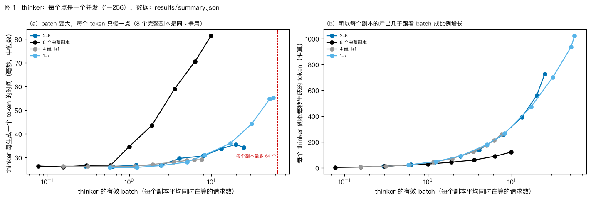
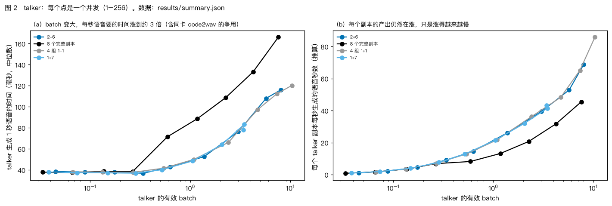
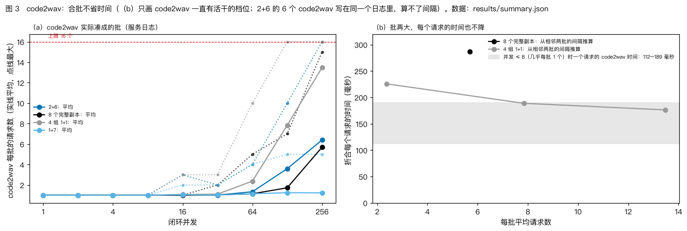

# 实验 4：每批处理多少任务最好？

> **状态：完成（2026-11-18，只用已有数据，没有新的 GPU 运行）**
> - 数据和实验 3 相同：4 种分法从并发 1 到 256 的闭环运行（2026-11-15、11-16），都记了服务端事件和服务日志。每种配置只跑过 1 次，结论都是**初步**的。
> - 这个问题当初没有写下预测，全部是看过数据后的描述（[hypotheses.md](hypotheses.md)）。限制见 [limitations.md](limitations.md)。
> - code2wav 的批大小后来有专门的实验：[实验 6](../实验06_Code2Wav时间拆解/README.md)（时间拆解）和[实验 10](../实验10_Code2Wav_Batching/README.md)（主动改批上限和组批方式）。本报告引用它们的结论，不重复。

## 第一部分：一句话

- 三个阶段对“凑大批”的反应完全不同：
  - **thinker（写文字）越大越划算**：2+6 的 thinker 平均同时算的请求从 2.4 个涨到 24.9 个，每个 token 只从 26.8 毫秒变成 34.2 毫秒（+28%），每个副本每秒产出的 token 涨了约 8 倍（91 → 727）。
  - **talker（生成声音编码）也划算，但代价更大**：同时算的请求从 0.3 个涨到 8 个，每秒语音要的时间从 37 毫秒涨到 116 毫秒（约 3 倍），每个副本的产出涨了约 7.5 倍。这里面混着同卡 code2wav 的争用。
  - **code2wav（生成声音）合批基本不省时间**：每批平均 13.5 个请求时，折合每个请求 176 毫秒；单独处理一个是 112–189 毫秒。
- 所以“每批多少最好”要分阶段回答：thinker 和 talker 在不超时的前提下越大越好；code2wav 的批大小不影响产出，长短不一时大批反而浪费在补齐上（实验 10）。
- 实际能凑多大，主要由软件上限决定：thinker 每个副本最多 64 个，talker 32 个，code2wav 每批最多 16 个且不等人凑批。

## 第二部分：为什么要做

- GPU 一次算很多个请求（batch），通常比一个一个算更划算：同一份模型权重读一次，可以给很多请求用。但 batch 太大，每个请求等得更久，显存也会不够。
- Omni 模型有三个阶段，各自的计算特点不同，“batch 多大最好”可能各不相同。
- 前面的实验已经零散地看到：thinker 合批几乎不变慢（第二批报告第 4 节），code2wav 合批不省时间（实验 6、10）。这份报告把三个阶段放在同样的数据上一起比较。

## 第三部分：先学几个概念

### 3.1 batch 和有效 batch

- **定义**：batch 是 GPU 一次一起算的请求。“有效 batch”是这里用的度量：一段时间里，一个副本平均同时有几个请求在它的模型里（利特尔法则：所有请求在模型里的时间加起来 ÷ 时间窗 ÷ 副本数）。
- **生活例子**：一辆公交车一趟拉多少人。有效 batch 像一天里车上平均有几个人。
- **本项目**：thinker 和 talker 是“连续 batching”：每一步都可以有新请求加入、旧请求离开，所以 batch 一直在变；code2wav 是一批一批地算，日志里记了每批几个请求。
- **容易混淆**：code2wav 的“有效 batch”按服务时间算，包含排队的请求，比真正的批大；看 code2wav 的批要用日志（图 3）。

### 3.2 单位耗时和产出

- **单位耗时**：thinker 每生成一个 token 的时间；talker、code2wav 每生成 1 秒语音的时间。用单位耗时，回答长短不同的请求也能比较。
- **产出**（推算）：一个副本每秒生成多少 token（或多少秒语音）≈ 有效 batch × 1000 ÷ 单位耗时（毫秒）。
- **容易混淆**：单位耗时是“一个请求感受到的速度”，产出是“这个副本的总吞吐”。batch 变大时前者变差、后者变好，要两个一起看。

### 3.3 为什么大模型解码适合凑大批

- **定义**：生成每个 token 都要把整个模型的权重从显存读一遍。batch 小时，时间主要花在读权重上（受显存带宽限制）；多几个请求一起算，权重还是只读一遍。
- **本项目**：thinker 约 8B 参数，每生成一个 token 要读约 15 GB 权重。按 A6000 标称带宽 768 GB/s，最快约 20 毫秒一个 token；实测 26 毫秒（第二批报告第 2 节）。实验 1 的 kernel 级测量显示，thinker 一步的 GPU 计算约 24 毫秒，显存带宽用到约 84%。
- **容易混淆**：code2wav 不是这种“读权重为主”的计算，每个请求自己的计算量就很大，所以合批省不了时间。

### 3.4 软件上限

- sglang-omni 520b49ee 给 MiniCPM-o 设的默认值（`sglang_omni/models/minicpm_o/`）：
  - thinker 每个副本最多同时处理 64 个请求（`stages.py` 第 361 行）；
  - talker 每个副本最多 32 个（`stages.py` 第 144 行）；
  - code2wav 每批最多 16 个，不等待凑批（`config.py` 第 144–145 行，`max_batch_wait_ms=0`）：队列里有几个就算几个。

## 第四部分：一个请求经过哪里

```
thinker（连续 batching，每个副本最多 64 个）
  → talker（连续 batching，每个副本最多 32 个；和 code2wav 在同一张卡上）
  → code2wav（一批一批地算，每批最多 16 个，不等人）
```

## 第五部分：我们究竟怎么做实验

- **运行**：和实验 3 完全相同的 8 个运行（4 种分法 × 小 batch 和闭环两段），W3b 负载，并发 1–256。
- **有效 batch 和单位耗时**：`scripts/analysis/stage_by_level.py` 从服务端事件算出每档的有效 batch、每个阶段的单位耗时（中位数）和各角色 GPU 的采样忙碌比例。
- **code2wav 的批**：服务日志里每批一行（`minicpm_code2wav_batch size=N`），按每档的时间窗统计每批几个请求、最多几个、有多少批是满的 16 个。
- **code2wav 每个请求的时间**：4 组 1+1 和 8 个完整副本每个日志里只有一个 code2wav，在它一直有活干的档位（每批平均 ≥ 2 个）上，“相邻两批的开始时间间隔 ÷ 前一批的请求数”就是折合每个请求的时间。2+6 的 6 个 code2wav 写在同一个日志里，算不了。

## 第六部分：每张图怎么读

### 图 1　thinker：batch 越大越划算



- **（a）**：横轴是有效 batch（对数），纵轴是每个 token 的时间。
  - thinker 独占 GPU 时（2+6、4 组 1+1、1+7），batch 从 0.1 到约 10，每个 token 都在 26–31 毫秒。2+6 到 24.9 时是 34.2 毫秒；1+7 的唯一 thinker 到 56 个（接近 64 的上限）时是 55 毫秒。
  - 8 个完整副本是例外：并发 16–256 时 batch 只从 1 涨到 10，每个 token 却从 35 毫秒涨到 81 毫秒。这不是 batch 的问题，是同一张卡上的 talker 和 code2wav 在抢 GPU。
- **（b）**：每个副本每秒产出的 token。2+6 从并发 8 的 91 涨到并发 256 的 727；1+7 的单个 thinker 最高 1,021。thinker 独占 GPU 的三种分法几乎落在同一条线上：产出由 batch 决定。
- **读法**：thinker 最好让 batch 尽量大。限制它的是 TTFT（请求在 thinker 前排队）和每个副本 64 个的上限（实验 19 的混合负载就是撞上了这个上限）。

### 图 2　talker：划算，但代价更大



- **（a）**：2+6 的 talker 从 batch 0.3 到 8，每秒语音的时间从 37 毫秒涨到 116 毫秒；4 组 1+1 到 10.3 时是 120 毫秒。
- **（b）**：每个副本每秒产出的语音秒数，2+6 从 9.2 涨到 68.8，4 组 1+1 最高 85.9。
- **读法**：
  - talker 的单位耗时涨得比 thinker 快得多。一部分原因是 talker 和 code2wav 在同一张卡上：负载越高，code2wav 越忙，抢走的 GPU 时间越多（实验 7：同卡时 talker 生成每秒语音的时间是独占时的 2.2 倍）。所以这里分不清多少是 batch 本身的代价、多少是争用。
  - talker 每个副本 32 个的上限在这些运行里没有撞到（最多 10 个）。只给 talker 1 张卡时会撞到（实验 9 的 2+1+5）。

### 图 3　code2wav：合批不省时间



- **（a）**：并发 32 以下，code2wav 几乎每批只有 1 个请求。并发 256 时，2+6 平均每批 6.4 个（22% 的批是满的 16 个），4 组 1+1 平均 13.5 个（72% 满批），8 个完整副本 5.7 个；1+7 的 code2wav 一直很闲（≤ 1.2 个），因为请求堵在唯一的 thinker 前面。
- **（b）**：4 组 1+1 每批平均 2.4、7.8、13.5 个时，折合每个请求 226、189、176 毫秒；8 个完整副本平均 5.7 个时 286 毫秒（还要和同卡的 thinker、talker 抢 GPU）。灰色带是并发 ≤ 8、几乎每批 1 个时一个请求的 code2wav 时间：112–189 毫秒。
- **读法**：批大了，每个请求的时间基本不降，所以 code2wav 每个进程每秒大约只能处理 5–6 个请求，和批多大无关。实验 6 用打点补丁直接量到：每个请求约 0.2 秒 GPU 计算，合批不省。实验 10 主动改了批上限：长度相近的请求（W3b），flow CUDA graph 关闭时批上限 16 比 1 省 15–23%，默认打开 graph 时差别很小；长短混在一起时，大批有 28% 的计算花在补齐上，连完全不凑批都多做 24%，按长度分组能多做 30%。

## 第七部分：证据等级

| 结论 | 等级 | 依据 |
|---|---|---|
| 各阶段的有效 batch、单位耗时、GPU 忙碌比例；code2wav 每批的请求数 | Measured | 8 个运行的服务端事件和服务日志，每种配置 1 次 |
| thinker 独占 GPU 时，batch 从 2.4 到 24.9 每个 token 只慢 28% | Measured（初步） | 2+6 的事件 |
| thinker 和 talker 每个副本的产出随 batch 增长 | Derived | 有效 batch × 1000 ÷ 单位耗时；忽略了 thinker 模型路径里的 prefill |
| code2wav 合批不省时间 | Derived（这里），Measured（实验 6、10） | 相邻两批的间隔 ÷ 批大小，只在一直有活干的档位；和单独处理一个的时间比 |
| talker 单位耗时上涨里，有多少来自 batch、多少来自同卡 code2wav | Unknown | 这些运行里两者同时变化 |
| 8 个完整副本的 thinker 变慢来自同卡争用 | Derived | batch 只有 1–10，同样 batch 的 thinker 在独占 GPU 时不变慢 |

## 第八部分：研究意义

1. **不能用一个“最佳 batch”管所有阶段**。thinker 要大 batch（受带宽限制的解码），code2wav 的 batch 大小不影响产出，talker 介于两者之间。调度和放置要按阶段分别考虑。
2. **thinker 的瓶颈常常是软件上限而不是 GPU**。每个副本 64 个的上限在混合负载（实验 19）和 1+7（这里 batch 到 56）时都起作用；GPU 还没算满，请求已经在排队。
3. **code2wav 是 Omni 服务里最“不吃 batch”的阶段**，它的产出只能靠更多的卡（实验 7、9）、更少的计算（例如 flow 步数），或者避免补齐浪费（实验 10）来提高。
4. **同卡放置会污染单位耗时的测量**：8 个完整副本里 thinker 的变慢、talker 的变慢，都混着争用。要测某个阶段对 batch 的真实反应，应该让它独占 GPU。

## 第九部分：下一步

1. **把 talker 单独放一张卡测 batch 曲线**（例如实验 9 的 2+2+4 分法），分开 batch 本身的代价和同卡 code2wav 的争用。
2. **试 thinker 每个副本更大的上限**（例如 128），配合实验 19 的“名额”推算，看 thinker 的 batch 再大一倍时每个 token 的时间和 TTFT。
3. code2wav 方向已经由实验 6、10 覆盖；下一步是减少它的计算量（flow 步数、HiFT 的实现），而不是调批大小。

## 附：文件在哪里

| 文件 | 内容 |
|---|---|
| [hypotheses.md](hypotheses.md) | 说明这个问题没有事先的预测 |
| [limitations.md](limitations.md) | 限制和对结论的影响 |
| [reproduce.md](reproduce.md) | 怎样从原始数据重新生成结果和图 |
| [metadata.json](metadata.json) | 8 个运行的目录、时间、状态、代码和软件版本 |
| `results/summary.json` | 全部汇总数字，图都从这里画（字段见[数据字典](../../../reports/research_updates/plan_v2_reports_data_dictionary.md)第七节） |
| `scripts/analysis/exp04_report.py`、`exp04_figures.py` | 分析和画图脚本；测试在 `tests/test_exp04_report.py`。有效 batch 和单位耗时复用 `scripts/analysis/stage_by_level.py` |

内部配置名（只用于复现）：`v2b_sb_{s2x6,r8,p4,s1x7}`、`v2b_a_{s2x6,r8}_c03`、`v2_a_{p4,s1x7}_run1`。
