# 实验 5：GPU 为什么会等待？

> **状态：第二版（2026-11-17）。**
> - **第一轮**：补测了 2+6 分工、并发 128，看高负载时 talker 卡被什么占满。内容保留在第 5.7 节和图 1–4。
> - **第二版**：没有新跑 GPU。把两批 8 卡 Job（625796、454290）里的 77 个运行、543 个负载档全部重新分析了一遍，回答“到底哪边有 bubble、为什么、哪个值得先修”。
> - 有 kernel trace 的只有 7 段（实验 1 的 6 段和本实验第一轮的 1 段），其余靠 nvidia-smi 和服务端事件。估计方法和 kernel 实测的差距见第 5.8 节。

## 先说结论

1. **最大的、能去掉的 bubble 在 thinker 卡上。**
   - thinker 每生成一个 token，GPU 算约 24 毫秒，然后空 3–8 毫秒（每一步的 11–23%）。
   - 原因：CPU 要等 GPU 把这一步算完，才开始准备下一步，这段时间 GPU 只能干等。
   - 所有分工、所有负载都是这样。只有 1 张 thinker 卡（1+7）时，高负载下 thinker 卡有约 43% 的时间手上有活却空着。推算这是 1+7 的首 token 时间（TTFT）不达标的主要原因。
   - 根子在代码里：sglang-omni 有“提前一步发射”的机制，但对要出语音的请求关掉了。
2. **决定吞吐的不是 bubble，是 talker 卡真的忙不过来。**
   - 高负载时 talker 卡 90–97% 的时间在算，大头是 code2wav（把语音编码变成波形的那一段）。
   - 请求在 code2wav 门口排队。并发 256 时，排队加合成占端到端的 62–76%。
3. **8 个完整副本是“假忙”。** 卡的忙碌比例最高（92–95%），但三段挤在一张卡上互相抢，thinker 每一步慢近一倍。
4. **空得最多的地方，反而不影响请求快慢。** 下面这些空闲都不在请求的关键路径上，是分工和负载选择的问题，不是系统的毛病：
   - 低负载时 talker 卡空着 64–96%，主要在等 thinker；
   - Agent 文字负载下，talker 卡 100% 空着；
   - thinker 卡给多了时，有 16–45% 的时间没活。
5. **卡之间传数据可以忽略**：每个请求两次传递一共约 15 毫秒，不到端到端的 1%。
6. **视频负载是例外**：GPU 有 86–88% 的时间在等 CPU 解码视频。

## 先认识几个词

GPU bubble、忙碌比例、关键路径、CUDA graph、争用这几个词，[实验 1](../实验01_8张GPU在做什么/README.md) 开头已经讲过。这里补充本报告要用的几个。

**GPU 没在跑 kernel，就一定有问题吗？**
- **不一定。** 系统里没请求时 GPU 空着很正常，空闲本身可能只是现象。
- **值得优化的空闲**有两种：
  - 这张卡手里有请求，GPU 却空着（**有活却空着**）；
  - 空着拖慢了请求，也就是空闲落在请求的关键路径上。
- **为什么最空的卡不一定最该修？** 请求要依次经过 thinker、talker、code2wav。请求多快完成，取决于这条链上最慢、最挤的那一段，不取决于最闲的那张卡。

**Bubble 的 8 种类型**

本报告按你给的分类来归因。每种类型给一个在本实验里的例子：

| 类型 | 是什么 | 在本实验里的例子 |
|---|---|---|
| 1 上游供给不足 | 下游的卡在等上游交活 | talker 卡空着，请求还在 thinker 那边 |
| 2 下游处理太慢 | 上游交了活，下游处理不完，请求排队 | 请求在 code2wav 门口排几秒；闭环测试里请求都堵在下游，thinker 卡反而没活 |
| 3 CPU / 调度 | GPU 在等 CPU 准备工作 | CPU 在解码视频；CPU 在准备 thinker 的下一步 |
| 4 CUDA 同步 | CPU 被“等 GPU 算完”卡住，没法提前准备 | thinker 每一步都等 GPU 算完才准备下一步 |
| 5 GPU 间通信 | 阶段之间传数据 | thinker 把结果交给 talker |
| 6 资源争用 | 几个进程抢一张卡 | 8 个完整副本里三段抢卡；talker 和 code2wav 抢卡 |
| 7 请求不足 | 没有请求可做 | 低并发；文字请求不需要 talker |
| 8 未知 | 数据不够判断 | 第 6.7 节 |

**有活却空着 和 没活空着**
- **有活却空着**：这张卡上的某个阶段手里有请求（在排队，或在生成），GPU 却没有 kernel 在跑。通常是类型 3、4、6。
- **没活空着**：这张卡上的阶段手里一个请求都没有。再按“请求这时在哪”细分成类型 1、2、3、5、7。
  - 请求还在上游 thinker → 类型 1；
  - 在两个阶段之间传递 → 类型 5；
  - 在 CPU 预处理 → 类型 3；
  - 都在下游 → 类型 2；
  - 服务里一个请求都没有 → 类型 7；
  - 另外单列一种：同一阶段在别的卡上有活，这张卡没分到（**分配不均**）。

**同步（synchronize）**
- **是什么**：CPU 发完命令后停下来，等 GPU 把活干完再往下走。
- **为什么需要**：CPU 要用 GPU 算出的结果。比如 thinker 要知道这一步生成了哪个字，才能决定下一步。
- **例子**：服务员（CPU）下完单就站在厨房门口等，菜做好了才回去招呼下一桌。这段时间厨房（GPU）做完菜就空着，等服务员带来下一张单。
- **在这里**：thinker 每一步都这样，所以每一步都有几毫秒 GPU 空着。

**提前一步发射（lookahead / async decode）**
- **是什么**：CPU 先把第 N 步发给 GPU，趁 GPU 在算第 N 步的时候，再去处理第 N−1 步的结果、准备第 N+1 步。
- **为什么需要**：CPU 准备工作和 GPU 计算可以同时进行，GPU 就不用等 CPU。
- **例子**：服务员下完一张单不站着等，先去招呼下一桌；菜好了再回来端。
- **在这里**：
  - talker 用上了：它每一步的下一步命令在当前步结束前约 0.1–1 毫秒就已经发到 GPU。
  - thinker 对要出语音的请求关掉了这个机制（原因见第 6.1 节），所以每一步都要同步。

**空转等待（spin wait）**
- CUDA 默认让等待中的 CPU 线程不停地查“GPU 算完没有”，不让出 CPU。
- 所以一个进程的 CPU 占用接近 100%，不代表它在干有用的活，可能大半时间在空转等 GPU。

## 1. 一句话解释

把两批 8 卡实验里每张 GPU 的空闲时间按原因拆开，找出哪些空闲真正拖慢了请求、哪些只是闲着，以及最该先修的那一个。

## 2. 为什么做

- 实验 1 只看了三种分工、两个并发档的 kernel 时间线；实验 5 第一轮只看了一个并发档。
- 两批 8 卡 Job 一共跑了 77 个运行，覆盖了 8 种分工、5 类负载、并发 1–512。还没有人把它们放在一起回答“哪里有 bubble”。
- 第一轮留下两个没弄清的问题：
  - thinker 每一步那几毫秒的空档，到底是 CPU 太慢，还是被同步卡住？
  - 每个进程都接近用满一个 CPU 核，这是真的在干活吗？

## 3. 实验怎么运行

**没有新跑 GPU**，全部用已有数据。

### 3.1 用到的数据

| 来源 | 内容 | 覆盖范围 |
|---|---|---|
| nvidia-smi，每 0.2 秒采样一次 | 每张卡的忙碌比例 | 全部 77 个运行、543 个负载档 |
| 服务端事件 | 每个请求进出每个阶段的时间 | 217 个负载档 |
| torch profiler 的 kernel trace | 每个 kernel 和 CPU 端 CUDA 调用的起止时间 | 7 段：8 个完整副本、4 对两卡流水线、2+6 各在并发 8 和 64；2+6 并发 128 的 3 秒 |
| sglang-omni 源码（520b49ee） | 调度循环、提前一步发射的开关 | — |

两批机器都是 8×A6000，软件版本相同：
- 第一批：Job 625796，共享 gpu 分区的一台节点，驱动 570。这台机器上 profiler 录不到 kernel。
- 第二批：Job 454290，compute-03，驱动 580。

77 个运行里，59 个用满 8 张卡；另外 18 个是同一个 8 卡 Job 里只用 1–4 张卡的对照（例如单副本、2 卡流水线）。

### 3.2 三个分析步骤

1. **普查**（`scripts/analysis/exp05_bubble_census.py`）：
   - 用服务端事件，以 1 毫秒为单位，画出每个请求在每一刻待在哪：CPU 预处理、thinker 排队或生成、传给 talker、talker 排队或生成、传给 code2wav、code2wav 排队或合成、返回。
   - 由此得到每张卡每一刻“有没有活”，没活时请求都在哪（类型 1/2/3/5/7、分配不均）。
   - talker 卡只算要出语音的请求：只要文字的请求永远不会到 talker，这时 talker 卡空着算“没请求”，不算“等上游”。
   - “有活却空着”用整档平均来估计：有活比例 − nvidia-smi 的忙碌比例。
   - 同时得到每个请求每一段的耗时（关键路径）。
2. **逐步拆空档**（`scripts/analysis/exp05_step_sync.py`）：
   - 在 kernel trace 里，把 thinker 和 talker 的每一步对齐到 CPU 发出它的那次 `cudaGraphLaunch`。
   - 每一步测：GPU 算了多久、空了多久、CPU 有没有卡在同步上、同步返回后又过了多久才发下一步。
3. **画图和排序**（`scripts/analysis/exp05_bubble_figures.py`）：
   - 把普查和拆分结果画成图 5–12；
   - 按对吞吐和延迟的影响给 bubble 排序。

### 3.3 并发 1–8 和 16–256 来自两批机器

- 4 种分工（8 个完整副本、4 对两卡流水线、1+7、2+6）的并发 1–8 来自第二批（compute-03），并发 16–256 来自第一批（2 次运行取平均）。
- 两批在相邻的并发 8 和 16 上结果衔接（例如 2+6 的 thinker 卡空闲 18% 和 22%），所以放在一张图里看趋势。但同一并发下的精确对比只在同一批里做。

## 4. 我们测量什么

| 你要求的测量 | 本实验怎么得到 | 性质 |
|---|---|---|
| Kernel 忙 / 空 | nvidia-smi（全部）；kernel trace（7 段） | 实测 |
| 各阶段处理时间 | 服务端事件：thinker 读提示 + 逐字生成、talker 生成、code2wav 合成；按每个 token、每秒语音归一化 | 实测 |
| 各阶段排队时间 | 服务端事件：进入调度队列 → 开始处理 | 实测 |
| CUDA 同步 | kernel trace：CPU 在 `cudaStreamSynchronize` 等调用里的时间、同步返回时这一步是否已算完 | 实测 |
| CPU 调度延迟 | kernel trace：同步返回后到发出下一步的时间 | 实测 |
| 阶段间通信 | 服务端事件：thinker 结束 → talker 收到；talker 结束 → code2wav 收到；另有实验 13 换连接方式 | 实测 |
| 进程争用 | kernel trace：同一张卡上两个进程的 kernel 同时在跑的时间 | 实测（7 段） |
| 凑批等待 | code2wav 的事件只有“派发”和“完成”，凑批和排队分不开 | **未知** |
| GPU 显存 | 本报告没有分析，见实验 2 | — |
| 每个阶段的实际 batch | 见实验 4 | — |
| 有活却空着（没有 trace 的运行） | 有活比例 − nvidia-smi 忙碌比例 | 推算，误差见第 5.8 节 |

## 5. 实验结果

### 5.1 Bubble 地图：一张图看哪边空

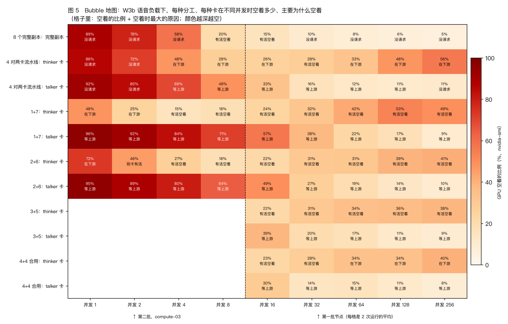

- **图怎么读**：
  - 每一行是一种分工里的一种卡，每一列是一个并发档；
  - 格子里写着这种卡空着的比例，以及空着时最大的原因；
  - 颜色越深越空。
- **低负载（并发 1–8）**：
  - 几乎每种卡都很空；
  - talker 卡主要在**等上游**（类型 1）；
  - 8 个完整副本和 4 对流水线主要是**没请求**（类型 7）。
- **高负载（并发 64–256）**：
  - talker 卡只空 8–22%；
  - thinker 卡空 31–56%。thinker 卡空的原因分两种：
    - 1+7、2+6、3+5 主要是**有活却空着**；
    - 4+4 和 4 对流水线主要是**请求在下游**，也就是 thinker 卡给多了。
- **8 个完整副本**在并发 32 以上只空 5–10%，是所有分工里最“忙”的，但这是假忙（第 6.3 节）。

### 5.2 每张卡的时间去哪了

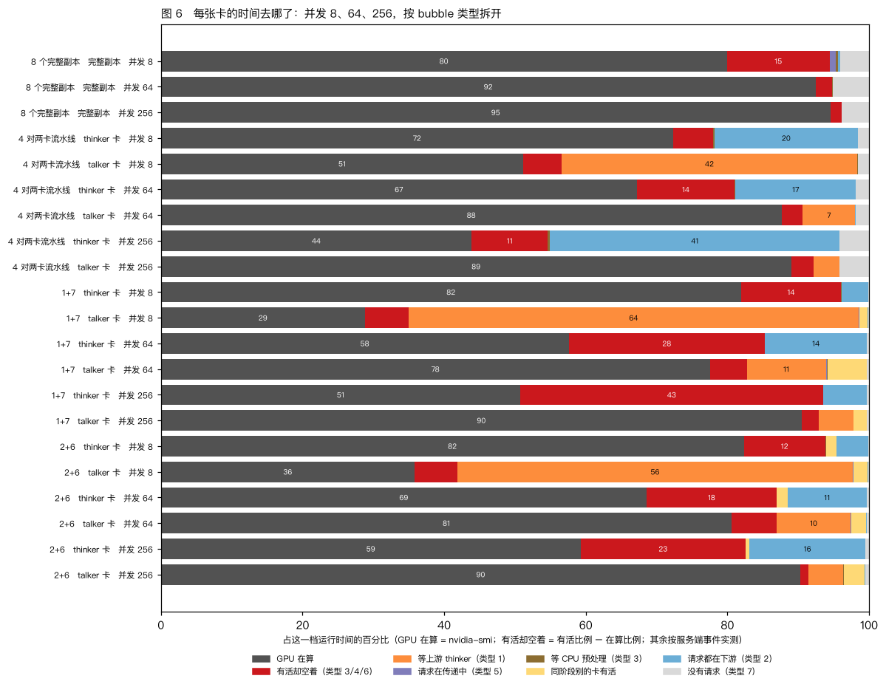

| 分工 | 卡 | 并发 | 在算 | 有活却空着 | 等上游（1） | 请求在下游（2） | 没请求（7） |
|---|---|---|---|---|---|---|---|
| 2+6 | thinker | 8 | 82% | 12% | — | 4% | 0 |
| 2+6 | thinker | 256 | 59% | **23%** | — | **16%** | 0 |
| 2+6 | talker | 8 | 36% | 6% | **56%** | — | 0 |
| 2+6 | talker | 256 | **90%** | 1% | 5% | — | 0 |
| 1+7 | thinker | 64 | 58% | 28% | — | 14% | 0 |
| 1+7 | thinker | 256 | 51% | **43%** | — | 6% | 0 |
| 1+7 | talker | 8 | 29% | 6% | **64%** | — | 0 |
| 4 对两卡流水线 | thinker | 256 | 44% | 11% | — | **41%** | 4% |
| 4 对两卡流水线 | talker | 256 | 89% | 3% | 4% | — | 4% |
| 8 个完整副本 | 全部三段 | 8 | 80% | 15% | — | — | 4% |
| 8 个完整副本 | 全部三段 | 256 | **95%** | 2% | — | — | 4% |

- 传递中（类型 5）和 CPU 预处理（类型 3）在 W3b 负载下都 ≤ 1%，表里省略了。
- 分配不均在 2+6 和 1+7 的部分格子里有 1–6%。

### 5.3 各阶段的处理时间和等待时间

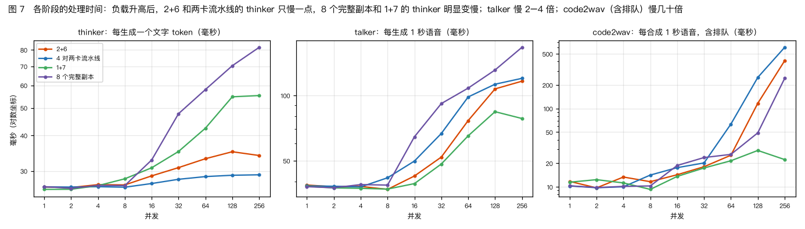

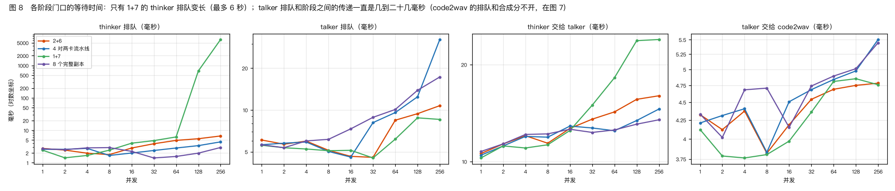

| 分工 | 并发 | thinker 每个 token | talker 每秒语音 | code2wav 每秒语音（含排队） | thinker 排队 | talker 排队 |
|---|---|---|---|---|---|---|
| 2+6 | 8 | 27 毫秒 | 37 毫秒 | 12 毫秒 | 2 毫秒 | 5 毫秒 |
| 2+6 | 256 | 34 毫秒 | 116 毫秒 | **408 毫秒** | 7 毫秒 | 11 毫秒 |
| 4 对两卡流水线 | 256 | 29 毫秒 | 120 毫秒 | **605 毫秒** | 4 毫秒 | 32 毫秒 |
| 1+7 | 256 | **55 毫秒** | 78 毫秒 | 22 毫秒 | **6.3 秒** | 9 毫秒 |
| 8 个完整副本 | 256 | **82 毫秒** | 167 毫秒 | 243 毫秒 | 3 毫秒 | 17 毫秒 |

- 负载升高后，thinker 和 talker 的排队时间几乎不变。只有 1+7 例外：它唯一的 thinker 撑不住，排队涨到 6.3 秒。
- 变慢最多的是 code2wav：在 talker 卡被占满的分工里，每秒语音从 10 毫秒左右涨到 240–670 毫秒（4+4 是 671 毫秒）。
  - code2wav 的事件只记了“派发”和“完成”，所以排队和合成分不开，这里是两者之和。
  - 低负载时每秒语音约 10 毫秒，可以当作纯合成时间。多出来的部分主要是排队。
- 阶段之间的传递：thinker → talker 11–24 毫秒，talker → code2wav 4–6 毫秒，几乎不随负载变化（图 8 右两幅）。

### 5.4 一个典型请求的时间花在哪（关键路径）

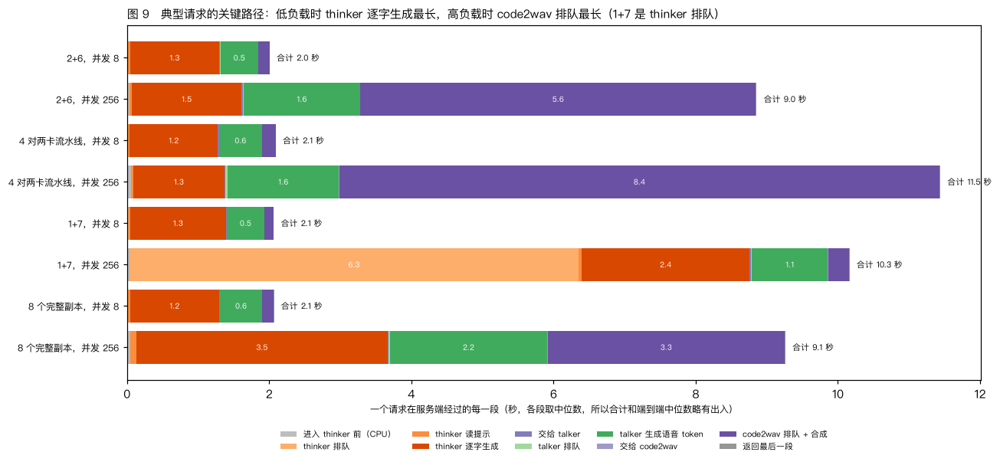

| 分工、并发 | 合计 | 最长的一段 | 占比 |
|---|---|---|---|
| 2+6，并发 8 | 2.0 秒 | thinker 逐字生成 1.26 秒 | 63% |
| 2+6，并发 256 | 9.0 秒 | code2wav 排队 + 合成 5.6 秒 | 62% |
| 4 对两卡流水线，并发 256 | 11.5 秒 | code2wav 排队 + 合成 8.4 秒 | 73% |
| 1+7，并发 256 | 10.3 秒 | thinker 排队 6.3 秒 | 62% |
| 8 个完整副本，并发 256 | 9.1 秒 | thinker 逐字生成 3.5 秒（并发 8 时 1.2 秒） | 39% |

- 4+4 合用在并发 256 时，code2wav 排队 + 合成占 76%。
- **低负载时**，关键路径上最长的是 thinker 逐字生成（约六成），其次是 talker（约四分之一）。
- **高负载时**，最长的一段取决于分工：
  - talker 卡不够的分工，请求在 code2wav 门口排队；
  - thinker 卡不够的 1+7，请求在 thinker 门口排队；
  - 8 个完整副本，每一段都因为抢卡而变慢。

### 5.5 thinker 每一步：GPU 空着的时候，CPU 在干什么

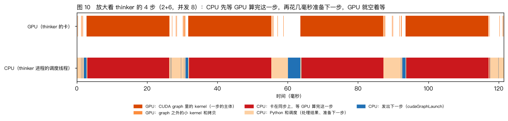

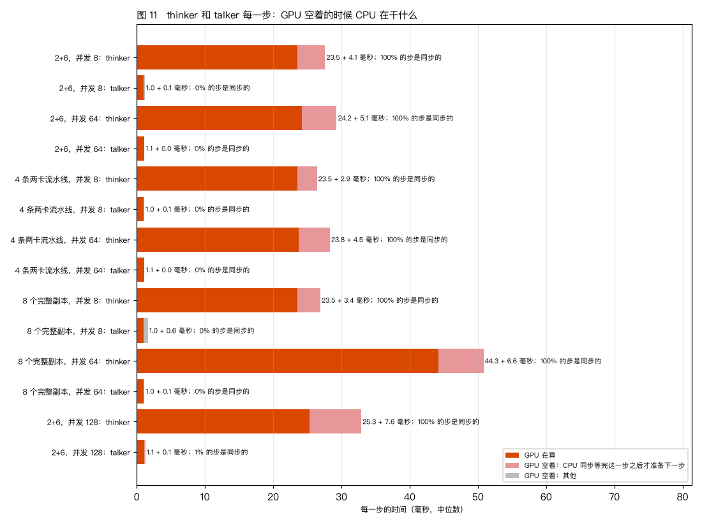

图 10 把 2+6、并发 8 时 thinker 的 4 步放大：
- GPU 一行：深橙色是一步的主体（CUDA graph），中间的白色空隙是 GPU 空着。
- CPU 一行：
  - 红色：CPU 卡在 `cudaStreamSynchronize` 上，等 GPU 算完这一步，每次约 23 毫秒；
  - 浅色：同步返回以后，CPU 处理结果、准备下一步；
  - 蓝色：发出下一步（`cudaGraphLaunch`）。
- GPU 的每个空隙，正好对上 CPU 的“浅色 + 蓝色”。

| 分工、并发 | 进程 | GPU 每步算 | GPU 每步空 | 同步完才准备下一步的步数 | 同步返回到发出下一步 | CPU 线程卡在同步里的时间 |
|---|---|---|---|---|---|---|
| 2+6，并发 8 | thinker | 23.5 毫秒 | 4.1 毫秒 | **100%** | 2.8 毫秒 | 80% |
| 2+6，并发 64 | thinker | 24.2 毫秒 | 5.1 毫秒 | **100%** | 3.8 毫秒 | 74% |
| 2+6，并发 128 | thinker | 25.3 毫秒 | 7.6 毫秒 | **100%** | 5.4 毫秒 | 54% |
| 4 对流水线，并发 8 / 64 | thinker | 23.5 / 23.8 毫秒 | 2.9 / 4.5 毫秒 | 100% | 2.2 / 3.3 毫秒 | 85% / 78% |
| 8 个完整副本，并发 8 / 64 | thinker | 23.5 / **44.3** 毫秒 | 3.4 / 6.6 毫秒 | 100% | 2.7 / 2.5 毫秒 | 83% / 85% |
| 2+6，并发 8 / 64 / 128 | talker | 1.0 / 1.1 / 1.1 毫秒 | 0.15 / 0.03 / 0.11 毫秒 | 0–1% | — | 1% / 27% / 38% |

- 数字是同一段 trace 里各进程中位数的中位数。并发 128 只有 3 秒 trace、38 步。
- **thinker**：
  - 7 段 trace 里，每一步都是“发出 → 同步等到这一步算完 → 准备 → 发出下一步”；
  - 下一步总是在这一步结束 3–8 毫秒以后才发出来；
  - 准备下一步的时间随负载变长：2.2–2.8 毫秒（并发 8）→ 5.4 毫秒（并发 128）。
- **talker**：
  - 几乎没有一步是同步完才准备的；
  - 并发 64 以上，下一步在当前步结束前 0.4–1.0 毫秒就已经发出；
  - 每一步只空几十到一百多微秒。

### 5.6 其他负载

| 负载 | 运行 | 看到的 bubble |
|---|---|---|
| 混合负载（四成请求要语音） | 7 种分工，并发 16–256 | 2+6 到 6+2 的 thinker 卡在并发 256 时有 12–33% 有活却空着。thinker 卡越多，“请求在下游”越多：4+4 28%、5+3 35%、6+2 45%。talker 卡空 13–24%，以等上游为主 |
| Agent 文字负载（并发 256） | 2+6、4+4、4 对流水线、8 个完整副本 | 三种拆分分工的 talker 卡 **100% 空着**（没有要说话的请求，类型 7）；thinker 卡有活却空着 28–37%，2+6 的请求在 thinker 门口排 2.0 秒 |
| 视频（只出文字） | 1、2、4、8 个副本 | GPU 只忙 2–38%；单副本时，请求有 89–97% 的时间在 CPU 预处理（解码视频），GPU 有 86–88% 的时间在等它（类型 3） |
| W3b 开环过载（16–40 请求/秒） | 6 种分工 | 到达速率 ≥ 24 请求/秒时，所有拆分分工的 talker 卡都 93–98% 忙；8 个完整副本 96–99% 忙。这批过载档受过客户端句柄上限的影响，只看 talker 卡忙碌，不细拆 |
| 回放（8 个完整副本） | 14 个回放 | GPU 忙 54–70%。没有服务端事件，不能细拆 |
| 卡间连接（4 对，分别经 NVLink、同一 PCIe 交换机、跨 PCIe 主桥、跨 CPU 插槽） | 2 次 | 传递时间都是约 12 + 5 毫秒，和连接方式无关；开环 15 请求/秒时 talker 卡 95–97% 忙 |

### 5.7 第一轮：并发 128 时 talker 卡被什么占满

第一轮补测的结果（2+6、并发 128，稳定段中的 3 秒 kernel trace）仍然成立，这里只列要点：

| 卡 | 在算（其中和别的进程抢着算） | 有活却空着 | 谁在算 |
|---|---|---|---|
| thinker 卡（GPU 0、1） | 66–68%（0） | 31–34% | thinker |
| talker 卡（GPU 2–7） | **94–97%**（25–33%） | 3–6% | code2wav 73–86%，talker 42–46% |


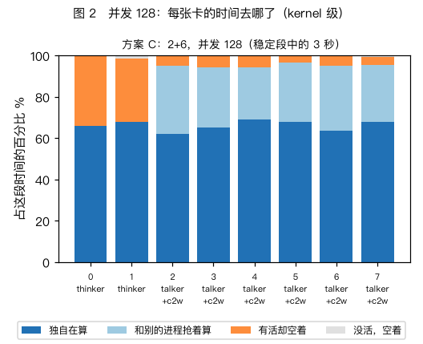

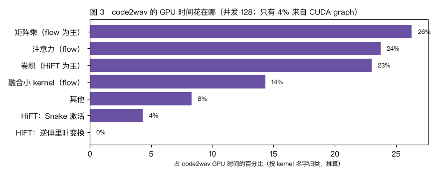

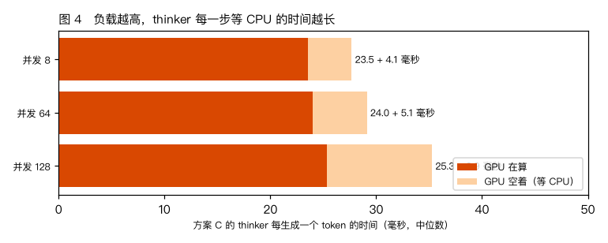

- 前后两段不开 profiler 的对照一致：端到端中位数 4.54 和 4.52 秒，吞吐 20.8 和 21.4 请求/秒。开 profiler 的那段慢约 22%。
- code2wav 的 GPU 时间：
  - flow 约 64%：矩阵乘 26%、注意力 24%、融合小 kernel 14%；
  - HiFT 约 27%。
  - 只有 4% 来自 CUDA graph，实验 1 并发 64 时是 26%。
- 新拆出来的一点：在 profiler 下，code2wav 进程 CUDA 调用的时间里，有 40–50% 花在一个个发 kernel 上（`cuLaunchKernel`、`cudaLaunchKernel`），17–24% 在同步上。profiler 会放大发 kernel 的开销，所以这个比例偏高，只说明方向。
- 图 4 的“每步空着”按另一种方法切步（包括没走 CUDA graph 的步），并发 128 时是 9.9 毫秒。第 5.5 节只算 CUDA graph 的步，是 7.6 毫秒。

### 5.8 估计方法靠不靠得住

没有 kernel trace 的运行，“有活却空着”只能估计：有活比例（服务端事件，实测）− 忙碌比例（nvidia-smi）。在有 kernel trace 的 6 段上，拿同一段数据对照：

| 分工、并发 | 卡 | kernel 实测：在算 / 有活却空着 / 没活 | 估计：在算 / 有活却空着 / 没活 |
|---|---|---|---|
| 8 个完整副本，8 | 全部三段 | 63 / 24 / 13 | 63 / 25 / 12 |
| 8 个完整副本，64 | 全部三段 | 78 / 8 / 15 | 80 / 6 / 14 |
| 4 对流水线，8 | thinker / talker | 62 / 9 / 29；43 / 18 / 40 | 62 / 8 / 30；46 / 13 / 41 |
| 4 对流水线，64 | thinker / talker | 49 / 11 / 40；71 / 9 / 20 | 55 / 5 / 40；71 / 8 / 21 |
| 2+6，8 | thinker / talker | 74 / 14 / 12；29 / 18 / 53 | 67 / 14 / 19；29 / 14 / 56 |
| 2+6，64 | thinker / talker | 51 / 16 / 33；58 / 12 / 30 | 44 / 23 / 33；60 / 11 / 30 |

- “有活却空着”平均差 2.7 个百分点，最大差 7.4 个百分点。所以本报告里没有 trace 的数字，要按 ±7 个百分点理解。
- 最早试过逐个 0.2 秒样本去对，低负载时会高估很多：4 对流水线的 thinker 卡在并发 8 时估成 20%，实测只有 9%。原因是 nvidia-smi 的采样窗口和查询间隔对不齐。改用整档平均后才对得上。
- 第一轮并发 128 的 3 秒窗口里，nvidia-smi 和 kernel 实测差得多（thinker 卡 38–59% 对 66–68%），因为开关 profiler 时进程会停顿。所以 profiler 窗口里的 nvidia-smi 数字不用。

## 6. 为什么出现这个结果

### 6.1 thinker：每一步都在同步，GPU 等 CPU 准备下一步（类型 4，准备本身是类型 3）

- **实测**（7 段 kernel trace）：
  - thinker 的每一步都是：CPU 发出 → CPU 在 `cudaStreamSynchronize` 上一直等到这一步算完 → 处理结果、准备下一步 2.2–5.4 毫秒 → 发出下一步；
  - GPU 每一步空 2.9–7.6 毫秒，占一步的 11–23%；
  - 8 个完整副本在并发 64 时，一步要算 44 毫秒，是抢卡造成的，见第 6.3 节。
- **实测**（源码，sglang-omni 520b49ee）：
  - thinker 和 talker 都运行“提前一步发射”的调度循环：`omni_scheduler.py` 的 `event_loop_async_decode`；
  - 但 thinker 的 `lookahead_eligible`（`sglang_omni/model_runner/thinker_model_runner.py` 第 495 行起）对任何要出语音的请求返回 False。只要一批里有一个这样的请求，整批都退回同步执行；
  - 代码注释给的原因：MiniCPM-o 的语音要在处理结果时读 thinker 的 hidden state，而提前发射的下一步会把它覆盖掉；
  - talker 没有这个限制，所以 talker 每一步几乎不空。
- **实测**：thinker 进程 CPU 占用接近 100%，但大半是在同步里空转。
  - 调度线程有 54–85% 的时间在同步调用里；
  - CUDA 默认用空转等待，所以 CPU 占用跟着 GPU 有多忙走：并发 1 时 25%，并发 128 时 104–107%；
  - 真正干活的只有每步 2–5 毫秒。
- **推算**：
  - 低负载时，thinker 逐字生成占端到端约六成，每一步有 15% 左右空着。去掉这个空档，2+6 并发 8 的端到端能快约 9%（1.26 秒 × 15% ≈ 0.19 秒，约占 2.0 秒的 9%）。
  - 1+7 在并发 128–256 时，thinker 卡约 43% 的时间有活却空着，thinker 每个 token 要 55 毫秒，而 GPU 本身大约 25–28 毫秒就够。
    - 这正是 1+7 撑不住、请求在 thinker 门口排 6.3 秒的原因。
    - 如果每一步的准备都能藏到 GPU 计算后面，一张 thinker 卡能扛的请求可能多出 30% 到将近一倍。
    - 高出多少，取决于大 batch 时 CPU 每步要干的活能不能少于 GPU 一步的时间。
- **未知**：1+7 和 Agent 文字负载没有 kernel trace。
  - 它们的空档里，同步占多少、没走 CUDA graph 的 prefill 步占多少，还不知道。
  - Agent 文字请求不出语音，按代码应该能用上提前一步发射，但它们的 thinker 卡仍有 28–37% 有活却空着。
  - **假设**：Agent 请求提示长、回答短，新请求几乎每一步都在进来，带 prefill 的步会先清空提前发射、改为同步执行（`event_loop_async_decode` 里的 flush 分支）。

### 6.2 talker 卡：真忙，请求在 code2wav 门口排队（类型 2）

- **实测**：
  - 并发 128–256 时，talker 卡 90–97% 的时间在算，有活却空着只有 1–6%，没有可以填的空隙；
  - 请求在 code2wav 门口排队，排队 + 合成占端到端的 62–76%。
- **实测**（第一轮）：
  - talker 卡的 GPU 时间里，code2wav 占 73–86%，talker 占 42–46%，两者有 25–33% 的时间重叠；
  - code2wav 只有 4% 的 GPU 时间走 CUDA graph；
  - 它的 CPU 时间里，发 kernel 和同步占了大头。
- **推算**：第一轮建议“给 code2wav 补录 CUDA graph”，按现在的数据，对吞吐的帮助可能有限。
  - 高负载时 talker 卡已经只空 1–6%。补录 graph 能省 CPU、能填这几个百分点的空隙，但 code2wav 的 kernel 本身要算的量不会变。
  - 要提高吞吐，得减少 code2wav 在 GPU 上的工作量，或者给它更多 GPU。
  - 这是对第一轮的修正。

### 6.3 8 个完整副本：三段抢一张卡（类型 6）

- **实测**（实验 1 的 kernel trace）：
  - 并发 64 时，每张卡 38% 的时间有两个以上进程同时有 kernel 在跑；
  - thinker 一步要算 44 毫秒，独占一张卡时只要 24 毫秒。
- **实测**（事件）：thinker 每个 token 的时间从并发 8 的 27 毫秒涨到并发 256 的 82 毫秒。逐字生成从 1.2 秒变成 3.5 秒，多出的 2.3 秒占并发 256 端到端的 25%。
- 所以 nvidia-smi 显示的 95% 忙碌，有一大块是三个进程轮流用 GPU 造成的“假忙”。

### 6.4 talker 和 code2wav 抢一张卡（类型 6）

- **实测**：talker 卡上两个进程同时有 kernel 在跑的时间，并发 64 时 12%，并发 128 时 25–33%。
- **未知**：抢卡让两边各慢了多少，现有数据分不开。这需要把 code2wav 放到单独的卡上对照（实验 9）。

### 6.5 低负载的流水线空闲、thinker 卡给多了（类型 1、2、7）

- **实测**：
  - 低负载时，talker 卡有 56–64% 的时间空着等 thinker（2+6、1+7，并发 8）。
  - 一个请求先在 thinker 待约 1.3 秒，才轮到 talker 和 code2wav 约 0.7 秒。所以 talker 卡天然有一大半时间等上游。
- **实测**：高负载时，thinker 卡多的分工里，thinker 卡有 16–45% 的时间没活，请求都堵在下游的 talker 和 code2wav：
  - 2+6 16%、4 对流水线 41%、混合负载下 6+2 45%。
  - 闭环测试里，在途请求数是固定的，下游堵住了，上游就收不到新请求。
- **这些都不在关键路径上**：
  - talker 卡等上游时，请求正在 thinker 那里被处理，不是在等；
  - thinker 卡没活时，请求在下游排队，thinker 再快也没用。
  - 它们说明的是卡的分配比例，不是系统的毛病。

### 6.6 传递和 CPU 预处理（类型 5、3）

- **实测**：
  - thinker → talker 的传递 11–24 毫秒，talker → code2wav 4–6 毫秒；
  - 实验 13 把 thinker 和 talker 放在不同连接方式的两张卡上，传递时间都一样。
  - 所以类型 5 可以忽略。
- **实测**：W3b 下 CPU 预处理每个请求 5–60 毫秒，也可以忽略。
- **视频负载例外**：单副本并发 1 时，预处理要 0.58 秒，占端到端 89%；并发 4 时请求在预处理排队，占 97%。GPU 有 86–88% 的时间在等。

### 6.7 还解释不了的（类型 8）

- **低负载时 talker 卡的“有活却空着”**：kernel 实测 18%（2+6、并发 8），但 talker 每一步的空隙只有 0.15 毫秒左右。
  - **假设**：多出来的空档在 code2wav 的“派发 → 完成”之间不跑 GPU 的部分，例如结果拷回 CPU、编码、发送。
  - 高负载时它缩到 1–6%，不影响吞吐。
- **估计误差**：没有 trace 的运行，“有活却空着”有 ±7 个百分点的误差（第 5.8 节）。
- **code2wav 内部的凑批等待**：事件不够，分不出来。

### 6.8 Bubble 根因排序

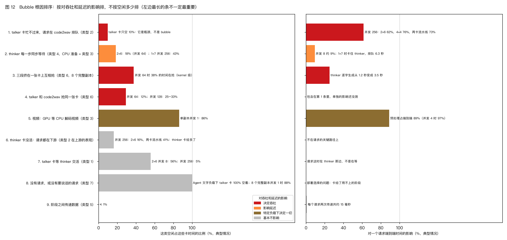

排序按对吞吐和延迟的影响，不按空闲多少：

| 排名 | Bubble | 在哪、什么时候 | 多大 | 影响 | 证据 | 能修吗 |
|---|---|---|---|---|---|---|
| 1 | talker 卡被 code2wav 占满，请求在 code2wav 门口排队（类型 2） | 拆分分工，高负载 | 卡只空 1–6%；排队 + 合成占端到端 62–76% | **决定吞吐和尾延迟** | 事件、kernel trace | 能：给 code2wav 更多 GPU，或减少它的计算量 |
| 2 | thinker 每一步同步等待（类型 4 + 3） | 所有分工、所有负载 | 每一步空 11–23%；1+7 高负载约 43% | 低负载时端到端约 9%；1+7 下决定吞吐 | kernel trace + 源码 | 能：让语音请求也能提前一步发射 |
| 3 | 三段挤一张卡（类型 6） | 8 个完整副本 | 38% 的时间在抢，thinker 一步慢近一倍 | 决定 8 个完整副本的吞吐和延迟 | kernel trace | 能：换成拆分分工 |
| 4 | talker 和 code2wav 抢卡（类型 6） | 拆分分工的 talker 卡 | 12–33% 的时间在抢 | 是第 1 条的一部分，单独影响未测 | kernel trace | 待实验 9 |
| 5 | 视频解码让 GPU 等 CPU（类型 3） | 视频负载 | GPU 86–88% 在等 | 视频负载下决定一切 | 事件 | 能：多开预处理进程 |
| 6 | thinker 卡没活，请求堵在下游（类型 2 的上游表现） | thinker 卡多的分工，高负载 | 16–45% | 不在关键路径上 | 事件 | 少给 thinker 卡 |
| 7 | talker 卡等 thinker（类型 1） | 低负载 | 56–64% | 不在关键路径上 | 事件 | 不必修 |
| 8 | 没有请求或没有要说话的请求（类型 7） | 低并发；Agent 文字负载 | 最高 100% | 不在关键路径上 | 事件 | 按负载选分工 |
| 9 | 阶段之间传数据（类型 5） | 全部 | ≤ 1% | 端到端不到 1% | 事件、实验 13 | 不必修 |

### 6.9 更正第一轮的两个说法

1. 第一轮第 6.3 节说“thinker 负载越高越受 CPU 限制”。
   - **更准确的说法**：thinker 被同步卡住。
   - CPU 占用接近 100%，大半是空转等 GPU。
   - 真正的问题是 CPU 的准备工作没法和 GPU 计算同时进行，因为语音请求关掉了提前一步发射。
2. 第一轮第 7 节说“每个阶段进程都只能用一个 CPU 核，下一个天花板会是 CPU”。
   - **对 thinker 不成立**：它每步真正干活只有 2–5 毫秒。
   - code2wav 发 kernel 的 CPU 开销确实大，但它的 GPU 已经占满了 talker 卡，CPU 不是眼下的瓶颈。

## 7. 这说明什么

**8 张 GPU 哪里浪费最多时间？**
- **按空闲的卡时间算**，最多的是低负载时的 talker 卡、文字负载下的 talker 卡、以及给多了的 thinker 卡。但这些空闲不拖慢请求，换分工或按负载选分工就能处理。
- **真正“有活却空着”的**，最大的是 thinker 卡：每一步空 11–23%，只有 1 张 thinker 卡时高达约 43%。
- **8 个完整副本**看着最忙，其实大量时间花在三段抢卡上。

**为什么会浪费？**
- thinker 对语音请求必须同步执行，CPU 准备下一步时 GPU 只能等。
- 高负载时，talker 卡被 code2wav 的计算占满，请求只能排队。这不是空闲，是真忙。
- 剩下的空闲，大多是分工比例或负载类型造成的“没活”。

**哪个问题最值得优先解决？**
- **想提高吞吐**：要解决 talker 卡上 code2wav 的计算量，或者给它更多卡。这是真正的瓶颈，但它不是 bubble，补录 CUDA graph 这类“填空隙”的办法帮助有限。
- **想去掉 bubble**：最值得先修的是 thinker 的同步执行。
  - 所有分工、所有负载都有它，而且在关键路径上；
  - 原因已经在代码里找到；
  - 修好以后 thinker 卡能扛更多请求，可能让 1+7 变得可行。这样就能多出一张卡给真正的瓶颈 talker 一侧（推算）。

## 8. 接下来做什么

最值得做的一步：**先用一个不改代码的对照，量出“让 thinker 提前一步发射”最多能省多少。**

- **做法**：
  - 同一个 2+6 服务，同样的提问，一组只要文字回答（这时 thinker 可以提前一步发射），一组要文字 + 语音（现在的同步方式）；
  - 在并发 8、32、64 各开几秒 kernel trace，比较 thinker 每一步的空档。
- **要注意**：只要文字时 thinker 也少了给 talker 准备 hidden state 的工作，所以测出的是改动能达到的上限。
- **成本**：约 15 分钟 8 卡时间，用 Job 454290 现在空着的卡即可。
- **之后**：如果上限明显，再改 sglang-omni，给 hidden state 留一份不被下一步覆盖的副本，让语音请求也能提前一步发射。同时检查输出的语音和改之前完全一致。

## 9. 文件在哪里

| 内容 | 路径 |
|---|---|
| 本报告 | `research/01_性能瓶颈/实验05_GPU为什么会等待/README.md` |
| 图 1–4（第一轮） | `figures/fig1`–`fig4`，由 `scripts/analysis/exp05_talker.py` 生成 |
| 图 5–9、12（普查、关键路径、排序） | `figures/fig5`–`fig9`、`fig12`，由 `scripts/analysis/exp05_bubble_figures.py` 生成 |
| 图 10–11（thinker、talker 每一步） | `figures/fig10`、`fig11`，由 `scripts/analysis/exp05_step_sync.py` 生成 |
| 普查结果：每个运行、每个负载档、每张卡 | `results/bubble_census.json`，由 `scripts/analysis/exp05_bubble_census.py` 生成 |
| 每一步的拆分 | `results/step_sync.json` |
| 报告里引用的汇总数字 | `results/bubble_summary.json`；第一轮的在 `results/summary.json` |
| 编号、内部 ID、Job、代码版本 | `metadata.json` |
| 源码依据 | sglang-omni 520b49ee：`sglang_omni/model_runner/thinker_model_runner.py`（`lookahead_eligible`）、`sglang_omni/scheduling/omni_scheduler.py`（`event_loop_async_decode`）、`sglang_omni/models/minicpm_o/bootstrap.py`（talker 打开提前一步发射） |
| 原始数据和 trace | 集群 `results/experiments/<运行目录>`，Mac 有镜像，不在仓库里（trace 带机器名和路径） |

复现（`<镜像>` 是放 `experiments/` 的目录）：

```bash
python scripts/analysis/exp05_bubble_census.py --data-root <镜像> --out research/01_性能瓶颈/实验05_GPU为什么会等待
python scripts/analysis/exp05_step_sync.py --data-root <镜像> \
    --run A=20261117_exp01_prof_r8_run01 --run B=20261117_exp01_prof_p4_run01 \
    --run C=20261117_exp01_prof_s2x6_run01 --run C128=20261117_exp05_talker_s2x6_run01 \
    --out research/01_性能瓶颈/实验05_GPU为什么会等待
python scripts/analysis/exp05_bubble_figures.py --out research/01_性能瓶颈/实验05_GPU为什么会等待 \
    --exp01 research/01_性能瓶颈/实验01_8张GPU在做什么/results/kernel_summary.json
```
