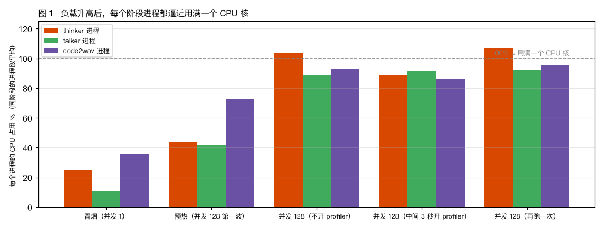

# 实验 5：GPU 为什么会等待（第一轮：高负载时的 talker 卡）

> **状态：第一轮（2026-11-17）。** 一次补测，2+6 分工、并发 128，在 compute-03 上运行（Job 454290）。结果是**初步**的：只跑了 1 次，但前后两段对照一致（第 5.1 节）。

## 先认识几个词

**CPU 受限（CPU-bound）**
- **是什么**：一个程序的速度被 CPU 卡住了，不是被 GPU 卡住。GPU 想干活，但要等 CPU 把下一批命令准备好、发过来。
- **为什么会发生**：这些服务进程是 Python 写的。Python 有一把“全局锁”，同一时刻一个进程里只有一个线程能真正在跑 Python 代码，所以一个进程最多只能用满约一个 CPU 核。
- **例子**：一个厨师（CPU）给一台很快的烤箱（GPU）备料。烤箱 5 分钟就烤好一盘，厨师备一盘料要 6 分钟，烤箱就有 1 分钟在等。
- **在这里**：如果某个阶段的进程 CPU 占用接近 100%（一个核），而它的 GPU 还常常空着，说明这个阶段是被 CPU 卡住的。

**CUDA graph 的“形状”**
- CUDA graph 是先录下来的一串 kernel（见实验 1）。录的时候，输入的大小（形状）是固定的，比如“2 个请求、每个 600 帧”。
- 运行时，如果这一批的形状在录过的范围内，就直接回放 graph，又快又省 CPU；超出范围，就只能由 CPU 一个一个地发 kernel。

## 1. 一句话解释

高负载时，2+6 分工的 talker 卡和 thinker 卡各自被什么卡住：是 GPU 算不过来，还是 CPU 跟不上。

## 2. 为什么做

- 实验 1 和实验 2 发现：高负载时，几乎所有分工都是 talker 那一侧先撑不住。
- 但实验 1 只测了并发 8 和 64，而且并发 64 那段只有一波请求、没有稳定段。也看不出 talker 卡满了是因为 talker 本身、code2wav，还是 CPU。
- 解决办法完全取决于原因：GPU 算不过来就要减少计算或加卡；CPU 跟不上就要减少 CPU 开销或多开进程。

## 3. 实验怎么运行

- **分工**：方案 C，2 张 thinker 卡 + 6 张 talker 卡（talker + code2wav），一个服务。
- **负载**：W3b（文字提问，文字 + 语音回答），闭环并发 128。
- **按顺序跑五段**，吸取了实验 1 补测的教训：
  1. 冒烟测试，2 个请求；
  2. 预热：在并发 128 下先跑一波（128 个请求），不记录；
  3. 稳定段，不开 profiler：每段 384 个请求（另加 128 个预热）；
  4. 同样的稳定段，从第 12 秒起开 3 秒 torch profiler；
  5. 再跑一次不开 profiler 的稳定段，检查先后顺序有没有影响。
- **新加的测量**：每秒记录每个进程的 CPU 占用，按进程号对应到它属于哪个阶段。以前只能看到整个服务的总和。
- **新加的功能**：只在稳定段中间开几秒 profiler。高负载下整段都开的话，一个 talker 进程每秒就要写约 110 MB 的 trace。
- **运行**：2026-11-17 01:46–01:50，内部代号 `exp05_talker_s2x6`，代码版本 90fbbc2。没有失败的请求。

## 4. 我们测量什么

| 指标 | 一句话解释 |
|---|---|
| 每个进程的 CPU 占用 | 100% 表示用满一个 CPU 核 |
| 每张卡的时间去向 | kernel 级：独自在算、和别的进程抢着算、有活却空着、没活空着 |
| code2wav 的 GPU 时间构成 | 按 kernel 名字归到 flow 和 HiFT 的各部分（推算） |
| thinker 每一步的“算 + 空” | 和实验 1 的并发 8、64 对比 |
| 端到端延迟和吞吐 | 前后两段对照，检查先后顺序和 profiler 的影响 |

## 5. 实验结果

### 5.1 前后两段对照一致（实测）

| 段 | 端到端中位数 | 端到端 p90 | 吞吐（请求/秒） |
|---|---|---|---|
| 并发 128，不开 profiler | 4.54 秒 | 5.82 秒 | 20.8 |
| 并发 128，中间开 3 秒 profiler | 5.61 秒 | 9.90 秒 | 16.3 |
| 并发 128，再跑一次 | 4.52 秒 | 5.86 秒 | 21.4 |

- 两段不开 profiler 的结果几乎一样，所以先后顺序没有影响。
- 开 profiler 的那段慢了约 22%，因为 profiler 本身的开销加上 trace 导出和后面的请求重叠。
- 有了预热和更长的稳定段，并发 128 的吞吐（20.8–21.4）比第一批测到的 18.3–18.7 高。

### 5.2 每个阶段进程都逼近用满一个 CPU 核（实测）

| 段 | thinker 进程 | talker 进程 | code2wav 进程 |
|---|---|---|---|
| 冒烟（并发 1） | 25% | 11% | 36% |
| 预热（第一波） | 44% | 42% | 73% |
| 并发 128（不开 profiler） | **104%** | **89%** | **93%** |
| 并发 128（再跑一次） | **107%** | **92%** | **96%** |

- 低负载时 CPU 占用不高，所以这些进程并不是在空转“忙等”。负载上去以后，每个进程都逼近一个核的上限。
- 整个服务一共用了约 14 个核，而这一步分到了 54 个核。所以不是 CPU 总量不够，而是每个 Python 进程只能用一个核。

### 5.3 每张卡的时间去哪了（kernel 级，稳定段中的 3 秒）

| 卡 | 在算（其中和别的进程抢着算） | 有活却空着 | 各阶段有 kernel 在跑的时间 |
|---|---|---|---|
| thinker 卡（GPU 0、1） | 66–68%（0） | **31–34%** | thinker 66–68% |
| talker 卡（GPU 2–7） | **94–97%**（25–33%） | 3–6% | code2wav **73–86%**，talker 42–46% |

### 5.4 code2wav 的 GPU 时间花在哪（推算，按 kernel 名字归类）

- flow 部分约 64%：矩阵乘 26%、注意力 24%、融合小 kernel 14%。
- HiFT 部分约 27%：卷积 23%、Snake 激活 4%。
- 只有 **4%** 的 GPU 时间来自 CUDA graph。实验 1 并发 64 时这个比例是 26%。

### 5.5 thinker 每一步等 CPU 的时间随负载变长（实测）

| 并发 | GPU 在算 | GPU 空着 | 空着的占比 |
|---|---|---|---|
| 8（实验 1） | 23.5 毫秒 | 4.1 毫秒 | 15% |
| 64（实验 1） | 24.0 毫秒 | 5.1 毫秒 | 18% |
| 128（本实验） | 25.3 毫秒 | 9.9 毫秒 | **28%** |

## 6. 为什么出现这个结果

### 6.1 talker 卡：真的被 GPU 工作占满了，大头是 code2wav

- **实测**：
  - 高负载时，talker 卡 94–97% 的时间有 kernel 在跑，“有活却空着”只有 3–6%。
  - code2wav 的 kernel 在 73–86% 的时间里在执行，talker 在 42–46% 的时间里在执行，两者有 25–33% 的时间在抢同一张卡。
- **结论**：这时 talker 卡的瓶颈是 GPU 时间。最大的用户是 code2wav，而 talker 和 code2wav 两个进程还在互相抢卡（Bubble 类型 6）。
- **改正实验 1 的推测**：实验 1 在低负载下看到“talker 手上有活时约四成时间空着”，当时推测 talker 受 CPU 限制。高负载时情况不同：talker 卡几乎没有空着。低负载时的空档并不是高负载瓶颈的原因。

### 6.2 code2wav：高负载时几乎没用上 CUDA graph，CPU 也被打满

- **实测**：
  - 并发 128 时，code2wav 只有 4% 的 GPU 时间来自 CUDA graph，并发 64 时是 26%。
  - 每个 code2wav 进程的 CPU 占用是 93–96%。
- **假设**：sglang-omni 只为 flow 的部分输入形状预先录了 CUDA graph。2–5 个请求合成一批时，最长的形状约 688–768 帧。
  - 并发 128 时，code2wav 常常 2–5 个请求一批，每个请求 400 多个语音编码 token。如果按每个 token 约 2 帧换算，会超出录过的范围。
  - 超出后只能由 CPU 一个一个地发 kernel：GPU 多了空隙，CPU 也被占满。
- **还不知道**：
  - code2wav 还有另一条“打包变长”的 graph 路径，有自己的形状表。高负载时走的是哪一条、为什么没命中，要读代码确认。
  - 帧数的换算也要核实。

### 6.3 thinker：负载越高，越受 CPU 限制

- **实测**：
  - 并发 128 时，thinker 卡有 31–34% 的时间“有活却空着”。
  - thinker 每一步空 9.9 毫秒，是并发 8 时的 2.4 倍。
  - thinker 进程的 CPU 占用在 104–107%。
  - 每一步来自 CUDA graph 的 kernel 从约 90% 降到 63–69%。
- **假设**：
  - batch 里的请求越多，CPU 每一步要为每个请求做的事越多。
  - 高负载时新请求不断进来，它们的 prefill（读入提示）没有走 CUDA graph，CPU 要发的 kernel 也更多。
- **意义**：2+6 分工在并发 128 时，thinker 还不是瓶颈（TTFT 正常）。但它说明 thinker 的速度上限一部分卡在 CPU 上。

### 6.4 Bubble 分类小结

| 卡 | 主要的 Bubble | 类型 |
|---|---|---|
| talker 卡 | 几乎没有空闲；有 25–33% 的时间 talker 和 code2wav 在抢卡 | 类型 6：GPU 资源争用 |
| thinker 卡 | 31–34% 的时间有活却空着，CPU 跟不上 | 类型 3：CPU / 调度 |
| 所有阶段进程 | CPU 都逼近一个核的上限 | 进一步提速的潜在天花板 |

## 7. 这说明什么

1. **高负载时，吞吐的瓶颈在 talker 卡的 GPU 时间上，其中 code2wav 是大头。** 加 talker 卡（实验 2 已经看到）或让 code2wav 更省 GPU，才能提高吞吐。
2. **code2wav 高负载时几乎没有用上 CUDA graph。** 如果让 graph 覆盖高负载下真实出现的形状，code2wav 的 CPU 和 GPU 开销都可能下降。这是一个改动小、目标明确的优化方向。
3. **每个阶段进程都只能用一个 CPU 核。** 即使 GPU 问题解决了，下一个天花板也会是 CPU。到时候可以考虑把一个阶段拆成更多进程。
4. **单纯把 code2wav 搬到别的卡（实验 9）帮助可能有限**：talker 一侧的 6 张卡已经几乎被占满，搬走只能减少两个进程抢卡的损失，总的计算量并不变。这个判断还要实验 9 验证。

## 8. 接下来做什么

最值得做的一步：**弄清 code2wav 在高负载下为什么没用上 CUDA graph，然后按实际的 batch 形状补录 graph，再测一次并发 128。** 这是第一个针对实测瓶颈的优化实验（属于优化方向 E：调度和同步优化）。

1. 先读 sglang-omni 的 code2wav 代码，确认高负载时走的是哪条 graph 路径、形状怎么匹配。这一步不占 GPU。
2. 再把 graph 的形状范围扩大，用同样的设计跑一次，对比 code2wav 的 CPU 占用、graph 覆盖比例、talker 卡的时间分配和吞吐。
3. 要注意：录更多 graph 会多占显存，2+6 分工的 talker 卡现在约用到 42 GiB（共 48 GiB）。

## 9. 文件在哪里

| 内容 | 路径 |
|---|---|
| 本报告 | `research/01_性能瓶颈/实验05_GPU为什么会等待/README.md` |
| 图 1–4 | `research/01_性能瓶颈/实验05_GPU为什么会等待/figures/` |
| 报告里的数字 | `research/01_性能瓶颈/实验05_GPU为什么会等待/results/summary.json` |
| 编号、内部 ID、Job、代码版本 | `research/01_性能瓶颈/实验05_GPU为什么会等待/metadata.json` |
| 分析脚本 | `scripts/analysis/exp05_talker.py`（用到 `scripts/analysis/exp01_kernel_timeline.py`） |
| 实验配置 | `configs/experiments/plan_a6000_8gpu_exp05.json`、`configs/experiments/a6000_8gpu_v2/exp05_talker_s2x6.json` |
| 新功能（短窗口 profiler、逐进程 CPU） | `src/omni_research/orchestration/experiment.py`，测试在 `tests/test_experiment_runner.py` |
| 原始数据和 trace | 集群 `results/experiments/20261117_exp05_talker_s2x6_run01`，Mac 镜像同名目录（不在仓库里） |

复现：`python scripts/analysis/exp05_talker.py --data-root <结果镜像目录> --run 20261117_exp05_talker_s2x6_run01 --exp01 research/01_性能瓶颈/实验01_8张GPU在做什么/results/kernel_summary.json --out research/01_性能瓶颈/实验05_GPU为什么会等待`
