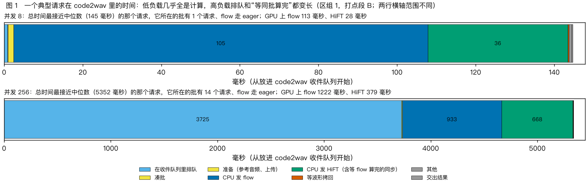
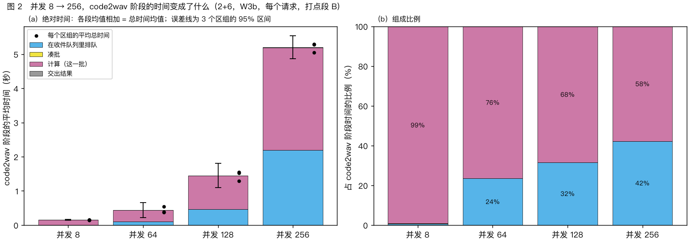
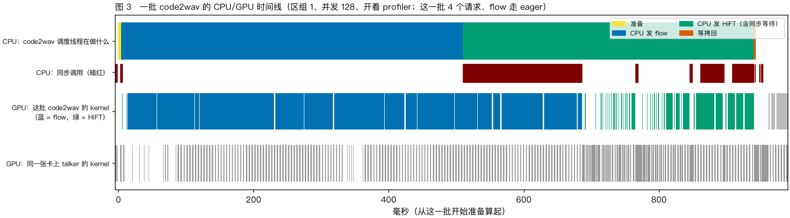
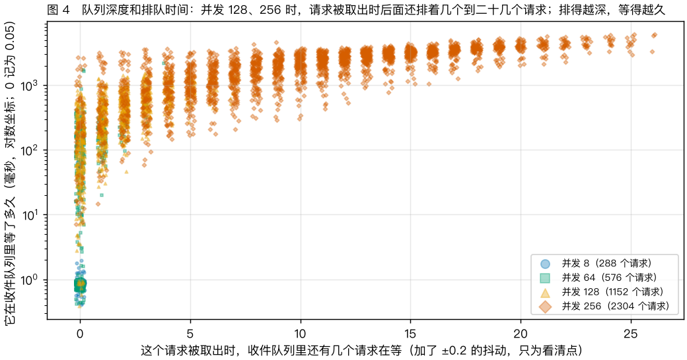
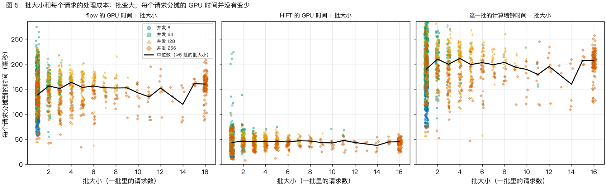
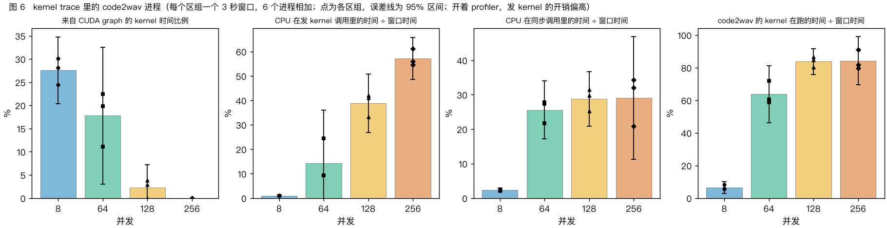

# 实验 6：Code2Wav 的时间到底花在哪里？

> **状态：完成（2026-11-17）**
> - 2+6 分工，并发 8、64、128、256。3 个独立区组，每个区组是一次单独启动的服务。
> - 用了打点版 sglang-omni：在 520b49ee 上加了测量补丁。
> - 事先登记的假设和判定标准在 [hypotheses.md](hypotheses.md)，限制和失败在 [limitations.md](limitations.md)。

## 第一部分：一句话

code2wav 每个请求要固定花约 0.2 秒的 GPU 计算，凑批也省不下来，还要和 talker 抢卡。所以 6 个副本一饱和，每个请求的时间就从 0.15 秒涨到 5.2 秒：42% 在排队，58% 在等同批的请求一起算完。

## 第二部分：为什么要做

- 实验 5 在 2+6 分工下看到：code2wav 阶段（派发 → 完成）的中位数，并发 8 时约 0.16 秒，并发 256 时约 5.56 秒，涨了 30 多倍。
- 这段时间是请求在 code2wav 里的全部停留时间。实验 5 的数据分不开其中有多少是在门口排队，多少是真的在算。
- 不同的原因要不同的修法：
  - 排队多，说明处理能力不够，要加卡或者让每个请求算得更快；
  - CPU 发命令慢，要减少发命令的次数，比如用 CUDA graph；
  - 和 talker 抢卡，要分开放（实验 7 专门测这一条）。

## 第三部分：先学几个概念

每个概念按三步讲：先一句话，再一个生活中的例子，最后说在 MiniCPM-o 的代码里它指什么。

**队列（queue）**
- **一句话**：活来得比做得快时，排着等的那一列。
- **例子**：奶茶店只有一个店员，客人进门先排队，排队的时间不算做奶茶的时间。
- **在这里**：每个 code2wav 进程有一个“收件队列”（`SimpleScheduler.inbox`）。talker 交来的请求先放进去，code2wav 的调度线程空下来才去取。

**凑批（batching）和批大小（batch size）**
- **一句话**：把几个请求放在一起一次处理；一次处理几个，就是批大小。
- **例子**：店员一次做 4 杯，比一杯一杯做省时间，前提是 4 杯能一起做。
- **在这里**：code2wav 每次从队列里取出第一个请求后，再顺手把已经在排的请求一起取走，最多 16 个，或者编码 token 总数到上限为止。之后一整批一起算。

**Kernel 和“发 kernel”（kernel launch）**
- **一句话**：kernel 是 GPU 上执行的一个小计算任务；“发 kernel”是 CPU 告诉 GPU“去做这个”的那一下。
- **例子**：厨师长（CPU）一张一张地给厨房（GPU）递菜单。递得太慢，厨房做完手上的菜就会闲着。
- **在这里**：code2wav 的 flow 部分跑一次要发几千到几万个 kernel。每发一个，CPU 都要花几微秒到几十微秒。

**CUDA graph**
- **一句话**：把一长串 kernel 先录成一张“菜单合集”，之后 CPU 只递一次，GPU 就能把整串做完。
- **例子**：把每天一样的 20 道菜写成一张套餐单，一次递过去。
- **在这里**：
  - code2wav 只为 flow 录了少数几种“形状”：一批 1 个请求时最多 1024 帧；一批 2–5 个请求时最多约 768 帧。
  - 这一批的形状落在录过的范围里，才能走 graph；否则只能一个一个地发 kernel，源码里叫 eager。

**同步（synchronize）**
- **一句话**：CPU 停下来，等 GPU 把排在前面的活做完。
- **例子**：厨师长站在厨房门口等菜出锅，这段时间不去写下一张菜单。
- **在这里**：
  - code2wav 每一批最后把波形拷回 CPU（`.cpu()`），这一步必然要同步；
  - 本实验还发现 HiFT 开头有同步，见第六部分。

**GPU 争用（contention）**
- **一句话**：两个进程共用一张 GPU，它们的 kernel 只能轮流或分享着跑，每一方都变慢。
- **例子**：两个厨师共用一个灶台。
- **在这里**：2+6 分工里，GPU 2–7 每张卡上同时有一个 talker 进程和一个 code2wav 进程。

**CUDA event（我们怎么测 GPU 时间）**
- **一句话**：往 GPU 的任务队列里插一个“打卡点”，GPU 做到那里时记下时间。
- **例子**：在流水线上放一个计时器，产品经过时按一下。
- **在这里**：
  - 我们在 flow 前后、HiFT 之后各插一个打卡点；
  - 等这一批本来就要做的那次同步之后再读，所以不额外让 CPU 等 GPU。
  - 要注意：打卡点之间的时间也包含 GPU 轮流去跑 talker kernel 的时间。所以它是“这段工作在 GPU 上从开始到结束的跨度”，不是 code2wav 独占 GPU 的时间。

**Profiler 的开销**
- **一句话**：录下每个 kernel 的工具本身也要花时间，会让被测系统变慢。
- **在这里**：
  - 只在中间开 3 秒 torch profiler（C 段）；
  - 正式的吞吐和延迟只用不开 profiler 的 A 段；
  - B、C 两段相对 A 段慢了多少，见第六部分。

**闭环并发（closed-loop concurrency）**
- **一句话**：客户端始终保持固定数量的请求在服务里，完成一个立刻补一个。
- **例子**：一家店里始终有 64 位客人，走一位进一位。
- **在这里**：并发 256 表示同时有 256 个请求在系统里。系统越慢，每个请求停留越久，但同时在场的请求数不变。

## 第四部分：我们究竟怎么做实验

### 4.1 用了哪几张 GPU、每张卡上有什么

| GPU | 进程 |
|---|---|
| 0、1 | 各一个 pipeline 进程：预处理 + thinker（写文字）+ 文字解码 |
| 2–7 | 各一个 talker 进程（生成语音编码）+ 一个 code2wav 进程（把编码变成波形） |

- 一共 2 个 pipeline 进程、6 个 talker 进程、6 个 code2wav 进程，外加一个协调进程。
- 每个请求进来时，各阶段按轮转挑一个副本。

### 4.2 负载和并发

- **负载**：W3b，文字提问，模型用文字 + 语音回答。最多 64 个文字 token，语音约 8–17 秒。
- **并发**：8、64、128、256。8 是低负载；64、128 是实验 5 里开始排队的区间；256 是饱和。
- **每个并发档**：先跑一波预热（并发数个请求，不计入），然后依次跑三段，每段测 max(96, 3 × 并发) 个请求。
  - **A 段**：不打点、不开 profiler。用来测正式的吞吐和延迟。
  - **B 段**：打点。每个 code2wav 请求和每一批都写事件，用来拆时间。
  - **C 段**：打点，并在中间开 3 秒 torch profiler，录下 kernel。
- **一个区组**：一次独立启动的服务，把 4 个并发档都跑一遍。
  - 并发档的顺序在区组内随机，种子 20261117：区组 1 是 128、256、64、8；区组 2 是 64、8、256、128；区组 3 是 256、8、64、128。
  - A、B、C 的先后在区组之间轮换（ABC、BCA、CAB），平衡先后顺序的影响。
- **重复**：3 个区组，2026-11-17 14:58–15:37（美东），同一台节点（compute-03），Slurm Job 454290。

### 4.3 用什么工具、每个数怎么算

**打点**：
- 补丁文件是 `configs/runtime/patches/sglang_omni_instr_exp06_08.patch`；
- 只有设了环境变量、而且这一段开了事件记录时才写；
- 用的时钟和 sglang-omni 自带的事件相同（墙钟纳秒）。

每个请求在 code2wav 里依次经过这些时刻：

```
放进收件队列 ─排队─▶ 被调度线程取出 ─凑批─▶ 这一批凑齐、开始计算 ─计算─▶ 这一批算完 ─交出─▶ 结果交给下一站
```

- 总时间 = 排队 + 凑批 + 计算 + 交出，四段首尾相接，可以相加。（实测）
- 计算这一段由这一批共享，再拆成 CPU 上依次发生的几步：准备参考音频和上传、发 flow、发 HiFT、等波形拷回、拆分和后处理。这几步发生在同一个线程上，可以相加。（实测）
- GPU 时间用 CUDA event 测：flow 和 HiFT 各自在 code2wav 那条 stream 上的跨度。它们和 CPU 各步在时间上重叠，**不能**和 CPU 各步相加。（实测）
- 一批的 GPU 时间只算一次，不按请求重复累加。“每个请求分摊”是批的时间 ÷ 批大小。（推算）

**kernel trace（C 段）**：torch profiler 只能录到启动它的那个线程里的 CPU 范围，code2wav 的计算在另一个线程上。所以：
- 先用打点事件里“发 flow”“发 HiFT”的 CPU 时间区间；
- 再看 trace 里每个 kernel 是哪个 CUDA 调用发出的；
- 由此判断这个 kernel 属于 flow 还是 HiFT。

两个时钟对得上吗？3 个区组共 182 批：打点事件里“波形拷回结束”的时刻，比 trace 里对应那次拷贝调用的结束时刻晚，中位数 39 微秒，范围 22–86 微秒。这段差值里还包括 Python 取时间戳的开销，所以对齐误差在 0.1 毫秒以内。（实测）

**GPU 忙碌比例**：nvidia-smi 每 0.2 秒采样一次。

**统计方法**：
- 以“一个区组”为一个独立样本，请求不算独立样本（同一次运行里的请求互相影响）；
- 表里的数是 3 个区组的均值，方括号里是基于 t 分布的 95% 区间（自由度 2，所以区间很宽），后面列出每个区组的原始值；
- 只有 3 次重复，不声称统计显著。

## 第五部分：每张图怎么读

### 图 1　一个典型请求的时间拆解



- **横轴**：从请求放进 code2wav 收件队列开始的毫秒数。上下两行的横轴范围不同，下面那行是上面的 30 多倍长。
- **颜色**：浅蓝 = 排队，黄 = 凑批或准备，深蓝 = CPU 发 flow，绿 = CPU 发 HiFT（包含等 flow 算完的同步），橙 = 等波形拷回，灰 = 其他和交出。
- **选哪个请求**：区组 1 里，总时间最接近这一档中位数的那个请求。
- **最重要的数**：
  - 并发 8：145 毫秒里几乎全是计算。flow 105 毫秒，HiFT 36 毫秒。
  - 并发 256：5352 毫秒里，排队 3725 毫秒，它所在的那一批（14 个请求）发 flow 933 毫秒、发 HiFT 668 毫秒。
- **说明**：高负载时，一个请求大部分时间在排队，剩下的时间在等自己这一大批算完。
- **不能说明**：一个请求只是一个例子，分布要看图 2。

### 图 2　四个并发下各段时间的对比



- **左图**：
  - 横轴是并发档，纵轴是 code2wav 阶段每个请求的平均时间（秒）。
  - 每种颜色是一段（排队、凑批、计算、交出）。用均值是因为均值可以相加：各段均值之和等于总时间均值。
  - 黑点是每个区组的平均总时间；误差线是 3 个区组的 95% 区间。
- **右图**：同样的数换成比例。
- **最重要的数**：并发 256 时平均 5.2 秒，其中排队 42%、计算 58%；并发 8 时 99% 是计算。
- **不能说明**：
  - “计算”里有多少是 GPU 在算、多少是 CPU 在发命令，要看图 3、图 6；
  - 中位数和尾部，在第六部分的表里。

### 图 3　一批的 CPU/GPU 时间线



- **横轴**：从这一批开始准备算起的毫秒数。
- **第一行**：CPU，也就是 code2wav 调度线程，在做哪一步。
- **第二行**：CPU 卡在同步调用里的时间（暗红）。
- **第三行**：这一批的 code2wav kernel 在 GPU 上运行的时间。蓝 = flow，绿 = HiFT，灰色 = 不属于这一批。
- **第四行**：同一张卡上 talker 的 kernel（灰）。
- **这一批**：区组 1、并发 128、开着 profiler，4 个请求，flow 逐个发 kernel。
- **看到什么**：
  - CPU 用约 500 毫秒发完 flow；
  - GPU 上 flow 的 kernel 一直跑到约 680 毫秒；
  - CPU 一进入 HiFT 就卡在同步上，直到 flow 在 GPU 上算完；
  - 之后 HiFT 按长度分了几组，每组之间 CPU 又同步，GPU 上 HiFT 的 kernel 一段一段地断开；
  - talker 的 kernel 在整个过程中不断插进来。
- **不能说明**：
  - 这是开着 profiler 的一批，发 kernel 会比平时慢；
  - 只是一个例子，统计在图 6。

### 图 4　队列深度和排队时间



- **横轴**：这个请求被取出时，队列里还剩几个请求在等。为了看清点，加了一点左右抖动。
- **纵轴**：它在队列里等了多久，对数坐标，0 记为 0.05 毫秒。
- **颜色和形状**：并发档。
- **最重要的数**：并发 256 时，请求被取出时后面常常还排着几个到二十几个请求，排队时间 1–5 秒，排得越深等得越久。
- **说明**：排队是因为前面的批还没算完，后面的请求只能等。
- **不能说明**：队列为什么不能更快地清空，要看图 5（每个请求的成本）。

### 图 5　批大小和每个请求的处理成本



- **横轴**：一批里有几个请求，最多 16 个。
- **纵轴**：每个请求分摊到的时间（毫秒）。三幅图依次是 flow 的 GPU 时间、HiFT 的 GPU 时间、整批计算的墙钟时间，各自除以批大小。
- **颜色和形状**：并发档。黑线是每种批大小的中位数，只画有 ≥ 5 批的批大小。
- **最重要的数**：不管一批是 1 个还是 16 个请求，每个请求分摊的 flow GPU 时间都在 140–160 毫秒，HiFT 约 45 毫秒，整批计算约 200 毫秒。
- **说明**：凑批没有让每个请求变便宜，只让请求多等了同批的其他请求。
- **不能说明**：
  - 批大小不是我们控制的，而是由负载决定的，所以这是相关关系；
  - 高负载时批大，同时争用也重，两者混在一起。

### 图 6　kernel trace 里的统计



- **四幅图**，横轴都是并发档，点是各区组的值，误差线是 95% 区间：
  - 来自 CUDA graph 的 kernel 时间比例；
  - CPU 在发 kernel 调用里的时间 ÷ 窗口时间；
  - CPU 在同步调用里的时间 ÷ 窗口时间；
  - code2wav 的 kernel 在跑的时间 ÷ 窗口时间。
- **最重要的数**：
  - 从并发 8 到 256，走 graph 的比例从 28% 降到 0；
  - 发 kernel 的时间比例从 1% 涨到 57%；
  - 同步比例从 2% 涨到 29%；
  - code2wav 的 kernel 在 84% 的时间里在跑。
- **不能说明**：
  - 开着 profiler，发 kernel 的开销被放大，这些比例只用来看趋势；
  - 3 个 C 段里有一个 code2wav 进程崩溃，它的 trace 缺失，统计只用其余 5 个进程：区组 1 的并发 64、区组 2 和区组 3 的并发 128。详见 limitations.md。

## 第六部分：结果到底意味着什么

### 6.1 实际测到了什么

**正式性能（A 段，不打点、不开 profiler）**

| 并发 | 吞吐（请求/秒） | 端到端 P50 / P95 / P99（秒） | talker 卡忙碌 | thinker 卡忙碌 |
|---|---|---|---|---|
| 8 | 3.68 [3.45, 3.91]（3.77、3.67、3.59） | 2.00 / 2.73 / 2.85 | 35% | 82% |
| 64 | 15.9 [14.7, 17.2]（15.9、15.4、16.4） | 2.99 / 4.04 / 4.43 | 83% | 66% |
| 128 | 20.1 [16.9, 23.4]（18.6、21.0、20.7） | 4.57 / 6.97 / 7.63 | 77% | 59% |
| 256 | 22.7 [20.3, 25.0]（21.7、23.6、22.8） | 8.85 / 11.4 / 12.4 | 91% | 62% |

- 这一档在 3 个区组里都没有错误。
- 首字时间（TTFT）中位数 0.05–0.11 秒；首段音频要等到整段语音合成完（MiniCPM-o 一次出完整段语音），所以和端到端几乎相同。

**code2wav 阶段的拆分（B 段，每个请求的中位数）**

| 并发 | 总时间 | 排队 | 计算（这一批） | 交出 | 平均批大小（P95） | HiFT 长度组数 |
|---|---|---|---|---|---|---|
| 8 | 155 毫秒 [135, 175] | 0.9 | 153 | 0.3 | 1.0（1） | 1.0 |
| 64 | 321 毫秒 [236, 407] | 38（P95 344） | 251 | 0.5 | 1.4（2.7） | 1.3 |
| 128 | 1.40 秒 [0.97, 1.82] | 375（P95 1204） | 969 | 2.5 | 3.4（7.3） | 3.0 |
| 256 | 5.25 秒 [4.99, 5.51] | 2198（P95 4235） | 3198 | 9.0 | 8.3（16，到上限） | 7.1 |

- 凑批本身每次不到 0.2 毫秒。

**每一批（B 段，各区组中位数的均值）**

| 并发 | GPU：flow | GPU：HiFT | CPU：发 flow | CPU：发 HiFT（含同步） | CPU：等拷回 |
|---|---|---|---|---|---|
| 8 | 118 毫秒 | 27 | 92 | 68 | 0.3 |
| 256 | 800 毫秒 | 252 | 628 | 456 | 2.2 |

**flow 用不用 CUDA graph（实测）**
- 一批只有 1 个请求时，帧数 ≤ 1024 就走 graph（478–1024 帧），> 1024 就逐个发 kernel（1026–1374 帧）。帧数包括参考音频的帧，W3b 的中位数约 1026–1120 帧，所以单个请求也有一半左右超出范围。
- 一批 ≥ 2 个请求时，760 批里 734 批是逐个发 kernel。
- 同样是一批 1 个请求、低负载（并发 8），走 graph 时 flow 的 GPU 时间中位数是 88 毫秒，逐个发 kernel 时是 133 毫秒。
  - 但两组请求的长度不同：走 graph 的都 ≤ 1024 帧（中位数 862），逐个发的都 > 1024 帧（中位数约 1100），所以不能直接相减。
  - 按每帧算（推算，假设 flow 时间和帧数成正比）：
    - 并发 8 时，逐个发 kernel 每帧慢 16%，3 个区组分别是 9%、15%、23%；
    - 并发 64、128、256 时只慢 4%、7%、11%。

**被 talker 挤占（实测）**：同样是“一批 1 个请求、走 graph”的 flow，按每帧算的 GPU 时间：
- 并发 8 时 104 微秒/帧；
- 并发 64 时 169（+62%）；
- 并发 128 时 163；
- 并发 256 时 157。

四档的帧数中位数差不多（848–880 帧），所以这个比较是公平的。

**GPU 在等 CPU，还是 CPU 在等 GPU（C 段，实测）**：每个 kernel 从 CPU 发出到在 GPU 上开始跑，中间要等多久（中位数）：
- 并发 8 时 0.08 毫秒：几乎一发出就开始跑，GPU 在等 CPU；
- 并发 64 时 12 毫秒；
- 并发 128 时 68 毫秒；
- 并发 256 时 94 毫秒（区组 1、2 约 15 毫秒，区组 3 是 253 毫秒）。

高负载时，kernel 发出后要在队列里等，说明 GPU 忙不过来，不是 CPU 发得慢。

**每秒语音的成本（推算 = 批的时间 ÷ 批里的语音秒数）**：
- 并发 8：flow GPU 8.3 毫秒，HiFT 1.8 毫秒，整批计算 10.7 毫秒；
- 并发 64–256：分别是 11–12、3.4、15–16 毫秒。

**测量本身的开销（同一区组内相对 A 段）**

| 并发 | 打点（B）：吞吐变化 | 打点（B）：端到端 P50 变化 | profiler（C）：吞吐变化 |
|---|---|---|---|
| 8 | +1.9% [+1.4, +2.4] | −1.1% | −12.9% |
| 64 | −6.6% [−26, +13] | +1.1% | −38.7%（区组 1 有崩溃） |
| 128 | +4.1% [−5, +14] | +1.4% | −27%（区组 2、3 有崩溃） |
| 256 | −1.3% [−8, +5] | −0.1% | −7.4% |

- 打点的影响在区组之间的波动范围内，区间都包含 0。
- profiler 在中等负载下让吞吐掉了 13–39%，所以 C 段的数只用来看 kernel 的结构，不用来报性能。
  - 其中有 3 段，code2wav 进程在 profiler 停止后崩溃（区组 1 并发 64；区组 2、3 并发 128），部分请求报错。
  - 不算这 3 段，profiler 让吞吐变化：并发 64 时 −31% 和 −41%，并发 128 时 −11%。
  - 所有崩溃都只发生在开 profiler 的 C 段，A、B 段一次也没有，详见 limitations.md。

### 6.2 为什么会这样

1. **code2wav 每个请求的成本几乎固定，凑批不省（实测）**。
   - flow 每个请求分摊约 150 毫秒 GPU 时间，HiFT 约 45 毫秒。
   - 一批 16 个和一批 1 个分摊到的成本差不多。
   - **推断的原因**：
     - flow 的计算量和“请求数 × 帧数”成正比，而且要补齐到这一批最长的那个；
     - HiFT 按长度分组，长度不同就各算各的；
     - 所以批越大，这一批要算的总量也越大。
2. **于是每个 code2wav 副本的处理能力大约是每秒 4.5–5 个请求（推算）**。
   - 1 ÷（每个请求约 0.2 秒的计算）≈ 5，再加上和 talker 抢卡，实际更少。
   - 实验 7 的预跑里，一张单独的 code2wav 卡也是约 5 请求/秒，两者一致。
   - 6 个副本合起来，最多约 27–30 请求/秒；同一张卡上还要分时间给 talker。实测并发 256 时总吞吐 22.7 请求/秒，talker 卡 91% 忙，已经接近饱和。
3. **饱和以后，时间变成了“等前面的批”和“等自己这一批”（实测 + 推算）**。
   - 并发 256 时，每个请求在 code2wav 里平均待约 5.2 秒。
   - 按利特尔定律（在场请求数 = 吞吐 × 停留时间）推算，同时约有 118 个请求在 code2wav 里，每个副本约 20 个。
   - 新来的请求先等前一批算完（排队约 2.2 秒），再和同批的十几个请求一起算；这一批的时间随批大小变长，因为每个请求的成本没变（计算段约 3.2 秒）。
4. **flow 大多不走 CUDA graph，但这不是高负载变慢的主要原因（实测 + 推算）**。
   - 帧数超过录过的范围，就只能逐个发 kernel。录过的范围是：一批 1 个请求最多 1024 帧；2–5 个请求最多约 768 帧；更大的批没有录。
   - **低负载时**：GPU 在等 CPU 递下一个 kernel（kernel 发出到开始只隔 0.08 毫秒）。逐个发 kernel 每帧比走 graph 慢约 16%。
   - **高负载时**：
     - 只慢 4–11%；
     - CPU 在 GPU 跑完之前就把 flow 的 kernel 都发完了：GPU 上 flow 的跨度比 CPU 发完它的时间长约 30%；
     - 发出的 kernel 要在队列里等 12–94 毫秒。
   - 这时决定时间的是 GPU。
5. **HiFT 开头有一次同步，CPU 只能等 flow 算完再继续（实测现象 + 推断原因）**。
   - **现象**：trace 里每一批 HiFT 区间有 2–4 次 `cudaStreamSynchronize`，第一次正好卡到 flow 在 GPU 上算完（图 3）。
   - **推断**：`decode_waveforms` 用 Python 列表 `row_indices` 去取 `mel[row_indices, ...]`，PyTorch 要先把这个列表拷到 GPU，默认是同步拷贝。
   - 这一点没有通过改代码来验证。
6. **和 talker 抢卡（实测，相关）**。
   - 同样一个请求、同样走 graph 的 flow，在并发 64 时比并发 8 慢 62%；
   - 高负载时 talker 卡 91% 的时间有 kernel 在跑。

### 6.3 有没有其他解释

- **“flow 每个请求的成本不随批变小”是否只是因为高负载时争用更重**（大批只出现在高负载）？
  - 在同一个并发档内比较，也没有下降（实测）。
    - 并发 128：每个请求分摊的 flow GPU 时间，批大小 1 是 153 毫秒，批大小 2–8 是 155–167 毫秒，等级相关系数 +0.06。
    - 并发 256：等级相关系数 +0.40，大批反而略贵，批大小 16 是 160 毫秒，批大小 1 是 132 毫秒。可能是补齐到最长请求的浪费（推断）。
  - 所以不只是争用造成的，但两者没有完全分开。
- **“HiFT 开头的同步”是否来自别的操作**，比如 cuFFT 建计划？
  - 我们没有逐行定位，所以把“索引拷贝”列为推断，不是结论。
- **profiler 本身会改变 kernel 之间的空隙**。
  - 所以第 4 条“逐个发 kernel 每帧慢多少”，用的是不开 profiler 的 B 段 CUDA event 数据，不是 profiler 数据。
- **“逐个发 kernel 慢多少”的数是按帧数线性折算的**。
  - flow 里有注意力层，计算量随帧数增长得比线性快。
  - 所以“每帧慢 16%”里有一部分可能来自长请求本身更贵，真实的发 kernel 损失可能更小。
  - 在 1024 帧边界附近比较：走 graph 的 900–1024 帧，中位数 948 帧、96 毫秒；逐个发的 1025–1150 帧，中位数 1092 帧、133 毫秒。帧数多 15%，时间多 39%。这说明两种因素都有，没法完全分开。

### 6.4 假设检验的结论（对照 hypotheses.md 的判定标准）

| 假设 | 结论 | 理由 |
|---|---|---|
| **H1：变慢主要是排队** | **推翻**（按事先标准） | 并发 8 → 256，总时间中位数增加约 5.1 秒，其中排队增加 2.2 秒（43%），“计算”增加 3.0 秒（60%）；每批计算时间涨了约 10 倍，远超 2 倍。但要说明：请求的“计算”里有很大一部分是等同批其他请求，本质上也是一种排队 |
| **H2：CPU 发 kernel 开销明显** | **高负载下不支持；低负载下存在但不大** | 按事先标准，高负载时出现的是“反驳”的模式：GPU 上 flow 的跨度比 CPU 发完它的时间长约 30%，kernel 发出后要排队 12–94 毫秒（GPU 在排队，不是在等 CPU）。低负载时 GPU 在等 CPU，逐个发 kernel 每帧慢约 16%。开着 profiler 时 code2wav 线程 39–57% 的时间在发 kernel，但这个比例被 profiler 放大，而且那时 GPU 本来就落后，所以不说明 CPU 是瓶颈。（最初的报告草稿把它判为“支持”，用的是没按帧数折算的 50%，已改正） |
| **H3：GPU 计算或争用是主要瓶颈** | **支持（相关性证据）** | 高负载时 talker 卡 91% 忙，code2wav 的 kernel 在 84% 的时间里在跑，同样的 flow 在并发 64 时比并发 8 慢 62%。因果检验在实验 7 |
| **H4：凑批改变每个请求的成本** | **推翻** | flow 和 HiFT 每个请求的成本都不随批大小下降。事先写的“支持”模式是 flow 下降、HiFT 不降，实测是两者都不降 |

### 6.5 证据够不够

- 3 个独立区组的方向完全一致，而且 B 段（打点）和 A 段（正式性能）的吞吐、延迟在波动范围内一致。所以拆分结果可以代表正常运行。
- 置信区间较宽（只有 3 次重复）。并发 64、128 的排队时间在区组之间差别较大，比如并发 64 的排队中位数是 37、54、23 毫秒。
- 各个“原因”里：
  - 第 1、3、4、6 条是直接测到的；
  - 第 2 条是推算；
  - 第 5 条的现象是实测，原因是推断。

### 6.6 对整个系统意味着什么

- **在 2+6 分工下，高负载时决定吞吐的是 code2wav**：它每个请求的 GPU 成本几乎固定，凑批也省不下来，和 talker 共用卡时还要再分走一部分时间。
- **“补录 CUDA graph”帮助有限**：
  - 按每帧折算，低负载时最多省约 16% 的 flow GPU 时间，高负载时只有 4–11%；
  - 高负载时瓶颈在 GPU 计算本身，graph 省不掉 flow 的计算量。
- **请求越多、批越大，每个请求等得越久，吞吐却不再增加**。所以在这套代码下，把凑批上限调大不会提高吞吐，只会拉长尾延迟。这一点是推算，没有改上限去验证。

## 第七部分：下一步做什么

1. **把 code2wav 放到单独的卡上，争用的影响有多大？**
   - 这就是实验 7（正在跑），用来检验上面第 6 条（H3）的因果关系；
   - 也回答在同样 8 张卡下，哪种分工吞吐更高。
2. **每个请求的 flow 能不能少算一些？**
   - flow 每个请求约 150 毫秒 GPU 时间，占 code2wav 计算的四分之三，凑批省不掉。
   - 可以试：
     - 大批里按长度分组，减少补齐到最长请求的浪费（并发 256 时，大批每帧反而比单个请求贵约 20%）；
     - 检查 flow 用的数值精度；
     - 评估少走几步 Euler 对音质的影响。这一条需要音质评测，不能只看速度。
3. **补录 CUDA graph、去掉 HiFT 开头的同步，值不值得做？**
   - 按本实验的数，补录 graph 每帧最多省 4–16%，而且高负载时 GPU 本来就忙，预计收益小；
   - 去掉同步之前要先确认它是不是索引拷贝引起的。
   - 这两件排在前两件之后。

## 附：文件在哪里

| 内容 | 路径 |
|---|---|
| 本报告、假设、限制 | `research/01_性能瓶颈/实验06_Code2Wav时间拆解/`（`README.md`、`hypotheses.md`、`limitations.md`） |
| 编号、运行 ID、版本、配置 | `metadata.json` |
| 汇总数字（每个区组和 3 个区组的均值、区间） | `results/summary.json` |
| 每个请求、每一批的表 | `results/requests.csv`、`results/batches.csv`（字段说明见 `reports/research_updates/data_dictionary.md`） |
| 每张图背后的数 | `results/figures_data.json` |
| 两个时钟的对齐检查 | `results/clock_alignment.json` |
| 图 | `figures/fig1`–`fig6` |
| 分析脚本 | `scripts/analysis/exp06_c2w_breakdown.py`（拆分和 kernel 统计，测试在 `tests/test_exp06_c2w_breakdown.py`）、`scripts/analysis/exp06_report.py`（汇总）、`scripts/analysis/exp06_figures.py`（作图）、`scripts/analysis/exp06_clock_alignment.py` |
| 测量补丁和检查 | `configs/runtime/patches/sglang_omni_instr_exp06_08.patch`、`configs/runtime/patches/check_sglang_omni_instr.py` |
| 实验配置 | `configs/experiments/exp06_08/exp06_c2w_block{1,2,3}.json`，由 `scripts/slurm/make_plan_exp06_08.py` 生成 |
| 原始数据（事件、trace、日志） | 集群 `results/experiments/20261117_exp06_c2w_block{1,2,3}_run01`，不在仓库里（体积大，带机器名和路径） |

复现：在能读到原始数据的机器上运行

```bash
python scripts/analysis/exp06_report.py --data-root <数据根目录> \
    --run 20261117_exp06_c2w_block1_run01 --run 20261117_exp06_c2w_block2_run01 --run 20261117_exp06_c2w_block3_run01 \
    --out research/01_性能瓶颈/实验06_Code2Wav时间拆解
python scripts/analysis/exp06_figures.py --out research/01_性能瓶颈/实验06_Code2Wav时间拆解 \
    --timeline <区组1 w3b_c128_C 的 code2wav@r0 trace> <同卡 talker@r0 trace> <code2wav@r0 的事件文件>
```
