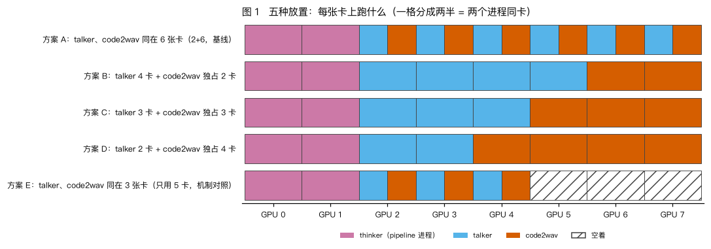
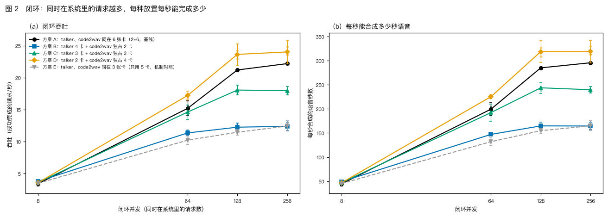
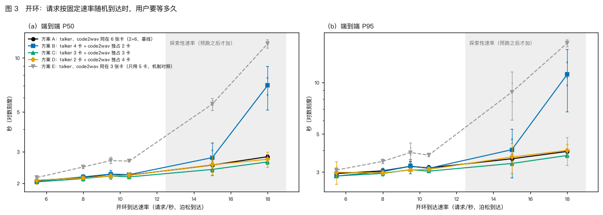
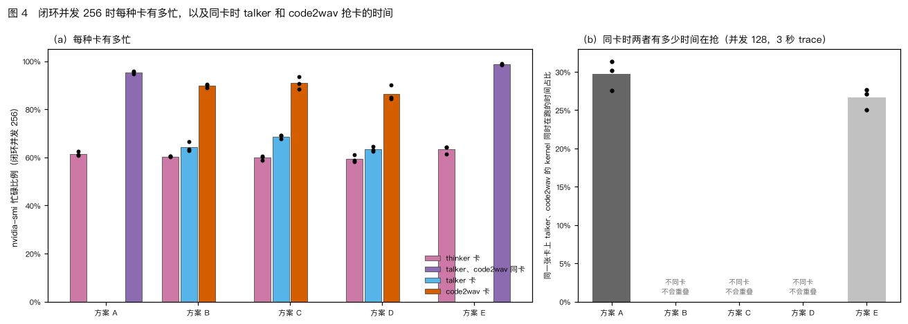
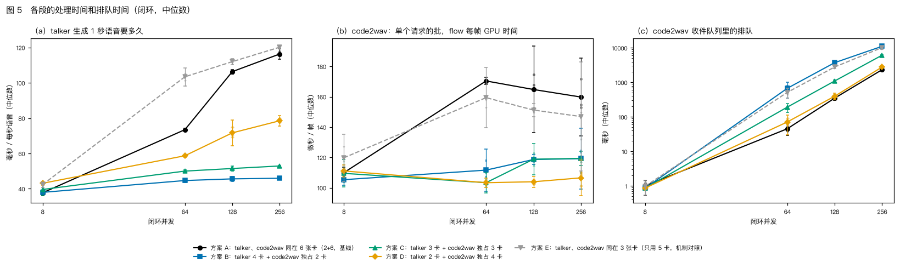
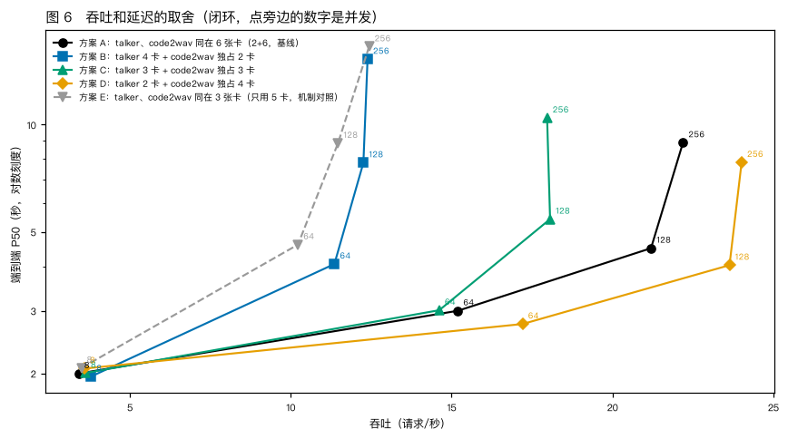

# 实验 7：把 code2wav 搬到单独的卡上，会不会更快？

> **状态：完成（2026-11-17 16:36–20:40）**。5 种放置（方案 A–E）× 3 个区组，共 15 次独立启动的服务。100,365 个计量请求全部成功，每个都有语音，没有一次崩溃或重启。事先登记的假设和判定标准见 [hypotheses.md](hypotheses.md)，限制见 [limitations.md](limitations.md)。

## 第一部分：一句话

code2wav 独占 GPU 后两者都快了很多，但 8 张卡里只有“2 张 talker + 4 张 code2wav”胜过 2+6：高负载吞吐 +8%，P95 −18%；负载不高时差不多。

## 第二部分：为什么要做

- 实验 6 发现，在 2+6 分工下，高负载时吞吐被 code2wav 卡住：
  - 每个请求要约 0.2 秒 GPU 计算，凑批也省不下来；
  - 而且它和 talker 挤在同一张卡上。同样形状的 flow 计算，并发 64 时每帧比并发 8 时慢 62%。
- 一个自然的想法是：把 code2wav 搬到单独的卡上，两者不再抢卡，是不是就快了？
- 这个想法里其实有两个不同的问题：
  1. **机制**：同卡时，talker 和 code2wav 真的互相拖慢吗？拖慢多少？
  2. **部署**：一共只有 8 张卡。给 code2wav 单独几张卡，talker 就少几张卡。同样的预算下，这样分是更好还是更差？
- 机制成立，不代表部署一定更好：同卡时两者可以互相填补对方的空闲，分开以后各自的卡都可能有空着的时候。

## 第三部分：先学几个概念

每个概念按三步讲：先一句话，再一个生活中的例子，最后说在这个实验里它指什么。

**同卡和独占**
- **一句话**：两个进程在同一张 GPU 上，叫同卡；一个进程独占一张 GPU，叫独占。
- **例子**：两个厨师共用一个灶台，或者各用一个灶台。共用时灶台很少闲着，但两人会互相等；各用一个时互不打扰，但有的灶台会空着。
- **在这里**：
  - 2+6 分工是每张 talker 卡上同时有一个 talker 进程和一个 code2wav 进程；
  - 独占的放置把 code2wav 放到另外几张卡上，那几张卡上只有 code2wav。

**副本和轮转分配**
- **一句话**：同一个阶段跑几份一样的进程（副本），新请求轮流交给它们。
- **例子**：银行开 3 个窗口，取号后轮流叫到各个窗口。
- **在这里**：
  - sglang-omni 520b49ee 在请求进来时，按轮转给每个阶段各挑一个副本（`sglang_omni/pipeline/replicas.py`，RoundRobinBindingPolicy）；
  - 所以 talker 有 4 份、code2wav 有 2 份也没问题。

**闭环和开环**
- **一句话**：
  - 闭环：客户端始终保持固定数量的请求在系统里，完成一个补一个；
  - 开环：请求按固定的平均速率随机到达，不管系统忙不忙。
- **例子**：
  - 闭环像一家店里始终有 64 位客人，走一位进一位；
  - 开环像路口的车流，每分钟平均来 10 辆，不会因为堵车就不来。
- **在这里**：
  - 闭环用来测“最多能处理多快”（吞吐）；
  - 开环用来测“在某个到达速率下，用户等多久”（延迟），更接近真实服务。
  - 开环的到达是泊松过程，也就是随机到达，间隔时长短不一。

**容量和排队**
- **一句话**：系统每秒最多能处理的请求数叫容量。到达速率接近容量时，排队会急剧变长。
- **例子**：收银员每分钟能结 10 个人。每分钟来 5 个人几乎不用排队，来 9 个人就经常要排，来 11 个人队伍会越排越长。
- **在这里**：
  - 开环的 4 个正式速率是最弱方案容量 X 的 50%、75%、90%、100%；
  - 超过某个方案的容量后，它的延迟会一直涨。

**机制对照和等预算对照**
- **一句话**：
  - 机制对照只改一个因素，看这个因素本身的影响；
  - 等预算对照固定总资源，比较不同的分法。
- **例子**：
  - 想知道“共用灶台会不会互相拖慢”，就让同样的两个厨师分别在一个灶台和两个灶台上做同样的菜（机制）；
  - 想知道“8 个灶台怎么分最好”，就固定 8 个灶台，比较几种分法（等预算）。
- **在这里**：
  - **机制对照**：方案 E 和方案 C 的副本数相同（talker 3、code2wav 3），只差 code2wav 是否同卡；E 只用 5 张卡，C 用 8 张；
  - **等预算对照**：方案 A（2+6，基线）、B、C、D 都用满 8 张卡。

**kernel 重叠**
- **一句话**：GPU 上的一次计算叫一个 kernel。同一张卡上两个进程的 kernel 在同一时刻都在跑，叫重叠。
- **例子**：两个人同时用一台打印机，打印机交替处理两边的页，每个人拿到自己那份都要等更久。
- **在这里**：在 3 秒的 kernel trace 里，把同一张卡上 talker 的 kernel 时间段和 code2wav 的 kernel 时间段求交集。重叠越多，两者越在抢同一份算力和显存带宽。

**同时在处理的请求数（Little 定律）**
- **一句话**：一段时间里平均同时在某个环节里的请求数 = 每秒进来的请求数 × 每个请求在这个环节里待的平均时间。
- **例子**：一家店每分钟进 2 位客人，每位平均待 15 分钟，那么店里平均有 30 位客人。
- **在这里**：talker 同时处理的请求越多，每一步要算的就越多，每个请求也会慢一些。比较“同卡”和“独占”时，要在同时处理的请求数差不多的条件下比，才能排除“只是因为批更小”。

**功耗上限和降频**
- **一句话**：GPU 的功耗接近上限时，会自动降低时钟频率，单位时间能做的计算变少。
- **例子**：电动车电池快到输出上限时，自动限速。
- **在这里**：RTX A6000 的官方功耗上限是 300 瓦。nvidia-smi 每 0.2 秒记一次每张卡的 SM 时钟和功耗。

## 第四部分：我们究竟怎么做实验

### 4.1 五种放置（方案 A–E）

| 方案 | GPU 0–1 | talker | code2wav | 用几张卡 | 回答 |
|---|---|---|---|---|---|
| A（基线，= 2+6） | thinker | GPU 2–7（6 份） | GPU 2–7，与 talker 同卡（6 份） | 8 | 等预算 |
| B | thinker | GPU 2–5（4 份） | GPU 6–7（2 份） | 8 | 等预算 |
| C | thinker | GPU 2–4（3 份） | GPU 5–7（3 份） | 8 | 等预算、机制 |
| D | thinker | GPU 2–3（2 份） | GPU 4–7（4 份） | 8 | 等预算 |
| E | thinker | GPU 2–4（3 份） | GPU 2–4，与 talker 同卡（3 份） | 5（GPU 5–7 空着） | 机制 |

- 每种放置里，talker、code2wav 的显存比例都和基线相同（各 0.40），只改 code2wav 放在哪里。
- 配置由 `scripts/slurm/make_plan_exp06_08.py` 生成，每个都用 `scripts/spark/check_pipeline_config.py` 离线检查过。配置文件名见文末“文件在哪里”。

### 4.2 预跑和开环速率

- **预跑**不是正式数据，只确认每种放置能启动，并估计容量。闭环并发 256 的吞吐分别是：
  - 方案 B：10.6 请求/秒；
  - 方案 C：15.1；
  - 方案 D：20.6；
  - 方案 E：11.0。
- 按事先定好的方法，取等预算方案里最弱的容量 X = 10.6。正式开环速率是 0.5X、0.75X、0.9X、1.0X，四舍五入到 0.5，即 5.5、8、9.5、10.5 请求/秒。
- 预跑之后另加了 15、18 请求/秒两档（各 60 秒），用来看较强方案在更高负载下的差别。这两档是**探索性**的，不参与判定。

### 4.3 每次运行做什么

- **负载**：W3b（文字提问，文字 + 语音回答，最多 64 个文字 token，thinker 温度 0）。
- **服务**：打点版 sglang-omni，和实验 6 相同（520b49ee 加测量补丁）。
- **段落**：
  1. **闭环**：并发 8、64、128、256。每档先预热一波，再测 max(96, 3 × 并发) 个请求，开事件记录。
  2. **kernel trace**：并发 128，在第 10 秒开 3 秒 torch profiler，用来看同卡时 talker 和 code2wav 的 kernel 有多少时间同时在跑。
  3. **开环**：5.5、8、9.5、10.5 请求/秒，各 90 秒，开事件记录。
  4. **探索性开环**：15、18 请求/秒，各 60 秒。
- **重复**：3 个区组，每个区组把 5 种放置各跑一次（每次独立启动服务）。区组内的顺序随机（种子 20261117），区组按 1、2、3 的顺序跑：
  - 区组 1：E → C → A → B → D；
  - 区组 2：C → E → B → A → D；
  - 区组 3：E → B → C → D → A。
- 同一台节点（compute-03），Slurm Job 454290，16:36 到 20:40。

### 4.4 主要指标和怎么算

| 指标 | 怎么算 | 用在 |
|---|---|---|
| 吞吐 | 闭环一档里成功完成的请求数 ÷（最后一个完成 − 第一个发出） | 等预算 |
| 端到端 P50、P95、P99，TTFT | 开环各速率和闭环各档，客户端测 | 等预算 |
| talker 生成 1 秒语音要多久 | 每个请求在 talker 里从开始 prefill 到模型路径结束的时间 ÷ 语音秒数，取中位数（不含排队） | 机制 |
| code2wav 同形状批的 GPU 时间 | 批大小为 1 的批，flow 的 GPU 跨度 ÷ 帧数，取中位数 | 机制 |
| 两者同时在跑的时间 | kernel trace 里同一张卡上 talker 和 code2wav 的 kernel 区间的交集 ÷ 窗口长度 | 机制 |
| 各段排队 | code2wav 收件队列里的等待（同实验 6）；talker 从入队到开始 prefill | 两者 |
| 每种卡的忙碌比例、显存 | nvidia-smi 每 0.2 秒采样，按角色分组 | 两者 |

- 判定以区组内的配对差为准（方案减基线），报告 3 个区组的原始值、均值和 t 分布 95% 区间（自由度 2）。
- 错误率 > 5% 的档位标为“不可用”。本实验没有这样的档位。
- 脚本是 `scripts/analysis/exp07_report.py`，测试在 `tests/test_exp07_report.py`。

**另外报告、不参与判定的描述性指标**（任务要求测，判定标准里没有；看过第一遍结果后才加进脚本）：
- talker → code2wav 的传递时间：talker 发出（stage_hop_sent）到 code2wav 收到（stage_input_received）；
- code2wav 每秒语音的 GPU 时间：一档里各批 flow + HiFT 的 GPU 时间之和 ÷ 这些批的语音秒数之和；
- thinker 每个 token 的时间（同实验 8）；
- 首个音频的时间（MiniCPM-o 一次返回全部音频，所以它约等于端到端时间）；
- 每种卡的 SM 时钟和功耗（nvidia-smi）。没有记录 GPU 温度。

## 第五部分：每张图怎么读

图都在 `figures/` 里，由 `scripts/analysis/exp07_figures.py` 从 `results/summary.json` 画出。除图 1 外：
- 线和柱是 3 个区组的均值；
- 误差线是 95% 区间；
- 小点是每个区组自己的值。

### 图 1　五种放置

- **横轴**：8 张 GPU。**每一行**：一种方案。
- **颜色**：粉色是 thinker，蓝色是 talker，橙色是 code2wav，斜线是空着的卡。一格分成两半，表示两个进程在同一张卡上。
- **先看什么**：A 和 E 是同卡（每格两半），B、C、D 是独占（整格一种颜色）。E 只用了 5 张卡。

### 图 2　闭环吞吐

- **横轴**：闭环并发（同时在系统里的请求数，对数刻度）。
- **纵轴**：（a）每秒成功完成的请求数；（b）每秒合成的语音秒数。
- **先看什么**：最右边并发 256 的位置。橙线（D）在黑线（A，基线）上面一点；绿线（C）低 19%；蓝线（B）和灰虚线（E）低了四成多（−44%）。
- **怎么理解**：并发 8 时五条线挤在一起，说明低负载时放置无所谓；差别都出现在并发 64 以后。

### 图 3　开环延迟

- **横轴**：开环到达速率。灰色背景是探索性速率（15、18），不参与判定。
- **纵轴**：端到端时间（秒，对数刻度），（a）是中位数 P50，（b）是 P95。
- **先看什么**：在正式速率（5.5–10.5）里，A、B、C、D 四条线几乎重合，都在 2.0–2.3 秒（P50）。只有只用 5 张卡的 E 明显高。
- **怎么理解**：这些速率都没有超过任何一个 8 卡方案的容量，排队还不严重，所以放置几乎没有影响。到 18 请求/秒时，容量只有约 12 的 B 开始堆积（P50 7 秒），A、C、D 仍在 3 秒以内。

### 图 4　每种卡有多忙，同卡时抢了多少

- **（a）**：闭环并发 256 时，nvidia-smi 测到的每种卡的忙碌比例。紫色是 talker 和 code2wav 同卡的卡，蓝色是只跑 talker 的卡，橙色是只跑 code2wav 的卡。
- **先看什么**：独占方案里，code2wav 卡 86–91% 在忙，talker 卡只有 63–69%。也就是说，独占以后 talker 卡有三分之一的时间空着。
- **（b）**：并发 128 的 3 秒 kernel trace 里，同一张卡上两者的 kernel 同时在跑的时间占比。只有 A 和 E 有同卡，B、C、D 不会重叠。
- **先看什么**：同卡时，约 27–30% 的时间两者在同时跑。

### 图 5　各段的处理时间和排队时间

- **（a）talker 生成 1 秒语音要多久**（不含排队）：同卡的 A、E 随并发涨到 110–120 毫秒；独占的 B、C 在并发 64 以上一直是 45–53 毫秒。D 只有 2 份 talker，每份要处理更多请求，涨到 78 毫秒。
- **（b）code2wav 单个请求的批，flow 每帧的 GPU 时间**：同卡的 A、E 在高负载时是 147–171 微秒；独占的在 103–120 微秒。高负载时单个请求的批很少（每个运行 2–42 个），所以误差线很宽。
- **（c）code2wav 收件队列里的排队**（对数刻度）：独占卡少的 B、C 排得最久；A 和 D 最短。
- **怎么理解**：（a）（b）说明独占后每一段都更快；（c）说明总吞吐还取决于 code2wav 有几张卡。

### 图 6　吞吐和延迟的取舍

- **横轴**：闭环吞吐。**纵轴**：端到端 P50（对数刻度）。点旁边的数字是并发。
- **怎么读**：越靠右下越好（吞吐高、等得短）。
- **先看什么**：D（橙）在 A（黑）的右下方，在同样的并发下吞吐更高、延迟更短；B、C、E 都在 A 的左上方。

## 第六部分：结果到底意味着什么

### 6.1 机制：同卡时两者真的互相拖慢（实测）

方案 E（同卡，5 张卡）对比方案 C（独占，8 张卡），两边副本数相同。下表是 3 个区组的均值，变化是区组内配对差的均值、95% 区间和每个区组的值。

| 指标（闭环） | 并发 | E 同卡 | C 独占 | 变化 |
|---|---|---|---|---|
| talker 生成 1 秒语音（毫秒） | 128 | 112.0 | 51.5 | −54.0% [−55.4, −52.7]（−53.9、−54.7、−53.6） |
| 同上 | 256 | 120.2 | 52.9 | −56.0% [−56.4, −55.5]（−56.2、−55.8、−55.9） |
| flow 每帧 GPU 时间，单个请求的批（微秒） | 128 | 151.3 | 118.8 | −21.4% [−27.9, −15.0]（−24.3、−19.2、−20.9） |
| 同上 | 256 | 147.0 | 119.4 | −18.1% [−42.1, +5.8]（−7.6、−20.3、−26.5） |
| code2wav 每秒语音的 GPU 时间（毫秒，描述性） | 128 | 14.4 | 9.0 | −37.0% [−40.2, −33.9] |
| 同上 | 256 | 13.5 | 9.1 | −32.7% [−36.8, −28.6] |

- **并发 8 时差别小**：talker −6.5% [−15.9, +3.0]，flow −8.3% [−24.8, +8.1]。低负载时两者很少同时在跑，抢不起来。
- **kernel 重叠（实测）**：并发 128 时，同卡的卡上：
  - E：两者同时在跑的时间占 trace 窗口的 25–28%；talker 的 kernel 时间里，有 67–78% 是和 code2wav 一起跑的。
  - A：占窗口的 28–31%；talker 的 kernel 时间里有 73–84% 和 code2wav 重叠。
  - 同卡时 talker 的 kernel 只占窗口的 36–38%，code2wav 占 72–88%。也就是说，talker 的计算大多是在 code2wav 正在跑的时候挤进去的。
- **排除“只是批变小了”（推算，Little 定律）**：
  - 同卡的 E 在并发 64 时，每个 talker 副本平均同时处理 4.3–4.7 个请求，生成 1 秒语音要 101–105 毫秒；
  - 独占的 C 在并发 128、256 时，每个副本同时处理 4.1–4.3 个请求，只要 51–53 毫秒。
  - 同样多的请求，同卡时 talker 慢一倍，所以差别不是来自批的大小。
- **独占的 code2wav 卡反而降频了（实测）**：闭环并发 256 时，
  - 只跑 code2wav 的卡平均 SM 时钟 1620–1660 MHz、功耗 281–288 瓦；
  - 同卡的卡是 1793–1811 MHz、278–286 瓦；只跑 talker 的卡 1893–1905 MHz、158–172 瓦；
  - 并发 8 时所有卡都在 1850–1915 MHz。
  - 推断：独占的 code2wav 卡接近 300 瓦的功耗上限而降频。即使这样，它每秒语音的 GPU 时间仍然少了三分之一，所以上表的改善不是因为它的时钟更高。

**结论**：同卡争用真实存在，而且很大（实测）。和独占相比，同卡时：
- talker 生成 1 秒语音的时间是 2.2 倍（112–120 对 51–53 毫秒）；
- code2wav 单请求批的 flow 每帧慢 23–27%（并发 128、256）；
- code2wav 每秒语音的 GPU 时间多 49–59%。

### 6.2 等预算：8 张卡怎么分（实测）

闭环，3 个区组的均值；“对 A”是区组内配对差。

| 方案 | 并发 128 吞吐 | 并发 256 吞吐 | 对 A（并发 256） | 并发 256 的 P50 / P95 / P99（秒） |
|---|---|---|---|---|
| A（2+6，基线） | 21.2 | 22.2 | — | 8.90 / 11.50 / 12.59 |
| B（talker 4 + code2wav 2） | 12.3 | 12.4 | −44.2% [−47.3, −41.0] | 15.27 / 17.53 / 18.20 |
| C（talker 3 + code2wav 3） | 18.1 | 18.0 | −19.0% [−21.9, −16.1] | 10.45 / 12.19 / 12.66 |
| D（talker 2 + code2wav 4） | 23.6 | 24.0 | +8.2% [−0.0, +16.5]（+6.9、+12.0、+5.8） | 7.83 / 9.48 / 10.02 |
| E（同卡 3 张，只用 5 张卡） | 11.5 | 12.4 | 不是等预算 | 16.57 / 19.61 / 20.31 |

- **D 对 A 的其他配对差**：
  - 并发 128 吞吐 +11.5% [+3.1, +20.0]（+7.8、+12.2、+14.5）；
  - 并发 256 的 P50 −12.0% [−16.2, −7.7]，P95 −17.6% [−20.7, −14.5]，P99 −20.4% [−23.8, −17.1]，3 个区组都是更低。
- **为什么是 D（推算）**：每张 code2wav 卡每秒能处理多少请求（并发 256 的吞吐 ÷ code2wav 的卡数）：
  - 独占：B 6.19、C 5.99、D 6.00；
  - 同卡：A 3.70、E 4.15（这张卡还要跑 talker）。
  - 三种独占方案的吞吐都约等于“6 × code2wav 卡数”，而且 code2wav 卡 86–91% 在忙、收件队列排 2.8–11 秒：**独占后的瓶颈仍然是 code2wav**。
  - 所以要胜过 A 的 6 × 3.7 ≈ 22，code2wav 至少要 4 张独占卡（4 × 6 = 24）。B（2 张）和 C（3 张）的 code2wav 卡不够。
- **代价**：独占后 talker 卡有 31–37% 的时间空着（图 4）。D 只剩 2 份 talker，每份要处理更多请求，生成 1 秒语音的时间从 B 的 46 毫秒涨到 78 毫秒（并发 256）；并发 8 时比 A 慢一点（43 对 38 毫秒）。

### 6.3 负载不高时，几种分法差不多（实测）

- 正式开环速率（5.5–10.5 请求/秒）下，A、B、C、D 的端到端 P50 都在 2.03–2.25 秒，P95 都在 2.84–3.24 秒。
- 对 A 的配对差，P50 都在 ±2.3% 以内，P95 都在 ±5% 以内；区间大都包含 0。
- 方向上，C 和 D 在 9.5、10.5 请求/秒略快一点（P95 −2% 到 −5%），C 在 10.5 时 3 个区组都更低（−4.2% [−7.0, −1.5]）：低于容量时，每个请求的 code2wav 都算得快一点。
- 只用 5 张卡的 E 在 9.5 请求/秒时 P50 已经是 2.67 秒，C 是 2.19 秒。
- 探索性速率 18 请求/秒（不参与判定）：A、C、D 的 P50 仍在 2.6–2.8 秒，B 已经堆积到 7.0 秒。

### 6.4 事先登记的假设，按登记的标准判定

| 假设 | 判定 | 根据 |
|---|---|---|
| H7a：同卡互相拖慢，独占后处理时间变短 | **不确定**（按登记的标准） | 4 项里 3 项达到“3 个区组都短 10% 以上”；第 4 项（并发 256 的 flow 每帧时间）区组 1 只短了 7.6%，均值 −18.1%，方向一致。这一项每个运行只有 3–11 个单请求批。登记的规则是 4 项都支持才算支持，所以判为不确定。另外两项描述性证据（kernel 重叠、Little 定律对照）都指向争用真实存在。 |
| H7b：同样 8 张卡，独占的吞吐和高负载尾延迟都更好 | **不确定**（按登记的标准） | 没有方案满足“并发 256 吞吐 3 个区组都高 10% 以上”：D 是 +6.9%、+12.0%、+5.8%。D 在 9.5 请求/秒的 P95 3 个区组都更低（−4.8%）。B、C 的吞吐更低。因为 D 在 3 个区组都更快，也不满足“反驳”的条件。 |
| H7c：低负载差别小，接近容量时差别大 | **不支持**（按登记的标准） | 登记的判法是并发 8 时各方案吞吐对 A 都相差 < 5%。实测 B +11.4% [−5.1, +27.8]、C +6.1%、D +5.3%，区间都包含 0。并发 8 的吞吐受这一档最后几个慢请求影响大，例如 A 的区组 1 有一个 P99 4.5 秒的尾巴。开环 5.5 和 9.5 两档的 P50 差别都在 2.3% 以内，没有随速率变大。大的差别只出现在闭环高并发，这超出了登记的开环速率范围。 |

### 6.5 回答任务里的问题

1. **独占是否降低了 talker 和 code2wav 的争用？** 是（实测）。
   - 同卡时，约 27–30% 的时间两者在同一张卡上同时跑；talker 的 kernel 时间里有 67–84% 是和 code2wav 一起跑的。
   - 独占后，两者不会再重叠。
2. **阶段处理速度是否改善？** 是（实测）。
   - talker 每秒语音的时间减半；
   - code2wav 单请求批的 flow 每帧快 18–21%，每秒语音的 GPU 时间少 33–37%。
   - 按登记的严格标准，H7a 判为不确定（见 6.4）。
3. **8 张卡的整体吞吐是否改善？** 只有 D 改善。
   - D：并发 128 +11.5%，并发 256 +8.2%，3 个区组都更高，但没达到登记的 +10% 门槛。
   - C 低 19%，B 低 44%：code2wav 的卡太少。
   - **独占减少的副本数会不会抵消收益**：B、C 抵消了还不止，D 刚好多出一点。
4. **高负载尾延迟是否改善？**
   - D 在闭环并发 256 时 P95 −18%、P99 −20%，3 个区组一致。
   - 开环正式速率（≤ 10.5 请求/秒）下，差别都在 5% 以内。
5. **什么时候同卡反而更划算？**（实测 + 推算）
   - **code2wav 的独占卡少于 4 张时**。一张同卡的卡能提供约 3.7 请求/秒的 code2wav 处理能力，同时还在跑 talker；一张独占卡能提供约 6 请求/秒，但不再跑 talker。6 张卡里：
     - 拿 2 张或 3 张给 code2wav 独占，code2wav 总能力只有 12 或 18，不如 6 张同卡的 22；
     - 拿 4 张才有 24。
   - **负载不高时**（本实验 ≤ 10.5 请求/秒，约为 A 容量的一半）。放置几乎不影响延迟，同卡配置更简单，6 张卡也都在为两种工作服务。
   - **独占以后 talker 卡有三分之一的时间空着**：同卡用掉了这部分空闲，代价是两者都变慢。
6. **跨卡传递 talker → code2wav 是否增加开销？** 没有（实测）。
   - 传递时间的中位数都在 1.25–1.52 毫秒；
   - 独占方案在并发 256 时反而短 9–14%（1.25–1.32 对 1.45 毫秒）。
   - 推断：传过去的主要是每个请求几百个整数的语音编码，量很小。
7. **thinker 受不受影响？** 不受（实测）。
   - 开环 9.5 请求/秒时，五种方案的 thinker 每个 token 都是 30.2–30.8 毫秒。
   - 闭环高并发时它们不同（30–37 毫秒），是因为各方案每秒流过 thinker 的请求数不同，thinker 的批大小也就不同。
8. **为什么 D 快，它牺牲了什么，什么时候不值得？**
   - 快：code2wav 有 4 张不受打扰的卡。
   - 牺牲：talker 只有 2 份，每份负担重。如果回答变长、talker 的工作变多，D 的 talker 可能先满（假设，没有测）。
   - 不值得：负载不高时没有收益；只需要文字的请求不经过 talker 和 code2wav，也没有收益。

### 6.6 有没有其他解释

- **各方案做的工作一样吗？** 一样：
  - 每个方案平均生成 44.5–45.0 个文字 token、12.8–13.6 秒语音；
  - 100,365 个计量请求全部成功，每个都有语音。
- **机器状态随时间变化？** 每个区组里 5 种方案的顺序是随机的。区组 1、2、3 依次跑，判定用区组内配对。3 个区组的方向在几乎所有比较上都一致。
- **独占卡的时钟更高？** 相反，独占的 code2wav 卡时钟更低（6.1）。
- **kernel trace 的窗口只有 3 秒**，而且只在并发 128。重叠比例是这 3 秒内的值，没有覆盖其他并发。
- **事件记录本身的开销**：所有方案都开着同样的事件记录。实验 6 测过，它对吞吐的影响在区组波动之内。

## 第七部分：下一步做什么

1. **降低 code2wav 每个请求的 GPU 时间**。
   - 不论同卡还是独占，吞吐都由 code2wav 决定：独占时约 6 请求/秒/卡，同卡时约 3.7。
   - 实验 6 指出的方向：按长度分组减少补齐、补录 CUDA graph、评估更少的 flow 步数（需要音质评测）。
2. **测 talker 单卡能撑多少请求**（现在未知）。
   - D 的 2 张 talker 卡在并发 256 时只有 63% 忙。如果 1 张 talker 卡能撑 30 请求/秒，“talker 1 张 + code2wav 5 张”可能更好；如果撑不住，D 就接近最优。
3. **在更长的回答和混合负载下复测 A 和 D**。
   - 本实验只有 W3b 的短回答（最多 64 个文字 token）。
   - talker 的工作变多时，D 只有 2 份 talker 的代价会更明显。

## 附：文件在哪里

| 内容 | 路径 |
|---|---|
| 本报告、假设、限制 | `research/01_性能瓶颈/实验07_Code2Wav独立GPU/`（`README.md`、`hypotheses.md`、`limitations.md`） |
| 编号、运行 ID、版本、配置、每次运行的时间 | `metadata.json` |
| 汇总数字 | `results/summary.json`（每个运行、每个方案的区间、判定）、`results/levels.csv`（每个运行每一档一行；字段见 `reports/research_updates/data_dictionary.md`） |
| 图 | `figures/`（`scripts/analysis/exp07_figures.py`） |
| 分析脚本和测试 | `scripts/analysis/exp07_report.py`、`tests/test_exp07_report.py`（code2wav 的拆分沿用 `scripts/analysis/exp06_c2w_breakdown.py`） |
| 实验配置 | `configs/experiments/exp06_08/exp07_*.json`、`configs/experiments/plan_exp07.json`（预跑：`plan_exp07_pilot.json`） |
| 原始数据 | 集群 `results/experiments/20261117_exp07_*`，不在仓库里 |

**方案和配置名的对应**（hypotheses.md 和脚本里用的是配置名）：

| 方案 | 配置名 | 放置配置文件 |
|---|---|---|
| A | t2_k6_shared（= S2:6） | `configs/models/minicpm_o_4_5_exp_t2_k6_shared.yaml` |
| B | t2_k4_c2 | `configs/models/minicpm_o_4_5_exp_t2_k4_c2.yaml` |
| C | t2_k3_c3 | `configs/models/minicpm_o_4_5_exp_t2_k3_c3.yaml` |
| D | t2_k2_c4 | `configs/models/minicpm_o_4_5_exp_t2_k2_c4.yaml` |
| E | t2_k3_shared | `configs/models/minicpm_o_4_5_exp_t2_k3_shared.yaml` |
