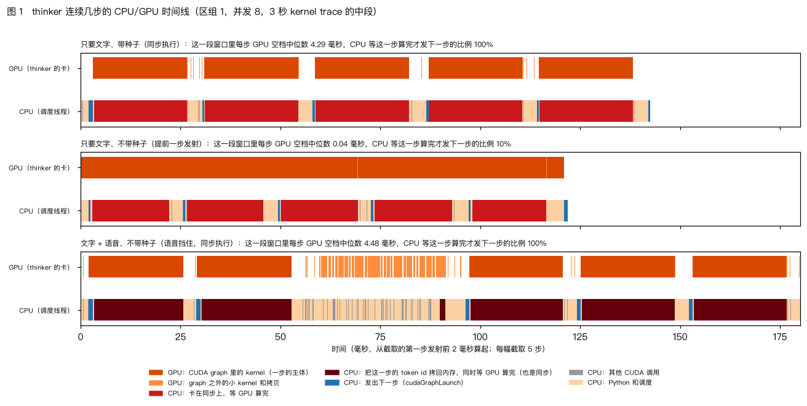
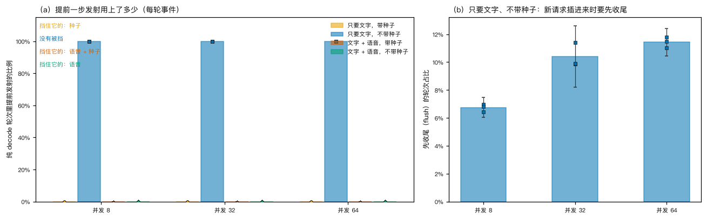
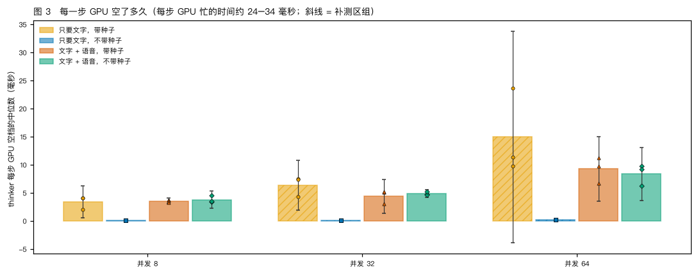
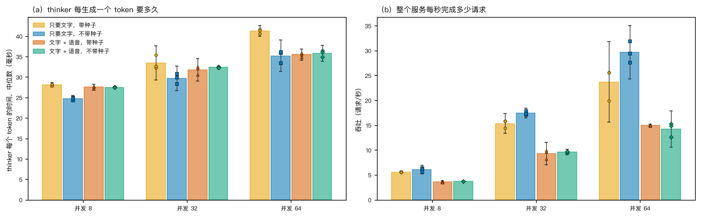

# 实验 8：thinker 的“提前一步发射”能省下多少 GPU 空档？

> **状态：第一、二阶段完成；第三阶段（原型）进行中（2026-11-17）**
> - 第一阶段：2+6 分工，2×2 个条件（只要文字 / 文字 + 语音 × 带种子 / 不带种子），并发 8、32、64。3 个主区组，另有 3 个补测区组。
> - 第二阶段：源码根因分析。
> - 第三阶段：最小原型，先做正确性检查，再做性能对比。
> - 事先登记的假设、两次补充登记和第三阶段的预测见 [hypotheses.md](hypotheses.md)，限制见 [limitations.md](limitations.md)。

## 第一部分：一句话

thinker 每步 GPU 算约 24 毫秒，同步执行时每步还要空 3–15 毫秒。提前一步发射能把空档降到 0.2 毫秒以下：纯文字快了 11–15%。语音请求一律被挡在同步路径上，原因是下一步会覆盖隐藏状态。

## 第二部分：为什么要做

- 实验 5 的 kernel trace 显示：thinker 每一步 GPU 算 23–25 毫秒，然后空 3–8 毫秒。CPU 要等 GPU 算完这一步，才准备下一步。
- sglang-omni 已经实现了“提前一步发射”（lookahead），可以消掉这段空档。但源码规定要出语音的请求不能用它。
- 所以要回答：
  - 这段空档有多大、提前发射能省多少；
  - 纯文字请求是不是真的用上了；
  - 语音请求为什么不能用、能不能安全地让它用；
  - 改了以后端到端能快多少。

## 第三部分：先学几个概念

每个概念按三步讲：先一句话，再一个生活中的例子，最后说在 MiniCPM-o 的代码里它指什么。

**thinker 的“一步”（decode step）**
- **一句话**：thinker 每生成一个文字 token，就要把整个模型跑一遍，这叫一步。
- **例子**：写字的人一笔一笔地写，每一笔都要先想好再落笔。
- **在这里**：thinker 是 MiniCPM-o 里负责写文字回答的大模型，跑在 GPU 0、1 上。一步的 GPU 计算约 24 毫秒，一批里的请求一起算。

**同步执行 vs 提前一步发射**
- **一句话**：
  - 同步执行：CPU 等 GPU 算完这一步，处理完结果，才发下一步；
  - 提前一步发射：GPU 还在算这一步时，CPU 就把下一步发出去，然后再回头处理上一步的结果。
- **例子**：厨师长（CPU）给厨房（GPU）递菜单。
  - 同步执行是等这道菜出锅、端走，才递下一张，中间厨房闲着；
  - 提前发射是菜还在锅里时，就把下一张菜单放到厨房门口。
- **在这里**：
  - 调度循环是 `OmniScheduler.event_loop_async_decode`（`sglang_omni/scheduling/omni_scheduler.py` 第 3631 行起）；
  - 源码注释写的是“先发射当前步，再收尾上一步”（launch-first）。
  - 下一步要用的 token id 不经过 CPU：它在 GPU 上采样后直接作为下一步的输入，所以可以提前发。

**CUDA graph 和它的固定输出区**
- **一句话**：把一整步的计算录成一张“套餐单”，以后每次重放都写到同一块显存里。
- **例子**：每天都在同一块白板上写当天的菜单，第二天来了就擦掉重写。要留住昨天的内容，必须在擦掉之前抄下来。
- **在这里**：
  - thinker 的每一步 decode 都是重放 CUDA graph；
  - 这一步最后一层的输出（隐藏状态）写在 graph 的固定输出区。

**隐藏状态（hidden state）**
- **一句话**：thinker 生成每个 token 时最后一层的那组数字，可以看成模型对这个字的“理解”。
- **例子**：演员念台词之前，脑子里对这句话的语气、情绪的理解。
- **在这里**：
  - MiniCPM-o 的 talker（说话的模型）要按 thinker 每个 token 的隐藏状态来生成语音；
  - 所以要出语音的请求，每一步都要把隐藏状态存下来（`MiniCPMOThinkerModelRunner.post_process_outputs`，第 132–162 行）；
  - 请求结束时一次性拷回 CPU，交给 talker（`on_request_finished`，第 172–190 行）。

**采样种子（seed）**
- **一句话**：固定随机数的起点，让“随机”生成可以重复。
- **例子**：洗牌前先说好按某个固定方式洗，结果每次一样。
- **在这里**：
  - 我们的压测客户端默认给每个请求带 `"seed": 0`（`src/omni_research/replay/backends.py`）；
  - sglang-omni 对带种子的请求一律不用提前发射（`lookahead_eligible`，`sglang_omni/model_runner/thinker_model_runner.py` 第 495 行起；采样参数的检查在第 527–539 行，种子是第 533 行）；
  - W3b 的 thinker 温度是 0（贪心解码），种子不影响结果，所以去掉种子不改变输出。

**收尾（flush）**
- **一句话**：新请求要插进来时，先把在途的那一步处理完，再换成同步方式跑新请求的 prefill。
- **例子**：厨房要临时加做一道大菜，先把锅里那道出锅，再开始。
- **在这里**：flush 的轮次越多，提前发射省下的时间越少。

**每步 GPU 空档**
- **一句话**：相邻两步之间，GPU 上没有 thinker kernel 在跑的时间。
- **在这里**：用 3 秒 kernel trace 测，脚本是 `scripts/analysis/exp05_step_sync.py`，和实验 5 相同。

## 第四部分：我们究竟怎么做实验

### 4.1 第一阶段：不改执行逻辑，只换请求的条件

**放置**：2+6。GPU 0、1 各一个 pipeline 进程（含 thinker）；GPU 2–7 各一个 talker 进程 + 一个 code2wav 进程。

**2×2 个条件**（同样 6 个问题、最多 64 个文字 token、温度 0）：

| 条件 | 输出 | 种子 | 预期被什么挡住 |
|---|---|---|---|
| w3t | 只要文字 | 带（`seed: 0`） | 种子 |
| w3t_ns | 只要文字 | 不带 | 无，应该走提前发射 |
| w3b | 文字 + 语音 | 带 | 语音、种子 |
| w3b_ns | 文字 + 语音 | 不带 | 语音 |

- **为什么是 2×2**：原设计只比较 w3t 和 w3b。打点版冒烟测试发现我们的客户端带了种子，纯文字也被挡住。所以在正式数据产生前加了“种子”这个因素（hypotheses.md 14:58 的补充登记）。
- **并发**：8、32、64。
- **每个（条件, 并发）组合**：
  - 先预热一波；
  - B 段测 max(96, 3 × 并发) 个请求，开事件记录。打点补丁会在 thinker 每一轮记一条：这一批多少请求、走没走提前发射、被什么挡住、有没有 flush。
  - C 段在中间开 3 秒 torch profiler，用来测每步 GPU 空档。
- **重复**：
  - 3 个主区组，每个区组是一次独立启动的服务，12 个组合的顺序随机（种子 20261117），2026-11-17 15:40–16:16（美东）；
  - 3 个补测区组：纯文字在并发 32、64 下跑得很快，原设计的 profiler 窗口打开时已经快跑完了，录到的步数很少甚至为 0。补测把这 4 个格子各跑六波，窗口提前到第 5 秒，16:19–16:36。
  - 这 4 个格子的 C 段指标只用补测区组（补充登记二，写于分析补测数据之前）。

### 4.2 第二阶段：读源码，找出语音为什么不能提前发射

不跑 GPU，读 sglang-omni 520b49ee 的调度循环、发射和收尾的代码、MiniCPM-o 保存隐藏状态的代码，画出数据依赖（第六部分 6.3）。

### 4.3 第三阶段：最小原型

（进行中，见第六部分 6.5。设计已在 hypotheses.md 补充登记二中事先写下。）

### 4.4 统计方法

- 以区组为一个独立样本；
- 表里是 3 个区组的均值，方括号是 t 分布的 95% 区间（自由度 2），圆括号是每个区组的值；
- 判定用事先登记的标准，脚本是 `scripts/analysis/exp08_report.py`（测试在 `tests/test_exp08_report.py`）；
- 只有 3 次重复，不声称统计显著。

## 第五部分：每张图怎么读

### 图 1　thinker 连续几步的 CPU/GPU 时间线



- **怎么画的**：三幅都来自区组 1、并发 8 的 3 秒 kernel trace，截取中段连续 5 步。
  - 上面一行是 thinker 那张卡上的 GPU kernel：深橙是 CUDA graph 里的 kernel，浅橙是 graph 之外的小 kernel。
  - 下面一行是 thinker 调度线程的 CPU 时间：红色是卡在同步上，深红是“把这一步的 token id 拷回内存”的调用（它也要等 GPU 算完，等同于同步），蓝色是发出下一步，浅色是 Python 和调度。
- **第一幅：只要文字、带种子**。
  - CPU 每次都要等 GPU 算完这一步（红），处理完结果、发出下一步（蓝）之后，GPU 才开始算下一步；
  - 每两步之间 GPU 空 4 毫秒左右。
- **第二幅：只要文字、不带种子**。
  - GPU 那一行几乎连成一片；
  - CPU 也在等（红），但等的是上一步，下一步已经在 GPU 上排着。
- **第三幅：文字 + 语音**。
  - 和第一幅一样是同步执行，空档 4.5 毫秒；
  - 中间那段密集的浅橙 kernel，推断是新请求的 prefill（prefill 不走 graph），没有逐个核对。
- **不能说明**：每幅只是 5 步，统计看图 3。

### 图 2　提前一步发射用上了多少，flush 有多频繁



- **（a）**：纵轴是纯 decode 轮次里走提前发射的比例。
  - 只有“只要文字、不带种子”是 100%，其余三种都是 0；
  - 左上角的文字是打点记录的被挡原因。
- **（b）**：只看“只要文字、不带种子”，纵轴是先收尾（flush）的轮次占比，这些轮次失去了提前发射的好处。
  - 并发 8、32、64 分别是 6.7%、10.4%、11.4%：并发越高，新请求插进来越频繁。
- **点**是每个区组的值，**误差线**是 95% 区间。

### 图 3　每一步 GPU 空了多久



- **纵轴**：每步 GPU 空档的中位数（毫秒）。
- **最重要的数**：
  - 走提前发射的“只要文字、不带种子”在三档都 ≤ 0.2 毫秒；
  - 其余三种在 3–15 毫秒，并且随并发变大。每步 GPU 忙的时间约 24–26 毫秒，所以空档占一步的 12–30%。
- **斜线柱**来自补测区组。
- “只要文字、带种子”在并发 64 的区间很宽：补测区组 2 的值是 23.6 毫秒。这一段 trace 里每步的“忙”也成了 50 毫秒，说明步的识别有问题，见 limitations.md。
- **不能说明**：空档省下来，端到端能快多少要看图 4 和第三阶段。

### 图 4　thinker 每个 token 的时间和吞吐



- **（a）**：thinker 从 prefill 结束到最后一个 token，平均每个 token 多少毫秒。来自事件，B 段。
- **（b）**：整个服务每秒完成的请求数。B 段，开着事件记录；实验 6 里，事件记录对吞吐的影响在区组之间的波动之内（−7% 到 +4%，区间都包含 0）。
- **最重要的数**：只要文字时，去掉种子后
  - 每个 token 从 28.1、33.4、41.2 毫秒降到 24.7、29.7、35.2 毫秒，即 −12%、−11%、−15%；
  - 吞吐从 5.6、15.3、23.7 升到 6.1、17.4、29.6 请求/秒，即 +9%、+14%、+25%。
  - 语音请求带不带种子没有差别。
- **不能说明**：语音请求如果也能提前发射会怎样，要看第三阶段。

## 第六部分：结果到底意味着什么

### 6.1 第一阶段实际测到了什么（实测）

**每步 GPU 空档**（毫秒，C 段）

| 条件 | 并发 8 | 并发 32 | 并发 64 |
|---|---|---|---|
| 只要文字、带种子 | 3.36 [0.56, 6.15]（4.02、4.00、2.06） | 6.37 [1.93, 10.8]（7.44、4.30、7.37）* | 14.9 [−3.9, 33.8]（11.4、23.6、9.77）* |
| 只要文字、不带种子 | 0.04（0.04、0.04、0.04） | 0.05（0.04、0.05、0.05）* | 0.19（0.20、0.18、0.19）* |
| 文字 + 语音、带种子 | 3.50 [2.97, 4.03] | 4.38 [1.37, 7.40] | 9.22 [3.46, 15.0] |
| 文字 + 语音、不带种子 | 3.73 [2.18, 5.29] | 4.83 [4.11, 5.54] | 8.35 [3.63, 13.1] |

\* 补测区组。

**thinker 每个 token（毫秒）、吞吐（请求/秒）、端到端 P50 / P95（秒）、TTFT P50（毫秒）**（B 段）

| 条件 | 并发 | 每个 token | 吞吐 | 端到端 P50 / P95 | TTFT |
|---|---|---|---|---|---|
| 只要文字、带种子 | 8 / 32 / 64 | 28.1 / 33.4 / 41.2 | 5.6 / 15.3 / 23.7 | 1.31 / 1.82；1.51 / 2.19；1.85 / 2.71 | 59 / 70 / 90 |
| 只要文字、不带种子 | 8 / 32 / 64 | 24.7 / 29.7 / 35.2 | 6.1 / 17.4 / 29.6 | 1.19 / 1.67；1.37 / 1.97；1.59 / 2.31 | 78 / 87 / 98 |
| 文字 + 语音、带种子 | 8 / 32 / 64 | 27.6 / 31.8 / 35.5 | 3.6 / 9.3 / 15.0 | 2.02 / 2.79；2.47 / 3.59；3.03 / 4.21 | 55 / 64 / 74 |
| 文字 + 语音、不带种子 | 8 / 32 / 64 | 27.5 / 32.3 / 35.8 | 3.7 / 9.6 / 14.2 | 2.00 / 2.76；2.42 / 3.37；3.09 / 4.51 | 54 / 66 / 79 |

- 纯 decode 的批大小中位数：
  - 文字 4、15、30；
  - 语音 2、8–9、12–15。
  - 语音请求只有一部分时间在 thinker 里，之后在 talker 和 code2wav 里，所以同样并发下 thinker 的批更小。
- 这些段没有客户端错误，唯一的例外是区组 1 的“文字 + 语音、带种子”在并发 64 的 C 段：code2wav 进程在 profiler 停止后崩溃（与实验 6 相同的问题），22 个请求报错。C 段只用 thinker 的 trace，不用它的客户端指标。

### 6.2 假设检验的结论（按事先登记的标准）

| 假设 | 结论 | 理由 |
|---|---|---|
| **H8c（主要）**：同为只要文字，不带种子的空档明显更小 | **支持** | 三档都至少减半，3 个区组方向全部一致。配对差（不带减带）：并发 8 是 −3.3 毫秒（−4.0、−4.0、−2.0），并发 32 是 −6.3 毫秒（−7.4、−4.3、−7.3），并发 64 是 −14.7 毫秒（−11.2、−23.5、−9.6） |
| **H8d（阴性对照）**：语音带不带种子没有差别 | **支持** | 差别都在 1 毫秒以内：+0.2、+0.5、−0.9 毫秒。事件显示，去掉种子后语音请求仍然 100% 被“语音”这一条挡住 |
| **H8a**：只要文字（带种子）的空档比语音小一半以上 | **推翻** | 两边都带种子，都走同步，按最接近的批大小比较，差别是 −0.1、−1.0、−2.9 毫秒，方向不一致。这在补充登记时已经预料到：挡住文字的是种子，不是别的 |
| **H8b**：只要文字时，因为新请求插入而 flush 的轮次随并发升高 | **支持** | 不带种子的纯文字：6.7%、10.4%、11.4% |
| **第三阶段进入条件**：H8c 支持，且推算语音每步可省 ≥ 2 毫秒 | **成立** | 按最接近的批大小，语音（不带种子）的空档减去走提前发射的纯文字的空档：并发 8 是 3.7 毫秒，并发 32 是 4.8 毫秒，并发 64 是 8.3 毫秒 |

**一个负面结果（实测）**：
- 纯文字走提前发射后，TTFT 变长了：并发 8、32、64 分别 +19、+17、+8 毫秒（59 → 78、70 → 87、90 → 98 毫秒）。
  - 并发 8、32 时，3 个区组方向一致；
  - 并发 64 时，区组 1 相反（94 → 91 毫秒）。
- 原因未知。一种可能（假设）：新请求到达时，要先收尾在途的那一步，才能开始它的 prefill。

### 6.3 第二阶段：语音为什么不能提前发射（源码，sglang-omni 520b49ee）

**数据依赖**（实测阅读）：

```
第 N 步发射：重放 decode 的 CUDA graph ──▶ 隐藏状态写进 graph 的固定输出区 H
           └ post_decode_launch：在 GPU 上采样，token id 异步拷到两块轮换的 pinned 内存之一
第 N+1 步发射：再次重放同一个 graph ──▶ 覆盖 H
第 N 步收尾：post_process_outputs 从 H 里取出这一步每个请求的隐藏状态，clone 一份存起来
           （clone 在 GPU 的同一条 stream 上排在第 N+1 步之后，所以读到的是第 N+1 步的值）
请求结束：on_request_finished 把存起来的隐藏状态一次性拷回 CPU，交给 talker
```

- **调度循环**：每一轮先发射当前步，再收尾上一步（`omni_scheduler.py` 第 3631 行起；“先发射、再收尾”的分支在第 3686–3716 行）。
- **隐藏状态的存法**：`post_process_outputs` 存的是 `hidden_rows[-1].detach().clone()`（`models/minicpm_o/thinker_model_runner.py` 第 157–162 行），旁边的注释是“CUDA graph replay overwrites the original hidden buffer”。这个 clone 在同步执行时足够，但它发生在收尾时，在提前发射的路径上就晚了一步。
- **上游自己的说明**：`lookahead_eligible` 的文档字符串（`model_runner/thinker_model_runner.py` 第 496–501 行）直接写了：“MiniCPM-o speech reads hidden states at resolve, after the next launch overwrote them”。
- **token id 为什么没有这个问题**：它们在发射时就异步拷进两块轮换的 pinned 内存（`async_host_buf`，第 542–555 行），第 N+1 步写另一块。
- **隐藏状态没有这样的双缓冲**：graph 只有一块固定输出区。
- **同步执行时 CPU 在等什么**（kernel trace 实测，区组 1、并发 8）：
  - 纯文字的同步路径里，调度线程 74% 的时间卡在 `cudaStreamSynchronize`；
  - 语音路径里，调度线程 77% 的时间卡在 `cudaMemcpyAsync`，是把 8–32 字节的 token id 拷到普通内存，这个调用要等这一步算完。
  - 两者都是“等这一步”。
  - 语音路径没有每步额外拷贝隐藏状态到 CPU：隐藏状态只在请求结束时拷一次。

**候选改法**：

| 改法 | 做什么 | 代价 | 风险 |
|---|---|---|---|
| A. 发射时立刻快照（本实验的原型） | 第 N 步发射后马上把 H clone 一份，交给收尾用 | 每步多一次显存内拷贝：批大小 × 隐藏维度 × 2 字节。thinker 的隐藏维度是 4096（模型配置的 hidden_size），批 64 时 0.5 MB，拷贝时间是微秒级（推算） | 快照必须排在第 N+1 步的重放之前，这由同一条 stream 的顺序保证 |
| B. graph 输出区做双缓冲 | 录两套 graph，各写一块输出区，交替重放 | graph 显存翻倍，改动在 sglang 的 graph runner 里 | 改动面大 |
| C. 在 graph 里把隐藏状态写进按步轮换的缓冲区 | 和 token id 的做法一样，预先分配两块，graph 内拷贝 | 要重新录 graph | 中 |
| D. 维持现状 | 语音请求继续同步 | 每步 3.7–8.3 毫秒空档（推算） | 无 |

选 A 做原型，原因有三：
- 改动最小，只改 MiniCPM-o 自己的 runner；
- 可以用环境变量开关；
- 正确性可以直接检查：同样的确定性输入，开和关的隐藏状态应该逐位相同。

### 6.4 有没有其他解释

- **去掉种子会不会改变输出，从而改变工作量**？
  - thinker 温度 0，种子不影响生成。两种纯文字条件的批大小（4、15、30）和 token 数一致，所以工作量相同。
- **空档变小会不会只是因为 profiler 的开销不同**？
  - 两种纯文字条件用同样的 profiler 窗口；
  - 而且每个 token 的时间来自不开 profiler 的 B 段事件，也下降了 11–15%，方向一致。

### 6.5 第三阶段：原型的正确性和性能

（进行中。正确性检查：关、开、开但不做快照三组，并发 1 逐个比较文字、隐藏状态和语音编码；性能对比排在实验 7 之后。结果出来后补在这里。）

## 第七部分：下一步做什么

（第三阶段完成后补写。）

## 附：文件在哪里

| 内容 | 路径 |
|---|---|
| 本报告、假设、限制 | `research/01_性能瓶颈/实验08_Thinker_Lookahead/`（`README.md`、`hypotheses.md`、`limitations.md`） |
| 编号、运行 ID、版本、配置 | `metadata.json` |
| 第一阶段汇总（主区组、补测区组） | `results/summary_main.json`、`results/summary_supp.json`（由 `scripts/analysis/exp08_lookahead.py` 生成） |
| 合并后的表和判定 | `results/phase1.json`（`scripts/analysis/exp08_report.py`） |
| 图 1 的数据 | `results/zoom.json`（`scripts/analysis/exp08_zoom.py`） |
| 图 | `figures/`（`scripts/analysis/exp08_figures.py`） |
| 测量补丁、原型补丁、CPU 检查 | `configs/runtime/patches/`：`sglang_omni_instr_exp06_08.patch`、`sglang_omni_proto_exp08.patch`、`check_sglang_omni_instr.py`、`check_sglang_omni_proto.py` |
| 实验配置 | `configs/experiments/exp06_08/exp08_*.json`，由 `scripts/slurm/make_plan_exp06_08.py` 生成 |
| 原始数据 | 集群 `results/experiments/20261117_exp08_*`，不在仓库里 |
