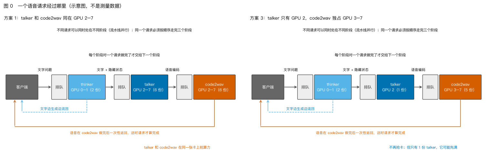

# 实验 9：8 张 GPU 怎么分工最好？

> **状态：RUNNING（正式运行进行中）**
> - 预跑 4 次（2026-11-17 22:39–23:07）已完成，只用来定开环速率，不进入判定。
> - 正式运行 12 次（4 种分工 × 3 个区组）从 23:12 开始。
> - 方案 2 区组 1 第一次启动失败（11-18 00:38，talker 的进程在 29500 端口上监听失败），没有产生任何测量。编排器按登记的规则用新的运行 ID 重跑，重跑正常。原因的排查见[技能文档](../../../docs/research_skills_used_exp09_11.md)的排查记录。
> - 事先登记的假设和判定标准见 [hypotheses.md](hypotheses.md)。
> - 下面第一、六到九部分要等 12 个运行结束、按登记的规则判定后才写。

## 第一部分：一句话

（待数据。）

## 第二部分：为什么要做

前面的实验已经知道下面几件事（数字来自 [实验 6–8 的发现](../../../reports/research_updates/exp06_08_findings.md)）：

- **高负载时，2+6 分工的吞吐被 code2wav 卡住。**
  - code2wav 每个请求固定要约 0.2 秒 GPU 时间（flow 约 150 毫秒，HiFT 约 45 毫秒）。
  - 凑成大批也不省（实验 6）。
- **talker 和 code2wav 放在同一张卡上会互相拖慢**（实验 7，实测）：
  - 同卡时 talker 生成 1 秒语音要 112–120 毫秒，独占时 51–53 毫秒；
  - code2wav 每秒语音的 GPU 时间多 49–59%。
- **同样 8 张卡，实验 7 只找到一种比 2+6 好的分法**：talker 2 张、code2wav 4 张。
  - 闭环并发 256 的吞吐 +8.2%（95% 区间 −0.0% 到 +16.5%），P95 −17.6%，P99 −20.4%；
  - code2wav 只给 3 张或 2 张卡时，吞吐反而少 19% 和 44%。
- **独占以后 talker 的卡有 31–37% 的时间空着**（nvidia-smi）。
  - 这提示：再从 talker 那里拿一张卡给 code2wav（talker 1 张、code2wav 5 张），code2wav 的能力还能再涨；
  - 但只剩 1 个 talker，它可能先满。实验 9 要直接测这件事（方案 3）。

实验 7 还留下三个没回答的问题：

1. **开环只测到 10.5 请求/秒**，离容量很远。那时各种分法的差别都小于 5%，看不出接近满负荷时的尾延迟和稳定容量。
2. **只用了短回答（W3b，平均约 44 个 token、13 秒语音）。** 回答变长时 talker 的工作量跟着涨，最好的分法可能会变。
3. **容量的算法有偏差**（实验 9 补充登记一）：
   - 闭环的“完成数 ÷（最后一个完成 − 第一个发出）”把最后一波请求的收尾也算进去，那段时间在途请求越来越少，所以会低估；
   - 实验 7 的“独占 code2wav 每张卡约 6 请求/秒”可能因此偏低。

## 第三部分：先学几个概念

下面 9 个概念摘自 [实验 9–11 的概念表](../../../reports/research_updates/exp09_11_concepts.md)，那里还有另外 11 个。

### 3.1 GPU 放置（placement）

- **定义**：哪个阶段的进程放在哪张 GPU 上。
- **例子**：一家餐馆有 8 个灶台，决定几个灶台炒菜、几个灶台煲汤、哪些灶台两样都做。
- **这里**：8 张 A6000 里，GPU 0–1 跑 thinker，剩下 6 张怎么分给 talker 和 code2wav，就是实验 9 比较的“方案”。例如方案 3 是 GPU 2 跑 talker，GPU 3–7 跑 code2wav。
- **别混淆**：放置决定的是“在哪张卡上”，副本数（下一条）决定的是“有几份”。同卡放置时，两种进程挤在同一张卡上，卡数少于进程数。

### 3.2 副本（replica）

- **定义**：同一个阶段同时跑的几份完全一样的进程，新请求轮流交给它们。
- **例子**：银行开 3 个窗口，每个窗口都能办同样的业务。
- **这里**：方案 2 有 2 个 talker 副本、4 个 code2wav 副本；sglang-omni 在请求进来时按轮转给每个阶段各挑一个副本。
- **别混淆**：副本多不等于快。如果瓶颈在别的阶段，多开副本只会让它们空着。

### 3.3 吞吐（throughput）

- **定义**：每秒完成多少个请求（或多少秒语音）。
- **例子**：收银台每分钟结账多少位客人。
- **这里**：
  - “完成的请求/秒”是客户端收到完整回答的数量除以时间；
  - “完成的语音秒/秒”把每个请求的语音时长加起来再除以时间，更能反映语音服务真正干了多少活。
- **别混淆**：
  - 发出去的速率（offered）、被接受的速率（accepted）和完成的速率（completed）是三件事。过载时发得多、完成得少，差额堆在队列里。
  - 实验 9 还发现：闭环测吞吐时，如果把最后一波请求的收尾也算进去，会低估稳定状态下的完成速率。

### 3.4 TTFT（首个 token 的时间）

- **定义**：从客户端发出请求，到收到回答的第一段文字所用的时间。
- **例子**：点餐后多久上第一道菜。
- **这里**：客户端用同一个单调时钟记“发出”和“收到第一段文字”，两者相减。MiniCPM-o 的语音在所有文字之后一次性返回，所以“首个音频的时间”约等于整个请求的时间，和 TTFT 不是一回事。
- **别混淆**：TTFT 包括网络和服务端在 prefill 之前的排队，不只是模型算第一个 token 的时间。实验 11 把它拆成了 9 段。

### 3.5 P50、P95、P99

- **定义**：把所有请求的耗时从快到慢排好，排在 50%、95%、99% 位置上的那个值。
- **例子**：100 个人跑步，P95 就是第 95 名的成绩，只有 5 个人比他慢。
- **这里**：每次运行内单独算百分位，再把 3 个区组的值汇总，而不是把所有请求混在一起算。失败和超时的请求按“无穷大”算进去，否则只看活下来的快请求会低估尾延迟。
- **别混淆**：P99 需要足够多的请求才可靠；几十个请求的 P99 实际上就是最慢的那一个。

### 3.6 闭环（closed loop）

- **定义**：客户端始终保持固定数量的请求在系统里，完成一个才补一个。
- **例子**：店里始终有 64 位客人，走一位进一位。
- **这里**：并发 256 就是始终有 256 个请求在途。闭环适合测“最多能处理多快”。
- **别混淆**：闭环的系统永远不会被“压垮”。处理慢了，客户端补得也慢，所以它看不到真实服务里的排队爆炸，那要靠开环。

### 3.7 开环（open loop）

- **定义**：请求按固定的平均速率随机到达，不管系统处理没处理完。
- **例子**：路口的车流，每分钟平均来 10 辆，不会因为堵车就不来。
- **这里**：到达间隔服从指数分布（泊松到达）。实验 9 在同一组“共同速率”下比较各个方案，每档 60 或 90 秒。
- **别混淆**：开环里看到的“完成速率”可能低于“到达速率”，差额就是正在积压的请求。

### 3.8 饱和（saturation）

- **定义**：某个阶段已经满负荷，再增加负载它也不会更快，只会让排队变长。
- **例子**：一台咖啡机一分钟最多做 2 杯，来再多人也只能做 2 杯。
- **这里**：判断方法是看到达速率上去后，完成速率还跟不跟得上、队列有没有一直涨。实验 9 用开环里“已发出未完成”的请求数的增长斜率判断是否稳态。
- **别混淆**：GPU 忙碌比例 100% 不一定饱和（可能在做低效的工作）；不到 100% 也可能已经饱和。例如实验 9 的预跑（不是正式数据）里，方案 3 唯一的 talker 前面排队的中位数是 8.4 秒，它的卡却只有 63% 的时间在忙。原因还没查清，一种推测是 talker 同时处理的请求数有上限。

### 3.9 背压（backpressure）

- **定义**：下游处理不过来，压力沿着流水线往上游传，上游被迫等待或排队。
- **例子**：收银台堵了，后面装袋的人也只能停下来等。
- **这里**：code2wav 处理不过来时，talker 做完的请求只能堆在 code2wav 的收件队列里。sglang-omni 没有主动限流，压力表现为排队变长。
- **别混淆**：背压是现象，不是某个阶段慢的原因。要找真正的瓶颈，看哪个阶段的驻留请求最多。

## 第四部分：一个请求经过哪里

**图 0 是示意图，不是测量数据。** 左边是方案 1（对照），右边是方案 3（新加的分法）。

- **三个阶段按顺序走**：
  1. thinker 写出文字，边写边把文字流回客户端；
  2. thinker 写完一个请求，把文字和每个 token 的隐藏状态交给 talker，talker 生成语音编码；
  3. talker 做完这个请求，再把语音编码交给 code2wav，code2wav 算出波形。语音在 code2wav 做完后一次性返回，这时请求才算完成。
- **每个阶段前面都有一个队列**。一个阶段忙不过来，请求就在它前面排队；sglang-omni 没有主动限流，所以下游慢了，表现就是这个队列变长（背压）。
- **哪些地方是并行的**：
  - 不同请求可以同时处在不同阶段（流水线并行）；
  - 同一个阶段的几个副本各自处理不同的请求；
  - 一个副本里的请求还会凑成一批一起算。
- **哪些地方是同步的**：同一个请求必须按顺序走完三个阶段，前一个阶段没做完，下一个阶段不会开始。
- **两种放法的区别**：
  - 方案 1 里，GPU 2–7 每张卡上同时有一个 talker 和一个 code2wav，它们抢同一张卡的算力；
  - 方案 3 里，两者不再抢卡，但 talker 只有 1 份，它可能先满。

## 第五部分：我们究竟怎么做实验

### 5.1 比较哪几种分工

| 方案 | 放置 | thinker | talker | code2wav | 来历 |
|---|---|---|---|---|---|
| 1（对照） | t2_k6_shared | GPU 0–1 | GPU 2–7 | GPU 2–7，与 talker 同卡 | 2+6，实验 7 的 A |
| 2 | t2_k2_c4 | GPU 0–1 | GPU 2–3 | GPU 4–7 | 实验 7 的 D |
| 3 | t2_k1_c5 | GPU 0–1 | GPU 2 | GPU 3–7 | 新加 |
| 4 | t2_k3_c3 | GPU 0–1 | GPU 2–4 | GPU 5–7 | 实验 7 的 C |

- **只改一样东西**：talker 和 code2wav 各占几张卡、是否同卡。
- **其余都不变**：
  - 显存比例（talker 0.40、code2wav 0.40）；
  - 软件：sglang-omni 520b49ee 加测量补丁，和实验 6、7 相同；
  - 模型、负载和客户端。
- 每次运行都重新启动服务。

### 5.2 负载

- **W3b**：6 个短问题，max_tokens 64，和实验 6–8 相同。
- **W3L**（新）：6 个要求约 100 个英文词回答的问题，max_tokens 160。预跑里实际平均 101.8 个 token、30.2 秒语音，最长 45.4 秒，全部自然结束，没有被截断。
- 两种负载的温度都是 0，客户端带 seed 0，所以 thinker 走同步执行，和实验 7 一致。实验 8 的提前发射不在本实验里。

### 5.3 预跑和开环速率（2026-11-17 22:39–23:07）

1. 每种分工启动一次，开事件记录，测 W3b 闭环 128、256 和 W3L 闭环 32、64、128。预跑不是正式数据。
2. 按登记的规则定开环速率：
   - X_min、X_max 是 4 种分工预跑闭环吞吐的最小值和最大值；
   - 速率 = {0.5 X_min，0.8 X_min，X_min，(X_min + X_max)/2，X_max，1.1 X_max}，四舍五入到 0.5。
3. 预跑的闭环吞吐（W3b 并发 256 / W3L 并发 128，请求/秒）：

   | | 方案 1 | 方案 2 | 方案 3 | 方案 4 |
   |---|---|---|---|---|
   | W3b | 20.69 | 21.22 | 15.26 | 15.73 |
   | W3L | 8.72 | 9.37 | 7.31 | 6.62 |

4. 算出的速率：
   - W3b：7.5、12、15.5、18、21、23.5 请求/秒；
   - W3L：3.5、5.5、6.5、8、9.5、10.5 请求/秒。
   - 写进配置后不再改，4 种分工用同一组速率。

### 5.4 正式运行（2026-11-17 23:12 起）

**顺序**：3 个区组依次跑，每个区组里 4 种分工各一次，区组内顺序随机（种子 20261118）：

| 区组 | 顺序 |
|---|---|
| 1 | 方案 4 → 3 → 1 → 2 |
| 2 | 方案 4 → 3 → 1 → 2（随机抽到了和区组 1 相同的顺序） |
| 3 | 方案 1 → 3 → 2 → 4 |

**每次运行依次做**（每次约 25–27 分钟，其中启动约 3 分钟）：

1. 冒烟：2 个请求，不计。
2. W3b 闭环 A 段：并发 8、64、128、256，不打点。每档先预热一波（不计），再测 max(96, 3 × 并发) 个请求。
3. W3b 闭环 B 段：并发 64、128、256，开服务端事件记录，用来看每个阶段的排队和处理时间。
   - 区组 1、3 先 A 后 B，区组 2 先 B 后 A。
4. W3b 开环：6 档速率，每档 60 秒，从低到高。
5. W3L 闭环 A 段：并发 16、64、128，每档 max(96, 2 × 并发)。
6. W3L 闭环 B 段：并发 128。
7. W3L 开环：6 档速率，每档 90 秒。

nvidia-smi 每 0.2 秒记一次每张卡的忙碌比例、显存、SM 时钟和功耗。这次不开 torch profiler：code2wav 在 profiler 里崩溃过，实验 9 也不需要 kernel 级的 trace。

### 5.5 怎么算

- **容量（登记的主要指标）**：
  - 闭环不打点段最高并发档（W3b 256、W3L 128）的完成请求/秒 = 成功完成的请求数 ÷（最后一个完成 − 第一个发出）。
  - 另算一个**描述性**的“满额时段吞吐”：只数第一个和最后一个测量请求发出之间完成的请求，这段时间每个闭环名额都占满。它是看过第一个运行的数据后才加的（补充登记一），只用来做敏感度分析，不改判定。
- **是否稳态**：开环每档每秒数一次“已发出、未完成”的请求数，在发送期的后半段拟合一条直线，斜率超过 0.05 × 到达速率就算“非稳态”（队列在涨）。
- **尾延迟**：每次运行内单独算 P50、P95、P99，失败和超时的请求按无穷大计入，再跨区组汇总。
- **哪个阶段是瓶颈**：在打点的 B 段，把每个阶段所有请求的驻留时间（收到 → 完成）加起来，除以这一档的时长，按利特尔法则得到“平均同时在这个阶段里的请求数”。最多的那个阶段就是瓶颈。
- **排除规则**（登记）：
  - 闭环档位的错误 + 超时超过 5% 时标为不可用，照样报告，不参与判定；
  - 服务在某一段重启时，这一段的值记为缺失，之后的段单独标出；
  - 开环的超时按无穷大计入，不排除；
  - 不删除任何运行目录。

### 5.6 统计

- **实验单位**是一次独立启动的服务（运行），一个运行里成百上千个请求不是独立重复。
- 所有比较都在同一区组内配对（方案 − 对照），报告每个区组的值、均值和 t 分布 95% 区间（自由度 2）。
- 只有 3 个区组，不声称统计显著。按实验 7 的波动事先估计，小于约 8% 的差别无法和 0 区分。

## 第六部分：每张图怎么读

（待数据。计划 9 张图：分工示意、每种卡的容量、闭环吞吐、开环尾延迟、队列深度、语音吞吐、GPU 忙碌和功耗、两种负载对比、阶段容量模型的预测。）

## 第七部分：证据等级

（待数据。）

## 第八部分：研究意义

（待数据。）

## 第九部分：下一步

（待数据。）

## 附：文件在哪里

| 文件 | 内容 |
|---|---|
| [hypotheses.md](hypotheses.md) | 事先登记的假设、判定标准和补充登记 |
| [reproduce.md](reproduce.md) | 怎样从头复现 |
| `results/summary.json`、`results/levels.csv` | 分析结果（字段见[数据字典](../../../reports/research_updates/exp09_11_data_dictionary.md)） |
| `figures/` | 图，全部可以用 `scripts/analysis/exp09_figures.py` 从 `results/` 重画 |
| `scripts/analysis/exp09_report.py` | 分析脚本 |
| `configs/experiments/plan_exp09.json` | 12 个正式运行的计划 |
