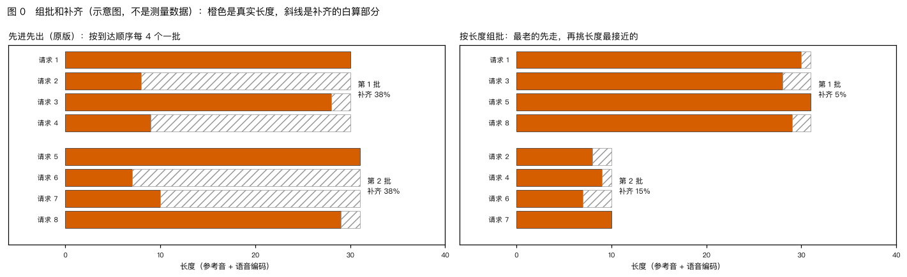
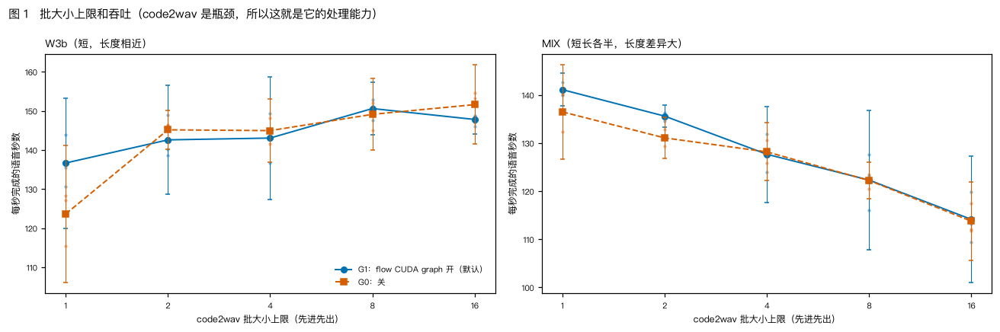
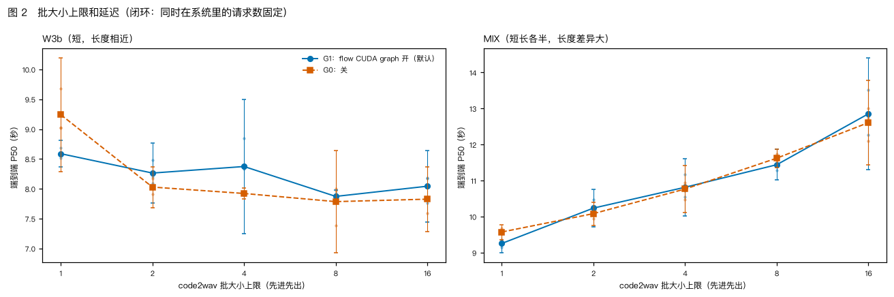
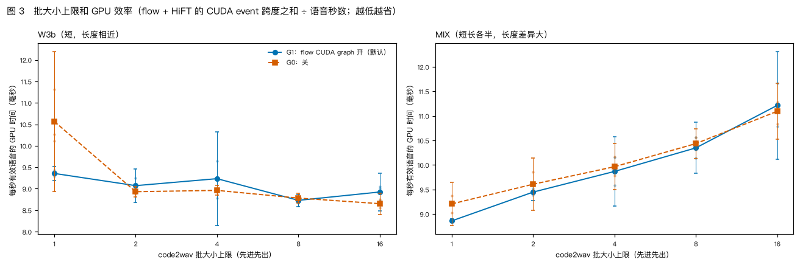
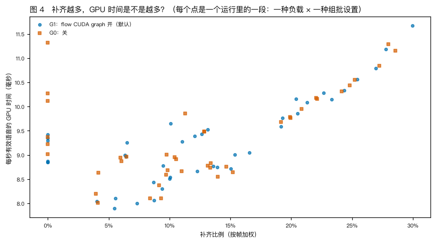
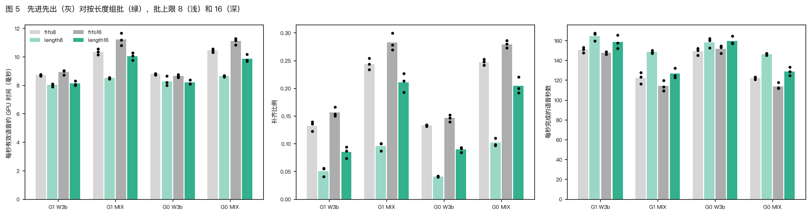
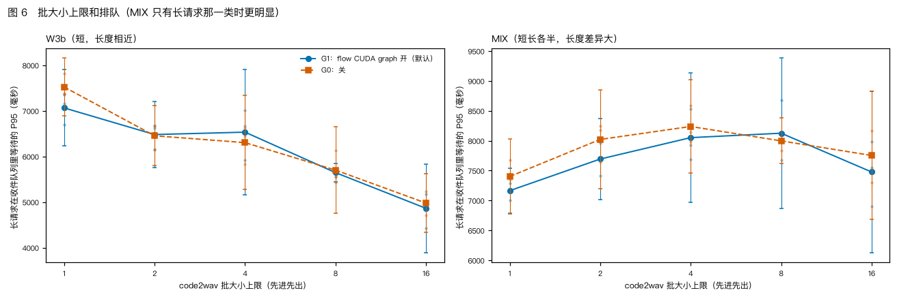
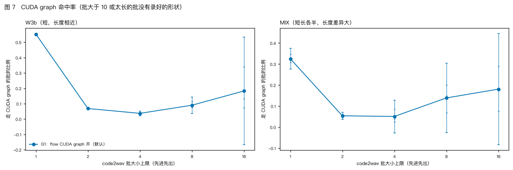
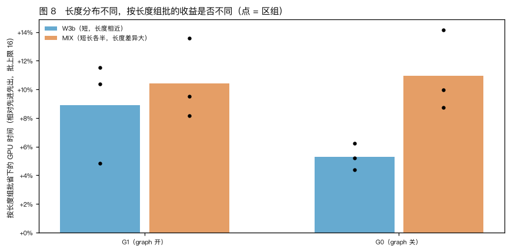
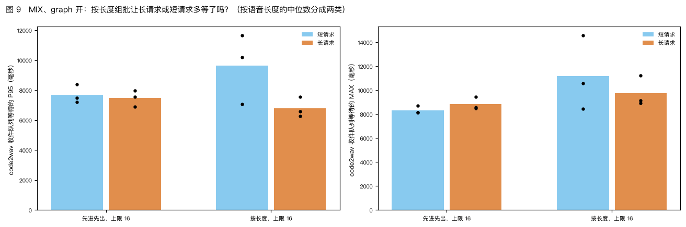

# 实验 10：code2wav 凑大批、按长度组批，真的能省 GPU 吗？

> **状态：COMPLETED（2026-11-18）**
> - 正确性检查（04:27–04:35）**通过**，结果见 5.5。
> - 6 个性能运行（04:35–05:54）全部成功，没有服务重启，所有段都可用、控制文件全部生效；按登记的规则判定，见第一部分。
> - 结果满足登记的触发条件，在实验 9 最好的放置 t2_k2_c4 上做了完整服务验证（3 个运行，06:04–06:55，全部成功），判定为**不确定**：两种组批方式的延迟几乎一样，见第六部分末尾。
> - 事先登记的假设、判定标准和补充登记见 [hypotheses.md](hypotheses.md)。
> - 第一、六到九部分要等数据出来、按登记的规则判定后才写。

## 第一部分：一句话

**长短混在一起的请求按先进先出凑成大批时，code2wav 有近三成的计算花在补齐上，批越大越费；把长度相近的请求凑成一批，code2wav 每秒能多做 30% 的语音。** 这是在 code2wav 独占 2 张卡、并且是瓶颈的放置（t2_k4_c2）上测的，flow CUDA graph 开（默认）：
- 长短混合（MIX）时，默认的“先进先出、批上限 16”每秒完成 114 秒语音，补齐占 28%；按长度组批、上限 8（length8）148 秒/秒（+30%，95% 区间 +17% 到 +43%），端到端 P50 从 12.9 秒降到 8.6 秒。
- 连完全不凑批（批上限 1）都比默认好：141 秒/秒（+24%）。
- 长度相近的短回答（W3b）上，length8 只多 11%，而且端到端 P95 从 9.3 秒变成 10.9 秒，长请求排队更久。

| 判定（按事先登记的规则） | 结果 |
|---|---|
| H10a：单靠增大批，不一定提高 GPU 效率 | **不确定**：graph 关、W3b 上批上限 16 比 1 省 15–23%（3 个区组的比值 0.77、0.84、0.85），没有都过 20% 的反驳线，也没有都在 10% 以内 |
| H10b：长度差异大的批有明显的补齐浪费 | **支持**：MIX 的补齐比例 0.27–0.29，比 W3b（0.14–0.15）高 0.12–0.14 |
| H10c：按长度组批能减少补齐和计算 | **支持**：MIX、graph 开、批上限 16，3 个区组的补齐都更低（0.19–0.23 对 0.27–0.30），每秒语音的 GPU 时间少 8.1%、13.6%、9.5% |
| H10d：按长度组批让长请求多等 | **不确定**：长请求排队的 P95 变化是 0%、−17%、−9%，最大值是 +32%、−5%、+6% |
| H10e：CUDA graph 只对小批有用 | **不确定**：批上限 1 时 graph 省 22%、10%、7%（没有 3 个区组都 ≥ 10%）；批上限 16 时省 −3%、−4%、−2%（都 ≤ 5%） |
| 完整服务验证（t2_k2_c4，W3b 开环，length8 对 fifo16） | **不确定**：21、23.5 请求/秒两档的 P50 变化在 −3.5% 到 +2.5% 之间，没有达到“3 个区组都低 ≥ 5%”，也不是“都没有降低” |

**要点**：组批方式只在 code2wav 排着长队时才起作用。完整服务在 23.5 请求/秒以下没有饱和，code2wav 平均每批只有 1.2 个请求，换成按长度组批，延迟没有变化。

## 第二部分：为什么要做

- **code2wav 是 2+6 分工在高负载时的瓶颈**（实验 6、7）。
  - 每个请求固定要约 0.2 秒 GPU 时间：flow 约 150 毫秒，HiFT 约 45 毫秒。
  - 并发 256 时，每个请求在 code2wav 里要待 5.2 秒（并发 8 时 0.15 秒）：42% 在收件队列里排队，58% 在等自己这一批（平均 8 个、最多 16 个请求）一起算完。
- **以前的两个观察互相矛盾，而且都没有因果证据**：
  - 实验 6（和 talker 同卡）说“凑批不省时间”：每个请求分摊的 flow、HiFT 时间对批大小 1–16 都是平的。并发 256 时大批每帧反而贵约 20%（160 对 132 微秒/帧），可能是补齐的浪费，但这只是假设。
  - 实验 7（独占卡）里，每秒语音的 GPU 时间从并发 8 的约 12 毫秒降到并发 256 的约 9 毫秒，同时平均批大小从约 1 变到约 14，看起来像是凑批省了时间。
  - 两者的批都是负载自然形成的：批大小和并发、和 talker 的争用一起变，分不出是哪一个起的作用。
- **CUDA graph 只覆盖小批**（源码，见第五部分）。所以“批大了不省”也可能只是因为大批没有录好的 graph，而不是凑批本身没用。

实验 10 的做法是**主动控制**：在同一个服务里用控制文件一次只改一个因素，分别看批大小上限、长度差异（补齐）和 CUDA graph 的作用。

## 第三部分：先学几个概念

下面 6 个概念摘自 [实验 9–11 的概念表](../../../reports/research_updates/exp09_11_concepts.md)。

### 3.1 吞吐（throughput）

- **定义**：每秒完成多少个请求（或多少秒语音）。
- **例子**：收银台每分钟结账多少位客人。
- **这里**：
  - “完成的请求/秒”是客户端收到完整回答的数量除以时间；
  - “完成的语音秒/秒”把每个请求的语音时长加起来再除以时间，更能反映语音服务真正干了多少活。
- **别混淆**：
  - 发出去的速率（offered）、被接受的速率（accepted）和完成的速率（completed）是三件事。过载时发得多、完成得少，差额堆在队列里。
  - 实验 9 还发现：闭环测吞吐时，如果把最后一波请求的收尾也算进去，会低估稳定状态下的完成速率。

### 3.2 饱和（saturation）

- **定义**：某个阶段已经满负荷，再增加负载它也不会更快，只会让排队变长。
- **例子**：一台咖啡机一分钟最多做 2 杯，来再多人也只能做 2 杯。
- **这里**：判断方法是看到达速率上去后，完成速率还跟不跟得上、队列有没有一直涨。实验 9 用开环里“已发出未完成”的请求数的增长斜率判断是否稳态。
- **别混淆**：GPU 忙碌比例 100% 不一定饱和（可能在做低效的工作）；不到 100% 也可能已经饱和。例如实验 9 的预跑（不是正式数据）里，方案 3 唯一的 talker 前面排队的中位数是 8.4 秒，它的卡却只有 63% 的时间在忙。原因还没查清，一种推测是 talker 同时处理的请求数有上限。

### 3.3 批大小（batch size）

- **定义**：GPU 一次一起处理的请求个数。
- **例子**：洗衣机一次洗几件衣服；件数多了每件分摊的电费可能更少，也可能一样。
- **这里**：code2wav 默认一次最多 16 个请求一起算；实验 10 用控制文件把上限改成 1、2、4、8、16 来比较。
- **别混淆**：
  - 批大小上限和实际批大小不同。上限是 16，但如果队列里只有 2 个请求，实际批就是 2。实验 10 让 code2wav 成为瓶颈，保证批能填满。
  - 批大了不一定省时间，要看计算是不是随批变得更高效。

### 3.4 补齐（padding）

- **定义**：一批里长短不一的请求，要补到和最长的一样长才能一起算；补出来的部分是白算的。
- **例子**：一辆车接 4 个人，只要一个人要去 30 公里外，车就得跑 30 公里。
- **这里**：code2wav 的 flow 把每行“参考音 + 语音编码”补到这一批最长的一行。补齐比例 = 1 −（真实长度之和 ÷（行数 × 最长一行））。
- **别混淆**：补齐浪费的是计算量；它是不是真的拖慢了 GPU，还要看 GPU 时间有没有随之变化。实验 10 用“按长度组批”主动减少补齐来检验。

### 3.5 CUDA graph

- **定义**：把一串固定形状的 GPU 操作提前录下来，之后一次性重放，省掉 CPU 一个个发命令的开销。
- **例子**：把常做的一套动作录成宏，以后按一个键就全部执行。
- **这里**：code2wav 为（批大小，帧数）的一组组合录了 graph；形状对不上就退回逐个发命令（eager）。批大于 10 没有录好的形状。thinker 的每个 decode 步也是一次 graph 重放。
- **别混淆**：graph 省的是 CPU 发命令的时间和小 kernel 之间的空隙，不会让单个 kernel 算得更快。重放时会写进录制时固定的那块输出内存，这正是实验 8、11 里“隐藏状态被覆盖”的来源。

### 3.6 CUDA event（CUDA 事件）

- **定义**：插在 GPU 工作流里的一个时间标记，GPU 执行到这里时记下时间，或者标记“前面的工作都做完了”。
- **例子**：流水线上放一个计时牌，产品经过时打卡。
- **这里**：
  - 实验 6、10 用两个事件之间的时间作为 flow、HiFT 的“GPU 跨度”；
  - 实验 11 用事件告诉旁路流“快照已经做完，可以复制了”。
- **别混淆**：两个事件之间的跨度不是纯计算时间。如果同一张卡上还有别的进程在跑，跨度里也包括等待的时间。

## 第四部分：code2wav 里发生了什么

一个请求在整条流水线里的路径，见[实验 9 的图 0](../实验09_最佳GPU分工/figures/fig0_request_path.png)。实验 10 只看最后一个阶段 code2wav：

1. talker 做完一个请求，把它的语音编码放进 code2wav 的**收件队列**。
2. code2wav 每次取出最老的一个请求，然后**不等待**地把队列里已有的请求加进来，直到批大小上限（默认 16），组成一批。
3. 这一批先过 **flow**：每行的“参考音 + 语音编码”都补齐到这批最长的一行，一起算；形状合适时走录好的 CUDA graph，否则逐个发命令（eager）。
4. 再过 **HiFT**：按语音编码数分组，每组分别算出波形。
5. 波形返回给客户端，请求完成。

**图 0 是示意图，不是测量数据。** 它说明两种组批方式的区别：

- 左边是原版的**先进先出**：按到达顺序每次取一批。长短请求混在一起时，短请求要补到和最长的一样长，斜线部分就是白算的。
- 右边是原型的**按长度组批**：
  - 最老的请求先走，再从排队的请求里挑长度和它最接近的，补齐少了；
  - 没挑上的按原来的顺序放回队首，下一批由其中最老的那个领头，所以长请求不会被一直跳过。
- 代价是：一个请求可能比它后到的请求晚走。这就是 H10d 要量的“公平性代价”。

## 第五部分：我们究竟怎么做实验

### 5.1 读源码（sglang-omni 520b49ee）

- code2wav 用 `SimpleScheduler`：
  - 先进先出，批上限 16；
  - 不等待凑批（`max_batch_wait_ms` 默认 0）；
  - 有一个按语音编码数计的成本上限，默认不设。
- flow 把一批补齐到最长的一行（不支持变长）。
- flow 的 CUDA graph 按（批大小，帧数）录好：
  - 批大小 1 到 1024 帧，批大小 2–8 到 700–780 帧左右；
  - 9、10 只有零星几个形状，11 以上没有；
  - W3L 的请求约 2000 多帧，一律不走 graph。
- flow 的初始噪声是进程启动时生成的固定噪声，每行都从开头取。所以同一个服务里，同样的语音编码在不同的批里只应有浮点误差级别的差别。这是正确性检查的依据。

### 5.2 原型：用控制文件切换组批方式

- 代码在 `configs/runtime/patches/sglang_omni_batch_exp10.patch`。
- 每次运行的服务带环境变量 `SGLANG_OMNI_C2W_CONTROL`，指向运行目录里的 `c2w_control.json`。code2wav 每次组批前发现文件变了，就重新读：
  - `max_batch_size`：批上限；
  - `policy`：`fifo`（先进先出）或 `length`（按长度）；
  - `window`：按长度组批时最多看多少个排队请求，设为 64。
- 没有控制文件时，行为和原版完全一样。
- 每批的事件里记下实际生效的批上限和策略，分析时逐批核对控制文件确实生效。
- CPU 检查 `check_sglang_omni_batch.py`：在改动之前的代码上失败，改动之后 14 项全部通过。

### 5.3 设计

- **放置**：t2_k4_c2（talker 4 张卡，code2wav 独占 2 张卡）。
  - code2wav 在这里明显是瓶颈（实验 7：并发 128 时排队 3.7 秒、平均批大小 14），批能填到任意上限，吞吐直接反映 code2wav 的处理能力；
  - code2wav 独占卡，它的 GPU 时间里不混有 talker 的 kernel。
- **每次运行之间改的因素 G**：
  - G1 是 flow CUDA graph 开（默认）；
  - G0 是关，其余配置逐项核对过不变。
- **每次运行之内改的因素 K**：用控制文件切换 7 种设置。
  - 先进先出：批上限 1、2、4、8、16；
  - 按长度：批上限 8、16。
  - 每次切换后等 3 秒。
- **负载 W**：
  - W3b：短回答，语音约 6–21 秒，闭环并发 128；
  - MIX：W3b 和 W3L 各一半，长度差异大，语音约 6–45 秒，闭环并发 96。
- **每段**：先写控制文件，再预热一波（不计），再测两波。开服务端事件。
- **区组**：3 个，每个区组 G1、G0 各一次运行，共 6 次运行。
  - 区组内顺序随机（种子 20261118）；
  - 每个负载里 7 种设置的顺序在每个区组随机；
  - 区组 1、3 先 W3b 后 MIX，区组 2 反过来。
- **正确性检查**（在性能运行之前，1 次运行，graph 开）：
  - 贪心负载：thinker、talker 温度都是 0，不带种子；
  - 并发 32，依次 fifo1、fifo16、length16、length8，再 fifo16 一次；
  - 记下每个请求语音编码的哈希和波形统计量。语音编码相同的请求，在不同组批方式下比较波形。第二次 fifo16 用来估计“同一种方式自己重复”的差别。
- **端口**：每次运行在自己的运行目录里认领 NCCL 端口。实验 9 里出过一次端口冲突，这样可以避免；端口不影响测量。

### 5.4 怎么算

- **E（每秒有效语音的 GPU 时间）**：一段里所有批的 flow 和 HiFT 的 CUDA event 跨度之和 ÷ 这些批里请求的语音秒数之和。越低越省。
- **补齐比例**：每批 1 −（各行真实长度之和）÷（行数 × 最长一行），按帧加权汇总。
- **其他指标**：
  - 每秒完成的语音秒数；
  - 实际批大小，以及等于批上限的批占多少；
  - 走 CUDA graph 的批占多少；
  - 收件队列里的等待，按语音长度的中位数分成短、长两类；
  - 端到端延迟。
- **对应关系**：每个请求的语音秒数应等于它的语音编码数 × 0.04 秒，差超过 1 个编码就算对不上。
- **排除和停止规则**（登记）：
  - 错误 + 超时 > 5% 的段、控制文件没有生效的段，照样报告，但不参与判定；
  - 任何请求的语音和编码对不上，或者同样的编码得到不同长度的波形，就停止所有关于按长度组批的性能结论，只报告失败证据。
- **统计**：
  - G 的比较是同一区组里两次运行之间的配对；K 的比较是同一次运行之内的配对；
  - 报告每个区组的值、均值和 t 分布 95% 区间（自由度 2），不声称统计显著。
- **完整服务验证**（补充登记一）：
  - 只有某种设置在 G1 上每个区组都比 fifo16 多 ≥ 5% 的语音秒/秒时才做；
  - 做法是在实验 9 登记容量最高的放置上，用 W3b 开环比较 fifo16 和这种设置，3 个区组。

### 5.5 正确性检查的结果（Measured，运行 `20261118_exp10_check_run01`）

按登记的正确性规则，**通过**。具体：

| 检查 | 结果 |
|---|---|
| 语音编码相同的请求，波形样本数是否相同 | 640 个请求里有 571 种不同的编码；同一种编码的波形样本数全部相同（0 种不一致） |
| 5 组比较各有几对“编码相同”的请求 | fifo16 对 fifo1：6 对；length16 对 fifo1：4 对；length8 对 fifo1：6 对；第二次 fifo16 对 fifo1：7 对；两次 fifo16 之间：9 对。每组都有，样本数都相同 |
| 波形的相对差（登记的算法：√\|Σx²₁ − Σx²₂\| ÷ √Σx²₂） | 各组的最大值：fifo16 4.0%，length16 4.5%，length8 3.8%；作为参照的“两次 fifo16 之间”是 4.7%。按长度组批的差别没有超出同一种方式自己重复的差别。换成两个波形的均方根之差，最大只有 0.11% |
| 控制文件是否每批都生效 | 410 批全部按这一段设定的上限和策略执行 |
| 每个请求的语音秒数是否等于编码数 × 0.04 秒 | 640 个请求全部对得上 |
| 服务是否中途重启 | 没有 |

- **为什么每组只有 4–9 对**：即使温度是 0，talker 的输出也会随批的组成有极小的数值差别，生成的语音编码因此常常不同。只有编码完全相同的请求才能比较波形，所以每段 128 个请求里只有几个能配上对。这让波形比较的证据偏少，见 [limitations.md](limitations.md) 第 7 条。
- **结论**：没有发现“同样的编码得到不同长度的波形”或“请求拿到别人的语音”。按长度组批的性能结果可以用，也可以触发完整服务验证。

## 第六部分：每张图怎么读

所有图都可以用 `scripts/analysis/exp10_figures.py` 从 `results/summary.json` 重画。除特别说明外：
- 线和柱是 3 个区组的均值，小点是每个区组，误差线是 t 分布 95% 区间；
- G1 是 flow CUDA graph 开（默认），G0 是关；
- 无效的格子（错误 + 超时 > 5%、控制文件没生效、服务在该段重启）不进均值。

### 图 1　批大小上限和吞吐

- **画的是什么**：横轴是先进先出的批大小上限（1、2、4、8、16），纵轴是每秒完成的语音秒数。左 W3b，右 MIX；蓝线 G1，橙线 G0。
- **怎么读**：code2wav 在这里是瓶颈，所以这条线就是它的处理能力。线随上限上升，说明凑批确实让 code2wav 处理得更多；线平，说明凑批不省。
- **结果**：
  - W3b（长度相近）：graph 开时，批上限从 1 到 16，每秒语音从 137 到 148 秒，只涨 8%；graph 关时从 124 涨到 152 秒，涨 23%，主要涨在 1 → 2。
  - MIX（长度差异大）：两条线都**往下走**。graph 开时从 141（上限 1）一路降到 114 秒（上限 16），默认的上限 16 是五个上限里最差的。
- **不能得出**：完整服务上的效果。其他放置下 code2wav 不一定是瓶颈。

### 图 2　批大小上限和延迟

- **画的是什么**：同样的横轴，纵轴是端到端延迟的 P50（闭环，同时在系统里的请求数固定）。
- **怎么读**：闭环下吞吐高，同样数量的请求就排得短，延迟就低。所以这张图和图 1 是一体两面。
- **结果**：
  - W3b：P50 在 7.8–9.2 秒之间，graph 关、上限 1 时最慢（9.2 秒）。
  - MIX：P50 随上限从 9.3 秒（上限 1）涨到 12.9 秒（上限 16），和图 1 正好相反。
- **不能得出**：开环时的尾延迟。

### 图 3　批大小上限和 GPU 效率

- **画的是什么**：E = 每产出 1 秒有效语音，code2wav 用掉的 GPU 时间（flow + HiFT 的 CUDA event 跨度之和），越低越省。
- **怎么读**：这是 H10a 用的指标。G0 W3b 上，批上限 16 的 E 和上限 1 的 E 之比：
  - 在 3 个区组都 ≥ 0.9 → 凑批省不到 10%（支持 H10a）；
  - 都 ≤ 0.8 → 省了 20% 以上（反驳）。
- **结果**：
  - W3b、graph 关：E 从 10.6 毫秒（上限 1）降到 8.7 毫秒（上限 16），比值 0.77、0.84、0.85，所以 H10a 不确定。graph 开时上限 1 已经是 9.4 毫秒，之后只降到 8.7–9.2 毫秒（比值 0.93–0.97）。
  - MIX：E 随上限**上升**，从 8.9 毫秒（上限 1）到 11.2 毫秒（上限 16），graph 开关都一样。
- **不能得出**：省下的是计算还是 kernel 之间的空隙。CUDA event 跨度两者都包括，要结合图 7 的 graph 命中率看。

### 图 4　补齐越多，GPU 时间是不是越多

- **画的是什么**：每个点是一个运行里的一段（一种负载 × 一种组批设置）。横轴是补齐比例，纵轴是 E。
- **怎么读**：点从左下到右上排列，说明补齐越多越费 GPU；点散成一团，说明补齐不是主要因素。
- **结果**：
  - 补齐比例 10% 以上的点基本排成一条向右上的线：补齐从约 10% 到 30%，E 从约 8.5 毫秒涨到约 11.5 毫秒。
  - 补齐为 0 的点（批上限 1）在 8.9–11.3 毫秒，比补齐 5–10% 的批（约 8.0–9.0 毫秒）还贵：一个请求一批，每批的固定开销分摊不出去，graph 关时更明显。
- **不能得出**：因果关系。补齐和批大小、请求长度一起变，这张图只是相关，因果要看图 5、8 里按长度组批这个主动的改变。

### 图 5　先进先出对按长度组批

- **画的是什么**：四组（G1 W3b、G1 MIX、G0 W3b、G0 MIX），每组四根柱：先进先出和按长度，批上限 8 和 16。三个子图分别是 E、补齐比例、每秒完成的语音秒数。
- **怎么读**：同一组里比较灰柱（先进先出）和绿柱（按长度）。MIX 的长度差异大，按长度组批应该在这里最能减少补齐。
- **结果**：
  - 按长度组批在四组里都降低了补齐和 E。降得最多的是 MIX、上限 8：补齐从 0.24 降到 0.10，E 从 10.4 降到 8.5 毫秒，每秒语音从 122 涨到 148 秒。
  - 上限 8 比上限 16 好：按长度组批时，上限 16 的批里长度仍然差得多（MIX 补齐 0.21），上限 8 的批更“齐”（0.10）。
- **不能得出**：公平性的代价。那要看图 9。

### 图 6　批大小上限和排队

- **画的是什么**：长请求（语音不短于这一段的中位数）在 code2wav 收件队列里等待的 P95。
- **怎么读**：上限小的时候，每批处理的请求少，队列更长；上限大以后，等待应该下降。
- **结果**：
  - W3b：长请求排队的 P95 从 7.1 秒（上限 1）降到 4.9 秒（上限 16），和预期一样。
  - MIX：一直在 7.2–8.1 秒之间，上限变大没有让排队变短，因为每批算得更慢了（图 3）。
- **不能得出**：每个请求在 code2wav 里的总时间。这里只有排队，没有算的时间。

### 图 7　CUDA graph 命中率

- **画的是什么**：G1 运行里，flow 走录好的 CUDA graph 的批占多少。
- **怎么读**：源码里批大小 11 以上没有录好的形状，帧数太长也没有，所以上限越大、请求越长，命中率越低。
- **结果**：
  - 批上限 1 时，W3b 有 55% 的批走 graph，MIX 只有 33%（长请求帧数超出录好的范围）。
  - 上限 2 以上，只有 4–18% 的批走 graph。也就是说，默认配置下 flow 的 CUDA graph 大多数时候没有用上。
  - 区间的下端有时低于 0，这是只有 3 个区组时 t 区间的算法造成的，比例本身不会小于 0。
- **不能得出**：每次命中省了多少时间。那要看 G0 对 G1 的比较（H10e）。

### 图 8　按长度组批省下的 GPU 时间

- **画的是什么**：同一个运行里，批上限 16 时按长度组批相对先进先出省下的 E（1 − E_按长度 ÷ E_先进先出）。点是每个区组，按区组配对。
- **怎么读**：H10c 要求 G1 MIX 上在 3 个区组都省 ≥ 5%，并且补齐比例都更低。
- **结果**：
  - G1 MIX：3 个区组省 8.1%、13.6%、9.5%，补齐都更低，H10c 支持。
  - G1 W3b：省 10.4%、11.5%、4.8%；G0 W3b：4.4%、6.2%、5.2%；G0 MIX：8.7%、10.0%、14.2%。长度差异大的 MIX 省得更多，和预期一致。
- **不能得出**：端到端的改善。完整服务上的效果要看验证（触发条件见第五部分）。

### 图 9　按长度组批让长请求或短请求多等了吗

- **画的是什么**：G1 MIX，批上限 16，先进先出和按长度两种方式下，短请求和长请求在收件队列里等待的 P95（左）和最大值（右）。
- **怎么读**：H10d 看长请求：按长度组批时，P95 在 3 个区组都多等 ≥ 20%，或者最大值在 3 个区组都多等 ≥ 20%，就支持“有公平性代价”。
- **结果**：
  - 长请求：P95 变化 0%、−17%、−9%，最大值 +32%、−5%、+6%，H10d 不确定。
  - **多等的反而是短请求**（描述性，登记没有判定它）：短请求排队的 P95 从 7.5、8.4、7.2 秒变成 11.7、10.2、7.1 秒，有两个区组多等了 56% 和 21%；最大值多等 79%、22%、4%。
  - 两类请求的中位数都变短了（短请求约 6 → 4 秒，长请求约 4.5 → 3 秒）。按长度组批让大多数请求等得更少，但一部分短请求要等很久。
- **不能得出**：用户感受到的延迟。排队只是端到端的一部分。

### 完整服务验证（补充登记一）

- **做了什么**：在实验 9 登记容量最高的放置 t2_k2_c4（thinker 2、talker 2、code2wav 4 张卡）上，graph 开，W3b 开环，速率用实验 9 的 7.5–23.5 请求/秒，每档 60 秒。同一个运行里 fifo16 和 length8 各一段，3 个区组（06:04–06:55）。
- **数据是否可信**：3 个运行都没有重启；每段约 4,800 批，控制文件全部生效；每段 5,850 个请求的语音秒数都和编码数对得上；36 个档位全部是稳态，没有失败的请求。
- **结果**（3 个区组的均值，Measured）：

| 速率（请求/秒） | fifo16：P50 / P95 / P99（秒） | length8：P50 / P95 / P99（秒） | 完成请求/秒（fifo16 → length8） |
|---|---|---|---|
| 7.5 | 2.10 / 2.99 / 3.31 | 2.06 / 2.90 / 3.11 | 7.21 → 7.21 |
| 12 | 2.25 / 3.17 / 3.37 | 2.25 / 3.20 / 4.10 | 11.85 → 11.72 |
| 15.5 | 2.47 / 3.51 / 4.14 | 2.45 / 3.38 / 3.68 | 14.59 → 14.64 |
| 18 | 2.59 / 3.63 / 4.01 | 2.66 / 3.79 / 4.60 | 17.45 → 17.44 |
| 21 | 2.77 / 3.88 / 4.25 | 2.80 / 3.98 / 4.45 | 20.80 → 20.82 |
| 23.5 | 2.84 / 4.04 / 4.58 | 2.81 / 4.02 / 4.41 | 22.25 → 22.22 |

- **判定（登记的规则）**：21、23.5 请求/秒两档 length8 的 P50 相对 fifo16 降低了 −2.3% 和 +3.5%（区组 1）、−2.5% 和 −0.2%（区组 2）、+1.8% 和 −0.3%（区组 3），完成速率都在 fifo16 的 99.7%–100.2%。不满足“3 个区组都低 ≥ 5%”，也不满足“都没有降低”，所以是**不确定**。实际上两者分不出差别。
- **为什么没有效果**：这些速率下服务没有饱和，code2wav 平均每批只有 1.2 个请求（5,850 个请求约 4,800 批）。没有排队就没有可重新组合的批，组批方式自然不起作用。实验 10 的收益是在 code2wav 排着长队（闭环、code2wav 只有 2 张卡）时测到的。
- **不能得出**：在更高的速率、或者长短混合的负载上，完整服务会不会受益。实验 9 的速率在 t2_k2_c4 上没有测到饱和点（23.5 请求/秒仍是稳态），这次验证也就没有覆盖饱和的情况。

## 第七部分：证据等级

| 结论 | 等级 | 依据 |
|---|---|---|
| 各设置的每秒语音、E、补齐比例、批大小、graph 命中率、排队、端到端延迟 | Measured | 6 个独立运行，每段 288（MIX）或 384（W3b）个请求（含一波预热），服务端逐批事件 + CUDA event |
| MIX 上 length8 比 fifo16 每秒语音多 30%（+17% 到 +43%） | Derived | 同一运行之内配对，3 个区组，t 分布 95% 区间 |
| 补齐是 MIX 上 E 变高的主要原因 | Derived | 按长度组批这个主动改变同时降低了补齐和 E（图 5、8）；图 4 的相关性单独不能说明因果 |
| 按长度组批让一部分短请求等很久 | Measured（描述性） | 登记只判定长请求（H10d），短请求的变化是看数据时发现的 |
| 默认配置下 flow 的 CUDA graph 大多没有用上 | Measured | 批上限 ≥ 2 时只有 4–18% 的批走 graph |
| 完整服务、W3b 开环 ≤ 23.5 请求/秒时，按长度组批不改变延迟 | Measured | 3 个区组的验证，36 个档位；判定为“不确定”，差别在 ±3.5% 以内 |
| 在饱和的完整服务或长短混合的开环负载上会怎样 | Unknown | 验证没有覆盖 |
| 在 code2wav 不是瓶颈的放置上会怎样 | Unknown | 只测了 t2_k4_c2 一种放置 |

## 第八部分：研究意义

1. **组批方式比批大小更重要**：
   - 长度差异大时，先进先出凑大批会把短请求补齐到长请求的长度，白算近三成；
   - 默认的批上限 16 在这种负载下是最差的设置，连不凑批都不如。
2. **按长度组批是便宜的改动，但只在 code2wav 排着长队时有用**：
   - 只改 code2wav 收件队列取请求的顺序，不改模型。正确性检查里，波形长度全部一致，数值上的差别没有超出同一设置自己重复时的差别。
   - 在 code2wav 是瓶颈、队列很长时，它能直接多出 11–30% 的处理能力；
   - 完整服务没饱和时（实验 9 最好的放置、≤ 23.5 请求/秒），每批平均只有 1.2 个请求，它没有作用，也没有坏处。
3. **但它有代价**：一部分短请求会等很久；在长度相近的负载（W3b）上 P95 反而变差。上线前要配一个“最长等待”的上限。
4. **CUDA graph 的价值被高估了**：大多数批走不到 graph，graph 只在不凑批时省 7–22%。

## 第九部分：下一步

1. **在会饱和的条件下再验证一次**：在 t2_k2_c4 上用长短混合的负载，或者把 W3b 开环速率推到 25 请求/秒以上，看按长度组批能不能推高稳定容量。这次的验证只覆盖了没有饱和的情况。
2. **给按长度组批加一个“最长等待”**：例如等了超过 1 秒的请求优先出队，看能不能保住吞吐的收益，同时去掉短请求的长尾。
3. **让 flow 的 CUDA graph 覆盖更常见的批形状**：录更多（批大小，帧数）组合，或者把帧数补齐到少数几个固定长度，看 graph 命中率提高后 E 能降多少。

## 附：文件在哪里

| 文件 | 内容 |
|---|---|
| [hypotheses.md](hypotheses.md) | 事先登记的假设、判定标准和补充登记 |
| [limitations.md](limitations.md) | 限制、失败和偏离 |
| [reproduce.md](reproduce.md) | 怎样从头复现 |
| [metadata.json](metadata.json) | 每个运行的目录、时间、状态、代码版本 |
| `results/summary.json` | 分析结果（字段见[数据字典](../../../reports/research_updates/exp09_11_data_dictionary.md)） |
| `figures/` | 图，全部可以用 `scripts/analysis/exp10_figures.py` 从 `results/` 重画 |
| `configs/runtime/patches/sglang_omni_batch_exp10.patch` | 原型补丁 |
| `scripts/analysis/exp10_report.py` | 分析脚本 |
