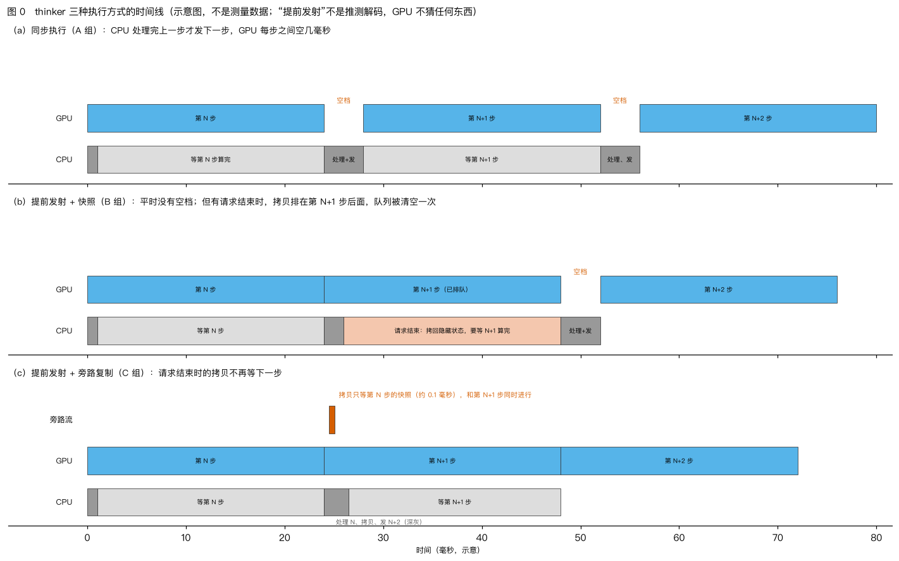

# 实验 11：thinker 提前发射以后，剩下的等待在哪里？

> **状态：IMPLEMENTED / SUBMITTED（排在实验 10 之后，还没有开始运行）**
> - 原型补丁、CPU 检查、正确性判定、分析和作图脚本都已完成并有测试。
> - 正确性检查 3 次运行（A、C、A2）已经放进 Job 454290 的队列。
> - 性能对比的 9 次运行**只有正确性检查通过才放进队列**。
> - 事先登记的假设、判定标准和补充登记见 [hypotheses.md](hypotheses.md)。
> - 第一、六到九部分要等数据出来、按登记的规则判定后才写。

## 第一部分：一句话

（待数据。）

## 第二部分：为什么要做

实验 8 已经做到（数字来自 [实验 6–8 的发现](../../../reports/research_updates/exp06_08_findings.md)，均为实测）：

- **同步执行时，thinker 每一步算 24–26 毫秒、两步之间空 3–15 毫秒。** GPU 在等 CPU 处理完上一步。
- **纯文字请求不带种子时，thinker 可以提前发射**：
  - 每个 token 快 11–15%，吞吐 +9% 到 +25%，端到端 P50 快 9–14%；
  - 但 TTFT 变长 8–19 毫秒。
- **语音请求原来不能提前发射**：下一步重放 CUDA graph 会覆盖上一步的隐藏状态，而 talker 需要它。
  - 实验 8 的原型在每步发射后立即复制一份隐藏状态（快照）。
  - 正确性：18 个请求的文字、隐藏状态、语音编码逐位相同。
  - 性能：decode 步之间的空档从 3.7–9.7 毫秒降到 ≤ 0.06 毫秒，每个 token 快 9–10%；但端到端 P50 只快 2–5%（区间都包含 0），TTFT 变长 17–21 毫秒。

还剩两个问题没解决：

1. **请求结束时有阻塞拷贝。**
   - 原型打开后，trace 里出现 320–520 KB、每次 22–24 毫秒的阻塞拷贝，并发 32、64 时约每 5 步一次，每次都把 GPU 的队列清空；
   - 所以并发 64 时按时间加权的空档只从 32% 降到 25%；
   - 大小和一个请求的隐藏状态一致，推测来自 `on_request_finished` 的同步拷贝，但当时没有调用栈。
2. **TTFT 为什么变长。**
   - 用实验 8 的原始事件把 TTFT 沿请求路径拆成 9 段（这是登记之前做的，已在 hypotheses.md 里说明）：多出来的时间几乎全在 thinker 的“进入调度队列 → prefill 开始”；
   - 并发 8：TTFT 多 19.9 毫秒，其中这一段多 19.8；并发 32：14.1 和 14.4；并发 64：9.8 和 9.6。

实验 11 要做三件事：
- 用新数据确认 TTFT 变长的机制；
- 找到阻塞拷贝的确切位置；
- 做一个安全的改动去掉它，在正确性检查通过之后，测它能不能转化成端到端的改善。

## 第三部分：先学几个概念

下面 10 个概念摘自 [实验 9–11 的概念表](../../../reports/research_updates/exp09_11_concepts.md)。

### 3.1 TTFT（首个 token 的时间）

- **定义**：从客户端发出请求，到收到回答的第一段文字所用的时间。
- **例子**：点餐后多久上第一道菜。
- **这里**：客户端用同一个单调时钟记“发出”和“收到第一段文字”，两者相减。MiniCPM-o 的语音在所有文字之后一次性返回，所以“首个音频的时间”约等于整个请求的时间，和 TTFT 不是一回事。
- **别混淆**：TTFT 包括网络和服务端在 prefill 之前的排队，不只是模型算第一个 token 的时间。实验 11 把它拆成了 9 段。

### 3.2 CUDA graph

- **定义**：把一串固定形状的 GPU 操作提前录下来，之后一次性重放，省掉 CPU 一个个发命令的开销。
- **例子**：把常做的一套动作录成宏，以后按一个键就全部执行。
- **这里**：code2wav 为（批大小，帧数）的一组组合录了 graph；形状对不上就退回逐个发命令（eager）。批大于 10 没有录好的形状。thinker 的每个 decode 步也是一次 graph 重放。
- **别混淆**：graph 省的是 CPU 发命令的时间和小 kernel 之间的空隙，不会让单个 kernel 算得更快。重放时会写进录制时固定的那块输出内存，这正是实验 8、11 里“隐藏状态被覆盖”的来源。

### 3.3 CUDA event（CUDA 事件）

- **定义**：插在 GPU 工作流里的一个时间标记，GPU 执行到这里时记下时间，或者标记“前面的工作都做完了”。
- **例子**：流水线上放一个计时牌，产品经过时打卡。
- **这里**：
  - 实验 6、10 用两个事件之间的时间作为 flow、HiFT 的“GPU 跨度”；
  - 实验 11 用事件告诉旁路流“快照已经做完，可以复制了”。
- **别混淆**：两个事件之间的跨度不是纯计算时间。如果同一张卡上还有别的进程在跑，跨度里也包括等待的时间。

### 3.4 CUDA stream（CUDA 流）

- **定义**：一条 GPU 工作队列；同一条流上的工作按顺序执行，不同流上的工作可以同时进行。
- **例子**：银行的两个窗口，各自按排队顺序办理，两个窗口之间互不等待。
- **这里**：thinker 的每一步都排在同一条流上。实验 11 新开了一条“旁路流”专门复制隐藏状态，让复制不必排在下一步后面。
- **别混淆**：不同流可以并行，但不保证先后顺序。需要先后顺序时，必须用事件让一条流等另一条流，否则可能读到还没写好的数据。

### 3.5 GPU 气泡（GPU bubble，空档）

- **定义**：GPU 在两段工作之间闲着的时间，通常是在等 CPU 准备或发出下一段工作。
- **例子**：厨师做完一道菜，要等服务员把下一张单子送来才能开始。
- **这里**：thinker 同步执行时，每步之间约空 3–15 毫秒。实验 11 按调度器的逻辑步对齐 trace，算每一步之前的空档，以及空档之和占总时间的比例。
- **别混淆**：
  - “典型一步的空档”（中位数）和“所有空档加起来占多少”是两回事。前者可能几乎为 0，而少数很长的空档仍然让 GPU 闲着很多时间。
  - 空档消失也不一定让请求变快，要看瓶颈在不在这里。

### 3.6 隐藏状态（hidden state）

- **定义**：模型内部每一步算出的一大串数字（这里每个 token 4096 个），表示模型对当前内容的理解。
- **例子**：翻译员在脑子里对一句话的理解，还没说出口。
- **这里**：MiniCPM-o 的 talker 不只看 thinker 写出的文字，还要读 thinker 每个 token 的隐藏状态来决定怎么说。每个请求结束时，这些隐藏状态整理好交给 talker。
- **别混淆**：隐藏状态不是输出的文字。文字对了，隐藏状态也可能是错的。实验 8 的诊断组就是这样：文字完全正常，隐藏状态却全错，服务也不报错。

### 3.7 提前发射（lookahead）

- **定义**：CPU 先把下一步发给 GPU，再回头处理上一步的结果，让 GPU 不必等 CPU。
- **例子**：洗碗时，先把下一摞碗放进水槽泡着，再去擦上一摞，水槽一直在工作。
- **这里**：
  - 下一步的输入 token 已经由上一步在 GPU 上采样好，不需要 CPU 先知道它是什么；
  - CPU 随后才把这个 token 拷回来、判断是否结束。
- **别混淆**：
  - 它**不是推测解码**（speculative decoding）。GPU 不猜任何东西，算的就是正确的下一步。
  - 它的代价是：一步已经发给 GPU 之后就撤不回来，新请求要等它算完。实验 11 里 TTFT 多出的时间就是这个。

### 3.8 快照（snapshot）

- **定义**：在数据被覆盖之前，先复制一份留着。
- **例子**：白板马上要被擦掉，先拍张照。
- **这里**：提前发射时，下一步的 graph 重放会写进同一块输出内存，覆盖上一步的隐藏状态。所以实验 8 的原型在每步发射后立刻把隐藏状态复制一份，处理结果时读这一份。
- **别混淆**：快照保证的是数据没被覆盖，不是复制有多快。实验 11 的改动是让复制不必排在下一步后面。

### 3.9 固定内存（pinned memory）

- **定义**：操作系统保证不会被换出的主机内存，GPU 可以直接、异步地往里写。
- **例子**：专用的装卸货车位，货车随时能停进来卸货，不用等现场腾地方。
- **这里**：原版把隐藏状态拷到普通（可分页）内存，CPU 必须等拷贝完成。实验 11 的原型**没有**改用固定内存，而是换了一条不用等下一步的流，拷贝仍然是同步的，只是不再多等一步。
- **别混淆**：固定内存是“能异步”的前提之一，但光用它不等于拷贝就安全地异步了，还要用事件保证数据准备好、用完之前不被释放。

### 3.10 异步拷贝（async copy）

- **定义**：CPU 发出拷贝命令后不等它完成就继续干别的，之后再通过事件确认拷贝已经完成。
- **例子**：寄快递拿到单号就走，需要时再查单号确认送到了没有。
- **这里**：实验 11 的拷贝放在旁路流上，GPU 的拷贝引擎可以和下一步的计算同时进行。但 CPU 仍然等这次拷贝本身完成，只是这次拷贝只有几百 KB，不再要等下一步。
- **别混淆**：代码里写 `non_blocking=True` 不等于拷贝真的异步、也不等于安全。要满足三点：
  1. 用事件确认源数据已经写好；
  2. 拷贝完成前不读结果；
  3. 内存在拷贝完成前不被释放或复用。

## 第四部分：一个请求经过哪里，三种执行方式有什么不同

一个语音请求在整条流水线里的路径见[实验 9 的图 0](../实验09_最佳GPU分工/figures/fig0_request_path.png)。和实验 11 有关的是 thinker 这一段：

- thinker 一步一步地生成 token。每一步 GPU 算出下一个 token 和这个 token 的隐藏状态。
- CPU 处理每一步的结果：
  - 把 token 拷回来，判断请求是否结束；
  - 把隐藏状态按行存进这个请求的记录里。
- 请求结束时，CPU 把这个请求所有的隐藏状态合并成一个张量，拷回 CPU 内存，交给 talker。

**图 0 是示意图，不是测量数据；时长是取整的示意值。** 三行分别是：

- **（a）同步执行（组 A）**：CPU 处理完第 N 步才发第 N+1 步。GPU 在每两步之间空几毫秒，就是“空档”。
- **（b）提前发射 + 快照（组 B，实验 8 的原型）**：
  - CPU 先发第 N+1 步，再处理第 N 步，平时 GPU 不再空着；
  - 但如果第 N 步有请求结束，拷回隐藏状态的操作排在同一条流上，要等第 N+1 步算完。CPU 被卡住，等它回来再发第 N+2 步时，GPU 已经空了。
- **（c）提前发射 + 快照 + 旁路复制（组 C，实验 11 的原型）**：
  - 复制放到另一条流（旁路流）上，只等第 N 步的快照写好，不等第 N+1 步；
  - CPU 只等这次几百 KB 的拷贝本身，不再多等一步。

**同步和并行**：
- 同一条流上的工作按顺序执行。组 B 的问题正是拷贝和第 N+1 步在同一条流上。
- 不同流上的工作可以同时进行，但需要用事件保证先后：旁路流要先等“快照写好”的事件，才能读快照。

## 第五部分：我们究竟怎么做实验

### 5.1 读源码（sglang-omni 520b49ee + 实验 8 原型）

1. **阻塞拷贝的位置**：
   - MiniCPM-o 的 `on_request_finished` 用 `torch.stack(seq).to("cpu")` 把隐藏状态拷到普通（可分页）内存；
   - CPU 要等这条流上排在前面的所有工作，提前发射时就多等约一步。
2. **逐行复制**：每步处理结果时，每个请求的那一行用 `clone()` 复制，同样排在下一步后面。它不阻塞 CPU，但让“这一行什么时候可用”晚一步。
3. **TTFT**：
   - 新请求大多在 CPU 等第 N 步时到达。下一轮发现它时，第 N+1 步已经在 GPU 上排队，必须先等它算完，才能做新请求的 prefill；
   - 推断：多出来的时间约等于一个 decode 步。这是“只对纯 decode 提前发射、混合轮次同步执行”这个设计本身的代价，本实验不尝试修复，只确认机制。

### 5.2 原型（组 C）

代码在 `configs/runtime/patches/sglang_omni_async_exp11.patch`，用环境变量 `SGLANG_OMNI_SPEECH_LOOKAHEAD=sidecopy` 打开。

- **快照之后记一个 CUDA 事件**。事件和快照张量一起保存；查找时核对是不是同一个张量对象，避免显存地址被复用时错配。
- **旁路复制**：处理第 N 步结果时，在旁路流上先等这个事件，再做逐行复制。
  - 用 `record_stream` 告诉显存分配器：快照的显存要等旁路流读完才能复用。
- **请求结束**：旁路流先等这个请求最后一行，再在旁路流上合并、拷回 CPU。
- **没有用固定内存**：拷贝仍然是同步的，只是放在不等下一步的流上。额外的显存只有每步一份快照，最多约 0.5 MB。
- **两种 profiler 标注**（三组都有）：
  - `thinker.request_finished_copy`：标出请求结束时的拷贝；
  - `thinker.step<序号>.<模式>.<la|sync>`：标出调度循环的每次发射，用来把 GPU kernel 对应回调度器的逻辑步，包括不走 CUDA graph 的步。
- **CPU 检查**：用替身对象模拟流和事件，在改动之前的代码上失败，改动之后通过。它只能验证控制流程和数据，真正的并发正确性靠下面的 GPU 正确性检查。

### 5.3 三组

| 组 | `SGLANG_OMNI_SPEECH_LOOKAHEAD` | 含义 |
|---|---|---|
| A | 0 | 同步执行（上游行为） |
| B | 1 | 实验 8 的快照原型 |
| C | sidecopy | 快照 + 旁路复制 |

- 同一份代码，每组单独启动服务，放置是 2+6。
- 请求的 seed 都是 null，这样 thinker 可以提前发射。
- 每次运行在自己的运行目录里认领 NCCL 端口（实验 9 里出过一次端口冲突），端口不影响测量。

### 5.4 正确性检查（性能对比的前提）

- **三次独立启动**：A、C、A2。A2 是 A 的重复，用来估计同一种设置自己重复时的差别。都打开 digest，用贪心负载。
- **段落**：
  1. 并发 1，18 个请求，逐个比较文字、隐藏状态哈希、语音编码哈希；
  2. 并发 8、32、64；
  3. 并发 32 的混合负载：文字和语音各半、短长各半、能和不能提前发射的各半，混在同一批里；
  4. 客户端 1.5 秒就放弃的长回答（服务端中途中止请求）；
  5. 紧接着一段普通负载，看中止之后服务是否干净；
  6. W3XL 并发 8，核对实际输出长度。
- **全部满足才通过**：
  - 并发 1 时 C 和 A 的三样东西逐个相同；
  - 除第 4 段的超时外没有报错，每个完成的语音请求，隐藏状态的行数都等于它的文字 token 数；
  - 文字相同的请求之间比较隐藏状态指纹：C 对 A 偏差超过 0.05 的比例，不比 A2 对 A 高出 5 个百分点以上。
- **不通过就不做 C 的性能对比**，只报告失败证据。出现无法解释的跨请求数据污染时同样处理。

### 5.5 性能对比

- **区组和顺序**：3 个区组，每个区组 A、B、C 各一次运行，组的先后按拉丁方（A→B→C、B→C→A、C→A→B）。
- **每次运行**：
  - W3b 并发 8、32、64，档的顺序在每个区组随机；
  - 每档做三种测量段：
    - **不打点段**：吞吐、端到端延迟、TTFT、显存；
    - **事件段**：提前发射和混合轮次的比例、每个 token 的时间、TTFT 的 9 段拆分；
    - **trace 段**：只给 thinker 进程开 3 秒 torch profiler，看空档和阻塞调用。
  - 然后是长回答：W3L（约 100 词）和 W3XL（约 180 词）各在并发 32 做不打点段和事件段。
- **空档的算法**：
  - 用调度步的标注把 GPU kernel 对应到逻辑步。每一步的“空档”= 这一步第一个 kernel 开始 − 上一步最后一个 kernel 结束；
  - 不走 graph 的步单独标出；
  - 报告中位数、P95、P99，以及按时间加权的空档比例（所有空档之和 ÷ 窗口时长）。
- **判定**（H11a–H11e，见 hypotheses.md）：
  - 都在同一区组内配对，报告每个区组的值、均值和 t 分布 95% 区间（自由度 2）；
  - 错误 + 超时 > 5% 的段在判定里当作缺失。
- **是否建议默认开启**（事先定好的规则）：
  - 只有 C 对 A 的端到端改善在每个区组都成立（H11d 支持），并且 TTFT 的增加 < 10 毫秒，才建议默认开启 C；
  - 否则只建议作为可选开关，并说明代价；
  - 不向上游提交任何补丁，除非你同意。

## 第六部分：每张图怎么读

（待数据。计划的图：TTFT 的 9 段拆分、每步之前的空档、空档比例、大块阻塞拷贝、端到端延迟、吞吐和 TTFT、长回答的收益、显存、正确性检查。）

## 第七部分：证据等级

（待数据。）

## 第八部分：研究意义

（待数据。）

## 第九部分：下一步

（待数据。）

## 附：文件在哪里

| 文件 | 内容 |
|---|---|
| [hypotheses.md](hypotheses.md) | 事先登记的假设、判定标准和补充登记 |
| [reproduce.md](reproduce.md) | 怎样从头复现 |
| `results/check.json`、`results/performance.json`、`results/ttft*.json` | 分析结果（字段见[数据字典](../../../reports/research_updates/exp09_11_data_dictionary.md)） |
| `figures/` | 图，可以用 `scripts/analysis/exp11_figures.py` 从 `results/` 重画；图 0 用 `scripts/analysis/exp09_11_diagrams.py` |
| `configs/runtime/patches/sglang_omni_async_exp11.patch` | 原型补丁 |
| `scripts/analysis/exp11_check.py`、`exp11_report.py`、`exp11_ttft.py`、`exp11_steps.py` | 分析脚本 |
