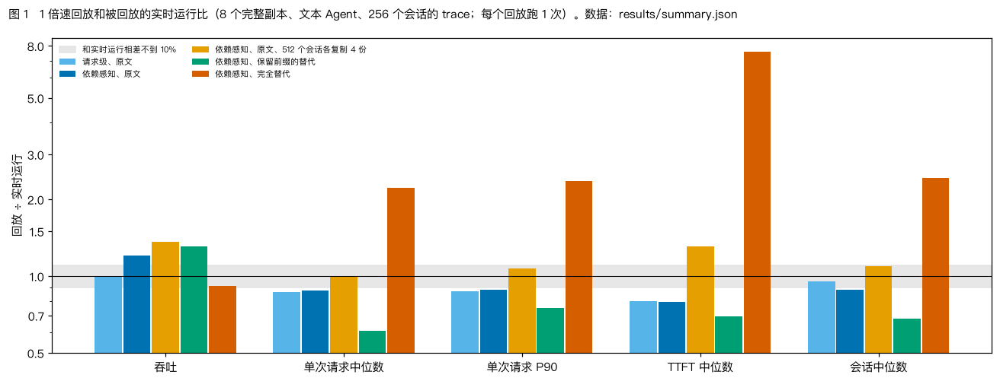
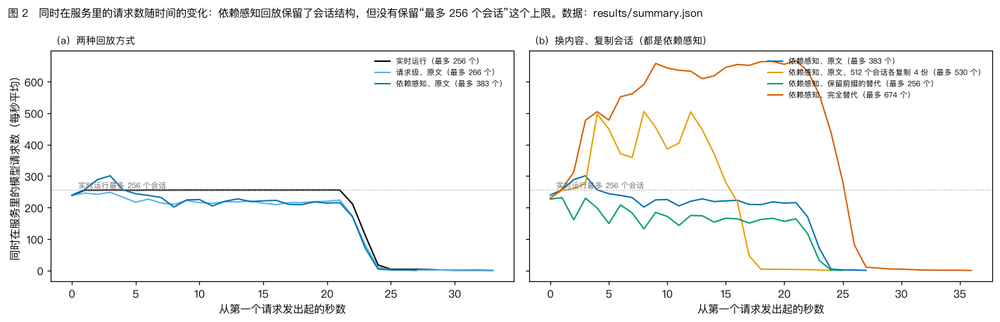
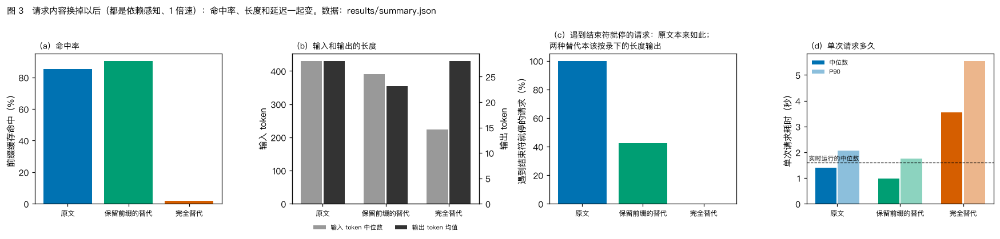
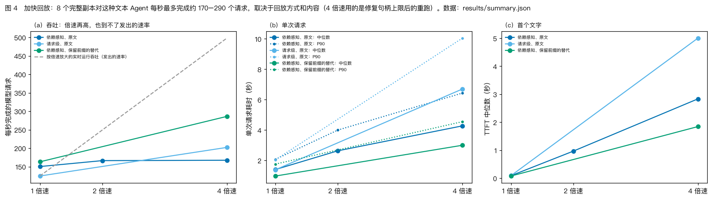
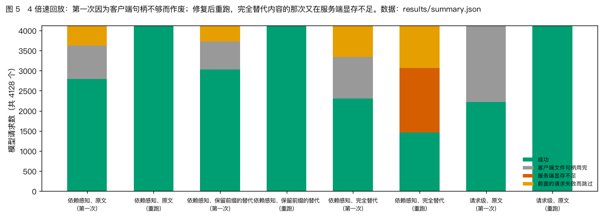

# 实验 12：回放能不能代替真实负载？

> **状态：完成（2026-11-18，只用已有数据，没有新的 GPU 运行）**
> - 数据来自 plan v2 第二批（Slurm Job 454290，compute-03，8×RTX A6000）：1 个被录下来的实时 Agent 运行（11-16 22:25–22:38），6 个回放（11-16），以及 11-17 的 8 个 4 倍速回放（前 4 个因为客户端文件句柄不够而作废，修复后重跑了 4 个）。
> - 每种回放只跑过 1 次，结论都是**初步**的。
> - 预测 D-H1 在 2026-11-11 写进计划，早于任何数据；判定方法是看过数据后定的，所以判定是**探索性**的，见 [hypotheses.md](hypotheses.md)。限制见 [limitations.md](limitations.md)。

## 第一部分：一句话

- 把一次真实运行录下来再“回放”，最忠实的做法（原文、按原来的时间点逐个发请求）能重现吞吐（124.6 对 124.5 请求/秒），但单次请求的延迟比实时运行低 13%，还达不到“相差不到 10%”。
- 改变回放方式或内容，结论变得更多：
  - **依赖感知回放**（等上一步完成再发下一步）保留了会话结构，但同时在服务里的请求最多到 383 个，比实时运行的 256 个多，吞吐偏高 21%。
  - **保留前缀的替代内容**：延迟中位数比实时运行低 39%。一个原因是 42% 的请求提前结束，平均输出短了 18%。
  - **完全替代内容**：前缀缓存命中率从 85% 掉到 2%，延迟中位数高 122%；4 倍速时服务端显存不足，39% 的请求失败。
  - **复制会话**（512 个会话各复制 4 份）：命中率只高 2.9 个百分点，但复制出来的会话同时开始，负载变得更集中，延迟反而高 14%。
- 计划里的预测 D-H1 三句话：复制会话会高估容量（**不支持**），保留前缀的替代和实时运行相差不到 10%（**不支持**），完全替代会低估容量（**支持**）。

## 第二部分：为什么要做

- 研究 Agent 服务需要可重复的负载。最直接的办法是把真实 Agent 的请求录成 trace，以后在别的配置上“回放”。
- 但回放和真实运行不一样：
  - 回放时没有真实的 Agent 在思考，请求什么时候发、发几个，要由回放程序决定；
  - 真实 trace 常常不能公开，只能换成替代内容；
  - 想测更高的负载时，常常把会话复制几份或加快回放。
- 这些做法会把结论改变多少，以前没有量化过。Job 409712（3 张卡）时已经发现：复制会话、重复回放会把前缀缓存命中率抬到 99.8%（`docs/05_findings/baseline_results.md` 第 14 节）。
- 计划（`docs/04_experiments/plan_8gpu_v2.md` 第 4 节 D，2026-11-11）写下了预测 **D-H1**：复制会话会高估容量（缓存虚高）；保留前缀的替代内容与实时运行相差不到 10%；完全替代会低估容量。

## 第三部分：先学几个概念

前缀缓存、Agent 会话、工具调用的解释见[实验 19 第三部分](../实验19_负载类型和最佳分工/README.md#第三部分先学几个概念)；TTFT、P50/P90、闭环和开环见[概念手册](../../../reports/research_updates/exp09_11_concepts.md)。

### 3.1 trace 和回放

- **定义**：trace 是一次运行的完整记录：每个请求什么时候发、属于哪个会话、依赖哪个前面的步骤、内容和长度。回放就是照着 trace 把请求重新发给服务。
- **生活例子**：把一场比赛录下来，以后拿录像研究战术；但录像里的球员不会因为你换了场地而改变跑位。
- **本项目**：被回放的是实验 19 里“8 个完整副本、文本 Agent、256 个会话同时进行、默认路由”那一档：2,048 个会话、4,128 个模型请求，约 33 秒。每次回放都在新启动的 8 个完整副本上进行（缓存是空的）。
- **容易混淆**：回放只重发**模型请求**；工具调用和等待由回放程序按录下的时长“睡”过去，不发给服务。

### 3.2 请求级回放（开环）和依赖感知回放（闭环）

- **请求级**：每个请求在录下的时间点发出，不管前一个请求有没有完成。负载的“发出速率”固定不变。
- **依赖感知**：一个请求要等它依赖的步骤完成，再隔开录下来的间隔（工具时间、Agent 处理时间）才发。服务变慢，后面的请求就跟着推迟，像真实的 Agent 一样。
- **生活例子**：请求级像按时刻表发车，不管前一班车有没有到站；依赖感知像接力赛，上一棒到了下一棒才跑。
- **本项目**：两种模式里，每个**会话**的开始时间都取自 trace（`session_arrival = trace`）。实时运行是“最多 256 个会话，结束一个才开始一个”；回放时会话开始的时间是固定的，不会因为前面的会话还没结束而推迟。
- **容易混淆**：依赖感知只在会话**内部**是闭环的；会话之间仍然按录下的时间开始。

### 3.3 倍速

- **定义**：把 trace 里的所有时间间隔除以一个倍数，例如 4 倍速时，请求间隔、会话开始时间、工具时间都缩短到四分之一。
- **本项目**：1、2、4 倍速。实时运行每秒发出约 124.5 个请求，4 倍速就是想发出约 500 个。
- **容易混淆**：依赖感知时，服务跟不上，实际发出的速率会低于“倍数 × 原速率”。

### 3.4 复制会话

- **定义**：取 trace 的一部分会话，每个复制几份一起回放，凑出更大的负载。
- **本项目**：取最早开始的 512 个会话，每个复制 4 份，共 2,048 个会话，和原 trace 一样多。
- **容易混淆**：复制出来的会话内容完全相同（前缀缓存会命中），而且开始时间相同（会挤在一起）。这是两个不同的效果。

### 3.5 替代内容

- **定义**：不发原来的文字，换成别的文字。
- **保留前缀的替代**：系统提示词照原样保留，其他每段文字换成同样长度的合成文字；原 trace 里相同的文字换成相同的替代，所以原来共用的部分仍然共用。输出长度设成录下的长度（`max_tokens`，并要求忽略结束符）。
- **完全替代**：所有内容都按录下的长度重新合成，连系统提示词也换掉；输出长度同样固定。
- **生活例子**：排练时用替身演员。替身个头一样（长度一样），但说话方式不同（模型对乱码文字的反应不同）。
- **容易混淆**：“长度一样”指字符数一样；换成合成文字后，切成 token 的数量会变（见图 3）。

## 第四部分：一个请求经过哪里

```
实时运行（实验 19，8 个完整副本）：
  Agent 程序（256 个会话）→ 按“在途请求最少”分给 8 个副本 → 每个副本：thinker 写文字（文本 Agent 不经过 talker）
  同时把每个请求、每次工具调用、它们之间的依赖录进 trace

回放：
  回放程序读 trace → 按模式决定什么时候发 → 同样分给新启动的 8 个副本
  工具调用：不发给服务，按录下的时长等待（除以倍速）
```

## 第五部分：我们究竟怎么做实验

### 5.1 用了哪些运行

| 名称 | 模式 | 内容 | 会话 | 倍速 | 时间 | 是否可用 |
|---|---|---|---|---|---|---|
| 实时运行 | — | 原文 | 2,048 个，最多 256 个同时 | — | 11-16 | 是（作为基准） |
| 请求级、原文 | 请求级 | 原文 | 2,048 | 1 | 11-16 | 是 |
| 依赖感知、原文 | 依赖感知 | 原文 | 2,048 | 1、2 | 11-16 | 是 |
| 依赖感知、复制 4 份 | 依赖感知 | 原文 | 前 512 个 × 4 | 1 | 11-16 | 是 |
| 依赖感知、保留前缀的替代 | 依赖感知 | 保留前缀的替代 | 2,048 | 1 | 11-16 | 是 |
| 依赖感知、完全替代 | 依赖感知 | 完全替代 | 2,048 | 1 | 11-16 | 是 |
| 4 倍速（第一次） | 两种 | 原文、两种替代 | 2,048 | 4 | 11-17 | **否**：客户端打开的连接到了文件句柄上限（约 1,015 个），17%–46% 的请求在客户端失败，加上因此跳过的，共损失 27%–46% |
| 4 倍速（重跑） | 两种 | 原文、两种替代 | 2,048 | 4 | 11-17 | 是，但完全替代那次服务端显存不足（见图 5） |

客户端的句柄上限在提交 a89165f 里修好了（运行时把软上限提到硬上限以内的 65,536），重跑用的是修好的版本。

### 5.2 怎么算

- 只统计**模型请求**，不算工具调用。
- **吞吐**：成功的模型请求数 ÷（第一个请求发出到最后一个完成的时间）。注意：这个时间包括最后几个慢请求的“收尾”，所以吞吐也受收尾影响（见 limitations.md）。
- **同时在服务里的请求数**：平均值 = 所有请求耗时之和 ÷ 时长（利特尔法则）；最多 = 任一时刻同时在服务里的请求数的最大值。
- **会话时长**：一个会话第一个请求发出到最后一个请求完成。
- **前缀缓存命中**：服务端统计的“输入 token 里从缓存拿到的比例”。
- **百分位**：线性插值。
- **GPU 忙碌比例**：8 张卡 nvidia-smi 采样的平均。

### 5.3 怎么判定

- D-H1 的三句话分开判定，“10%”取自预测本身。
- 计划里说的是“容量”，但这些回放没有直接测容量（只有 1、2、4 三个倍速）。所以用“同样倍速下，单次请求耗时的中位数”代替：回放看起来更快，就会让人高估容量；更慢，就会低估。
  - **复制会话会高估容量**：和不复制的回放（依赖感知、原文、1 倍速）比，中位数低 ≥ 10% 算支持，高 ≥ 10% 算不支持，其余不确定。
  - **保留前缀的替代与实时运行相差不到 10%**：单次请求的中位数、P90、会话中位数都在 ±10% 以内算支持，有一项超出算不支持。
  - **完全替代会低估容量**：比实时运行的中位数高 ≥ 10% 算支持，低 ≥ 10% 算不支持，其余不确定。
- 作废的 4 次运行不参加任何比较。

## 第六部分：每张图怎么读

### 图 1　1 倍速回放和实时运行比



- 每组柱子是一个指标，柱高是“回放 ÷ 实时运行”，灰色带是 ±10%。
- **请求级、原文**：吞吐 124.6 对 124.5 请求/秒，几乎完全一样；但单次请求中位数 1.39 对 1.60 秒（−13%），TTFT 中位数 −20%，会话中位数 −5%。
- **依赖感知、原文**：吞吐高 21%（150.2），单次请求中位数 −12%，会话中位数 −12%。
- **复制 4 份**：吞吐高 36%，单次请求中位数和实时运行一样，但 TTFT 中位数高 31%。
- **保留前缀的替代**：单次请求中位数 −39%，P90 −25%，会话中位数 −32%。
- **完全替代**：单次请求中位数 +122%（3.55 秒），TTFT 是实时运行的 7.6 倍，会话中位数 +143%。
- **读法**：没有一种回放在所有指标上都落在 ±10% 以内；最接近的是请求级、原文。

### 图 2　同时在服务里的请求数随时间的变化



- **（a）**：实时运行在前 21 秒稳定在 256 个（每个会话都有一个请求在服务里，工具几乎不花时间），然后收尾。请求级回放始终略低（平均 156 个对 180 个）。依赖感知回放开头冲到约 300 个（每秒平均），瞬间最多 383 个。
- **为什么会超过 256（推算）**：回放时每个会话的开始时间是固定的。新启动的服务开头比实时运行慢，前面的会话还没结束，后面的会话就按时开始了，于是重叠的会话比实时运行多。
- **（b）**：复制 4 份时，同一个会话的 4 份同时开始，负载一阵一阵地冲高，最多 530 个；完全替代时每个请求都慢，堆积到最多 674 个。保留前缀的替代因为每个请求快，始终在 256 个以下。
- **读法**：回放的负载形状可以和实时运行很不一样，即使会话和请求一个不少。

### 图 3　换掉内容以后发生了什么



- 三种内容都是依赖感知、1 倍速：
  - **（a）命中率**：原文 85.2%，保留前缀的替代 90.4%，完全替代 1.8%。完全替代把所有会话共用的系统提示词也换掉了，服务每次都要从头算。
  - **（b）长度**：输入 token 的中位数分别是 430、390、224 个。字符数相同，但合成文字切成的 token 更少。平均输出 28.0、23.1、28.1 个 token。
  - **（c）提前结束**：原文本来就是模型自己写完就停（实时运行也是这样）。两种替代都要求按录下的长度输出：完全替代几乎全部做到了；保留前缀的替代只有 58% 做到了，**42%（1,754 个）遇到结束符就停了**，平均只写了 20.1 个 token，原来是 32.0 个。为什么“忽略结束符”对这部分请求没有生效，还不知道（Unknown）。
  - **（d）延迟**：单次请求中位数 1.40、0.97、3.55 秒。
- **读法**：
  - 保留前缀的替代偏快，有两个原因：输出变短（−18%），命中率反而更高（+5 个百分点）。
  - 完全替代偏慢，是因为没有了共用的前缀，每个请求都要算完整的输入。

### 图 4　加快回放



- **（a）吞吐**：依赖感知、原文从 1 倍速的 150 到 2 倍速的 166、4 倍速的 167 请求/秒，基本到顶；虚线是“倍数 × 实时运行速率”，回放远远达不到。请求级 4 倍速做到 202，保留前缀的替代 4 倍速做到 286（输出短）。
- **（b）（c）延迟**：依赖感知、原文的单次请求中位数 1.40 → 2.63 → 4.28 秒，TTFT 中位数 0.09 → 0.97 → 2.83 秒。请求级 4 倍速不等前面的请求，最多同时有 3,053 个请求在服务里，中位数 6.70 秒。
- **读法**：
  - 8 个完整副本对这种文本 Agent，每秒最多完成约 170 个请求（依赖感知）。实时运行的 124.5 大约是它的四分之三。
  - 请求级回放把请求一直堆上去，能挤出更高的吞吐（202），代价是每个请求要等好几秒。“容量”取多少，取决于能接受多长的延迟，也取决于用哪种回放。

### 图 5　4 倍速回放的失败



- **第一次（灰色）**：客户端最多只能同时打开约 1,015 个连接（文件句柄的软上限 1,024），4 倍速时同时在途的请求超过这个数，17%–46% 的请求在客户端就失败了；依赖感知时，失败的请求后面的步骤也被跳过，加起来损失 27%–46%。这 4 次运行作废。
- **重跑**：修好句柄上限后，原文和保留前缀的替代全部成功。**完全替代的那次在服务端显存不足（红色）**：4,128 个请求里 1,609 个报 CUDA out of memory，1,064 个因为同一会话前面的请求失败而跳过，只有 1,455 个成功。
- **为什么完全替代会显存不足（推算）**：没有共用的前缀，每个请求都要占一份完整的 KV 缓存；4 倍速时同时在服务里的请求多，8 个副本的显存就不够了。原文和保留前缀的替代共用前缀，占的显存少得多。

## 第七部分：证据等级

| 结论 | 等级 | 依据 |
|---|---|---|
| 各回放的吞吐、延迟、同时在途请求数、命中率、输入输出长度、失败数 | Measured | 每种回放 1 次运行；客户端时钟、服务端前缀缓存统计 |
| 请求级、原文能重现吞吐，但延迟比实时运行低 13% | Measured（初步） | 1 次回放对 1 次实时运行 |
| 复制会话会高估容量：**不支持** | Measured（初步），判定是探索性的 | 复制 4 份后单次请求中位数比不复制时高 14%，命中率只高 2.9 个百分点；只复制了 4 份 |
| 保留前缀的替代与实时运行相差不到 10%：**不支持** | Measured（初步），判定是探索性的 | 中位数 −39%、P90 −25%、会话 −32% |
| 完全替代会低估容量：**支持** | Measured（初步），判定是探索性的 | 中位数 +122%；4 倍速时服务端显存不足 |
| 依赖感知回放同时在途的请求超过 256，是因为会话开始时间固定 | Derived | 回放引擎的会话开始规则（`session_arrival = trace`）加上图 2 的时间序列 |
| 完全替代 4 倍速显存不足，是因为没有共用前缀 | Derived | 命中率 1.7%、报错的都是服务端 CUDA out of memory；没有显存的逐步记录 |
| 连最忠实的回放也比实时运行快 13%，原因 | Unknown | 可能是实时运行的 Agent 程序本身在客户端多花了时间，也可能是服务的状态不同，没有测 |
| 保留前缀的替代里 42% 的请求没按要求的长度输出，原因 | Unknown | 只知道结束原因是“遇到结束符” |
| 对其他负载（语音 Agent、别的分法、真实的 Agent trace）是否同样成立 | Unknown | 只回放了一档文本 Agent |

## 第八部分：研究意义

1. **回放本身是一个有偏差的测量工具**。即使原文、按原时间点发，延迟也比实时运行低 13%。用回放比较两个配置时，偏差多半相互抵消；但用回放的绝对数字去推断真实服务时，要先量出这个偏差。
2. **“会话结构对了”不等于“负载对了”**。依赖感知回放会话、请求一个不少，同时在服务里的请求数却和实时运行不同（最多 383 对 256）。评估 Agent 服务时，除了会话结构，还要还原“最多同时有多少个会话”这类上限。
3. **替代内容的影响最大**。命中率、token 长度、模型的输出长度一起变。不能公开原始 trace 时，替代内容至少要保留共用的前缀，并且检查输出长度是否真的被固定住；只保留字符数是不够的。
4. **复制会话不是“免费”的放大**。它同时带来缓存命中和同步的负载高峰，后者在这里的影响更大。

## 第九部分：下一步

1. **量出最忠实回放的偏差从哪来**（最重要）：在同一个已经热身的服务上，紧接着实时运行做一次请求级回放；再换一个更轻的客户端重跑实时运行。两次对比能分开“服务状态”和“客户端开销”两种解释。
2. **修好保留前缀替代的长度控制**：查清为什么“忽略结束符”对 42% 的请求没生效，修好后重跑，单独看“内容不同”带来的偏差。
3. **复制会话时错开开始时间**：用别的 `session_arrival` 让复制的会话错开开始，把“缓存命中”和“负载高峰”两个效果分开。

## 附：文件在哪里

| 文件 | 内容 |
|---|---|
| [hypotheses.md](hypotheses.md) | 事先写下的预测、事后定的判定方法和判定结果 |
| [limitations.md](limitations.md) | 限制、作废的运行和对结论的影响 |
| [reproduce.md](reproduce.md) | 怎样从原始数据重新生成结果和图 |
| [metadata.json](metadata.json) | 15 个运行的目录、时间、状态、代码和软件版本 |
| `results/summary.json` | 全部汇总数字和每秒的在途请求数，图都从这里画（字段见[数据字典](../../../reports/research_updates/plan_v2_reports_data_dictionary.md)第三节） |
| `results/runs.csv` | 每个运行一行的主要数字 |
| `scripts/analysis/exp12_report.py`、`exp12_figures.py` | 分析和画图脚本；测试在 `tests/test_exp12_report.py` |
| `src/omni_research/replay/engine.py` | 回放引擎（两种模式、复制会话、替代内容的实现） |

内部配置名（只用于复现）：实时运行是 `v2b_b2l_r8` 的 `lo_text_c256` 段；回放是 `v2b_d_{req_orig_1x, dep_orig_1x, dep_orig_2x, dep_orig_copy4_1x, dep_prefix_1x, dep_sur_1x}`，4 倍速 `v2b_d_{dep_orig, dep_prefix, dep_sur, req_orig}_4x`（第一次，作废）和 `..._4x_r2`（重跑）。
