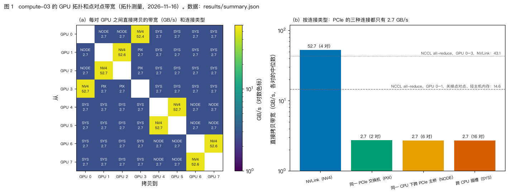
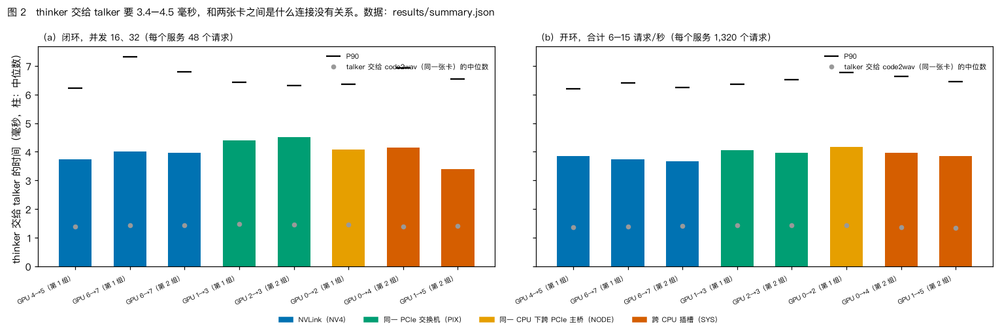
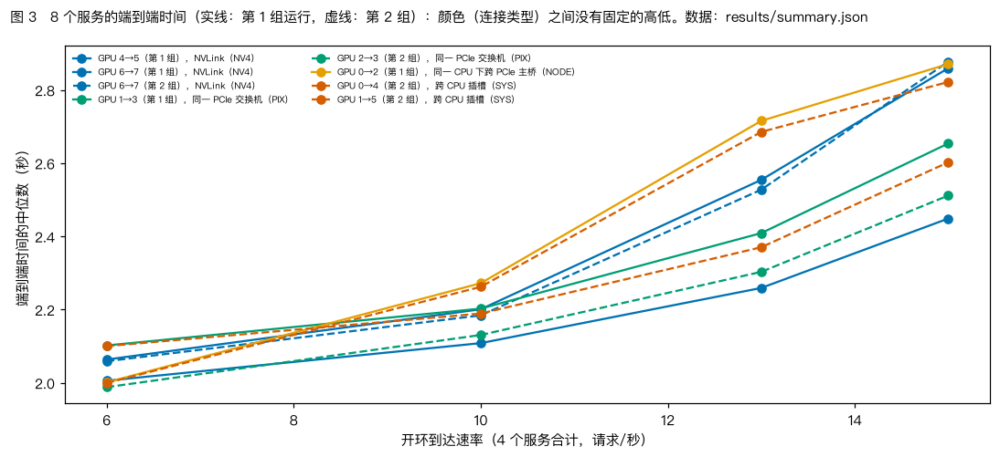

# 实验 13：GPU 之间的连接快慢有没有影响？

> **状态：完成（2026-11-18，只用已有数据，没有新的 GPU 运行）**
> - 数据来自 plan v2 第二批（Slurm Job 454290，compute-03，8×RTX A6000）：2026-11-16 的一次拓扑测量，以及两组“4 个服务同时运行”的对比（23:05–23:26）。
> - 每组只跑过 1 次，结论都是**初步**的。
> - 预测 G-H1 在 2026-11-11 写进计划，早于任何数据；判定方法是看过数据后定的，所以判定是**探索性**的，见 [hypotheses.md](hypotheses.md)。限制见 [limitations.md](limitations.md)。

## 第一部分：一句话

- thinker 写完文字后，要把结果交给另一张卡上的 talker。这一步在四种连接上（NVLink、同一个 PCIe 交换机、同一 CPU 下跨 PCIe 主桥、跨 CPU 插槽）都要 3.4–4.5 毫秒，没有快慢顺序，只占一个请求端到端时间（约 2.5 秒）的 0.2% 左右。
- 端到端时间也看不出连接的影响：
  - 开环（每个服务 1,320 个请求）时，非 NVLink 的服务和 NVLink 的服务只差 1.3%。
  - 闭环（每个服务 48 个请求）时差 9.8%，但两个同样跨 CPU 插槽的服务之间就差 33%，说明这是服务之间的随机差别。
- 这台机器的 PCIe 点对点拷贝本身就很慢：只有 2.7 GB/s，NVLink 是 52.7 GB/s。即使这样，传递时间也不受影响，因为每次传的数据不多，几毫秒主要花在软件处理上（推算）。
- 所以给 MiniCPM-o 选放置时，不用在意 thinker 和 talker 是不是在 NVLink 相连的两张卡上。

## 第二部分：为什么要做

- 8 张卡之间的连接不一样：compute-03 上只有 4 对卡（0–3、1–2、4–5、6–7）用 NVLink 直接相连，其余的走 PCIe，有的还要跨 CPU 插槽。
- 把 thinker 和 talker 拆到两张卡上以后（实验 2、7、9 都这么做），每个请求都要跨卡传一次数据。如果连接慢会拖累请求，选放置时就要优先用 NVLink 对，这会限制可选的分法。
- Job 409712（3 张卡）时测到传递只要几毫秒（`docs/05_findings/baseline_results.md` 第 7 节），但那台机器没法比较不同的连接。
- 计划（`docs/04_experiments/plan_8gpu_v2.md` 第 4 节 G，2026-11-11）写下了预测 **G-H1**：差别不到 5%，因为传递只有几毫秒。

## 第三部分：先学几个概念

### 3.1 NVLink 和 PCIe

- **定义**：两种 GPU 之间传数据的通道。NVLink 是 NVIDIA 的专用高速线（这里每对 4 条，nvidia-smi 记作 NV4）；PCIe 是主板上的通用总线。
- **生活例子**：NVLink 像两栋楼之间的专用天桥；PCIe 像先下楼、走大街、再上楼。
- **本项目**：nvidia-smi 用这些缩写描述两张卡之间的 PCIe 路径：
  - **PIX**：经过同一个 PCIe 交换机（最近）；
  - **NODE**：在同一个 CPU 下，但要跨 PCIe 主桥；
  - **SYS**：要跨两个 CPU 插槽（最远）。
- **容易混淆**：“连接类型”说的是物理路径，实际带宽还取决于驱动和主板设置（见图 1：这台机器上三种 PCIe 路径的带宽一样低）。

### 3.2 点对点拷贝（P2P）和 NCCL

- **定义**：点对点拷贝是一张卡直接把数据写进另一张卡的显存，不经过主机内存。NCCL 是 NVIDIA 的多卡通信库，all-reduce 是它最常用的一种操作（每张卡的数据求和后再分给所有卡）。
- **本项目**：拓扑测量对每一对卡做了点对点拷贝，测双向带宽；在一对 NVLink 卡和一对 PCIe 卡上做了 NCCL all-reduce（PCIe 那对关掉了点对点，走主机内存中转）。

### 3.3 阶段之间的传递（hop）和 CUDA IPC

- **定义**：一个请求从上一个阶段（例如 thinker）交到下一个阶段（talker）。这里用服务端事件来量：下一阶段“收到输入”的时刻减去上一阶段“发出”的时刻。
- **本项目**：thinker 和 talker 在不同的进程、不同的卡上。sglang-omni 按放置决定每条边怎么传：两端都在 GPU 上时用 CUDA IPC（让接收的进程直接读发送进程的显存），否则经过共享内存（sglang-omni 520b49ee 的 `pipeline/mp_runner.py` 和 `config/placement.py`）。
- **容易混淆**：传递时间包括序列化、进程间发消息、排进接收方的队列等软件步骤，不只是数据在线上跑的时间。

## 第四部分：一个请求经过哪里

```
客户端（4 个服务轮流分配）
  → 某个两卡服务：
      第一张卡：thinker 写文字
        ──（跨卡传递：CUDA IPC；连接类型 = 这两张卡之间的 NV4 / PIX / NODE / SYS）──▶
      第二张卡：talker 生成声音编码
        ──（同一张卡上、跨进程传递）──▶ code2wav 生成声音
  → 客户端
```

两组运行，每组 4 个服务同时跑：

| 组 | 服务（thinker 卡 → talker 卡，连接类型） |
|---|---|
| 第 1 组 | GPU 0→2（NODE）、GPU 1→3（PIX）、GPU 4→5（NV4）、GPU 6→7（NV4） |
| 第 2 组 | GPU 0→4（SYS）、GPU 1→5（SYS）、GPU 2→3（PIX）、GPU 6→7（NV4） |

## 第五部分：我们究竟怎么做实验

- **拓扑测量**（2026-11-16 19:02–19:08）：28 对卡逐对做点对点拷贝，测双向带宽；NCCL all-reduce（256 MiB）在 GPU 0–3（NVLink）和 GPU 0–1（PCIe，关掉点对点）上各测一次。
- **两组对比**（第 1 组 23:05–23:15，第 2 组 23:15–23:26）：
  - 负载 W3b（文字提问、语音回答），和实验 2 相同。
  - 闭环：并发 16、32（4 个服务合计），每档 96 个计量请求，每个服务每档约 24 个。
  - 开环：4 个服务合计 6、10、13、15 请求/秒，每个服务一共 1,320 个请求。
  - 两段都记了服务端事件，用来量传递时间。
- **怎么算**：
  - 传递时间：每个服务所有请求的中位数和 P90。
  - 端到端时间：每个服务在最高一档（闭环并发 32、开环 15 请求/秒）的中位数。
  - 请求属于哪个服务：看它的编号出现在哪个服务的服务端事件里（请求记录里只有服务的地址）。
- **怎么判定**（看过数据后定的，hypotheses.md）：
  - 不同连接的传递时间（中位数）最大差 < 端到端中位数的 5%；
  - 而且非 NVLink 服务的平均端到端和 NVLink 服务相差 < 5%，算“支持”。
  - 相差 ≥ 5% 时，如果还没有两个同种连接的服务之间的差别大，算“不确定”，否则“不支持”。
  - 开环、闭环两段结论一致才算总体结论。

## 第六部分：每张图怎么读

### 图 1　这台机器的 GPU 拓扑和点对点带宽



- **（a）**：8×8 的表，每格是“从这张卡直接拷贝到那张卡”的带宽和连接类型。黄色的 4 对是 NVLink，52.4–52.7 GB/s；其余 24 对都是 2.7 GB/s，不管是 PIX、NODE 还是 SYS。
- **（b）**：按连接类型汇总。两条虚线是 NCCL all-reduce：NVLink 对 43.1 GB/s；PCIe 对关掉点对点、经主机内存中转是 14.6 GB/s。
- **读法**：这台机器上 PCIe 的点对点拷贝比经主机内存中转还慢约 5 倍，不正常，原因不知道（Unknown；plan v2 第一批报告第 8 节已经记录过）。所以这里的“PCIe 对 NVLink”，其实是“很慢的 PCIe 对 NVLink”，差别比正常机器上更大。

### 图 2　thinker 交给 talker 要多久



- 每根柱子是一个服务，颜色是连接类型；柱高是传递时间的中位数，横线是 P90，灰点是同一张卡上 talker 交给 code2wav 的时间。
- **开环（右）**：NVLink 的 3 个服务 3.67–3.84 毫秒，PIX 3.97–4.05，NODE 4.18，SYS 3.86–3.97。各种连接的中位数最大只差 0.44 毫秒，是端到端中位数的 0.016%。
- **闭环（左）**：3.39–4.52 毫秒，同样没有顺序：最快的是跨 CPU 插槽的 GPU 1→5（3.39）。
- 同一张卡上、跨进程的 talker → code2wav 也要 1.35–1.47 毫秒。说明跨进程传递本身就有 1 毫秒以上的软件开销，跨卡多出来的 2–3 毫秒也主要不是线速的问题。
- **推算（Derived）**：按图 1 的带宽，即使在最慢的 2.7 GB/s 上，传 1 MB 也只要约 0.4 毫秒；在 NVLink 上约 0.02 毫秒。实测各种连接之间的差别不到 0.7 毫秒，所以每次传的数据量应该在这个量级以下。没有直接量每次传多少数据。

### 图 3　端到端时间



- 开环下 8 个服务的端到端中位数随速率上升，从约 2.0 秒涨到 2.45–2.88 秒。
- 颜色（连接类型）之间没有固定的高低：15 请求/秒时最快的是 NVLink 的 GPU 4→5（2.45 秒），最慢的也有 NVLink 的 GPU 6→7（2.86、2.88 秒）。非 NVLink 服务的平均比 NVLink 服务低 1.3%。
- 快慢看起来跟着具体的卡走：两组里的 GPU 6→7 都偏慢，thinker 在 GPU 0 上的两个服务（0→2、0→4）也偏慢。为什么，不知道（Unknown）。
- 所有服务在所有档位都有 ≥ 99% 的请求满足 SLO（TTFT ≤ 1 秒、端到端 ÷ 语音秒 ≤ 0.5）。

## 第七部分：证据等级

| 结论 | 等级 | 依据 |
|---|---|---|
| NVLink 对 52.4–52.7 GB/s，其余 24 对 2.7 GB/s；NCCL 43.1 和 14.6 GB/s | Measured | 拓扑测量 1 次 |
| 各种连接的传递时间都是 3.4–4.5 毫秒，没有顺序 | Measured（初步） | 2 组 × 4 个服务，各 1 次；开环每个服务 1,320 个请求 |
| G-H1“差别不到 5%”：开环**支持**，闭环**不确定**，总体**不确定** | Measured（初步），判定是探索性的 | 开环非 NVLink 对 NVLink −1.3%；闭环 +9.8%，但同种连接的服务之间差 33% |
| thinker → talker 的数据走 CUDA IPC | Measured（代码） | sglang-omni 520b49ee 按放置给每条边选传输方式 |
| 传递的几毫秒主要是软件开销，不是线速 | Derived | 同一张卡上跨进程也要约 1.4 毫秒；按带宽算，1 MB 在最慢的连接上也只要 0.4 毫秒 |
| 这台机器的 PCIe 点对点为什么这么慢 | Unknown | 不能改驱动和 BIOS 设置，没有查 |
| GPU 6→7、GPU 0 当 thinker 时偏慢的原因 | Unknown | — |
| 张量并行（一个 thinker 跨两张卡）时连接是否重要 | Unknown | 计划里的 G2 没有跑 |

## 第八部分：研究意义

1. **放置可以不考虑 NVLink**：对 MiniCPM-o 这种 thinker 和 talker 分在两张卡上的流水线，连接类型不影响请求。实验 2、7、9 比较的各种分法，结论不会因为“哪两张卡相连”而改变。
2. **跨阶段传递的开销是软件，不是带宽**：要缩短这几毫秒（目前只占端到端的 0.2%），应该减少进程间的消息和序列化，而不是换更快的连接。
3. **这台机器的 PCIe 点对点有问题**：2.7 GB/s 比走主机内存还慢。对需要大量跨卡传数据的用法（张量并行、跨卡搬 KV 缓存）会是大问题；做这类实验时应该优先用 NVLink 对，或者关掉点对点。

## 第九部分：下一步

1. **测连接真正可能有影响的场景**（计划里的 G2）：一个 thinker 用张量并行跨两张卡（例如 Qwen3-Omni 的 thinker 必须 TP=2），分别放在 NVLink 对、PCIe 对（点对点开和关）上比较。
2. **查清 PCIe 点对点为什么慢**：把测量结果交给管理员（我们不能改驱动或主板设置），确认是不是 IOMMU 或 ACS 一类的设置。
3. 如果以后要缩短跨阶段的传递，先量清楚每次传多少数据、时间花在哪个软件步骤。

## 附：文件在哪里

| 文件 | 内容 |
|---|---|
| [hypotheses.md](hypotheses.md) | 事先写下的预测、事后定的判定方法和判定结果 |
| [limitations.md](limitations.md) | 限制和对结论的影响 |
| [reproduce.md](reproduce.md) | 怎样从原始数据重新生成结果和图 |
| [metadata.json](metadata.json) | 3 个运行的目录、时间、状态、代码和软件版本 |
| `results/summary.json` | 全部汇总数字，图都从这里画（字段见[数据字典](../../../reports/research_updates/plan_v2_reports_data_dictionary.md)第五节） |
| `scripts/analysis/exp13_report.py`、`exp13_figures.py` | 分析和画图脚本；测试在 `tests/test_exp13_report.py` |

内部配置名（只用于复现）：拓扑测量 `v2b_y0_env_topology`；第 1 组 `v2b_g1a_links`（服务 `g_node`、`g_pix`、`g_nv4a`、`g_nv4b`），第 2 组 `v2b_g1b_links`（服务 `g_sysa`、`g_sysb`、`g_pix`、`g_nv4`）。
