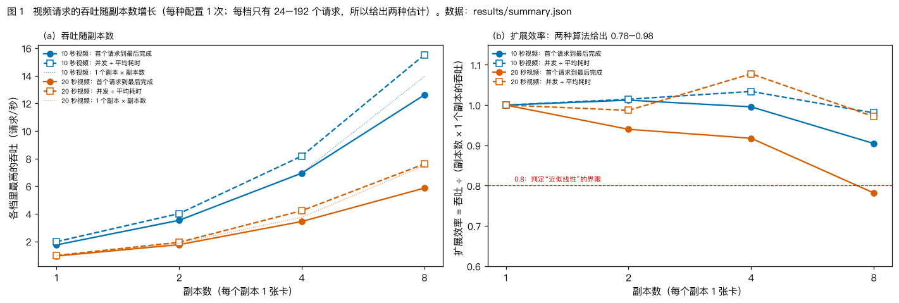
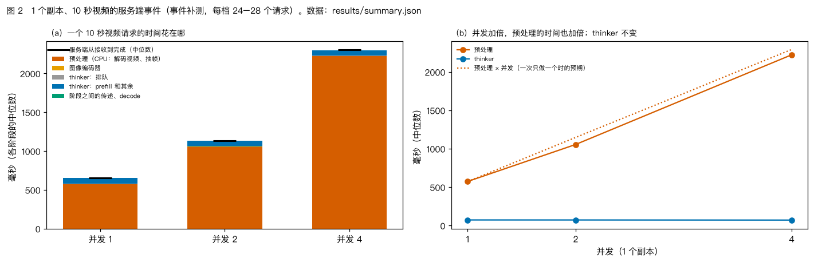
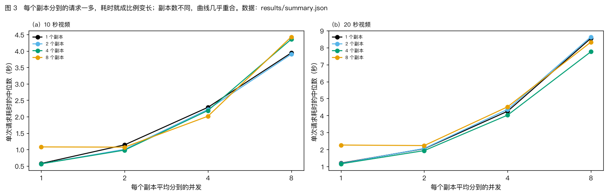
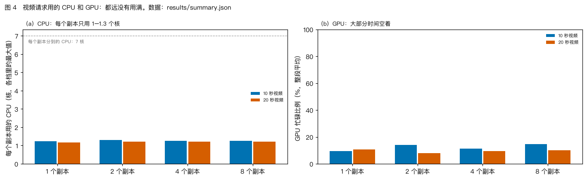

# 实验 14：视频请求能不能靠加副本提速？

> **状态：完成（2026-11-18，只用已有数据，没有新的 GPU 运行）**
> - 数据来自 plan v2 第二批（Slurm Job 454290，compute-03，8×RTX A6000）：1、2、4、8 个副本各 1 次（2026-11-16），以及 1 个副本带服务端事件的补测（2026-11-17）。
> - 每种配置只跑过 1 次，每档只有 24–192 个请求，结论都是**初步**的。
> - 预测 F-H1 在 2026-11-11 写进计划，早于任何数据；判定方法是看过数据后定的，所以判定是**探索性**的，见 [hypotheses.md](hypotheses.md)。限制见 [limitations.md](limitations.md)。

## 第一部分：一句话

- 视频理解请求（问“视频里有几个圆”）的吞吐随副本数几乎成比例增长：8 个副本是 1 个副本的 7.2 倍（10 秒视频）和 6.3 倍（20 秒视频）。换一种算法（并发 ÷ 平均耗时）是 7.8 倍左右。每档请求太少，两种算法各有偏差，真实值在两者之间。
- 但这是在浪费 GPU：每张卡只有 8%–15% 的时间在忙。一个 10 秒视频请求在服务里约 650 毫秒，其中约 570 毫秒（87%）花在 CPU 上的**预处理**（解码视频、抽帧），GPU 上的 thinker 只要约 70 毫秒。
- 每个副本的预处理一次只做一个请求：并发从 1 加到 2、4，预处理的时间就从 0.57 秒变成 1.05、2.22 秒。每个副本只用了 1–1.3 个 CPU 核，分给它的 7 个核大部分空着。
- 所以“加副本”能提速，只是因为每个副本自带一个预处理位；真正该改的是预处理。

## 第二部分：为什么要做

- 视频理解（看一段视频，回答一个问题）是 Omni 模型的重要用途。它的瓶颈和语音回答完全不同。
- Job 409712（3 张卡）时已经发现：1 个副本上，10 秒视频请求 95% 的时间在预处理，GPU 只有 15% 的时间在执行 kernel，并发加到 8 吞吐也不涨（`docs/05_findings/baseline_results.md` 第 3 节）。上游 sglang-omni 的 #2580 在 H200 上也报告了“视频预处理只有一个串行处理位”。
- 那么在 8 张卡上，最简单的扩展办法——每张卡放一个副本——能不能线性提速？瓶颈会不会变？
- 计划（`docs/04_experiments/plan_8gpu_v2.md` 第 4 节 F，2026-11-11）写下了预测 **F-H1**：视频吞吐随 pipeline 副本数近似线性增长，直到 CPU 饱和；GPU 空闲比例基本不变。

## 第三部分：先学几个概念

吞吐、并发、闭环、副本、GPU 忙碌比例的解释见[概念手册](../../../reports/research_updates/exp09_11_concepts.md)和[实验 9 第三部分](../实验09_最佳GPU分工/README.md#第三部分先学几个概念)。

### 3.1 视频请求的预处理

- **定义**：模型不能直接读视频文件。服务先在 CPU 上把视频解码成一帧帧的图片，按规则挑出一部分帧、缩放，再交给图像编码器变成 token。这一步叫预处理。
- **生活例子**：寄来一箱书，读之前要先拆箱、挑出要读的几本、摆好。拆箱的人只有一个，书再多也只能一箱一箱拆。
- **本项目**：视频是程序生成的：彩色圆在画面里移动，8 帧/秒，640×360，10 秒或 20 秒。问题是“有几个圆”（1、3 或 5 个），模型回答一个字符。10 秒视频变成约 1,366 个输入 token，20 秒约 2,706 个。
- **容易混淆**：预处理在 CPU 上，和 GPU 上的“图像编码器”是两个阶段。

### 3.2 串行处理位

- **定义**：一个阶段同一时刻只能处理一个请求，其余的排队。
- **生活例子**：只有一个窗口的售票处，来再多人也是一个一个买。
- **本项目**：每个副本的视频预处理就是这样（Job 409712 和本实验的事件都显示：并发翻倍，预处理时间也翻倍）。
- **容易混淆**：串行不等于 CPU 不够。预处理只用了约 1 个核，其余的核闲着；是“一次只做一个”的设计限制了它。

### 3.3 扩展效率

- **定义**：n 个副本的吞吐 ÷（n × 1 个副本的吞吐）。1 表示完全线性，0.5 表示加的副本只发挥了一半。
- **本项目**：用“各档里最高的吞吐”来算。
- **容易混淆**：每档请求很少时，吞吐本身就测不准（见 5.3），效率也跟着不准。

## 第四部分：一个请求经过哪里

```
客户端（轮流发给各个副本）
  → 副本 k（1 张卡，--text-only，不产生语音）：
      预处理（CPU：解码视频、抽帧、缩放）      约 570 毫秒，一次只做一个请求
      → 图像编码器（GPU）                      约 3 毫秒
      → thinker（GPU：prefill 约 1,400–2,700 个 token，再写 1 个字）  约 70 毫秒
      → decode（把 token 变回文字）             不到 1 毫秒
  → 客户端
（时间是 1 个副本、10 秒视频、并发 1 时各阶段的中位数）
```

## 第五部分：我们究竟怎么做实验

### 5.1 用了哪些运行

| 副本数 | GPU | 闭环并发（10 秒和 20 秒视频各一段） | 每档请求数 | 时间 |
|---|---|---|---|---|
| 1 | 0 | 1、2、4、8 | 24 | 2026-11-16 |
| 2 | 0–1 | 2、4、8、16 | 24、24、24、48 | 2026-11-16 |
| 4 | 0–3 | 4、8、16、32 | 24、24、48、96 | 2026-11-16 |
| 8 | 0–7 | 8、16、32、64 | 24、48、96、192 | 2026-11-16 |
| 1（事件补测） | 0 | 1、2、4（只有 10 秒视频） | 24 | 2026-11-17 |

- 每个副本是 1 张卡上一个完整的 MiniCPM-o 服务（`--text-only`），分到 7 个 CPU 核。
- 每档另有和并发数相同的预热请求，不计入统计。
- 四次运行共 1,536 个计量请求，全部成功；补测 72 个，全部成功。

### 5.2 测什么

- **吞吐**：一档里完成的请求数 ÷（第一个请求发出到最后一个完成的时间）。
- **吞吐的第二种估计**：并发 ÷ 平均耗时（利特尔法则：闭环时同时在系统里的请求数 = 吞吐 × 平均耗时）。
- **各阶段时间**：补测的服务端事件，按请求拆成预处理、图像编码器、thinker 等阶段，取中位数。
- **CPU**：每秒一次的进程采样，服务进程（不含客户端）在这一档里平均用了几个核，再除以副本数。
- **GPU 忙碌比例**：用到的卡上 nvidia-smi 每 0.2 秒采样的利用率，整段（4 档合起来）的平均。

### 5.3 为什么给两种吞吐估计

- 每档请求很少：1 个副本、并发 8 时每个并发位只发 3 个请求；8 个副本、并发 16 时整档只持续 3.8 秒。
- 第一种（首尾时间）会把开头升温、结尾只剩几个请求的时间都算进去，偏低。
- 第二种（并发 ÷ 平均耗时）在结尾并发变小、请求变快时偏高。
- 真实值大概在两者之间。

### 5.4 怎么判定

- F-H1 分三句判定，规则是看过数据后定的（hypotheses.md）：
  - **近似线性**：8 个副本时的扩展效率 ≥ 0.8，10 秒和 20 秒视频都满足算支持，都不满足算不支持，其余不确定。主要用第一种吞吐，第二种作为对照。
  - **直到 CPU 饱和**：看 CPU 有没有用满。
  - **GPU 空闲比例基本不变**：1、2、4、8 个副本的 GPU 忙碌比例（整段平均）最大和最小相差 ≤ 5 个百分点算支持，两种视频合起来判定。

## 第六部分：每张图怎么读

### 图 1　吞吐随副本数



- **（a）**：实线是第一种估计，虚线是第二种，细点线是“1 个副本 × 副本数”的线性预期。
  - 10 秒视频：1、2、4、8 个副本的最高吞吐是 1.74、3.53、6.94、12.61 请求/秒；第二种估计 1.98、4.01、8.18、15.52。
  - 20 秒视频：0.94、1.76、3.44、5.86；第二种估计 0.98、1.93、4.22、7.61。
- **（b）扩展效率**：8 个副本时，第一种估计 0.90（10 秒）和 0.78（20 秒）；第二种 0.98 和 0.97。
- **读法**：两种算法都没有看到加到 4 个副本以前有损失；8 个副本时第一种估计开始低于线性，但这一档太短（3.8–8.2 秒），说不清是真的损失还是测量的问题。

### 图 2　一个视频请求的时间花在哪



- **（a）**：1 个副本、10 秒视频。并发 1 时服务端从接收到完成的中位数 655 毫秒，其中预处理 573 毫秒（87%），thinker 72 毫秒（prefill 35 毫秒），图像编码器 3 毫秒，排队和传递加起来不到 5 毫秒。
- 并发 2、4 时，总时间变成 1,134、2,302 毫秒，预处理占 93%、96%。
- **（b）**：预处理的时间几乎和并发成正比（573 → 1,054 → 2,221 毫秒，虚线是“× 并发”的预期），thinker 一直在 70 毫秒左右。这就是“一次只做一个”：请求在预处理里排队。
- 由此推算（Derived）：1 个副本最多每秒处理 1 ÷ 0.573 ≈ 1.75 个 10 秒视频请求，和实测的 1.74 对得上。

### 图 3　耗时随每个副本分到的并发



- 横轴是“每个副本平均分到几个并发”。1、2、4、8 个副本的曲线几乎重合：每个副本多分到一个请求，耗时就多一个预处理时间。副本之间互不影响，所以吞吐能按副本数增长。
- **例外**：8 个副本、每个副本平均 1 个并发时，耗时是其他配置的两倍左右（10 秒视频 1.08 对 0.57 秒）。可能是客户端轮流分配请求时，有时两个请求落到同一个副本，另一个副本却空着（Hypothesis）；4 个副本的同一档也有一点（平均耗时 0.73 秒，中位数 0.56 秒）。

### 图 4　CPU 和 GPU 用了多少



- **（a）CPU**：每个副本最多用 1.30 个核，分给它的是 7 个核。8 个副本合起来也只用了约 10 个核。CPU 远没有饱和。
- **（b）GPU**：整段平均只有 8%–15% 的时间在忙（10 秒视频 9.5%–14.6%，20 秒视频 8.1%–10.6%），副本数变了也差不多。
- **读法**：瓶颈不是 CPU 不够，也不是 GPU 不够，而是预处理“一次只做一个”。

## 第七部分：证据等级

| 结论 | 等级 | 依据 |
|---|---|---|
| 各副本数下的吞吐、耗时、CPU 核数、GPU 忙碌比例 | Measured | 每种配置 1 次运行；客户端时钟、进程 CPU 采样、nvidia-smi 采样 |
| 10 秒视频请求 87%–96% 的时间在预处理，thinker 约 70 毫秒 | Measured | 补测的服务端事件，每档 24 个请求 |
| 每个副本的预处理一次只做一个请求 | Derived | 预处理时间和并发成正比；单副本吞吐 ≈ 1 ÷ 预处理时间；和 Job 409712、上游 #2580 一致 |
| 吞吐随副本数近似线性（F-H1 第一句）：**不确定** | Measured（初步），判定是探索性的 | 8 个副本的效率按两种算法是 0.78–0.98；每档太短 |
| 直到 CPU 饱和（F-H1 第二句）：**没有检验到** | Measured | CPU 从来没有饱和（每个副本 ≤ 1.3 个核） |
| GPU 空闲比例基本不变（F-H1 第三句）：**不确定** | Measured（初步），判定是探索性的 | 整段平均 8%–15%，10 秒视频相差 5.1 个百分点，刚好超过 5 的界限；20 秒视频相差 2.6 |
| 8 个副本、低并发时偶尔两个请求落到同一个副本 | Hypothesis | 只有耗时的分布，没有每个请求分到哪个副本的统计 |
| 预处理为什么一次只做一个 | Unknown | 没有读 sglang-omni 预处理的代码，也没有改并发数做实验 |
| 如果预处理并行，一张卡能处理多少视频请求 | Derived（上限） | GPU 上每个请求约 75 毫秒（thinker + 图像编码器），上限约 13 请求/秒，是现在的约 7 倍；没有验证 |

## 第八部分：研究意义

1. **视频请求的瓶颈在 CPU 上的一个串行步骤，不在 GPU**。8 张 A6000 处理视频时，每张卡 85%–92% 的时间空着。
2. **加副本有效，但代价是整张卡**。每个副本多带来一个预处理位，吞吐就几乎成比例增长；可每加一个副本就要占一张 GPU，而这张 GPU 大部分时间闲着。
3. **更划算的方向是改预处理**：
   - 让一个副本里的预处理同时处理多个请求（每个副本还有约 6 个空闲的 CPU 核）；
   - 或者把预处理拆成一个单独的 CPU 进程池，供给少数几个 GPU 副本。
   - 按 GPU 上每个请求约 75 毫秒推算，一张卡的上限约 13 个 10 秒视频请求/秒，是现在的 7 倍左右（Derived，未验证）。
4. **做视频负载的容量规划时，要看 CPU 预处理的处理位数，而不是 GPU 数**。

## 第九部分：下一步

1. **找出并去掉预处理的串行限制**（最重要）：读 sglang-omni 的 MiniCPM-o 视频预处理代码，看它为什么一次只处理一个请求（单线程、单个工作进程，还是锁）；然后在 1 个副本上试 2、4 个预处理并发，看吞吐能不能涨、GPU 能不能忙起来。
2. **用更长的档位重测扩展效率**：每档至少 200 个请求，把“0.78 还是 0.98”这个问题说清楚。
3. 计划里的 F2（给服务 2、4、8、16 个 CPU 核）没有跑。在预处理串行的情况下，多给核大概没用，等第 1 条做完再决定要不要跑。

## 附：文件在哪里

| 文件 | 内容 |
|---|---|
| [hypotheses.md](hypotheses.md) | 事先写下的预测、事后定的判定方法和判定结果 |
| [limitations.md](limitations.md) | 限制和对结论的影响 |
| [reproduce.md](reproduce.md) | 怎样从原始数据重新生成结果和图 |
| [metadata.json](metadata.json) | 5 个运行的目录、时间、状态、代码和软件版本 |
| `results/summary.json` | 全部汇总数字，图都从这里画（字段见[数据字典](../../../reports/research_updates/plan_v2_reports_data_dictionary.md)第四节） |
| `scripts/analysis/exp14_report.py`、`exp14_figures.py` | 分析和画图脚本；测试在 `tests/test_exp14_report.py` |

内部配置名（只用于复现）：`v2b_f1_r1`、`v2b_f1_r2`、`v2b_f1_r4`、`v2b_f1_r8`，事件补测 `v2b_f1_r1_events`。Job 409712 时期的视频实验是 `x4`、`x4c`（3 张卡、另一台节点），本报告只引用它们的结论，没有把数字放在一起比。
