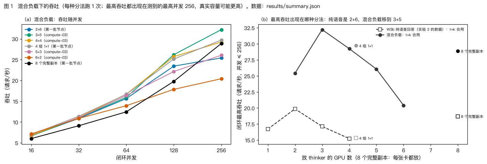
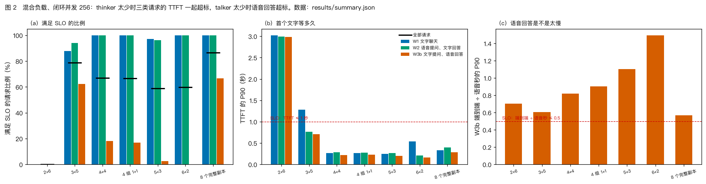
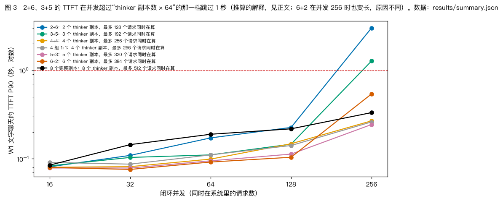
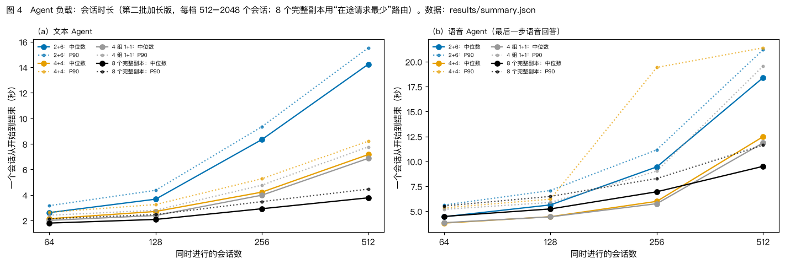
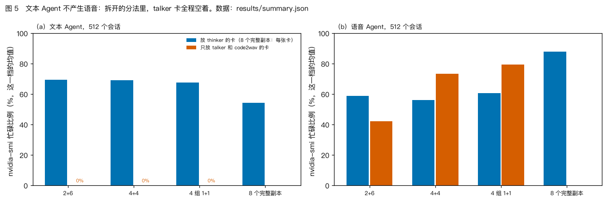
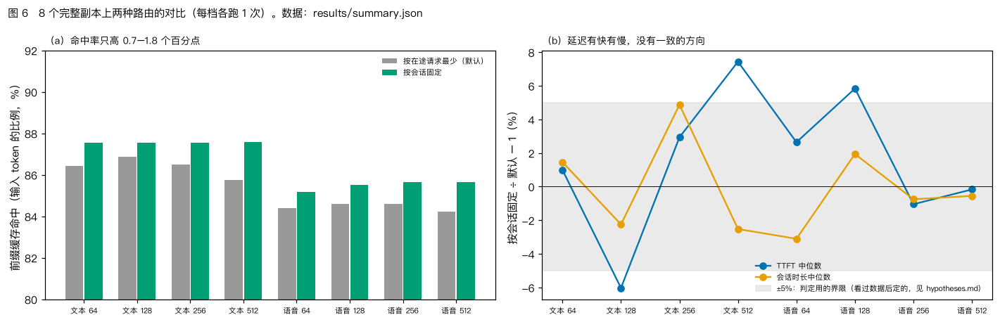
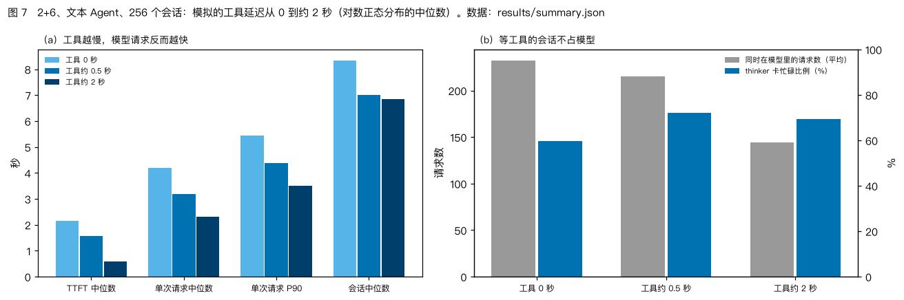

# 实验 19：负载类型会不会改变最佳分工？

> **状态：完成（2026-11-18，只用已有数据，没有新的 GPU 运行）**
> - 数据来自 plan v2 的两批 8 卡运行：第一批 2026-11-15（Slurm Job 625796，“第一批节点”），第二批 2026-11-16（Job 454290，compute-03）。两台都是 8×RTX A6000；同一种分法在两台节点上吞吐相差不到 3%（[第二批报告](../../../reports/experiment_reports/20261116_plan_v2_batch2_a6000_8gpu.md)第 5 节）。
> - 用到 28 个运行，全部成功，没有服务中途重启。每种配置只跑过 1 次，所以下面的结论都是**初步**的。
> - 三条预测（B-H1、B-H2、B-H3）在 2026-11-11 写进计划，早于任何数据；但判定方法是看过第一批结果以后才定的，所以判定是**探索性**的，见 [hypotheses.md](hypotheses.md)。限制见 [limitations.md](limitations.md)。

## 第一部分：一句话

- 只有语音回答时（实验 2），8 张卡最好的分法是 2 张放 thinker、6 张放 talker（下面写作“2+6”）。负载里文字请求一多，最好的分法就往“更多 thinker”那边移：
  - **混合负载**（四成文字聊天、四成语音回答、两成语音提问文字回答）：3+5 吞吐最高，闭环并发 256 时 32.2 请求/秒，比 2+6 的 25.4 高 27%。2+6 在并发 256 时三类请求的首个文字都要等约 3 秒，一个请求也没有满足 SLO。
  - **文本 Agent**：8 个完整副本最好，256 个会话同时进行时，一个会话的中位数是 2.9 秒，2+6 要 8.3 秒。拆开的分法里 talker 卡全程 0% 忙，因为文本 Agent 不产生语音。
  - **语音 Agent**（最后一步语音回答）：8 个完整副本和 4 组 1+1 最好，2+6 最差。
- 2+6 在混合负载下变慢，不是因为 thinker 的 GPU 算不过来（只忙 64%），而是因为两个 thinker 最多只能同时处理 128 个请求，多出来的只能排队（推算）。
- 让同一个会话的请求固定发到同一个副本，前缀缓存命中率只高 0.7–1.8 个百分点，延迟没有一致的变化。

## 第二部分：为什么要做

- 实验 2、7、9 比较分法时只用了一种负载：W3b（文字提问、语音回答）。真实服务里还有只要文字回答的请求，以及 Agent：模型先决定调用哪个工具，拿到结果后再回答，一个任务要好几次模型请求。
- 不同的请求压在不同的阶段上：文字回答只经过 thinker，语音回答还要经过 talker 和 code2wav。负载里文字多，thinker 就会先满，最好的分法可能就不是 2+6。
- 这个问题直接影响部署：如果只按语音负载选了 2+6，遇到文字为主的流量时，6 张 talker 卡可能大部分时间闲着。
- 计划（`docs/04_experiments/plan_8gpu_v2.md`）在 2026-11-11 写下了三条预测：
  - **B-H1**：混合负载下，最优比例比纯 W3b 更偏向 thinker。
  - **B-H2**：Agent 负载的多数步骤是很短的文本工具调用，最优比例比纯 W3b 更偏向 thinker。
  - **B-H3**：8 个副本按“在途请求最少”路由时，前缀缓存被分成 8 份，命中率低于单卡；按会话固定路由能恢复命中率，并降低 TTFT。
- 第一批（11-15）跑了 3 种分法的混合负载，以及每档只有 4–40 秒的 Agent 负载。第二批（11-16）补了 4 种分法的混合负载，并把 Agent 每档加长到 512–2048 个会话。第二批的结果一直没有整理成报告，第一批报告对 B-H2 写的是“待第二批确认”。这份报告把两批放在一起。

## 第三部分：先学几个概念

闭环、开环、吞吐、TTFT、P50/P90、副本、放置这些基础概念，见[概念手册](../../../reports/research_updates/exp09_11_concepts.md)和[实验 9 第三部分](../实验09_最佳GPU分工/README.md#第三部分先学几个概念)。这里只讲本实验新用到的。

### 3.1 混合负载（mixed workload）

- **定义**：同一段时间里，不同类型的请求混在一起发给服务。这里每个请求按比例随机抽：40% W1（文字提问、文字回答），40% W3b（文字提问、文字加语音回答），20% W2（语音提问、文字回答）。
- **生活例子**：餐厅里有人只点饮料，有人点全套。只点饮料的人多了，吧台先忙不过来，后厨反而闲。
- **本项目**：W1 和 W2 只经过 thinker；W3b 还要经过 talker 和 code2wav。混合负载里六成请求根本不需要 talker。
- **容易混淆**：W2 的输入是语音，要先经过音频编码器（和 thinker 在同一张卡上），但回答是文字，不需要 talker。

### 3.2 SLO（服务等级目标）

- **定义**：事先定好的“够快”的标准。一个请求满足 SLO，算它“合格”。
- **生活例子**：外卖平台承诺 30 分钟送达，超过就算超时。
- **本项目**（和 plan v2 相同）：请求成功，并且首个文字的时间（TTFT）≤ 1 秒；如果要语音回答，还要“端到端时间 ÷ 语音秒数”≤ 0.5，也就是 10 秒的语音最多等 5 秒。
- **容易混淆**：W1、W2 只看 TTFT；W3b 两条都要满足。所以 TTFT 很快、语音很慢的 W3b 也不合格。

### 3.3 Agent 会话和工具调用

- **定义**：一个 Agent 任务由几次模型请求组成。模型先决定调用哪个工具（例如计算器），程序执行工具，把结果交回模型，模型再给出最终回答。一个任务从开始到结束叫一个**会话**。
- **生活例子**：你打电话问客服账单，客服先查系统（工具），再告诉你结果。整通电话是会话，客服每次开口是一次模型请求。
- **本项目**：任务是合成的（算术、查表等），每个会话最多 5 步，实际中位数是 2 次模型请求：一次决定调用工具，一次回答。工具在客户端进程里执行，各档的中位数只有 24–60 微秒。
  - **文本 Agent**：全程文字。
  - **语音 Agent**：最后一步用语音回答；用户每一步之间有“思考时间”（对数正态分布，中位数 1 秒）。
  - 每一档“同时进行的会话数”是 64、128、256、512。一个会话结束，马上开始下一个，所以同时在模型里的请求数小于会话数（有的会话在等工具或在“思考”）。
- **容易混淆**：会话时长 = 几次模型请求 + 工具时间 + 思考时间；“单次请求延迟”只是其中一次模型请求的时间。

### 3.4 前缀缓存（prefix cache）

- **定义**：很多请求的开头相同（例如同一段系统提示词和工具说明）。服务端把这段已经算过的中间结果留下来，下一个请求直接复用，只算后面不同的部分。
- **生活例子**：每份合同开头的条款都一样，律师只需要读新加的那几页。
- **本项目**：Agent 请求的输入中位数约 370–430 个 token（文本 Agent 430，语音 Agent 373），其中 83%–88% 可以从缓存里拿到。
- **容易混淆**：
  - 命中率是“输入 token 里被复用的比例”，不是“请求里命中的比例”。
  - 每个副本有自己的缓存，副本之间不共享。

### 3.5 路由：在途请求最少 和 按会话固定

- **定义**：有多个独立的服务副本时，客户端要决定每个请求发给谁。
  - **在途请求最少**（least outstanding）：发给手上正在处理的请求最少的副本（默认）。
  - **按会话固定**（session affinity）：同一个会话的所有请求都发给同一个副本。
- **生活例子**：银行叫号时去人最少的窗口，或者每次都找同一个熟悉你业务的柜员。
- **本项目**：只有“8 个完整副本”是 8 个独立的服务，客户端才需要路由，所以只在它上面比较。其他分法是一个服务，内部自己分配。
- **容易混淆**：按会话固定的好处是第二次请求能用上第一次留下的缓存。但所有会话共用的系统提示词，在每个副本上很快就都缓存了，这部分不靠路由。

### 3.6 thinker 的“同时处理上限”

- **定义**：每个 thinker 副本最多同时处理一定数量的请求；超过的请求在 thinker 前面排队，等有名额再开始。sglang-omni 520b49ee 给 MiniCPM-o 的 thinker 默认设的是 64 个（`sglang_omni/models/minicpm_o/stages.py` 第 361 行，`max_running_requests=64`）；我们的配置没有改它。talker 的默认是 32 个。
- **生活例子**：一间教室最多坐 64 个人。来了 100 个人，36 个人在门外等，哪怕老师讲得一点也不吃力。
- **本项目**：2+6 有 2 个 thinker 副本，最多同时处理 128 个请求；闭环并发 256 时，放不下的请求只能排队。
- **容易混淆**：这是软件的设置，不是 GPU 算不过来。下面的图 2 里，2+6 的 thinker 卡只忙 64%，TTFT 却要 3 秒。

## 第四部分：一个请求经过哪里

```
W1 文字聊天：          客户端 → thinker（文字）→ 客户端
W2 语音提问、文字回答： 客户端 → 音频编码器 → thinker（文字）→ 客户端
W3b 文字提问、语音回答：客户端 → thinker（文字）→ talker（声音编码）→ code2wav（声音）→ 客户端

文本 Agent 的一个会话：
  请求 1：thinker 决定调用哪个工具 → 客户端执行工具（几十微秒；或模拟约 0.5、2 秒）
  请求 2：thinker 读工具结果，写出回答 → 会话结束，马上开始下一个会话
语音 Agent：最后一步还要经过 talker 和 code2wav；每一步之间用户“思考”约 1 秒
```

7 种分法（thinker 放在哪几张卡上，其余的卡放 talker 和 code2wav；talker 和 code2wav 在同一张卡上，但在不同的进程里）：

| 名称 | 8 张卡怎么分 | thinker 副本数 | 是否一个服务 |
|---|---|---|---|
| 2+6 | GPU 0–1 thinker，GPU 2–7 talker 和 code2wav | 2 | 一个服务，内部把请求分给各个副本 |
| 3+5 | GPU 0–2 thinker，GPU 3–7 talker 和 code2wav | 3 | 同上 |
| 4+4 | GPU 0–3 thinker，GPU 4–7 talker 和 code2wav | 4 | 同上 |
| 5+3 | GPU 0–4 thinker，GPU 5–7 talker 和 code2wav | 5 | 同上 |
| 6+2 | GPU 0–5 thinker，GPU 6–7 talker 和 code2wav | 6 | 同上 |
| 4 组 1+1 | 4 个独立的两卡服务：偶数卡 thinker，奇数卡 talker 和 code2wav | 4 | 4 个服务，客户端按“在途请求最少”分配 |
| 8 个完整副本 | 每张卡一个完整服务，thinker、talker、code2wav 都在这张卡上 | 8 | 8 个服务，客户端分配 |

## 第五部分：我们究竟怎么做实验

### 5.1 用了哪些运行

| 负载 | 分法 | 什么时候、在哪 | 每种分法 |
|---|---|---|---|
| 混合负载 | 8 个完整副本、4 组 1+1、2+6 | 第一批，2026-11-15 07:17–07:59，第一批节点 | 1 次 |
| 混合负载 | 3+5、4+4、5+3、6+2 | 第二批，2026-11-16 21:32–22:25，compute-03 | 1 次 |
| Agent（加长） | 8 个完整副本（两种路由）、2+6（另加工具延迟）、4 组 1+1、4+4 | 第二批，2026-11-16 22:25–23:04，compute-03 | 1 次 |
| Agent（每档太短，只作对照） | 8 个完整副本、4 组 1+1、2+6 | 第一批，2026-11-15 05:59–06:17 | 1 次 |
| 纯语音 W3b（参照，即实验 2 的数据） | 8 个完整副本、4 组 1+1、1+7、2+6、3+5、4+4 | 第一批各 2 次；2+6 和 8 个完整副本在 compute-03 上又各跑 1 次 | 2–3 次 |

5+3、6+2 只跑了混合负载；3+5、5+3、6+2 没有 Agent 数据。

### 5.2 负载

- **混合负载**：
  - 闭环：并发 16、32、64、128、256，每档 max(96, 2×并发) 个计量请求，另有与并发数相同的预热请求不计入统计。
  - 开环：泊松到达，速率取这次运行闭环最高吞吐的 0.5、0.75、0.9、1.0、1.2 倍，每档 120 秒。
- **Agent（加长）**：每档的会话总数是同时进行会话数的 8 倍（512 个时是 4 倍），即 512–2048 个会话。每档实际持续 15–85 秒（配置说明里写的“约 2–3 分钟”是估计，实际更短）。
  - 8 个完整副本上，每一档分别用“在途请求最少”和“按会话固定”各跑一遍。
  - 2+6 上，256 个会话时另加两档模拟工具延迟：对数正态分布，中位数 0.5 秒和 2 秒。
- 所有输入都是合成数据。

### 5.3 怎么算

- **吞吐**：一档里完成的请求数 ÷ 这一档从第一个请求发出到最后一个完成的时间（`analyze_experiment.py` 的 `tp_requests_per_s`，和实验 2 相同）。
- **闭环最高吞吐**：各档吞吐的最大值。7 种分法的最大值都出现在测到的最高并发 256，所以它其实是“并发 256 时的吞吐”，真实的上限可能更高（见 limitations.md）。
- **满足 SLO 的比例**：失败的请求算不合格，预热请求不算。
- **百分位**：线性插值（和 numpy 默认相同）；Agent 的单次请求和会话时长的百分位取自 `analyze_experiment.py`。
- **GPU 忙碌比例**：nvidia-smi 每 0.2 秒采样一次的“利用率”，按角色（放 thinker 的卡、只放 talker 和 code2wav 的卡）求这一档的均值。它只说明“这段时间有没有 kernel 在跑”，不说明算力用满了没有。
- **Agent 的吞吐**：一档里完成的模型请求数 ÷ 这一档的时长。“同时在模型里的请求数”= 所有模型请求的耗时之和 ÷ 这一档的时长（利特尔法则）。

### 5.4 怎么判定

三条预测是事先写的，但没有事先写判定方法。下面的方法是看过第一批结果以后定的（第一批报告在 11-16 已经对它们下过初步判断），所以只能算探索性的检验：

- **“更偏向 thinker”**：纯语音时最好的分法是 2+6（实验 2 的结论；闭环最高吞吐 19.4–19.9 请求/秒，最大）。如果某种负载下“最好的分法”放 thinker 的 GPU 多于 2 张，就算更偏向 thinker。参照固定是 2 张，不随下面的容差重新挑（理由见 hypotheses.md）。8 个完整副本每张卡都放 thinker，按 8 张算。
- **“最好的分法”**：指标最好的那个，加上和它相差 3% 以内的。纯语音数据里同一种分法重复运行，多数相差不到 3%；最大的是 4+4 的两次运行，差 5.6%。所以又用 6% 重算了一遍，判定不变。这些分法都多于 2 张 thinker 卡才算“支持”，都不多于才算“不支持”，否则“不确定”。
  - 混合负载：主要指标是闭环最高吞吐，另看并发 256 时满足 SLO 的比例。
  - Agent：会话时长的中位数，文本 Agent 在 256 和 512 个会话两档都支持才算支持；语音 Agent 单独报告。
- **按会话固定路由**：命中率每档都高 ≥ 3 个百分点才算“恢复”；TTFT 中位数每档都低 ≥ 5% 才算“降低 TTFT”，没有一档低 5% 算“不支持”，其余“不确定”。
- 详细规则和理由见 [hypotheses.md](hypotheses.md)。

## 第六部分：每张图怎么读

### 图 1　混合负载下的吞吐



- **左图**：横轴是闭环并发，纵轴是吞吐。并发 64 以下 7 种分法差不多；到 128、256 时拉开。
- **右图**：横轴是放 thinker 的 GPU 数。空心方块是纯语音 W3b（实验 2 的数据），实心圆是混合负载。
  - 纯语音时最高点在 2+6（19.9 请求/秒），3+5 低约 14%（17.1）。
  - 混合负载时最高点移到 3+5（32.2 请求/秒，Measured），比第二名 4 组 1+1（29.7）高 8%，比 2+6（25.4）高 27%。
  - thinker 再多（5+3、6+2）又往下掉：talker 卡太少，语音回答跟不上。
- 8 个完整副本在混合负载下 28.9 请求/秒，排第四。

### 图 2　混合负载、闭环并发 256：谁不合格、为什么



- **（a）满足 SLO 的比例**：8 个完整副本 86.5%，3+5 78.7%，4+4 和 4 组 1+1 约 67%，6+2 59.8%，5+3 58.8%，**2+6 是 0**。
- **（b）TTFT 的 P90**：2+6 三类请求都在 3.0 秒左右，全部超过 1 秒；3+5 的文字聊天是 1.28 秒（88% 合格）；其他分法都在 0.6 秒以下。
- **（c）语音回答**：thinker 卡越多、talker 卡越少，语音越慢。5+3、6+2 的“端到端 ÷ 语音秒”P90 是 1.10、1.49，语音回答几乎全部不合格（2%、0%）。
- 读法：左边（thinker 少）坏在 TTFT，右边（talker 少）坏在语音；3+5 和 8 个完整副本两边都不太坏。
- 降到并发 128 时，除了 6+2（73%），所有分法都有 ≥ 95.7% 的请求合格。所以这些差别只在很高的负载下出现。

### 图 3　为什么 2+6 的 TTFT 一下子变成 3 秒



- 横轴是闭环并发，纵轴是文字聊天（W1）的 TTFT P90（对数坐标）。
- 2+6 在并发 128 时 TTFT 还只有 0.23 秒，到 256 时变成 3.0 秒；3+5 从 0.15 秒变成 1.28 秒。
- **推算的解释（Derived）**：2 个 thinker 副本最多同时处理 2 × 64 = 128 个请求，3 个是 192 个。闭环并发 256 时，放不下的请求只能在 thinker 前排队。4 个及以上 thinker 副本有 ≥ 256 个名额，TTFT P90 都在 0.6 秒以下。
- 支持这个解释的另一个现象：2+6 在并发 256 时 thinker 卡只忙 64%（Measured），GPU 并没有算满。
- 这只是推算：没有用“改大上限”的运行验证（第九部分第 1 条）。
- 6+2 有 6 个 thinker 副本、384 个名额，TTFT 在并发 256 时也涨到 0.54 秒。这不是名额不够，可能是 2 张 talker 卡已经满了（92% 忙），请求在流水线后面堵住，影响到了前面（Hypothesis）。

### 图 4　Agent 负载：一个会话要多久



- **文本 Agent（左）**：8 个完整副本在每一档都最快。256 个会话时会话中位数 2.9 秒，4 组 1+1 是 4.0 秒，4+4 是 4.2 秒，2+6 是 8.3 秒；512 个会话时分别是 3.8、6.9、7.2、14.2 秒。
  - 每秒完成的模型请求（512 个会话）：8 个完整副本 177 个，4+4 127 个，4 组 1+1 118 个，2+6 65 个。
  - TTFT 中位数（512 个会话）：8 个完整副本 0.14 秒；4 组 1+1、4+4 约 1.8–1.9 秒；2+6 5.5 秒。和图 3 的解释一致：8 个副本有 512 个名额，4 个副本只有 256 个，2 个副本只有 128 个。
- **语音 Agent（右）**：256 个会话时 4 组 1+1（5.8 秒）和 4+4（6.0 秒）的中位数最短，8 个完整副本 7.0 秒；512 个会话时 8 个完整副本最短（9.5 秒）。2+6 两档都最慢（9.5、18.4 秒）。
  - 4+4 和 4 组 1+1 的尾巴很长：512 个会话时单次请求 P90 是 10.7、9.3 秒，8 个完整副本是 4.6 秒。4+4 在 256 个会话时，会话时长的 P90 跳到 19.4 秒，这一档有 16 个请求因为 GPU 显存不足失败（见 limitations.md）。
- 第一批每档太短的数据给出同样的顺序：文本 Agent 512 个会话时单次请求中位数 8 个完整副本 1.76 秒，4 组 1+1 3.06 秒，2+6 6.45 秒。

### 图 5　文本 Agent 时，talker 卡在干什么



- 文本 Agent、512 个会话：2+6、4+4、4 组 1+1 放 thinker 的卡 68–69% 忙，**只放 talker 和 code2wav 的卡 0% 忙**（Measured）。文本 Agent 不产生语音，这些卡一直空着：2+6 有 6 张、4+4 和 4 组 1+1 有 4 张。
- 8 个完整副本每张卡都放了 thinker，8 张卡都在处理文字请求，平均 54% 忙。
- 语音 Agent 时 talker 卡才有活：4+4、4 组 1+1 的 talker 卡 73–79% 忙；2+6 只有 42%，因为请求堵在 2 个 thinker 前面，到 talker 的少。

### 图 6　按会话固定路由有没有用



- 只在 8 个完整副本上比较，每档两种路由各跑 1 次。
- **（a）命中率**：按会话固定每档都高，但只高 0.7–1.8 个百分点（例如文本 512 个会话：85.8% → 87.6%）。
- **（b）延迟**：TTFT 中位数的变化在 −6.0% 到 +7.4% 之间，会话时长在 −3.1% 到 +4.9% 之间，有快有慢，没有一致的方向。
- 为什么效果小（Hypothesis）：命中的主要是所有会话共用的系统提示词和工具说明，每个副本很快都缓存了；每个会话只有约 2 次请求，会话内部能复用的部分很少。和第一批报告的判断一致。

### 图 7　工具变慢以后会怎样



- 2+6、文本 Agent、256 个会话，模拟的工具延迟从 0 增加到中位数约 0.5 秒、约 2 秒：
  - TTFT 中位数 2.16 → 1.56 → 0.60 秒；单次请求中位数 4.20 → 3.19 → 2.31 秒；会话中位数 8.34 → 7.00 → 6.85 秒。
  - 同时在模型里的请求平均 233 → 216 → 145 个。
- **读法**：会话在等工具时不占模型。工具越慢，同时挤在 thinker 前的请求越少，排队越短，每次模型请求反而越快；会话时长多了工具时间，但少了排队时间，结果略短。
- 计划里想看“工具等待让各个池空闲了多少”：thinker 卡的忙碌比例是 60%、72%、69%，并没有因为工具变慢而变闲；talker 卡三档都是 0%。工具延迟为 0 时 thinker 卡反而最不忙、请求最多，原因不清楚（Unknown）。

## 第七部分：证据等级

| 结论 | 等级 | 依据 |
|---|---|---|
| 各分法在混合负载下的吞吐、SLO 比例、TTFT；Agent 的会话时长、单次请求延迟、命中率、GPU 忙碌比例 | Measured | 每种配置 1 次运行；客户端单调时钟、服务端前缀缓存统计、nvidia-smi 每 0.2 秒采样 |
| 混合负载下最好的分法从 2+6 移到 3+5（B-H1 支持） | Measured（初步），判定是探索性的 | 3+5 比第二名高 8%，超过同一分法重复运行的差别（多数 < 3%，最大 5.6%）；但只有 1 次运行，判定方法是事后定的 |
| 文本、语音 Agent 下最好的分法都多于 2 张 thinker 卡（B-H2 支持） | Measured（初步），判定是探索性的 | 4 种分法里 8 个完整副本或 4 组 1+1 最好；3+5、5+3、6+2 没有 Agent 数据 |
| 按会话固定路由只把命中率提高 0.7–1.8 个百分点，TTFT 没有一致的下降（B-H3 后半句：命中率效果小，TTFT 不确定） | Measured（初步） | 8 档各 1 次 |
| 8 个副本的命中率低于单卡（B-H3 前半句） | Unknown | plan v2 没有同一种 Agent 负载的单卡运行 |
| 2+6、3+5 的 TTFT 在高并发时跳起来，是因为 thinker 名额不够 | Derived | 默认上限 64 个（代码）× 副本数，和 TTFT 跳起来的那一档对得上；thinker 卡没有算满；没有用改大上限的运行验证 |
| 文本 Agent 时拆开的分法里 talker 卡全空 | Measured | talker 卡 nvidia-smi 0% |
| 6+2 在并发 256 时 TTFT 变长，是因为 talker 满了往前堵 | Hypothesis | 只有忙碌比例和延迟，没有阶段内的排队数据 |
| 按会话固定效果小，是因为命中主要来自共用的系统提示词 | Hypothesis | 没有按“共用部分 / 会话内部”分开统计命中 |
| 工具延迟为 0 时 thinker 卡最不忙 | Unknown | — |
| 换成真实的 Agent 流量、更长的会话、别的模型时的结论 | Unknown | 只测了合成任务和 MiniCPM-o 4.5 |

## 第八部分：研究意义

1. **最好的分法取决于负载的组成**。只按语音负载选出的 2+6，对文本 Agent 是 4 种分法里最差的（会话 8.3 秒对 2.9 秒）。部署前要先知道流量里文字和语音各占多少。
2. **“名额”是一个看不见的容量上限**。2+6 的 thinker 卡只忙 64%，TTFT 已经 3 秒。只看 GPU 忙不忙会以为还有余量；规划容量时要把“每个副本最多同时处理多少请求”算进去（推算，待验证）。
3. **拆开的分法在文字为主的负载下浪费卡**。文本 Agent 时 talker 卡 0% 忙，2+6 等于只用了 2 张卡。能按负载切换角色的放置（例如让 talker 卡上也放一个 thinker 副本），或者在文字多时用完整副本，可能更划算（Hypothesis）。
4. **对这种合成 Agent，按会话固定路由不值得**。命中率只高 1–2 个百分点，延迟没有变化。真实 Agent 的会话更长、每个会话自己的上下文更多，结论可能不同（Unknown）。

## 第九部分：下一步

1. **验证“名额”解释**（最便宜、信息最多）：在 2+6 上只把 thinker 的 `max_running_requests` 从 64 调到 128，重跑混合负载的并发 128、256 两档。如果 TTFT 回到 1 秒以下、吞吐上升，就说明 2+6 在混合负载下输给 3+5 的主要原因是这个设置，而不是 GPU 不够；同时要看显存是否够用。
2. **在三段分法上重做混合负载**：实验 9 发现语音负载下 2+2+4（thinker、talker、code2wav 分开）比 2+6 好。混合负载下是否会变成 3+2+3 一类的分法，还没测。
3. **重复关键配置**：3+5、4 组 1+1、2+6 的混合负载和 8 个完整副本的文本 Agent 各再跑 2 次，给出重复的范围，把“初步”去掉。

## 附：文件在哪里

| 文件 | 内容 |
|---|---|
| [hypotheses.md](hypotheses.md) | 事先写下的三条预测、事后定的判定方法和判定结果 |
| [limitations.md](limitations.md) | 限制、失败的请求和对结论的影响 |
| [reproduce.md](reproduce.md) | 怎样从原始数据重新生成结果和图 |
| [metadata.json](metadata.json) | 28 个运行的目录、时间、状态、代码和软件版本 |
| `results/summary.json` | 全部汇总数字，图都从这里画（字段见[数据字典](../../../reports/research_updates/plan_v2_reports_data_dictionary.md)第二节） |
| `results/mix_closed.csv` | 混合负载闭环：每种分法、每档的吞吐和各类请求的 SLO 比例、TTFT、端到端 |
| `results/agent_phases.csv` | Agent：每个运行、每档的会话、请求、命中率、GPU 忙碌比例 |
| `scripts/analysis/exp19_report.py`、`exp19_figures.py` | 分析和画图脚本；测试在 `tests/test_exp19_report.py` |

内部配置名（只用于复现）：混合负载 `v2_b1_{r8,p4,s2x6}`、`v2b_b1_{s3x5,s4x4,s5x3,s6x2}`；Agent `v2b_b2l_{r8,s2x6,p4,s4x4}`、`v2_b2_{r8,p4,s2x6}`；纯语音参照 `v2_a_{r8,p4,s1x7,s2x6,s3x5,s4x4}_run{1,2}`、`v2b_a_{s2x6,r8}_c03`。r8 = 8 个完整副本，p4 = 4 组 1+1，s<t>x<k> = t+k。
