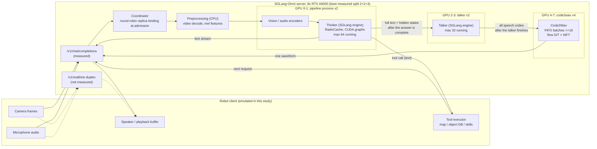
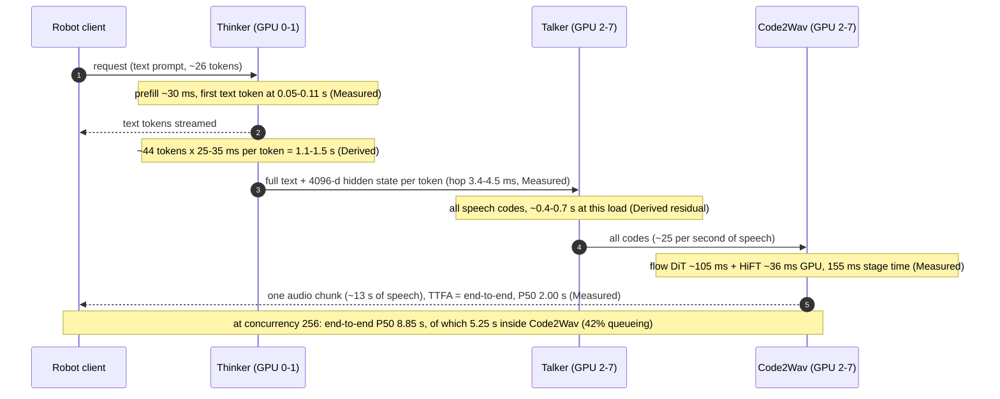
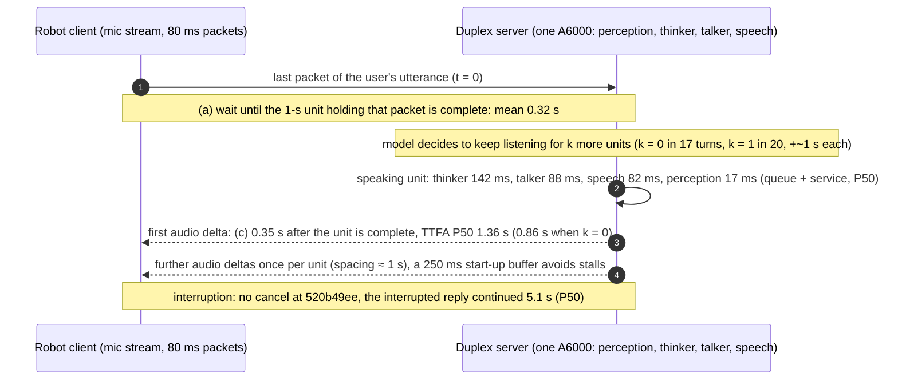

# Real-Time Multimodal Robot Assistants on a Multi-Stage Omni Serving Stack

**Application, System Architecture, Observed Bottlenecks, and Research Directions**

> Source material for a group-meeting talk (audience: PhD students and faculty in AI/GPU/ML systems and robotics). Written 2026-11-18. Sections 1–10 are in English; section 11 is a Chinese companion.
> Every number below is tied to an experiment in this repository. Evidence levels: **Measured**, **Derived** (computed from measurements), **Estimated**, **Hypothesis**, **Proposed**, **Unknown**.
> **Scope disclaimer.** No robot was deployed and no robot was tested. All measurements come from synthetic workloads replayed against a serving system. The measured execution path is the request–response `/v1/chat/completions` path; the full-duplex `/v1/realtime` path had **not** been measured on our hardware when this was written (2026-11-18; see the update below).
>
> **Update 2026-11-19 (pre-presentation validation, branch `research/pre-presentation-validation`).** The full-duplex `/v1/realtime` path was measured in R0–R2 on one A6000 with synthetic speech (§2.6, Finding F); the request–response results of experiments 1–19 are unchanged and are kept separate from the duplex results. New numbers trace to `presentation_validation/final_experiment_results.md` and `presentation_validation/presentation_evidence.md`. Still no robot, no real camera, no real users.

**Common conditions for all measurements below** (not repeated per finding): MiniCPM-o 4.5 served by SGLang-Omni at commit `520b49ee` (SGLang 0.5.21, torch 2.13) plus our measurement or prototype patches; one node with 8× NVIDIA RTX A6000 48 GB (NVLink only between GPU pairs 0-3, 1-2, 4-5, 6-7); synthetic workloads (W3b: six short text questions answered in text + speech, ~44 text tokens and ~13 s of speech; W3L: ~100-word answers, ~30 s of speech; MIX: half and half). Unless noted, comparisons use 3 independently restarted blocks with paired 95% t-intervals (df = 2); we do not claim statistical significance.

---

## 1. Application Motivation

### 1.1 Target application

We target a **real-time, voice-interactive robot assistant**: a robot that continuously observes its surroundings through a camera, listens to people through a microphone, reasons over what it sees and hears, occasionally calls external tools (e.g., a map lookup, an object database, a task planner, or a robot-skill API), and answers by speaking. The interaction is continuous: users ask follow-up questions, refer to things in view ("what about the red one?"), and interrupt the robot while it speaks.

For this study the robot is **emulated**: a client replays camera frames, audio, and tool events with controlled timing, so that every run is reproducible. Motion control and closed-loop actuation are out of scope; we study the perception–reasoning–speech serving loop that sits between the sensors and the speaker.

### 1.2 Why it needs real-time multimodal inference

- **Inputs are continuous and multimodal.** Video frames and audio arrive whether or not the model is ready. A single turn can carry an image (64 visual tokens per slice, up to 9 slices in MiniCPM-o's vision front end) and seconds of speech (10 audio tokens per second after pooling).
- **Outputs are speech.** The robot must start speaking soon after the user stops. The relevant latency is **time to first audio (TTFA)**, not time to first text token.
- **Interactions have deadlines.** A response that arrives after the user has moved on, or that keeps playing after the user interrupts, is a failure even if throughput is high.

### 1.3 How the workload differs from conventional LLM serving

| Property | Conventional LLM serving | Real-time robot assistant on an omni model |
|---|---|---|
| Unit of work | One text request | A **session**: a chain of multimodal turns, tool calls, and spoken replies |
| Pipeline | One model (prefill + decode) | Several heterogeneous stages: CPU preprocessing → encoders → **Thinker** (LLM) → **Talker** (small AR model producing speech codes) → **Code2Wav** (flow-matching vocoder + HiFT) |
| Bottleneck resource | Memory bandwidth (decode) and KV capacity | Differs per stage: bandwidth-bound Thinker decode, launch-bound Talker, compute-bound vocoder, CPU-bound video preprocessing |
| Latency metric | TTFT, inter-token latency | TTFA, barge-in latency, playback stalls, deadline misses |
| State across requests | Prefix cache | Session context (accumulated images/audio/dialogue), tool waits, partially played audio |

### 1.4 Why latency, scheduling, and GPU efficiency matter

A robot assistant is deployed on a fixed GPU budget (an on-board or edge server) and may serve **several independent interactions at once** — several users, several robots sharing a server, or one robot running background perception queries alongside a conversation. When those interactions compete:

- the stages saturate at **different** load levels, so the slowest stage sets the latency of everyone's speech (Finding A);
- queueing in front of the vocoder dominates end-to-end time at high load (Finding B);
- adding more GPU replicas helps only if they land on the bottleneck stage, and moving one GPU too many to the bottleneck can create a new bottleneck (Finding A).

---

## 2. How the Application Works

### 2.1 Stages and their resources

| Step | What happens | Where it runs | State kept across requests |
|---|---|---|---|
| Audio / video input | Camera frames and microphone audio are captured by the robot client | Robot (client) | — |
| Input preprocessing | Video decode and frame sampling (decord, 1 fps, ≤ 64 frames), image slicing/resizing (custom Triton bicubic kernel), audio resampling and mel features (CPU `torch.stft`) | **CPU** (decode, mel); GPU (image resize) | Stage cache of encoder outputs |
| Multimodal encoding | SigLIP-style vision encoder (27 layers) + resampler; Whisper-medium audio encoder | **GPU**, inside the Thinker process | Encoder output cache keyed by content hash |
| Thinker | Qwen3-8B-shaped LLM (36 layers, hidden 4096): reads the prompt, writes the answer token by token, streams text to the client | **GPU** (SGLang engine, CUDA graphs, RadixCache prefix cache) | KV cache / radix tree (session prefixes) |
| Tool / agent execution | The model emits a tool call; the client executes it and sends the result back as the next request | Client (in our harness) | Session history (client side) |
| Talker | ~0.19 B-parameter Llama-style model that turns the Thinker's text and per-token hidden states into speech codes (25 codes per second of speech) | **GPU** (SGLang engine, CUDA graphs) | None across requests (no radix cache) |
| Code2Wav | Flow-matching DiT (16 blocks, 10 Euler steps with classifier-free guidance) turns codes into a mel spectrogram; HiFT turns the mel into a 24 kHz waveform | **GPU** | Speaker-reference cache |
| Response | Text is streamed as it is generated; audio is returned to the client and played | Network / client | Playback buffer |

### 2.2 Dependencies and overlap

- **Serial dependencies (measured path).** For one request, the Talker starts only after the Thinker has finished the whole answer, and Code2Wav starts only after the Talker has finished all speech codes. Audio is returned **in one piece** when Code2Wav finishes. *(Source code: `sglang_omni/models/minicpm_o/config.py:80-117`, `routing.py:155-194`; upstream documentation: "The speech output is non-streaming." Measured: one audio chunk per request, so TTFA ≈ end-to-end latency; `docs/04_experiments/metrics.md`.)*
- **Overlap that already exists.** Different requests occupy different stages at the same time (pipeline parallelism), stage replicas serve different requests, and requests inside a stage are batched. Text streams to the client while the Thinker is still decoding.
- **Overlap that is possible in principle but not implemented for this model's chat path.** Starting the Talker on a partial Thinker output (Qwen3-Omni's pipeline does this with `enable_partial_start`), streaming Talker codes into chunked Code2Wav, and returning audio in chunks.
- **What runs where.** CPU: video decode, audio features, Python schedulers of every stage (one GIL per stage process). GPU: encoders, Thinker, Talker, Code2Wav.

### 2.3 Request–response path vs. full-duplex path

| | Request–response (`/v1/chat/completions`) | Native full duplex (`/v1/realtime`, `--variant session`) |
|---|---|---|
| Status in this project | **Measured** (experiments 1–19) | **Measured in R0–R2** (2026-11-19; one A6000, stock `520b49ee`, synthetic speech). Before that: source code and upstream reports only |
| Input | Whole turn (text/audio/images/video) per request | Continuous 1 s audio units at 16 kHz; images can be appended (`sglang.input_image.append`) |
| Output | Text stream; audio in one chunk at the end | Audio deltas per unit (24 kHz) |
| Who decides to speak | The client sends a request | The model decides listen/speak every unit |
| Interruption | Client abort → abort broadcast to all stages; an in-flight Code2Wav batch runs to completion and its result is discarded | Model-driven; `response.cancel` is **not supported** at `520b49ee` (added upstream later). Measured (R1): an interrupted reply kept playing 5.1 s at the median (max 11.6 s) |
| Session state | Client-side history; server-side prefix cache only | Server-side streaming sessions for Thinker and Talker; history bounded at 8,192 tokens per session |
| Default capacity | Limited by stage capacity (Finding A) | `max_sessions = 2` by default; all four stages on one GPU (fractions 0.12/0.52/0.15/0.15). Measured (R2, `max_sessions 8`, one A6000): 1-s units stay real-time up to 4 sessions; 8 sessions run out of GPU memory |
| Upstream measurements (not ours, different GPU) | — | 1×H200: unit lag p50 180→282 ms and p99 271→604 ms for 1→8 sessions (SGLang-Omni PR #2843); 8 concurrent sessions meet the real-time target (SGLang-Omni interactive-runtime blog) |

**Results measured on the request–response path must not be read as properties of the full-duplex path.** The duplex path uses a different pipeline configuration (all stages on one GPU, per-unit vocoding, streaming sessions), so its bottlenecks may differ.

### 2.4 System architecture (as implemented and measured)

### 2.5 Request execution timeline (measured path, low load)

Approximate durations for one W3b request at closed-loop concurrency 8 on the 2+6 split (experiment 6, section 6.1; experiment 8, phase 3). The Talker duration is the residual and is therefore Derived.

### 2.6 Full-duplex path as measured (R0–R2, added 2026-11-19)

One user turn on the full-duplex path, one session on one A6000 (R1, 3 blocks; medians; Measured unless marked). Audio is cut into 1-s units; each unit is processed by perception → thinker → (talker → speech only if the model decides to speak) and its output is released at the end of the unit's processing.

Under load (R2, `max_sessions 8`, one A6000): the speaking unit's processing grows from 353 ms (1 session) to 707 ms (8 sessions, P99 1.48 s), about equally in thinker, talker and speech; at 8 sessions 46 % of units miss their second and sessions fail with CUDA out-of-memory, because the speech stage's state outgrows its nominal 15 % of the card.

---

## 3. What Bottlenecks Have We Observed?

Five findings, ordered by how strongly they support a research question. Each follows *Observation → Evidence → Root cause → Why it matters for the application*.

### Finding A — Stage imbalance makes GPU placement, not GPU count, the first-order knob

- **Observation.** With 8 GPUs, the best split we tested gives 2 GPUs to the Thinker, 2 to the Talker, and 4 to Code2Wav (2+2+4). Moving one more GPU from the Talker to Code2Wav (2+1+5) *reduces* capacity by 25%, although the single Talker GPU is busy only 65% of the time.
- **Evidence.**

  | Experiment | Workload | Key numbers | Baseline | Evidence level |
  |---|---|---|---|---|
  | 9 (12 runs, 3 blocks) | W3b closed loop, c=256 | Capacity 23.77 req/s for 2+2+4 vs 22.12 for 2+6 (+7.5%, 95% CI +2.8% to +12.1%); 17.75 for 2+1+5 | 2+6 (Talker and Code2Wav co-located on 6 GPUs) | Measured / Derived |
  | 9 | W3b open loop, 23.5 req/s | P95 3.74 s (2+2+4) vs 4.34 s (2+6); 2+1+5 unstable (P95 10.8 s) | 2+6 | Measured |
  | 9 | W3L open loop, 10.5 req/s | Only 2+2+4 stable in all blocks; P95 7.08 vs 8.55 s | 2+6 | Measured |
  | 7 (5 placements × 3 blocks) | W3b | Co-location: Talker needs 2.2× more time per second of speech; Code2Wav needs 49–59% more GPU time per second of speech | Exclusive GPUs | Measured |
  | This round (from exp. 9 scheduler logs) | W3b c=256 on 2+1+5 | 80–83% of the single Talker's decode log lines show exactly 32 running requests with 178–184 queued; with 2 Talkers each runs a median of 16–18 with no queue | — | Measured (heuristic attribution of log lines) |
  | 19 (single runs, preliminary) | Mixed text/speech; text-only agent | Best split moves to 3+5 for the mix (32.2 vs 25.4 req/s); for text agents 8 full replicas win (session median 2.9 vs 8.3 s), and in split layouts the Talker GPUs are 0% busy | 2+6 | Measured (1 run each) |

- **Root cause.** The stages have very different per-request costs and different software limits. The Talker's admission limit is hard-coded to 32 running requests (`sglang_omni/models/minicpm_o/stages.py:144`), and its CUDA graphs are captured only up to batch 32; the Thinker's is 64 (`:361`). Capacity peaks where two stages have equal capacity; past that point, adding GPUs to the "slow" stage starves another one. GPU busy fractions do not reveal this — a Talker at 65% busy was the bottleneck.
- **Why it matters for the application.** A robot fleet's traffic mix (how often the robot speaks, how long it speaks, how often it only thinks or calls tools) shifts the optimum. A placement chosen for one mix can strand GPUs under another (0%-busy Talker GPUs for text-only agent turns).
- **Scope and limitations.** One model, one node, synthetic prompts; capacity depends on the calculation method (registered vs busy-window throughput differ by 20–36%), but the ranking does not. Files: `research/01_性能瓶颈/实验09_最佳GPU分工/README.md`, `实验07_Code2Wav独立GPU/README.md`, `实验19_负载类型和最佳分工/README.md`, `research/next_steps/results/p0_*_talker_slots.json`.

### Finding B — The vocoder is the throughput limiter for speech, and FIFO batching wastes compute on padding

- **Observation.** Code2Wav costs ~0.2 s of GPU time per request (flow ~150 ms, HiFT ~45 ms) and natural batching does not make individual requests cheaper. At high load, requests spend most of their time queueing in front of Code2Wav. When requests of different lengths are batched first-in-first-out, padding wastes up to 28% of the flow computation.
- **Evidence.**

  | Experiment | Workload | Key numbers | Baseline | Evidence level |
  |---|---|---|---|---|
  | 6 (3 blocks) | W3b, 2+6, c=8…256 | Code2Wav stage time 155 ms (c=8) → 5.25 s (c=256): 42% queueing, 58% waiting for the own batch; kernel launch-to-start delay 12–94 ms at high load (GPU-bound) | c=8 | Measured |
  | 10 (6 runs, controlled batching) | MIX on a placement where Code2Wav is the bottleneck (2 dedicated GPUs) | FIFO, cap 16: padding 28%, 114 s of speech per second; length-aware batching, cap 8: +30% speech per second (95% CI +17% to +43%), end-to-end P50 12.9 → 8.6 s | FIFO16 (default) | Measured / Derived |
  | 10 | same | Some short requests wait longer: short-request queue P95 +56% and +21% in two of three blocks | FIFO16 | Measured (descriptive) |
  | 10 (validation, 3 runs) | W3b open loop ≤ 23.5 req/s on 2+2+4 | No difference (P50 within ±3.5%): not saturated, ~1.2 requests per batch | FIFO16 | Measured |
  | This round (kernel census of exp. 7 traces) | W3b c=128, Code2Wav on dedicated GPUs | GEMM 25%; padded masked attention (`fmha_cutlassF_f16`, PyTorch memory-efficient kernel, est. occupancy 33%) 19% plus 6% of mask/layout preparation; HiFT FP32/TF32 convolutions 10% and NCHW→NHWC conversions 3%; CUDA graphs 0.3% of kernel time | — | Measured (kernel names and durations); flow/HiFT attribution by name heuristic matches exp. 6's CUDA-event split |

- **Root cause.** The flow solves 10 Euler steps over the batch padded to its longest row (prompt included), with classifier-free guidance doubling the rows; the DiT's SDPA receives a boolean padding mask, which rules out the flash backend. The CUDA-graph table covers batch ≤ 10 with narrow frame limits, so batched work runs eagerly. HiFT runs in FP32, once per distinct length.
- **Why it matters for the application.** For a speaking robot, the vocoder queue is TTFA. Padding waste and graph misses translate directly into how many concurrent spoken replies one GPU can sustain within a deadline.
- **Scope and limitations.** The +30% is a local, saturated-vocoder result; it did not transfer to an unsaturated full service. Files: `实验06_Code2Wav时间拆解/README.md`, `实验10_Code2Wav_Batching/README.md`, `research/next_steps/results/c2w_kernel_census_*.json`.

### Finding C — Thinker scheduling bubbles are real, but removing them barely moves speech latency

- **Observation.** For speech requests the Thinker executes synchronously: the GPU idles 3–15 ms between decode steps (11–23% of step time) while the CPU processes the previous step.
- **Evidence.**

  | Experiment | Key numbers | Evidence level |
  |---|---|---|
  | 5, 8 phase 1 | Per-step idle 3–15 ms; for text-only requests without a seed, one-step lookahead already works and cuts end-to-end P50 by 9–14% | Measured |
  | 8 phase 3 (3 blocks) | A snapshot-at-launch prototype is bit-exact (18 requests) and removes the decode idle (≤ 0.06 ms per step) and makes tokens 9–10% faster, but speech end-to-end P50 improves only 2–5% (all CIs include 0), and TTFT grows by 17–21 ms | Measured |
  | 11 | The follow-up (copying hidden states on a side stream) **failed its pre-registered correctness gate**; no performance comparison was run | Measured |

- **Root cause.** With lookahead, the next step's CUDA-graph replay overwrites the hidden states that the Talker needs (`sglang_omni/model_runner/thinker_model_runner.py:495-540`). The prototype fixes that, but the Thinker is only about half of a speech request's time, mixed prefill/decode steps stay synchronous, and a blocking 320–520 KB copy at request end drains the GPU queue.
- **Why it matters for the application.** Robot dialogue with long reasoning or tool planning is Thinker-heavy, so these bubbles matter more there than in our speech benchmark. More generally this is our clearest example that a **local kernel/decode improvement need not be an end-to-end improvement**.
- **Files:** `实验05_GPU为什么会等待/README.md`, `实验08_Thinker_Lookahead/README.md`, `实验11_Thinker异步优化/README.md`.

### Finding D — Speech is generated serially and returned at the end, so TTFA equals end-to-end latency

- **Observation.** On the measured path, the first audio byte arrives only after the full Thinker answer, the full Talker generation, and a full Code2Wav batch. TTFA is therefore the whole request latency: ~2.0 s at low load and ~8.9 s (P50) at closed-loop concurrency 256, while the first *text* token arrives in 0.05–0.11 s.
- **Evidence.** Experiment 6 (section 6.1: one audio chunk per request; TTFT vs end-to-end), experiment 9 (TTFT median 63–70 ms in open loop for all splits), source code (`sglang_omni/models/minicpm_o/config.py:80-117`; upstream cookbook "The speech output is non-streaming.").
- **Root cause.** Pipeline configuration, not hardware: the Thinker streams only to the text decoder; the Talker request is built from the complete Thinker output; Code2Wav is a non-streaming batch stage. MiniCPM-o's native duplex variant and Qwen3-Omni's chat pipeline do stream, with different configurations.
- **Why it matters for the application.** Conversational turn-taking needs the robot to start speaking within a few hundred milliseconds; at 2 s even at low load, the request–response path is unsuitable for interactive speech without streaming.
- **What still needs validation (Unknown).** TTFA and barge-in latency on the duplex path on A6000s; how they scale with concurrent sessions (default `max_sessions = 2`); whether streaming reduces throughput.
- **Update 2026-11-19.** The duplex path has now been measured (Finding F); it streams audio per 1-s unit, so this finding remains a property of the request–response path only.

### Finding E — Video preprocessing and agent dependencies change which resource is critical

- **Observation (video, measured).** For 10 s video questions, 87% of the ~650 ms service time is CPU preprocessing (~570 ms); the Thinker needs ~70 ms; GPUs are busy only 8–15% of the time. Each replica preprocesses one request at a time (1–1.3 cores), so throughput scales with replicas (7.2× with 8 replicas) only because each replica brings its own serial preprocessing slot.
- **Observation (agents, measured, preliminary).** Our synthetic agent sessions are short (median 2 model calls, ~425 input tokens, tools of 24–60 µs). Session-affinity routing raised the prefix-cache hit rate by only 0.7–1.8 points with no consistent latency change; adding 0.5–2 s of synthetic tool latency made each model call *faster* (less contention) and did not idle the Thinker GPUs.
- **Hypotheses (not yet tested).** With continuous camera input, CPU preprocessing — not GPU compute — may bound perception throughput. With long multimodal sessions, the per-session context may exceed the Thinker's KV capacity (127,039 tokens per replica, measured), at which point tool waits and user turns would cause re-prefill; the current synthetic agents are far below that scale.
- **Files:** `实验14_视频请求加副本/README.md`, `实验19_负载类型和最佳分工/README.md`, `实验12_回放能不能代替真实负载/README.md`.

---

### Finding F — On the full-duplex path, turn-taking and the unit structure gate the first spoken response; memory gates concurrency (added 2026-11-19)

- **Observation.** With one session, every 1-s unit is processed within its second (0 of 900 units missed; unit lag P99 0.43 s), yet the first spoken response arrives 1.36 s (median) after the user stops talking. Of that, ~0.32 s is waiting for the current unit to fill, ~1 s is an extra listening unit in 54 % of answered turns, and only ~0.35 s is processing. With up to 4 sessions the units stay real-time; at 8 sessions on one GPU 46 % of units miss and sessions fail with CUDA out-of-memory. Interrupted replies keep playing for 5.1 s at the median.
- **Evidence.** R0 (functional, 1–2 sessions × 300 s), R1 (3 blocks × 1 session, stage timing from server events), R2 (3 blocks × 1/2/4/8 sessions, `max_sessions 8`); experiment IDs `ppv_r0_*`, `ppv_r1_*`, `ppv_r2_*`; MiniCPM-o 4.5, stock SGLang-Omni `520b49ee`, one RTX A6000, synthetic spoken questions; `presentation_validation/results/r{0,1,2}_summary.json`. Evidence level: Measured (TTFA parts Derived from client timestamps; stage shares from server events).
- **Root cause.** (1) The model listens in fixed 1-s units and decides per unit whether to speak; when the utterance ends late in a unit, the unit holds little trailing silence and the model tends to wait one more unit (Hypothesis, consistent with the k = 1 turns having a shorter wait (a)). (2) Within a speaking unit the thinker is the largest stage (41 %), talker and vocoder 24 % each. (3) At 8 sessions the speech stage's per-session state grows past its nominal memory share (13.6 GiB vs ≈ 7.1 GiB) — memory, not a single compute stage, fails first.
- **Why it matters for the application.** For a robot, the turn-taking policy and unit size dominate perceived responsiveness at low load; kernel speedups on the vocoder can shorten at most ~24 % of a 0.35 s speaking unit. Concurrency on a shared card is limited by memory partitioning between stages, so placement and memory budgets, not only compute, decide how many robots one GPU can serve. Interruption needs a cancel path that the pinned version lacks.
- **Limitations.** Synthetic TTS questions with fixed pauses; one GPU type; demo sampling (temperature 0.7) makes turn-taking stochastic; the registered R2 capacity verdicts are "below the lowest level" because of a first-reply warm-up and a client I/O stall (descriptive capacity: 4 sessions); nvidia-smi utilization is unusable under the 1 Hz duplex load (power is reported instead); the request–response reference (TTFA 0.72 s for one-sentence answers at concurrency 1) has different semantics and is not a speed comparison.

## 4. Research Gap and Motivation

### 4.1 What previous systems already solve

- **Multi-stage omni serving.** SGLang-Omni already decouples stages into processes and GPUs with a configurable stage–process–GPU topology and provides a full-duplex runtime; upstream reports single-H200 numbers for both. Cornfigurator/Cornserve search deployment plans over GPU budgets for any-to-any models; M\* and HorizonServe address dataflow execution and single-GPU admission/SM sharing for omni models.
- **Interactive speech serving.** OmniCast schedules by playback progress and first-audio priority and handles barge-in; VoxServe co-schedules the LM and codec with TTFA/stall SLOs; Metronome bounds per-session KV with online admission for full-duplex models (including MiniCPM-o 4.5).
- **Agent-aware LLM serving.** ThunderAgent makes the agentic program the scheduling unit (program-level admission, pause/resume, global queue) to avoid KV thrashing during tool execution; Parrot, Autellix/Agentix, InferCept, Continuum, KVFlow, and TokenCake handle dependencies and KV retention around tool calls. FlashStates manages hybrid (attention + recurrent) state with arbitrary checkpointing and cost-aware admission/eviction.

### 4.2 What our experiments reveal

1. The optimal division of GPUs between omni stages is sharp and workload-dependent, and stage-level software limits (admission caps, graph coverage) can bottleneck a stage whose GPU is far from busy (Finding A).
2. The vocoder stage dominates speech latency at load, and its efficiency is governed by batch composition and shape coverage (padding, mask-based attention, CUDA-graph misses), not by raw kernel speed (Finding B).
3. Locally successful optimizations (lookahead, length-aware batching) did not translate into end-to-end gains unless they were on the critical path at the measured load (Findings B, C).
4. The measured chat path cannot meet conversational TTFA because speech is serial and unstreamed (Finding D).

### 4.3 What remains unanswered

- How should stage capacity *and admission* be allocated when the mix of spoken vs. silent (tool) steps, reply lengths, and video inputs changes over time — and can a policy track that optimum online?
- What determines TTFA and barge-in latency on the streaming/duplex path on commodity GPUs, and which stage limits the number of concurrent interactive sessions?
- Which compiler/runtime optimizations shorten the *vocoder* critical path (shape specialization for variable-length attention, precision and layout of the vocoder), and do they survive end-to-end validation under load?
- Do program-level signals (session identity, step type, tool waits) help a multi-stage omni pipeline at all, or only once session context exceeds KV capacity?

We are not aware of prior work that measures a multi-stage omni pipeline under **agent sessions with tool waits and spoken final steps** on workstation GPUs (our literature notes: `docs/01_research/prior_work.md` sections 7–9); this is a claim about our search, not a proof that no such work exists.

---

## 5. Research Questions and Hypotheses

### RQ1 — Stage-aware placement and admission under heterogeneous multimodal workloads

- **Motivation.** Finding A: the best split shifts with the workload; stage caps (32/64 running requests) and graph coverage create bottlenecks invisible to GPU utilization.
- **Existing evidence.** Experiments 2, 7, 9, 19; this round's Talker log analysis.
- **Hypothesis.** A policy that uses per-stage queue depth and per-request step type (spoken vs. silent) to set admission and stage capacity achieves higher goodput than any single static split across a workload mix, without raising P99 TTFA.
- **Proposed experiment.** First, the single-parameter test P0 (Talker cap 32 → 64 on 2+1+5). Then a workload whose spoken/silent ratio changes over time, comparing static splits (2+6, 2+2+4, 3+5) with a downstream-aware admission gate.
- **Baseline.** Best static split per phase (oracle) and the default 2+6.
- **Metrics.** Goodput under the SLO (TTFT ≤ 1 s and end-to-end/speech ≤ 0.5), P95/P99 TTFA, per-stage queue time.
- **Expected contribution.** A measured characterization of when stage capacity, not GPU count, limits omni serving, and whether online adaptation is worth its cost.
- **Limitations.** One model family; stage re-assignment at runtime is not supported by the serving system (only admission can be dynamic in a first study).

### RQ2 — The interaction-latency critical path: TTFA and barge-in under concurrent sessions

- **Motivation.** Finding D: TTFA = end-to-end on the measured path.
- **Existing evidence.** Experiments 6, 9 (measured path only); upstream duplex numbers on H200 (not ours).
- **Hypothesis.** On A6000s, the duplex path's per-unit latency and session capacity are limited by the per-unit vocoder and Thinker steps colocated on one GPU, and splitting stages across GPUs (as in Finding A) raises the number of sessions that meet a real-time unit deadline.
- **Proposed experiment.** Functional validation of `--variant session`, then a session-count sweep with replayed audio/video, measuring unit lag, TTFA, stalls, and barge-in latency; compare default single-GPU placement against split placements.
- **Baseline.** Default duplex configuration (`max_sessions = 2`, one GPU); the request–response path for the same dialogue.
- **Metrics.** TTFA, barge-in latency, deadline miss ratio, playback stall time, sessions meeting the deadline.
- **Expected contribution.** The first (to our knowledge) A6000 characterization of duplex omni serving under concurrent robot-like sessions, with stage-level attribution.
- **Limitations.** Synthetic sensor streams; turn-taking quality is not evaluated.

### RQ3 — Compiler and runtime optimizations on the actual critical path

- **Motivation.** Finding B: the vocoder dominates; Finding C: local wins do not automatically transfer.
- **Existing evidence.** Kernel census (masked memory-efficient attention 19% + 6% preparation; HiFT FP32 convolutions + layout conversions), experiments 6 and 10.
- **Hypothesis.** Shape specialization of the flow DiT (variable-length packed attention + packed CUDA graphs) and compile-time optimization of HiFT (weight-norm folding, channels-last layout, half precision under a quality gate) reduce Code2Wav GPU time per second of speech by ≥ 10% (Estimated), and this raises end-to-end capacity only in placements where Code2Wav is the bottleneck.
- **Proposed experiment.** Microbenchmarks replaying recorded batch shapes, then end-to-end runs on a vocoder-bound placement and on the best placement; quality gates (waveform equivalence, objective audio metrics, ASR read-back).
- **Baseline.** Default dense FP16 DiT with FIFO16; default FP32 HiFT.
- **Metrics.** GPU ms per second of speech, padding ratio, graph hit rate, capacity, P95 TTFA, audio-quality metrics.
- **Expected contribution.** A profile-driven case study of where kernel- and graph-level optimization pays off in a heterogeneous multi-stage pipeline, including negative results.
- **Limitations.** A6000 (sm_86) only for performance claims; GB10 results are reported separately and never compared directly.

---

## 6. Proposed Evaluation Methodology

### 6.1 Workload dimensions (smallest set that tests the hypotheses)

| Dimension | Levels | Used for |
|---|---|---|
| Users | single session; 2–64 concurrent sessions | RQ2 (latency), RQ1 (capacity) |
| Output | text only; text + speech | RQ1 (spoken vs. silent steps) |
| Input | text; audio (spoken question); video (camera clip or frames) | Finding E; RQ2 |
| Reply length | short (W3b), long (W3L), mixed | RQ1, RQ3 |
| Arrival | closed loop (capacity); open loop (stability, tails) | all; open loop is the primary metric for stable capacity |
| Agent dependencies | sessions with tool steps (synthetic tool latency distributions) | RQ1; the session-context hypothesis |
| Streaming / duplex | only after functional validation of `/v1/realtime` | RQ2 |

### 6.2 Metric definitions (start and end points)

| Metric | Start | End | Source |
|---|---|---|---|
| TTFT | client sends the request | first non-empty text delta received | client, monotonic clock (`docs/04_experiments/metrics.md`) |
| TTFA | client sends the request (duplex: end of the user's last speech unit sent) | first audio chunk / first `response.output_audio.delta` received | client |
| End-to-end latency | client sends the request | last chunk received | client |
| P95 / P99 | per run, then aggregated across blocks; failures and timeouts count as +∞ | — | analysis scripts of experiments 9–10 |
| Goodput | — | fraction (and rate) of requests meeting TTFT ≤ 1 s and end-to-end ÷ speech seconds ≤ 0.5 | `src/omni_research/analysis/metrics.py` (`goodput`) |
| Kernel busy time | union of kernel/copy intervals in a profiler window | — | torch profiler (CUPTI) |
| Queueing time per stage | `scheduler_queue_enter` | `scheduler_prefill_start` (AR stages); code2wav inbox → dequeue (batch events) | server events |
| Deadline miss ratio | — | fraction of spoken replies whose TTFA exceeds a per-turn deadline (e.g., 1 s; sensitivity 0.5–2 s) | client |
| Audio playback stall | first audio chunk starts a simulated player | count and duration of buffer underruns, with optional pre-buffer | existing metric in `metrics.md` |
| Barge-in latency (Proposed) | first audio packet of the interrupting user speech sent | last assistant audio delta received after that point | client (duplex) |

### 6.3 Minimal experiments, in order

1. **P0** (Talker cap 32 → 64 on 2+1+5): tests the admission-limit explanation of Finding A. Ready to run; needs GPU budget.
2. **Duplex functional validation and a 1–8 session sweep** on one GPU with the default configuration: establishes whether RQ2 is measurable on our hardware.
3. **Robot-session working-set measurement** (images + speech per turn, tool steps, 8–128 sessions): decides whether session-level cache management (ThunderAgent/FlashStates-style) matters at all.
4. **Vocoder shape specialization microbenchmark** (dense vs. packed flow): decides whether RQ3's first optimization is worth an end-to-end run.

Design rules (as in experiments 6–11): one primary question per experiment, hypotheses and decision rules registered before the data, paired blocks, failed runs kept, local and end-to-end results reported separately.

---

## 7. Evidence vs. Hypothesis

| Claim | Evidence | Status | Limitation | Source |
|---|---|---|---|---|
| On the chat path, MiniCPM-o returns speech in one chunk after all three stages finish; TTFA ≈ end-to-end | Client chunk timing; source routing | Measured | Request–response path only | Exp. 6 §6.1; `metrics.md`; `sglang_omni/models/minicpm_o/config.py:80-117` |
| 2+2+4 has the highest capacity among the tested splits (+7.5% over 2+6) and lower P95 | 12 runs, 3 blocks | Measured / Derived | W3b/W3L; one node | Exp. 9 |
| 2+1+5 is limited by the Talker's 32-request admission cap | Scheduler logs show 32 running + ~180 queued 80–83% of the time; Talker GPU 65% busy | Derived (mechanism consistent) / Hypothesis (causal) | No run with a higher cap yet | Exp. 9; `results/p0_*` |
| Talker step time grows ~0.088 ms per additional request between batch 16 and 32 | SGLang decode-throughput log lines | Measured | Interpolated region only; ≥ 33 unmeasured | `results/p0_k1c5_talker_slots.json` |
| Raising the cap to 64 increases Talker throughput by 10–20% but 2+1+5 stays below 2+2+4 | Extrapolation of the measured curve | Estimated (pre-registered prediction) | Step-time growth beyond 32 unknown | `p0_p3_experiment_plan.md` |
| Co-locating Talker and Code2Wav slows both (2.2×, +49–59%) | 5 placements × 3 blocks | Measured | W3b | Exp. 7 |
| Code2Wav costs ~0.2 s GPU per request; queueing dominates at load | CUDA events, server events | Measured | 2+6 placement | Exp. 6 |
| FIFO batching wastes up to 28% on padding; length-aware batching +30% when the vocoder saturates | Controlled batching, 3 blocks | Measured / Derived | Local result; unsaturated full service shows no gain | Exp. 10 |
| Masked memory-efficient attention is the largest single Code2Wav kernel (19%) | Kernel census of profiler traces | Measured | 3 s windows; shapes inferred from grids | `results/c2w_kernel_census_exclusive_c128.json` |
| Packed variable-length flow attention reduces Code2Wav GPU time | C1 microbenchmark on 47,484 real batch shapes (updated 2026-11-19) | **Measured (microbenchmark):** packed + compile −13..−42 % GPU time per audio second on batched shapes, −1 % at ~1.2 requests per batch; eager packed is slower (+21..+58 %) | The pinned packed path is BF16 and fails the audio-quality gate (MCD +1.01 dB); FP16 packing passes (+0.06 dB, exploratory); no end-to-end run | `presentation_validation/final_experiment_results.md` C1 |
| HiFT half precision keeps audio quality | C2 microbenchmark (updated 2026-11-19) | **Measured: no** — FP16 HiFT body MCD 0.83 dB vs FP32 (gate 0.1 dB) and +31..+50 % slower; weight-norm folding exact but no measurable gain; channels-last fails the numerical gate | Microbenchmark; three shape groups | `presentation_validation/final_experiment_results.md` C2 |
| Thinker idle per step is 3–15 ms; lookahead removes it but speech end-to-end improves only 2–5% | 3 blocks, CIs include 0 | Measured | W3b; short answers | Exp. 8 |
| Side-stream hidden-state copy is correct | Gate failed | Unknown (not demonstrated) | Fingerprint check too coarse | Exp. 11 |
| Video requests are bound by serial CPU preprocessing | Single runs | Measured (preliminary) | Synthetic videos | Exp. 14 |
| Session-affinity routing does not help current synthetic agents | Single runs | Measured (preliminary) | Short sessions | Exp. 19 |
| Robot sessions exceed Thinker KV capacity and need session-level cache management | — | Hypothesis | Not measured | `thunderagent_flashstates_related_work.md` §5 |
| Duplex TTFA/barge-in on A6000 and the session limit | R0–R2 (updated 2026-11-19) | **Measured:** 1-s units real-time up to 4 sessions on one A6000 (unit miss ≤ 0.6 %); TTFA P50 1.36 s with one session (0.86 s when the model does not wait an extra unit); interrupted replies continue 5.1 s; 8 sessions fail on GPU memory | Synthetic speech; registered capacity verdicts "below the lowest level" (first-reply warm-up, client I/O stall); request–response numbers are not comparable | `presentation_validation/final_experiment_results.md` R0–R2 |
| A downstream-aware admission gate improves goodput | — | Proposed | — | same |

---

## 8. PPT-ready Research Narrative (10 slides)

| # | Slide title | One key message | Supporting evidence | Suggested figure / table | What to explain verbally | Source |
|---|---|---|---|---|---|---|
| 1 | Research Motivation | A speaking robot is judged by when it starts speaking, and current omni serving is built for throughput | TTFA = end-to-end ≈ 2 s at low load, ≈ 9 s (P50) at c=256 | Exp. 3 `figures/fig2_tradeoff.png` | Define TTFA vs TTFT; why turn-taking needs sub-second audio | Exp. 3, 6 |
| 2 | Target Application | Continuous camera + microphone → reasoning → tools → speech, with interruptions | — | Mermaid architecture (section 2.4) | What is emulated and what is not; no real robot | This document §1–2 |
| 3 | Omni Serving Architecture | Thinker, Talker, and Code2Wav are different kinds of work on different resources | Stage table (§2.1) | Exp. 9 `figures/fig0_request_path.png` (schematic) | Serial per request, parallel across requests; where CPU vs GPU work happens | Exp. 9; source |
| 4 | Experimental Setup | Pre-registered, paired-block experiments on 8×A6000 | 3 blocks per comparison; open + closed loop | Exp. 9 `figures/fig1_layouts.png` | Why open-loop stable capacity is the primary metric | Exp. 9 §5 |
| 5 | Key Bottleneck Observations | At load, the vocoder queue — not the LLM — sets speech latency | Code2Wav 155 ms → 5.25 s (42% queueing) | Exp. 6 `figures/fig2_breakdown_by_level.png` | Queueing vs batch waiting; GPU-bound at high load | Exp. 6 |
| 6 | Stage Placement and Batching | Placement is a sharp optimum; batching helps only when the vocoder saturates | 2+2+4 +7.5%; 2+1+5 −25%; length-aware +30% (saturated) / 0 (unsaturated) | Exp. 9 `figures/fig3_closed_throughput.png`; Exp. 10 `figures/fig5_fifo_vs_length.png` | The 2+1+5 paradox: 65% busy Talker is the bottleneck (32-slot cap) | Exp. 9, 10; `results/p0_*` |
| 7 | Why Existing Optimizations Are Insufficient | Local wins did not become end-to-end wins | Lookahead: −9% per token, −2..−5% end-to-end; length-aware: no gain unsaturated; async copy failed correctness | Exp. 8 `figures/fig5_phase3_off_on.png` | Critical-path reasoning; the correctness gate as a methodological safeguard | Exp. 8, 10, 11 |
| 8 | Related Work and Research Gap | Prior systems optimize one stage, one engine, or text-only agents | ThunderAgent (throughput, single KV pool), FlashStates (hybrid state), OmniCast/VoxServe/Metronome (interactive speech) | Comparison table (`thunderagent_flashstates_related_work.md` §4) | What is new: multi-stage + agent sessions + spoken steps on workstation GPUs | `prior_work.md`; related-work notes |
| 9 | Proposed Research Questions | RQ1 placement/admission, RQ2 interaction latency, RQ3 compiler/runtime on the critical path | Findings A–E | Three-box RQ diagram | What would falsify each hypothesis | This document §5 |
| 10 | Evaluation Plan and Expected Contributions | Four minimal experiments decide which RQ to pursue first | P0, duplex validation, working-set measurement, vocoder microbenchmark | Exp. 5 `figures/fig9_critical_path.png` or the census table | Budget, risks, what we will report even if negative | `p0_p3_experiment_plan.md`; `robotics_experiment_plan.md` |

Every figure listed above already exists in the repository; none needs to be redrawn. The Mermaid diagrams in section 2 are schematic and must be labeled as such on the slides.

---

## 9. Spoken Introduction

### A. 90-second introduction

> I'm studying how to serve a real-time robot assistant — a robot that watches through a camera, listens through a microphone, sometimes calls tools, and answers by speaking. The model we use, MiniCPM-o 4.5, is not one network but a pipeline: a language model called the Thinker writes the answer, a smaller Talker turns it into speech codes, and a vocoder called Code2Wav turns those codes into audio. We serve it with SGLang-Omni on eight RTX A6000s.
>
> In controlled, pre-registered experiments we found three things. First, the stages saturate at very different loads, so how you divide the GPUs matters more than how many you have: the best split we tested is two GPUs for the Thinker, two for the Talker, and four for the vocoder, and moving one more GPU to the vocoder makes things 25% worse because the single Talker hits a software cap of 32 concurrent requests. Second, at high load the vocoder queue dominates latency, and first-in-first-out batching wastes up to 28% of its compute on padding. Third, on this serving path the robot cannot speak until the whole pipeline finishes, so time to first audio is about two seconds even when the system is idle.
>
> My next step is to study scheduling and compiler-level optimizations on that interaction-critical path, including the full-duplex mode we have not measured yet.

### B. 3–5 minute technical introduction

> The application I care about is a voice-interactive robot assistant. Unlike a chatbot, it has continuous inputs — video frames and audio — and its output is speech, so the latency that matters is time to first audio, not time to first token. It also runs in sessions: the user asks follow-ups, refers to objects in view, the robot sometimes calls tools, and the user may interrupt.
>
> We use MiniCPM-o 4.5 because it is an open omni model that SGLang-Omni serves both in a request–response mode and in a native full-duplex mode, and it fits on a 48-gigabyte card, which lets us explore placements on eight A6000s. Inside, it is three heterogeneous models. The Thinker is an 8-billion-parameter transformer; its decode step reads all weights and runs at about 85% of memory bandwidth. The Talker is a 0.2-billion-parameter autoregressive model whose decode step is about 180 tiny kernels — it is launch-bound. Code2Wav is a flow-matching vocoder: a 16-block DiT solved with 10 Euler steps under classifier-free guidance, followed by a HiFT network. It is compute-bound and costs about 0.2 seconds of GPU time per request.
>
> SGLang-Omni runs each stage as its own process and lets us place stages on GPUs. Our experiments are pre-registered with paired blocks, and we separate closed-loop capacity from open-loop stable throughput.
>
> Three observations shape the research questions. First, stage imbalance. With eight GPUs, the best split we tested was 2+2+4, which beat the default 2+6 by 7.5% in capacity and lowered P95 latency by about 14% at the highest stable rate. But 2+1+5 was 25% worse. The single Talker GPU was only 65% busy; its scheduler logs show it pinned at 32 running requests with about 180 waiting. So the bottleneck was a software admission cap, not compute — something GPU utilization would never reveal.
>
> Second, the vocoder. At concurrency 256, a request spends over five seconds in Code2Wav, 42% of it queueing. When short and long replies are batched first-in-first-out, 28% of the flow computation is padding; batching by length increases vocoder throughput by 30% — but only when the vocoder is saturated, and it makes some short requests wait longer. A kernel census shows the biggest single kernel is a memory-efficient attention kernel chosen because the model passes a padding mask, at an estimated occupancy of 33%, and CUDA graphs cover almost none of the batched work.
>
> Third, local wins are not end-to-end wins. Making the Thinker launch one step ahead removed its idle gaps entirely and made tokens about 9% faster, but speech latency improved only 2 to 5%, within noise. A follow-up that copied hidden states asynchronously failed our pre-registered correctness check, so we never benchmarked it.
>
> And on the measured path, speech is serial: the robot cannot start speaking until all three stages finish, so time to first audio is about two seconds even at low load.
>
> This leads to three questions. How should capacity and admission be divided across stages as the mix of spoken and silent steps changes? What limits time to first audio and barge-in latency in the full-duplex mode, which we have not measured yet? And which compiler and runtime optimizations shorten the vocoder's critical path — for example, specializing the flow model's attention for variable-length batches and compiling the vocoder at lower precision — while surviving end-to-end validation? The next experiments are small: a one-parameter test of the Talker cap, a duplex functional validation, a working-set measurement for robot-like sessions, and a vocoder microbenchmark.

---

## 10. Anticipated Questions

| Question | Answer |
|---|---|
| Why MiniCPM-o 4.5? | It has both request–response and native full-duplex modes in SGLang-Omni, accepts images, video, and speech, and fits on one 48 GB GPU, so placement can be studied on 8 workstation GPUs. Qwen3-Omni needs Thinker TP=2 on these cards and is planned as a second model. |
| Why SGLang-Omni? | It exposes the stage–process–GPU topology as configuration, records per-stage events, and has a duplex runtime; we can patch stage schedulers without forking a model implementation. We pin one commit (`520b49ee`) for all results. |
| Why is this a robotics-relevant workload? | The serving loop — continuous multimodal input, tool calls, spoken output, interruption — is the one an assistant robot runs. We do not claim anything about motion control, and our inputs are synthetic. |
| Is this a serving bottleneck or a model-architecture limitation? | Both, and we separate them. Serial audio and full-utterance vocoding are pipeline configuration (other pipelines stream); the 32-request cap and graph coverage are serving software; the vocoder's ~0.2 s/request GPU cost is the model's. |
| How generalizable are the results? | One model, one node type, synthetic prompts. The mechanisms (stage imbalance, admission caps, padding, local-vs-end-to-end) are general; the specific best split is not, and experiment 19 already shows it moves with the workload. |
| Why not simply add GPUs? | Adding a GPU to the wrong stage made the system 25% worse (2+1+5). Throughput scales only on the bottleneck stage, and the bottleneck moves. |
| Why not use streaming models directly? | We will: the duplex path is the next functional validation. It is a different pipeline (one GPU, 1 s units, default 2 sessions), so it needs its own measurements; upstream numbers are on H200, not A6000. |
| What is new relative to existing work? | Interactive speech systems (OmniCast, VoxServe, Metronome) and agent systems (ThunderAgent, InferCept, Continuum) each address one side; we measure the combination — multi-stage omni pipelines under sessions with tool steps and spoken final steps — on workstation GPUs. This is a gap in our literature search, not a novelty claim yet. |
| What is the proposed baseline? | Default SGLang-Omni at `520b49ee` with the best measured static split (2+2+4) and default batching (FIFO, cap 16), plus the default 2+6 for continuity. |
| What would falsify the main hypothesis? | For RQ1: if raising the Talker cap does not raise 2+1+5 capacity, or if a downstream-aware admission gate does not beat the best static split on goodput. For RQ3: if packed attention or HiFT optimization reduces GPU time per second of speech by < 5% in microbenchmarks, or if gains vanish end-to-end at saturation. |
| Can you measure duplex TTFA today? | Not yet. Duplex has never been run on our A6000s; we have a validation plan and upstream H200 numbers only. |

---

## 11. 中文研究说明（准备报告用）

**一句话**：我们研究的是“会看、会听、会调用工具、用语音回答的机器人助手”背后的服务系统；用 MiniCPM-o 4.5 + SGLang-Omni 在 8 张 A6000 上做了 19 个编号实验里的大部分，发现决定语音体验的是阶段之间的分工和声码器（Code2Wav）的排队，而不是大模型本身。

**报告时最重要的三点**：
1. **分工比卡数重要**：2+2+4 最好；2+1+5 反而差 25%，因为唯一的 talker 被“最多同时 32 个请求”的软件上限卡住，卡只忙 65%。本轮从实验 9 的调度日志确认：80–83% 的时间正好 32 个在跑、约 180 个在排队。但“改成 64 就能变快”还只是假设（P0 要验证）。
2. **声码器是语音的瓶颈**：高负载时 code2wav 里 42% 的时间在排队；长短混合时 28% 的计算浪费在补齐上；按长度组批在声码器饱和时 +30%，没饱和时没有效果。kernel 普查显示最大的单个 kernel 是带 padding mask 的注意力（19%）。
3. **局部优化不等于端到端优化**：thinker 提前发射把空档消掉、每 token 快 9%，语音端到端只快 2–5%（区间含 0）；异步拷贝没通过正确性检查。

**必须讲清楚的边界**：没有真实机器人；所有数据来自 `/v1/chat/completions` 的请求-响应路径；全双工 `/v1/realtime` 还没跑过，上游的全双工数字是 H200 上的，不能当成我们的结果；Agent 负载是合成的短会话。

**三个研究问题**：RQ1 阶段感知的放置和准入；RQ2 实时交互的关键路径（首段音频、打断延迟）；RQ3 关键路径上的编译器/运行时优化（flow 的变长注意力和打包 graph、HiFT 的精度和布局）。

**被问到“新在哪里”时**：不要说“前人没做过”，要说“在我们查到的文献里，多阶段 omni 流水线 + 带工具等待和语音最终步的会话 + 工作站 GPU 这个组合没有测量”，并说明这还需要和导师一起确认。
